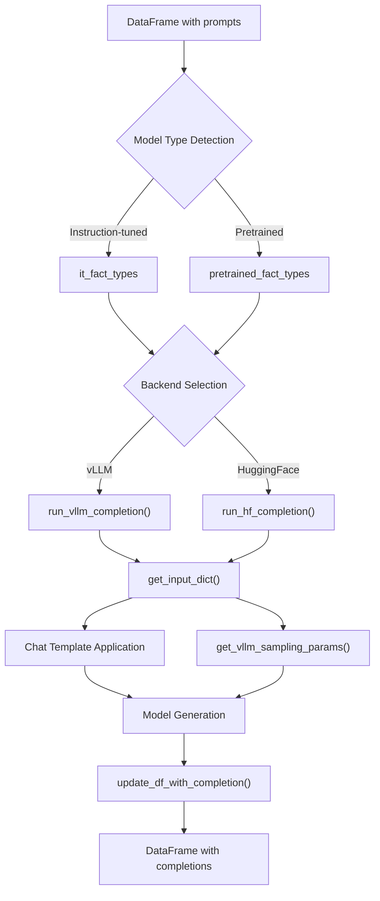
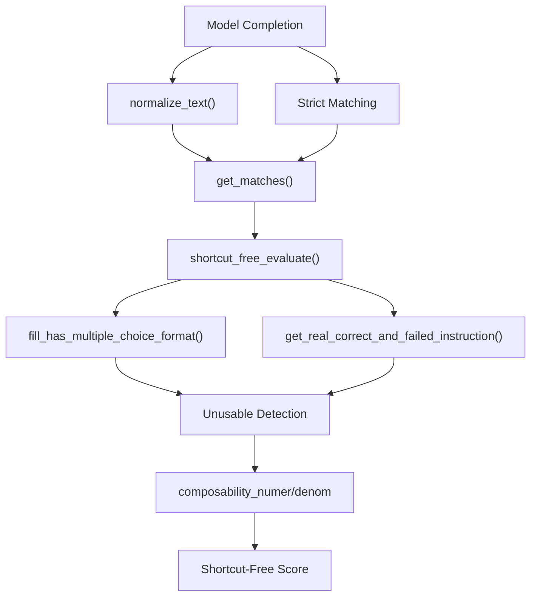
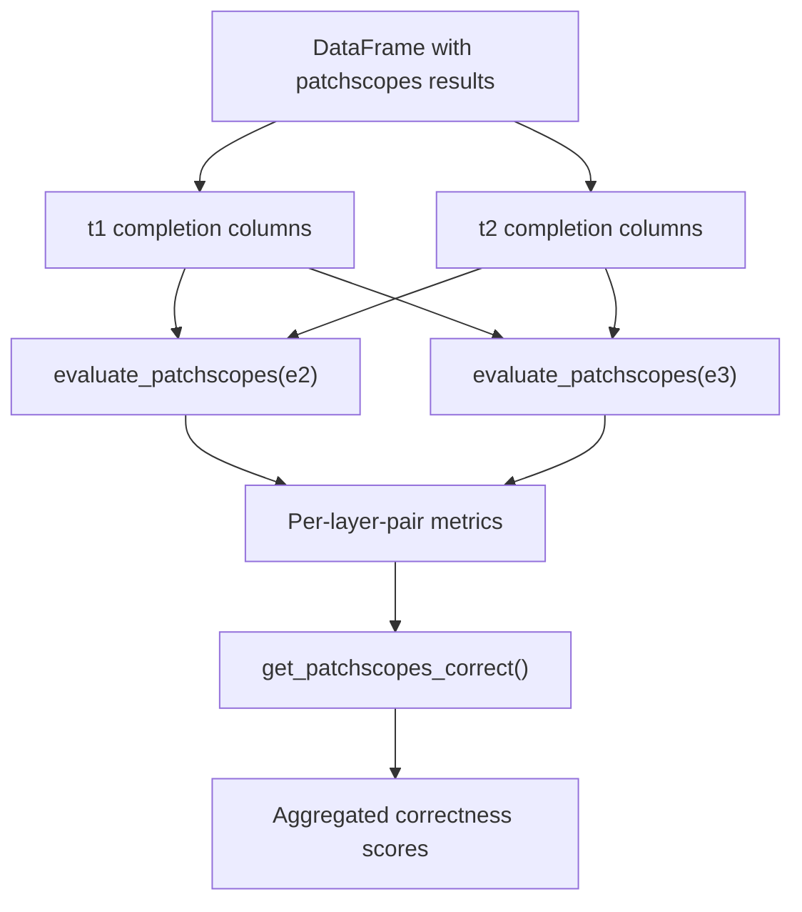
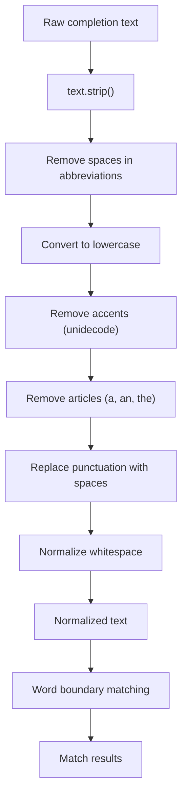

<!-- source: DeepWiki mcp.deepwiki.com · repo google-deepmind/latent-multi-hop-reasoning · page 4.2 Evaluation Utilities · fetched 2026-10-26 -->

# Evaluation Utilities

Relevant source files

The following files were used as context for generating this wiki page:

- [src/evaluation_utils.py](src/evaluation_utils.py)

This module provides the core evaluation functionality for the latent multi-hop reasoning experiments. It handles model completion generation using both vLLM and HuggingFace backends, implements shortcut-free evaluation methods, and provides patchscopes evaluation capabilities. The module is primarily used by the main entry points for Paper 2 experiments.

For inspection-specific utilities used in Paper 1 experiments, see [Inspection Utilities](#4.3). For general model operations, see [Model Utilities](#4.4).

## Core Completion Generation

The module provides unified interfaces for generating completions using either vLLM or HuggingFace models through the `run_completion()` function, which automatically detects model type and delegates to the appropriate backend.

### Completion Pipeline Flow

Sources: [src/evaluation_utils.py:787-843]()

### Fact Types and Model Adaptation

The module defines different fact types for pretrained and instruction-tuned models:

| Model Type | Fact Types | Examples |
|------------|------------|----------|
| Pretrained | `pretrained_fact_types` | `"condition": "r1(e1)"`, `"entailed": "r2(r1(e1))"` |
| Instruction-tuned | `it_fact_types` | `"blank.entailed": "r2(r1(e1)).blank"`, `"blank.cot": "r2(r1(e1)).blank.cot"` |

The `get_completion_messages()` function handles instruction formatting for different prompt types, with special handling for chain-of-thought and blank-filling tasks.

Sources: [src/evaluation_utils.py:36-72](), [src/evaluation_utils.py:75-127]()

## Shortcut-Free Evaluation

The core innovation of this module is the shortcut-free evaluation methodology that prevents models from exploiting superficial patterns instead of performing genuine multi-hop reasoning.

### Evaluation Architecture

Sources: [src/evaluation_utils.py:373-463](), [src/evaluation_utils.py:551-586]()

### Key Evaluation Components

The `shortcut_free_evaluate()` function implements several critical checks:

1. **Multiple Choice Detection**: Identifies and filters out multiple-choice formatted responses using `fill_has_multiple_choice_format()`
2. **Entity Ordering**: Ensures e3 (final answer) appears before e2 (intermediate entity) in completions via `get_real_correct_and_failed_instruction()`
3. **Guessing Prevention**: Filters cases where models might guess correctly on null entities

The evaluation produces several boolean columns:
- `{fact_type}.correct`: Basic correctness
- `{fact_type}.real.correct`: Shortcut-free correctness  
- `{fact_type}.unusable`: Cases excluded from evaluation
- `{fact_type}.failed_instruction`: Instruction-following failures

Sources: [src/evaluation_utils.py:466-525](), [src/evaluation_utils.py:527-549]()

## Patchscopes Evaluation

The module provides specialized evaluation for patchscopes experiments through `run_patchscopes_evaluation()`, which processes layer-wise intervention results.

### Patchscopes Processing Flow

The function processes completions for different source and target layer combinations, evaluating both e2 (intermediate) and e3 (final) entity recall across multiple return sequences.

Sources: [src/evaluation_utils.py:889-953](), [src/evaluation_utils.py:845-887]()

## Text Normalization and Matching

### Text Processing Pipeline

The module implements robust text normalization through `normalize_text()` with configurable options:

The `get_matches()` function performs word-boundary matching between completions and correct answer aliases, returning tuples of matched entities.

Sources: [src/evaluation_utils.py:602-653](), [src/evaluation_utils.py:655-695](), [src/evaluation_utils.py:588-600]()

## Integration with Main Experiments

### Backend Integration

The module integrates with the broader experimental framework through several key functions:

| Function | Purpose | Used By |
|----------|---------|---------|
| `run_completion()` | Main completion interface | [evaluate_latent_reasoning.py](#3.2) |
| `run_shortcut_free_evaluation()` | Shortcut-free metrics | [evaluate_latent_reasoning.py](#3.2) |
| `run_patchscopes_evaluation()` | Patchscopes analysis | [run_patchscopes.py](#3.3) |
| `get_df_with_shortcut_free_metrics()` | Composability metrics | Paper 2 analysis |

The module handles both vLLM and HuggingFace backends through unified interfaces, with automatic model type detection and appropriate parameter selection.

Sources: [src/evaluation_utils.py:787-843](), [src/evaluation_utils.py:697-784]()

---

