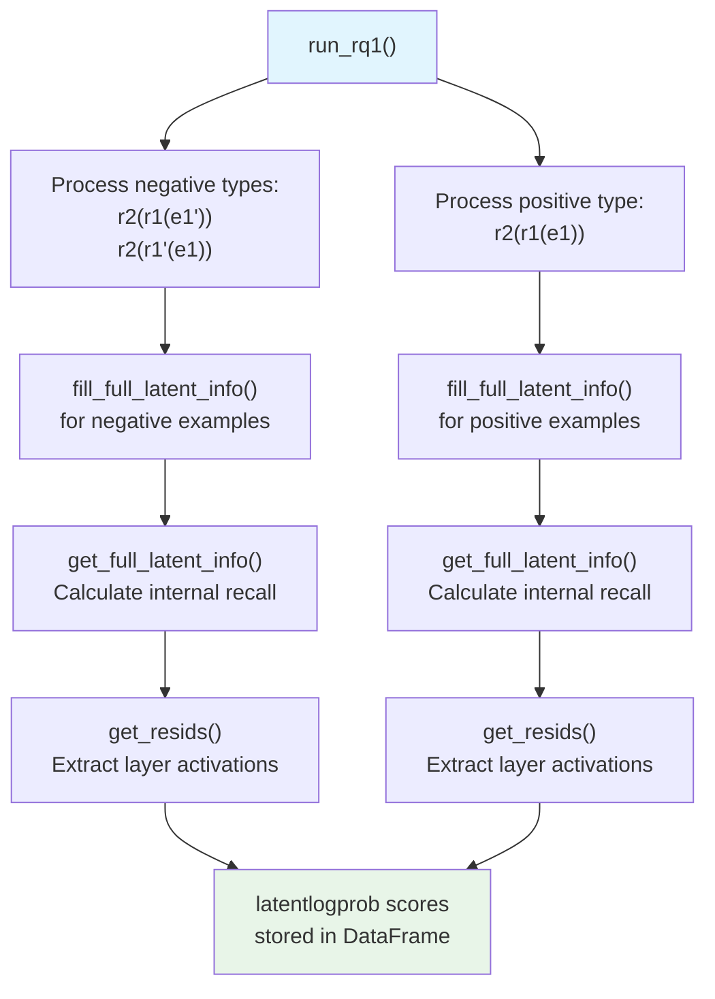
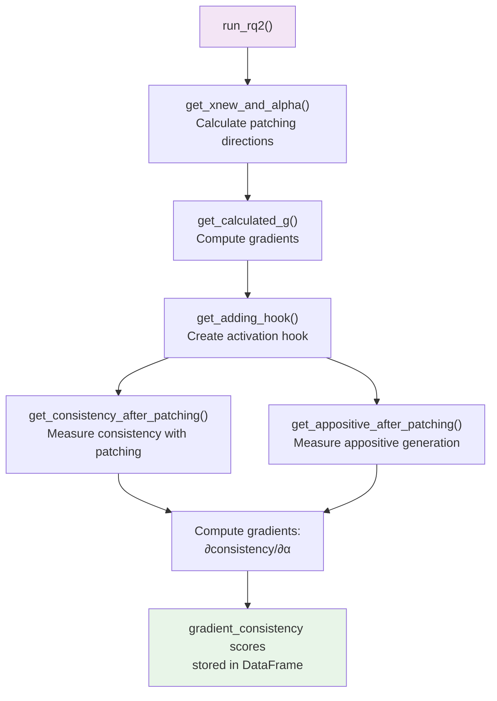
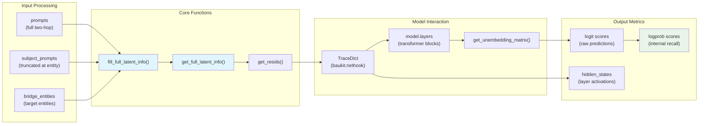
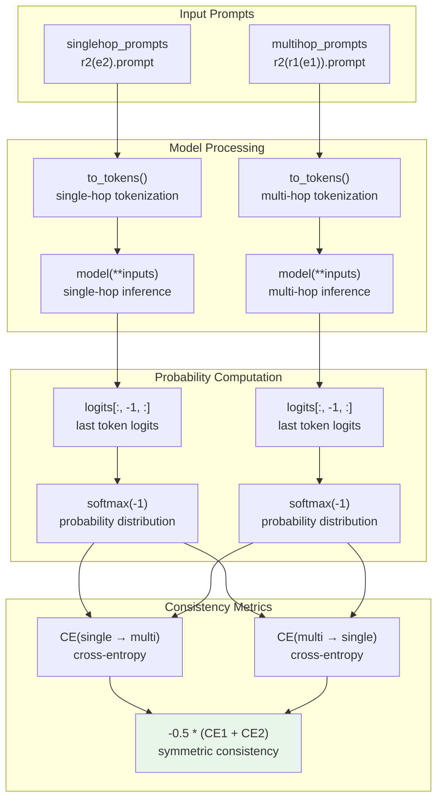
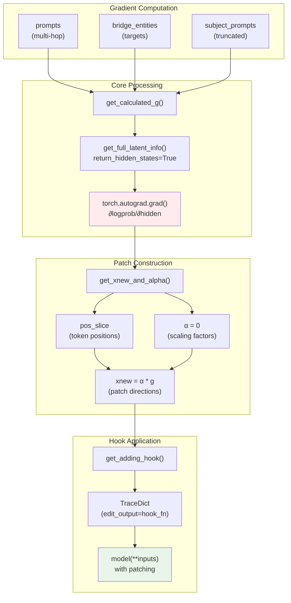
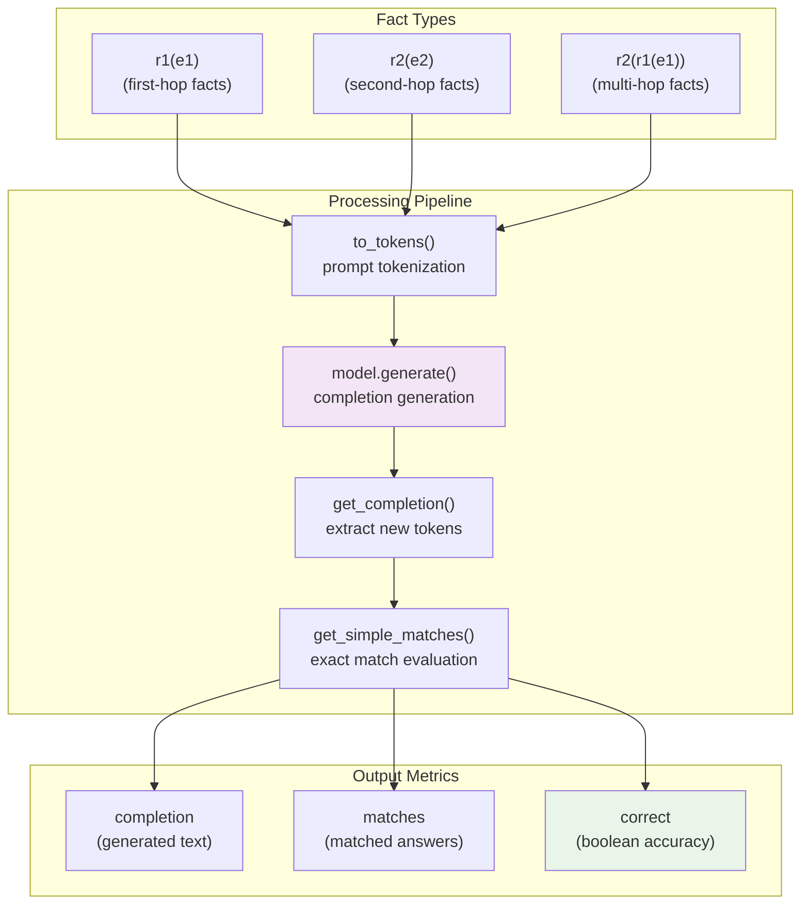

<!-- source: DeepWiki mcp.deepwiki.com · repo google-deepmind/latent-multi-hop-reasoning · page 4.3 Inspection Utilities · fetched 2026-10-26 -->

# Inspection Utilities

Relevant source files

The following files were used as context for generating this wiki page:

- [src/inspection_utils.py](src/inspection_utils.py)

The `inspection_utils.py` module provides the core experimental infrastructure for answering the research questions in Paper 1: "Do Large Language Models Latently Perform Multi-Hop Reasoning?". This module implements internal entity recall measurement, consistency scoring, activation patching, and completion evaluation methods.

For broader evaluation utilities including shortcut-free evaluation, see [Evaluation Utilities](#4.2). For patchscopes-specific analysis, see [Patchscopes Utilities](#4.5).

## Core Research Question Implementation

The module implements two primary research questions through dedicated functions that orchestrate complex experimental pipelines:

| Research Question | Function | Purpose | Key Metrics |
|-------------------|----------|---------|-------------|
| RQ1: First-hop reasoning frequency | `run_rq1()` | Measure internal entity recall for bridge entities | `latentlogprob` scores across layers |
| RQ2: Second-hop reasoning consistency | `run_rq2()` | Measure consistency between single-hop and multi-hop predictions | `gradient_consistency` scores |
| Appositive validation | `run_appositive()` | Validate RQ1 metric using appositive constructions | Appositive generation probabilities |
| Chain-of-thought validation | `run_cot()` | Validate RQ2 metric using explicit reasoning | CoT consistency scores |

**Research Question 1 Flow**

**Research Question 2 Flow**

Sources: [src/inspection_utils.py:65-123](), [src/inspection_utils.py:211-341]()

## Internal Entity Recall System

The internal entity recall system measures how well language models internally represent bridge entities during multi-hop reasoning. This is the core metric for RQ1.

**Internal Entity Recall Architecture**

The system operates by:

1. **Position Identification**: Uses `tokenization_utils.find_exact_substrings_token_positions_from_string()` to locate the last token of the bridge entity mention
2. **Activation Extraction**: Captures hidden states at the identified position using `TraceDict` from baukit
3. **Logit Computation**: Projects hidden states through the unembedding matrix to get vocabulary logits
4. **Probability Calculation**: Applies softmax and log to get the internal entity recall score

Sources: [src/inspection_utils.py:343-404](), [src/inspection_utils.py:406-498](), [src/inspection_utils.py:501-582]()

## Consistency Measurement Framework

The consistency framework measures the similarity between single-hop and multi-hop prediction distributions, serving as the core metric for RQ2.

| Function | Purpose | Formula |
|----------|---------|---------|
| `get_consistency()` | Calculate symmetric consistency score | `-0.5 * (CE(p1, p2) + CE(p2, p1))` |
| `get_ce()` | Calculate cross-entropy between distributions | `-(p_target ⊙ log(p_pred)).sum()` |
| `fill_consistency()` | Batch process consistency calculations | Applies `get_consistency()` with batching |

**Consistency Calculation Pipeline**

Sources: [src/inspection_utils.py:804-874](), [src/inspection_utils.py:877-904]()

## Activation Patching System

The activation patching system performs causal interventions to test whether increasing internal entity recall leads to improved consistency in multi-hop reasoning.

**Patching Direction Calculation**

The patching system implements the following mathematical framework:

1. **Gradient Calculation**: `∂(internal_recall)/∂(hidden_state)` at the bridge entity position
2. **Patch Construction**: `patch = α * gradient` where `α` starts at zero
3. **Intervention**: `hidden_state_new = hidden_state_original + patch`
4. **Gradient Measurement**: `∂(consistency)/∂α` evaluated at `α = 0`

Sources: [src/inspection_utils.py:907-1009](), [src/inspection_utils.py:1012-1083](), [src/inspection_utils.py:1086-1130]()

## Completion and Evaluation Pipeline

The module provides comprehensive completion generation and evaluation capabilities for measuring model performance on factual knowledge tasks.

| Function | Input | Output | Purpose |
|----------|-------|--------|---------|
| `run_completion_and_evaluation()` | DataFrame with prompts | Completion results | Orchestrate evaluation for all fact types |
| `fill_completion_and_evaluation()` | Specific fact type | Completion metrics | Process single fact type with batching |
| `get_completion_and_evaluation_result()` | Prompt batch | Generated completions | Core generation and evaluation logic |
| `get_simple_matches()` | Completion and answers | Matched answers | Exact match evaluation |

**Completion Evaluation Flow**

The evaluation system processes three types of factual queries:
- **r1(e1)**: First-hop facts (e.g., "The mother of Stevie Wonder" → "Lula Mae Hardaway")
- **r2(e2)**: Second-hop facts (e.g., "The birthplace of Lula Mae Hardaway" → "Alabama")  
- **r2(r1(e1))**: Multi-hop facts (e.g., "The birthplace of the mother of Stevie Wonder" → "Alabama")

Sources: [src/inspection_utils.py:34-62](), [src/inspection_utils.py:585-643](), [src/inspection_utils.py:645-694](), [src/inspection_utils.py:1133-1158]()

## Validation Experiments

The module implements two key validation experiments that provide empirical support for the metrics used in RQ1 and RQ2.

### Appositive Validation

The `run_appositive()` function validates the internal entity recall metric by testing whether models are more likely to generate bridge entities as appositives (e.g., "The mother of the singer of Superstition, Stevie Wonder") when internal recall is higher.

### Chain-of-Thought Validation  

The `run_cot()` function validates the consistency score by comparing it against explicit chain-of-thought reasoning patterns across multiple prompt variations:

| CoT Prompt Type | Column Name | Purpose |
|-----------------|-------------|---------|
| Step-by-step first-hop | `cot.r1(e1).therefore.prompt` | Explicit first-hop reasoning |
| Step-by-step second-hop | `cot.r2(e2).therefore.prompt` | Explicit second-hop reasoning |
| Full step-by-step | `cot.r1(e1).r2(e2).therefore.prompt` | Complete reasoning chain |
| Implicit first-hop | `cot.r1(e1).prompt` | Partial reasoning exposure |
| Implicit second-hop | `cot.r2(e2).prompt` | Partial reasoning exposure |
| Full implicit | `cot.r1(e1).r2(e2).prompt` | Complete reasoning exposure |

Sources: [src/inspection_utils.py:125-164](), [src/inspection_utils.py:167-209]()

---

