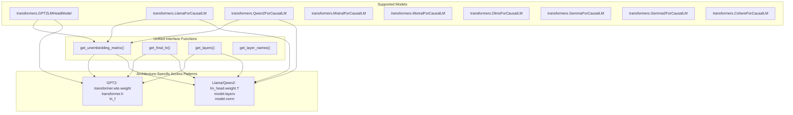
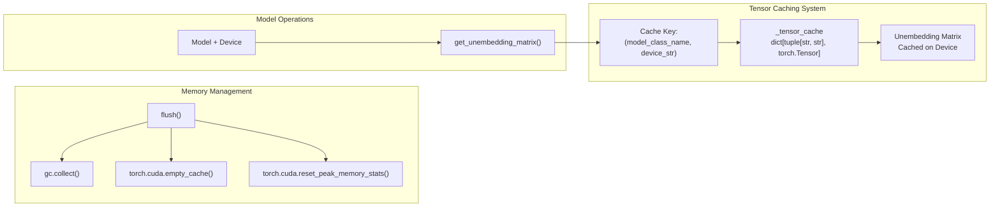
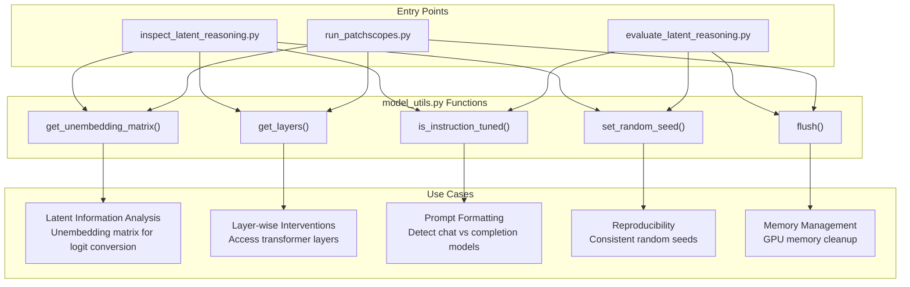

<!-- source: DeepWiki mcp.deepwiki.com · repo google-deepmind/latent-multi-hop-reasoning · page 4.4 Model Utilities · fetched 2026-10-26 -->

# Model Utilities

Relevant source files

The following files were used as context for generating this wiki page:

- [src/model_utils.py](src/model_utils.py)

The Model Utilities module provides a centralized interface for working with transformer models across different architectures in the latent multi-hop reasoning experiments. This module abstracts model-specific implementations and provides unified access to model components, memory management, and configuration detection.

This module specifically handles transformer model operations and architecture-specific logic. For data processing operations, see [Data Utilities](#4.1). For text tokenization operations, see [Tokenization Utilities](#4.6).

## Core Functions

The `model_utils.py` module provides several categories of functionality for transformer model operations:

| Function Category | Functions | Purpose |
|-------------------|-----------|---------|
| Model Architecture Access | `get_unembedding_matrix`, `get_final_ln`, `get_layers`, `get_layer_names` | Extract architecture-specific components |
| Model Configuration Detection | `is_instruction_tuned`, `get_messages_start_role` | Identify model capabilities and requirements |
| System Utilities | `flush`, `set_random_seed` | Memory management and reproducibility |

Sources: [src/model_utils.py:1-237]()

## Model Architecture Support

The module supports multiple transformer architectures with unified interfaces:

Sources: [src/model_utils.py:46-56](), [src/model_utils.py:72-83](), [src/model_utils.py:95-106]()

## Caching and Memory Management

The module implements efficient caching for expensive tensor operations and provides memory management utilities:

The global cache `_tensor_cache` stores unembedding matrices with keys combining model class name and device string, avoiding redundant tensor transfers between devices.

Sources: [src/model_utils.py:25-27](), [src/model_utils.py:30-60](), [src/model_utils.py:220-224]()

## Instruction-Tuning Detection

The module provides logic to detect instruction-tuned models and configure appropriate message formatting:

| Model Family | Name Patterns | Starting Role |
|--------------|---------------|---------------|
| Google Gemma | `google/gemma` | `user` |
| Mistral Mixtral | `mistralai/Mixtral` | `user` |
| Mistral | `mistralai/Mistral` | `system` |
| Meta Llama | `meta-llama/Meta-Llama`, `meta-llama/Llama` | `system` |
| Qwen | `Qwen/Qwen` | `system` |
| Yi | `01-ai/Yi` | `system` |
| OLMo | `allenai/OLMo` | `user` |

The `is_instruction_tuned` function detects instruction-tuned models by checking for patterns like `-Instruct`, `-chat`, `command-r`, `gpt`, `claude`, `gemini` in model names.

Sources: [src/model_utils.py:132-183](), [src/model_utils.py:186-217]()

## Integration with Experiment Scripts

The model utilities are used across all main experiment entry points:

Sources: [src/model_utils.py:1-237]()

## Random Seed Management

The `set_random_seed` function ensures reproducibility across multiple random number generators used in the experiments:

- `random.seed()` for Python's built-in random module
- `np.random.seed()` for NumPy random operations
- `torch.manual_seed()` for PyTorch CPU operations  
- `torch.cuda.manual_seed_all()` for PyTorch CUDA operations

This comprehensive seeding is essential for reproducible experimental results across different model architectures and devices.

Sources: [src/model_utils.py:227-237]()

---

