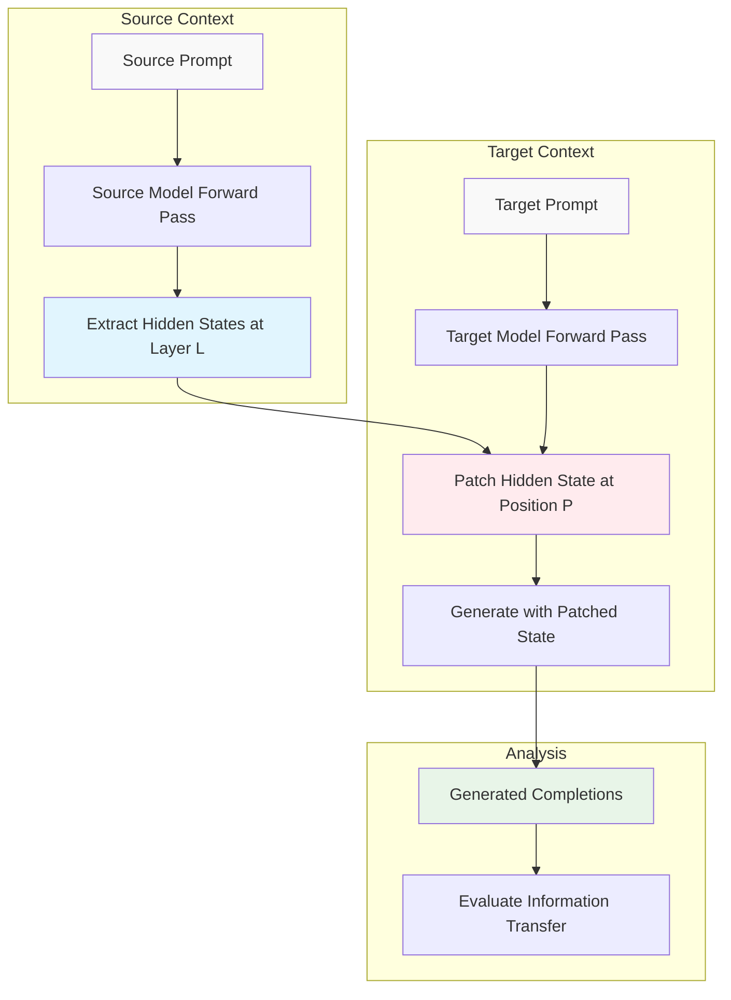
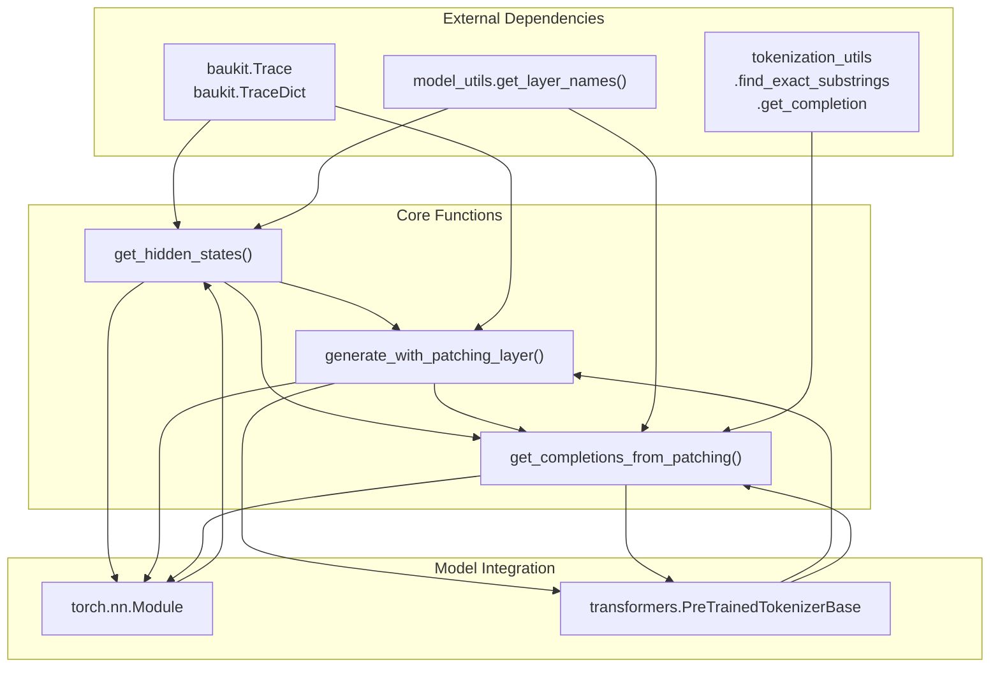
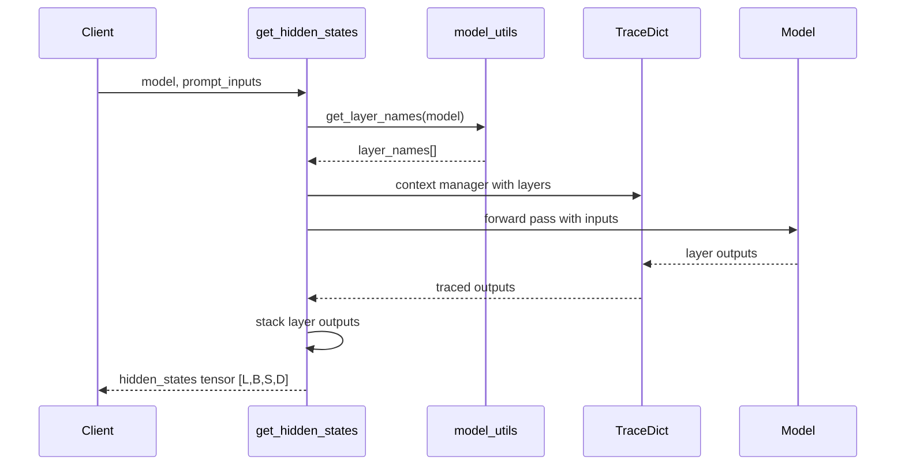
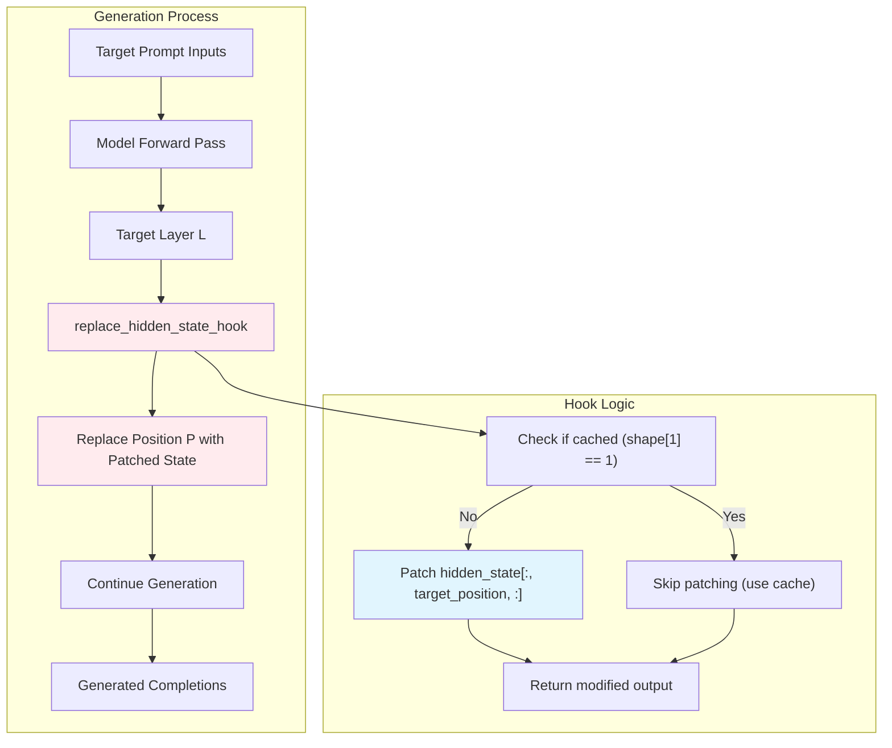
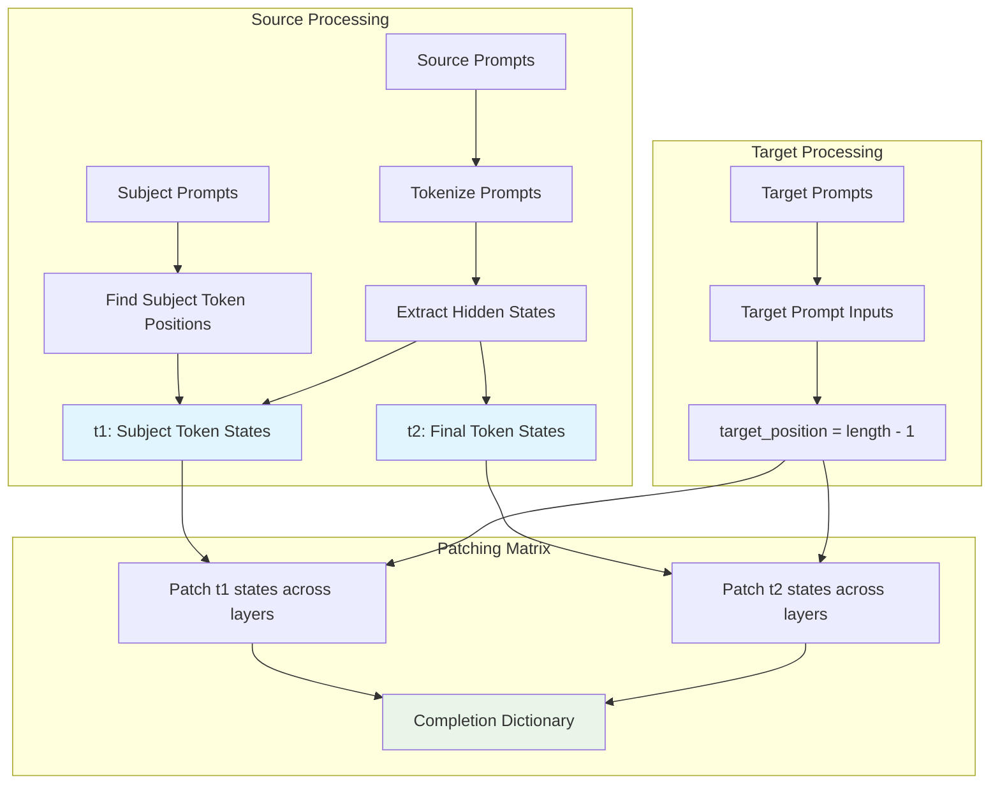
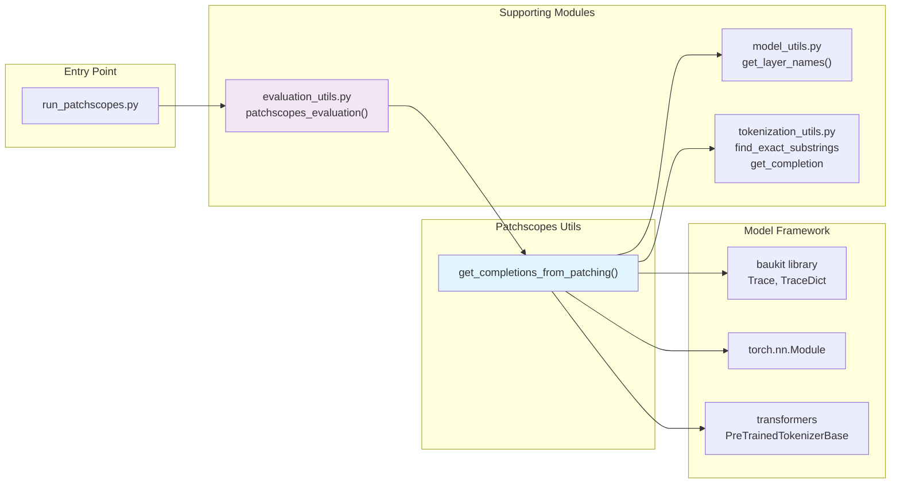

<!-- source: DeepWiki mcp.deepwiki.com · repo google-deepmind/latent-multi-hop-reasoning · page 4.5 Patchscopes Utilities · fetched 2026-10-26 -->

# Patchscopes Utilities

Relevant source files

The following files were used as context for generating this wiki page:

- [src/patchscopes_utils.py](src/patchscopes_utils.py)

This module implements the Patchscopes methodology for analyzing latent representations in language models through hidden state interventions. The utilities support experiments from the paper "Do Large Language Models Perform Latent Multi-Hop Reasoning without Exploiting Shortcuts?" by enabling systematic patching of internal model states across different layers and positions.

For general model operations and layer management, see [Model Utilities](#4.4). For tokenization and completion extraction, see [Tokenization Utilities](#4.6). For the main Patchscopes experimental pipeline, see [Run Patchscopes](#3.3).

## Core Patchscopes Methodology

The Patchscopes technique involves extracting hidden states from one prompt context and injecting them into a different prompt context at specific layers and token positions. This allows researchers to study what information is encoded at different layers by observing how patched representations influence generation.

**Patchscopes Intervention Process**

*Sources: [src/patchscopes_utils.py:15-19]()*

## Function Architecture

The module provides three main functions that work together to implement the complete Patchscopes pipeline:

| Function | Purpose | Input | Output |
|----------|---------|-------|--------|
| `get_hidden_states` | Extract internal representations | Model + prompt inputs | Hidden states tensor [L, B, S, D] |
| `generate_with_patching_layer` | Single layer intervention | Model + hidden state + target layer | Generated completions |
| `get_completions_from_patching` | Systematic multi-layer analysis | Multiple prompts + layer configs | Completion dictionary |

**Function Dependencies and Integration**

*Sources: [src/patchscopes_utils.py:21-28](), [src/patchscopes_utils.py:30-49](), [src/patchscopes_utils.py:52-119](), [src/patchscopes_utils.py:122-228]()*

## Hidden State Extraction

The `get_hidden_states` function serves as the foundation for all Patchscopes operations by extracting internal representations from every model layer.

### Implementation Details

**Hidden State Extraction Sequence**

The function uses `baukit.TraceDict` to intercept and collect outputs from all transformer layers during a single forward pass. The resulting tensor has dimensions `[num_layers, batch_size, sequence_length, hidden_dim]`.

*Sources: [src/patchscopes_utils.py:30-49]()*

## Layer-Specific Patching

The `generate_with_patching_layer` function implements the core intervention mechanism, replacing hidden states at a specific layer and position during text generation.

### Patching Hook Implementation

The function uses a custom hook that intercepts layer outputs and replaces the hidden state at the target position:

**Layer Patching Hook Mechanism**

The hook handles both initial generation and cached autoregressive steps by checking tensor dimensions and only patching during the initial forward pass.

*Sources: [src/patchscopes_utils.py:87-93](), [src/patchscopes_utils.py:95-108]()*

## Comprehensive Patching Analysis

The `get_completions_from_patching` function orchestrates systematic analysis across multiple layers and token positions.

### Multi-Position Analysis

The function analyzes two key positions in the source prompts:
- **t1**: Last token of subject entities (`last_subject_token_positions`)
- **t2**: Final token position of the prompt

**Multi-Position Patching Strategy**

### Output Structure

The function returns a dictionary with keys of the format `(token_position, k, source_index, target_index)`:
- `token_position`: Either "t1" or "t2"
- `k`: Completion sample index (when `num_return_sequences > 1`)
- `source_index`: Source layer index where hidden state was extracted
- `target_index`: Target layer index where hidden state was patched

*Sources: [src/patchscopes_utils.py:147-150](), [src/patchscopes_utils.py:154-174](), [src/patchscopes_utils.py:175-228]()*

## Integration with Evaluation Pipeline

The Patchscopes utilities integrate with the broader experimental framework through standardized interfaces:

**Integration with Experimental Pipeline**

*Sources: [src/patchscopes_utils.py:21-28]()*

---

