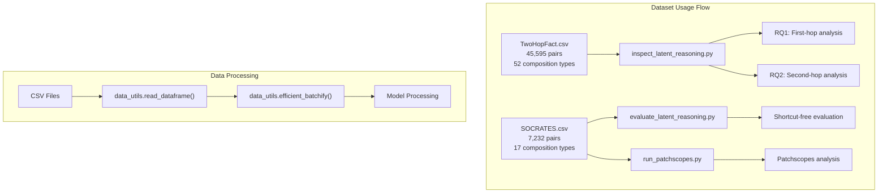
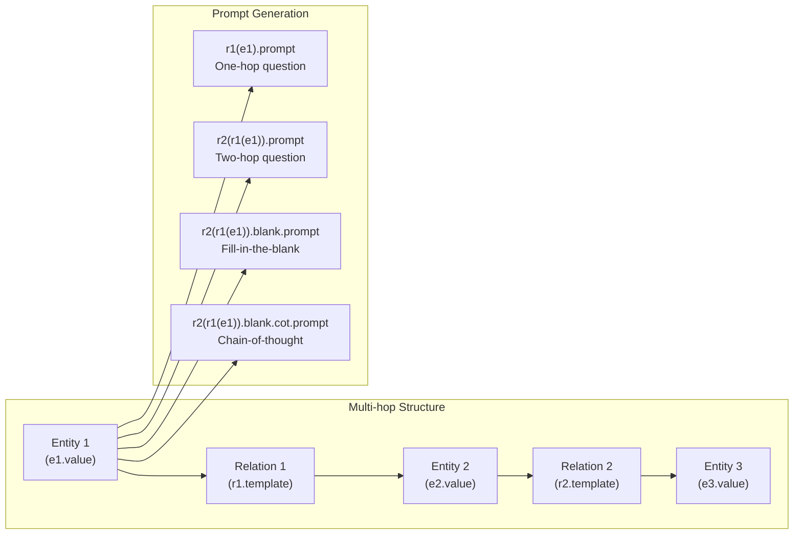
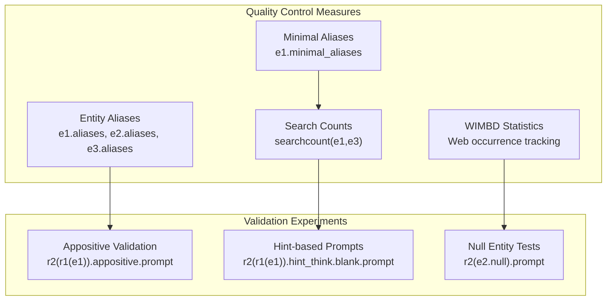
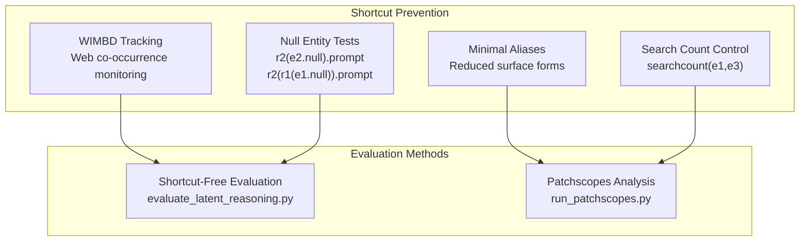

<!-- source: DeepWiki mcp.deepwiki.com · repo google-deepmind/latent-multi-hop-reasoning · page 5 Datasets · fetched 2026-10-26 -->

# Datasets

<details>
<summary>Relevant source files</summary>

The following files were used as context for generating this wiki page:

- [README.md](README.md)
- [datasets/SOCRATES_v1.csv](datasets/SOCRATES_v1.csv)

</details>


This document provides an overview of the datasets used in the latent multi-hop reasoning research experiments. The codebase utilizes two primary datasets for different experimental approaches: TwoHopFact for latent reasoning pathway inspection and SOCRATES for shortcut-free evaluation of multi-hop reasoning capabilities.

For information about how these datasets are processed and loaded, see [Data Utilities](#4.1). For details on the experimental scripts that use these datasets, see [Main Entry Points](#3).

## Overview

The datasets in this codebase are designed to evaluate large language models' ability to perform multi-hop reasoning tasks. Both datasets contain paired one-hop and two-hop factual prompts that test whether models can internally compose factual knowledge to answer complex questions.



**Dataset Structure and Processing Flow**

Sources: [README.md:21-38](), [src/data_utils.py]()

## Data Schema and Entity Relationships

Both datasets follow a structured approach to multi-hop reasoning where entities are connected through compositional relationships:



**Entity-Relation-Entity Composition Pattern**

Sources: [datasets/SOCRATES_v1.csv:1-5]()

The datasets use a systematic approach where:
- `e1` (first entity) connects to `e2` (intermediate entity) via `r1` (first relation)
- `e2` connects to `e3` (target entity) via `r2` (second relation)
- Various prompt templates test different aspects of this compositional reasoning

## Common Dataset Features

Both datasets share several structural elements that enable systematic evaluation:

| Feature | Description | Example |
|---------|-------------|---------|
| `uid` | Unique identifier for each example | `3870`, `8211` |
| `fact_comp_type` | Type of factual composition | `nobelchem of eurovisioncity's year` |
| `rough_fact_comp_type` | Broader category | `winner of eventcity's year` |
| Entity aliases | Multiple valid names | `('Turin', 'Torino', 'Turin, Italy')` |
| Prompt variants | Different question formats | `blank.prompt`, `cot.prompt`, `appositive.prompt` |
| WIMBD statistics | Web occurrence frequencies | `wimbd.dolma17(e1,e2)`, `wimbd.oscar(e2,e3)` |

The WIMBD (What's In My Big Data) statistics track how frequently entity pairs co-occur in large web corpora, helping researchers understand potential shortcut paths that models might exploit.

Sources: [datasets/SOCRATES_v1.csv:1-10]()

## Dataset Validation and Quality Control

The datasets include several mechanisms for ensuring quality and controlling for potential shortcuts:



**Dataset Quality Assurance Pipeline**

Sources: [datasets/SOCRATES_v1.csv:59-80]()

# 5.1 TwoHopFact Dataset

The TwoHopFact dataset is used primarily for Paper 1 experiments focused on inspecting the latent reasoning pathways within language models.

## Dataset Characteristics

- **Size**: 45,595 example pairs
- **Composition Types**: 52 different fact composition patterns
- **File Location**: `datasets/TwoHopFact.csv`
- **File Size**: 91MB
- **Primary Use**: Latent reasoning pathway inspection via `inspect_latent_reasoning.py`

## Research Applications

The TwoHopFact dataset enables several specific research questions:

| Research Question | Implementation | Dataset Feature Used |
|-------------------|----------------|---------------------|
| RQ1: First-hop analysis | `inspection_utils.run_rq1()` | One-hop prompts and entity recall |
| RQ2: Second-hop analysis | `inspection_utils.run_rq2()` | Two-hop prompts and consistency measures |
| Appositive validation | `--run_appositive` flag | Entity recall validation prompts |
| CoT validation | `--run_cot` flag | Chain-of-thought consistency scores |

Sources: [README.md:25-30](), [README.md:42-55]()

## Processing Configuration

When using TwoHopFact with `inspect_latent_reasoning.py`, the following batch sizes are typically configured:

```bash
--rq1_batch_size 256      # For first-hop analysis
--rq2_batch_size 8        # For second-hop analysis  
--completion_batch_size 64 # For completion generation
```

The smaller batch size for RQ2 accommodates the more memory-intensive activation patching operations.

Sources: [README.md:47-54]()

# 5.2 SOCRATES Dataset

The SOCRATES (ShOrtCut-fRee lATent rEaSoning) dataset is designed specifically for Paper 2 experiments that evaluate latent multi-hop reasoning while minimizing shortcut exploitation risks.

## Dataset Variants

The SOCRATES dataset comes in two versions:

| Version | File | Description | Use Case |
|---------|------|-------------|----------|
| v0 | `datasets/SOCRATES_v0.csv` | Original version with minor grammatical errors | Paper experiments |
| v1 | `datasets/SOCRATES_v1.csv` | Cleaned version without grammatical errors | Recommended usage |

Both versions contain the same core structure but v1 provides higher quality text for reproduction studies.

Sources: [README.md:32-38]()

## Shortcut Prevention Features

SOCRATES includes several mechanisms to prevent models from exploiting superficial patterns:



**SOCRATES Shortcut Prevention Architecture**

Sources: [datasets/SOCRATES_v1.csv:47-53]()

## Detailed Schema Structure

The SOCRATES dataset contains the following key column groups:

### Entity Information
- `e1.category`, `e1.value`, `e1.aliases`, `e1.wikidata_qid` - First entity details
- `e2.category`, `e2.value`, `e2.aliases`, `e2.wikidata_qid` - Intermediate entity  
- `e3.category`, `e3.value`, `e3.aliases`, `e3.wikidata_qid` - Target entity

### Relation Templates  
- `r1.template`, `r1.template_id` - First relation formatting
- `r2.template`, `r2.template_id` - Second relation formatting

### Prompt Variants
- `r1(e1).prompt` - One-hop question
- `r2(r1(e1)).prompt` - Two-hop question  
- `r2(r1(e1)).blank.prompt` - Fill-in-the-blank format
- `r2(r1(e1)).blank.cot.prompt` - Chain-of-thought prompting

### Validation Controls
- `r2(e2.null).prompt` - Null intermediate entity test
- `r2(r1(e1.null)).prompt` - Null first entity test
- `r2(r1(e1)).appositive.prompt` - Appositive validation

Sources: [datasets/SOCRATES_v1.csv:1]()

## Processing with Evaluation Scripts

SOCRATES is processed by two main evaluation scripts:

### Standard Evaluation
```bash
python evaluate_latent_reasoning.py \
    --input_csv_path datasets/SOCRATES.csv \
    --batch_size 256 \
    --tensor_parallel_size 2
```

### Patchscopes Analysis  
```bash
python run_patchscopes.py \
    --input_csv_path datasets/SOCRATES.csv \
    --batch_size 64 \
    --source_layer_idxs 1,2 \
    --target_layer_idxs 30,31
```

The patchscopes analysis uses smaller batch sizes due to the computational overhead of layer interventions.

Sources: [README.md:59-81]()

## Web Data Integration

SOCRATES includes comprehensive tracking of entity co-occurrence in web corpora through WIMBD statistics:

| Corpus | Column Pattern | Purpose |
|--------|----------------|---------|
| Dolma | `wimbd.dolma17(e1,e2)` | Track entity pair frequency |
| Oscar | `wimbd.oscar(e2,e3)` | Monitor relation occurrence |  
| C4 | `wimbd.c4(e1,e2)` | Validate shortcut paths |
| OpenWebText | `wimbd.openwebtext(e2,e3)` | Cross-corpus validation |
| Tulu | `wimbd.tulu(e1,e2)` | Instruction data tracking |

These statistics help researchers identify potential shortcut paths that models might exploit instead of performing genuine multi-hop reasoning.

Sources: [datasets/SOCRATES_v1.csv:54-64]()

---

