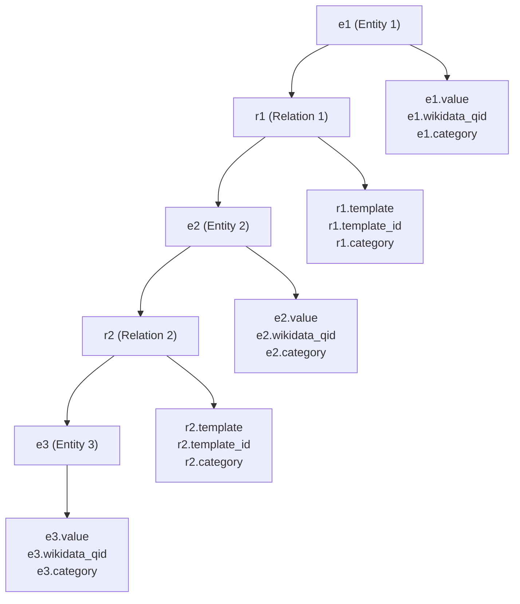
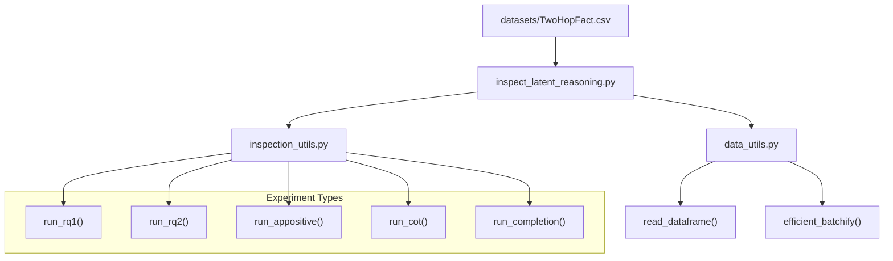
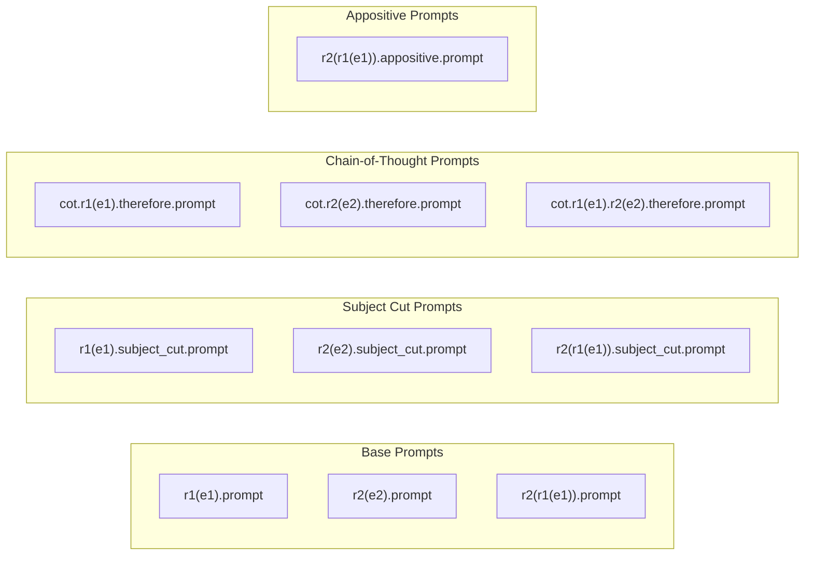
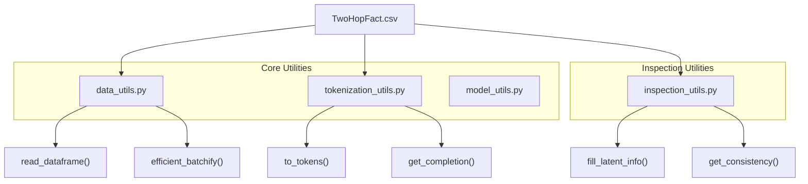

<!-- source: DeepWiki mcp.deepwiki.com · repo google-deepmind/latent-multi-hop-reasoning · page 5.1 TwoHopFact Dataset · fetched 2026-10-26 -->

# TwoHopFact Dataset

<details>
<summary>Relevant source files</summary>

The following files were used as context for generating this wiki page:

- [README.md](README.md)
- [datasets/TwoHopFact.csv](datasets/TwoHopFact.csv)

</details>


This document describes the TwoHopFact dataset, its structure, and integration within the latent multi-hop reasoning experimental framework. For information about the SOCRATES dataset used in Paper 2 experiments, see [SOCRATES Dataset](#5.2).

## Purpose and Scope

The TwoHopFact dataset is designed to evaluate the internal mechanisms of multi-hop reasoning in large language models. It contains structured pairs of one-hop and two-hop factual prompts that enable researchers to probe whether models perform latent multi-hop reasoning or rely on surface-level pattern matching. The dataset serves as the primary input for the inspection experiments described in the ACL 2024 paper "Do Large Language Models Latently Perform Multi-Hop Reasoning?".

## Dataset Overview

The TwoHopFact dataset contains 45,595 pairs of factual prompts across 52 different fact composition types with balanced distribution. Each entry represents a structured multi-hop reasoning scenario where models must combine two pieces of factual knowledge to answer a question.

### Dataset Statistics

| Metric | Value |
|--------|-------|
| Total Entries | 45,595 |
| Fact Composition Types | 52 |
| File Size | 91MB |
| Format | CSV |
| Distribution | Balanced across composition types |

**Dataset Locations:**
- Local: `datasets/TwoHopFact.csv`
- HuggingFace: `soheeyang/TwoHopFact`

Sources: [README.md:25-30]()

## Dataset Structure and Schema

The TwoHopFact dataset follows a complex schema designed to support various experimental conditions and prompt variations for multi-hop reasoning analysis.

### Core Entity Structure



### Schema Components

| Field Category | Fields | Description |
|----------------|--------|-------------|
| **Identifiers** | `uid`, `eid` | Unique identifiers for entries |
| **Composition** | `fact_comp_type`, `category` | Type classification and categorization |
| **Entities** | `e1.value`, `e2.value`, `e3.value` | Entity names and values |
| **Entity Metadata** | `e1.wikidata_qid`, `e1.category`, etc. | Wikidata IDs and categories |
| **Relations** | `r1.template`, `r2.template` | Relation templates |
| **Aliases** | `e2.aliases`, `e3.aliases` | Alternative entity names |
| **Prompts** | Various prompt columns | Different experimental prompt variations |

Sources: [datasets/TwoHopFact.csv:1]()

## Integration with Experimental Pipeline

The TwoHopFact dataset integrates directly with the inspection experiments through the `inspect_latent_reasoning.py` entry point and associated utilities.

### Data Flow Architecture



### Usage in Code

The dataset is loaded and processed through several key functions:

1. **Data Loading**: [data_utils.py]() provides `read_dataframe()` for CSV loading
2. **Batch Processing**: [data_utils.py]() provides `efficient_batchify()` for memory-efficient processing
3. **Experiment Execution**: [inspection_utils.py]() contains experiment-specific functions

Sources: [README.md:42-55](), [README.md:88-90]()

## Prompt Template Structure

The dataset includes multiple prompt variations for different experimental conditions, enabling comprehensive analysis of model behavior.

### Prompt Categories



### Example Prompt Structure

From the dataset sample, a typical entry follows this pattern:

- **Entity 1**: "Nineteen Eighty-Four" (novel)
- **Relation 1**: "The author of the novel {} is"
- **Entity 2**: "George Orwell" (author)
- **Relation 2**: "{} was born in the city of"
- **Entity 3**: "Motihari" (birthcity)

This creates multi-hop reasoning: "The author of Nineteen Eighty-Four was born in the city of [answer]"

Sources: [datasets/TwoHopFact.csv:2-3]()

## Data Processing Utilities

The dataset integrates with several utility modules for processing and analysis:

### Integration Points



### Key Processing Functions

- **`read_dataframe()`**: Loads the CSV with proper encoding and error handling
- **`efficient_batchify()`**: Creates memory-efficient batches for model processing
- **`to_tokens()`**: Converts text prompts to model tokens
- **`fill_latent_info()`**: Extracts latent reasoning information from model activations

Sources: [README.md:88-92]()

## Experimental Applications

The TwoHopFact dataset supports five main experimental approaches within the inspection framework:

### Research Questions Supported

| Experiment | Flag | Purpose |
|------------|------|---------|
| **RQ1** | `--run_rq1` | First-hop analysis and internal entity recall |
| **RQ2** | `--run_rq2` | Second-hop analysis and consistency patching |
| **Appositive** | `--run_appositive` | Entity recall metric validation |
| **Chain-of-Thought** | `--run_cot` | Consistency score validation |
| **Completion** | `--run_completion` | Standard evaluation baseline |

### Command Line Usage

```bash
python inspect_latent_reasoning.py \
    --model_name_or_path $MODEL_NAME_OR_PATH \
    --input_csv_path datasets/TwoHopFact.csv \
    --run_rq1 --run_rq2 --run_appositive --run_cot --run_completion
```

Sources: [README.md:47-55]()

---

