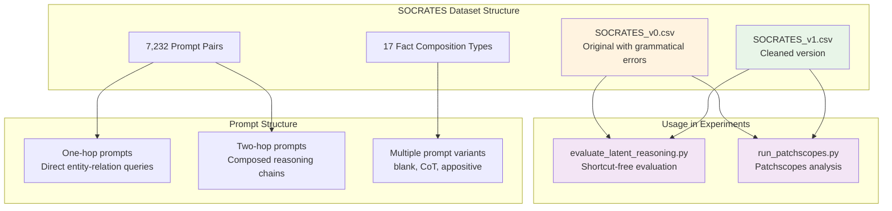
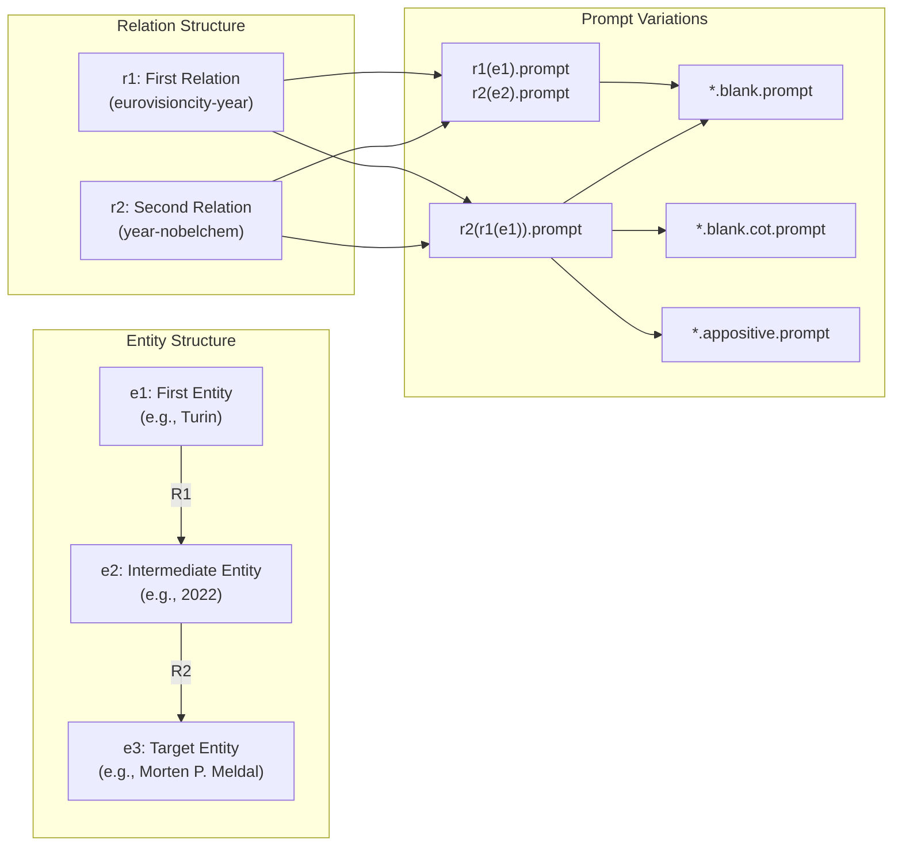
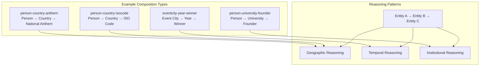
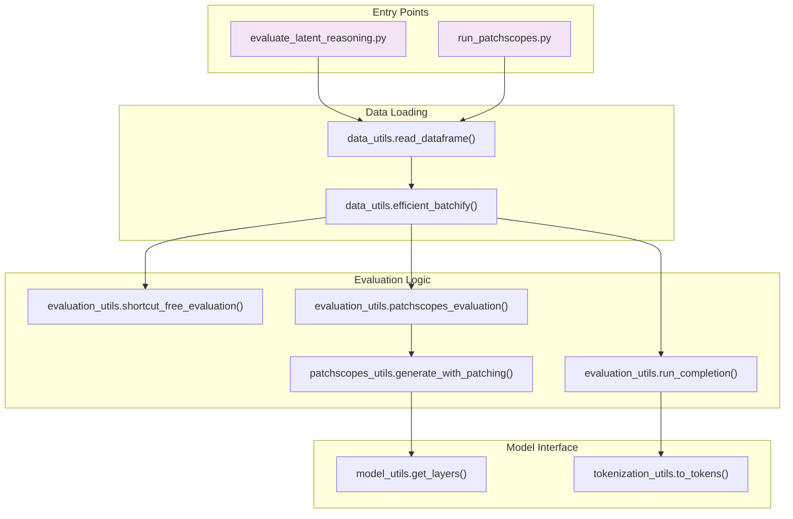

<!-- source: DeepWiki mcp.deepwiki.com · repo google-deepmind/latent-multi-hop-reasoning · page 5.2 SOCRATES Dataset · fetched 2026-10-26 -->

# SOCRATES Dataset

<details>
<summary>Relevant source files</summary>

The following files were used as context for generating this wiki page:

- [README.md](README.md)
- [datasets/SOCRATES_v0.csv](datasets/SOCRATES_v0.csv)
- [datasets/SOCRATES_v1.csv](datasets/SOCRATES_v1.csv)

</details>


This document covers the SOCRATES dataset used for Paper 2 experiments in the latent multi-hop reasoning research codebase. For information about the TwoHopFact dataset used in Paper 1 experiments, see [TwoHopFact Dataset](#5.1).

## Purpose and Scope

The SOCRATES dataset (ShOrtCut-fRee lATent rEaSoning) is designed specifically for evaluating latent multi-hop reasoning abilities in Large Language Models while minimizing the risk of shortcut exploitation. It provides carefully curated factual prompts that enable accuracy-based evaluation of whether models perform genuine multi-hop reasoning rather than relying on superficial patterns or memorized associations.

## Dataset Overview

SOCRATES contains 7,232 pairs of one-hop and two-hop factual prompts spanning 17 different fact composition types. The dataset was constructed to address limitations in existing multi-hop reasoning evaluations where models might exploit shortcuts rather than performing the intended reasoning steps.



Sources: [README.md:32-38](), [datasets/SOCRATES_v1.csv:1-10]()

## Dataset Versions

SOCRATES is available in two versions with distinct characteristics:

| Version | File | Description | Usage |
|---------|------|-------------|-------|
| v0 | `SOCRATES_v0.csv` | Original dataset with grammatical errors | Used in paper experiments |
| v1 | `SOCRATES_v1.csv` | Cleaned version without grammatical errors | Recommended for new experiments |

The key difference between versions is data quality - v1 corrects grammatical issues present in v0. For example, comparing the same entry:

**v0**: `"In 2022, the leaureate of the Nobel Prize in Chemistry was"`
**v1**: `"In 2022, the laureate of the Nobel Prize in Chemistry was"`

Sources: [README.md:36-37](), [datasets/SOCRATES_v0.csv:2-4](), [datasets/SOCRATES_v1.csv:2-4]()

## Dataset Structure and Schema

SOCRATES follows a structured format with entities, relations, and multiple prompt variations designed for comprehensive multi-hop reasoning evaluation:



### Key Schema Fields

The dataset includes the following core components:

- **Entity Information**: `e1.value`, `e2.value`, `e3.value` with aliases and Wikidata QIDs
- **Relation Templates**: `r1.template`, `r2.template` with template IDs  
- **Prompt Variants**: Multiple formulations for different experimental conditions
- **Metadata**: Search counts, web mention statistics, fact composition types

Sources: [datasets/SOCRATES_v1.csv:1]()

## Fact Composition Types

SOCRATES covers 17 different fact composition types that represent various multi-hop reasoning patterns:



Examples from the dataset:
- `eurovisioncity-year-nobelchem`: Eurovision host city → year → Nobel Chemistry winner
- `person-country-anthem`: Person → birth country → national anthem
- `person-university-founder`: Person → university → founder

Sources: [datasets/SOCRATES_v1.csv:2-150]()

## Integration with Codebase

SOCRATES integrates into the research codebase through two main experimental pipelines:



### Usage Commands

The dataset is loaded via command-line arguments in both main entry points:

```bash
# Shortcut-free evaluation
python evaluate_latent_reasoning.py \
    --input_csv_path datasets/SOCRATES_v1.csv \
    --model_name_or_path $MODEL_NAME \
    --batch_size 256

# Patchscopes analysis  
python run_patchscopes.py \
    --input_csv_path datasets/SOCRATES_v1.csv \
    --model_name_or_path $MODEL_NAME \
    --source_layer_idxs 1,2 \
    --target_layer_idxs 30,31
```

Sources: [README.md:62-67](), [README.md:72-80]()

## Example Data Entry

Here's a representative example showing the multi-hop reasoning structure:

| Field | Value |
|-------|-------|
| **Fact Type** | `eurovisioncity-year-nobelchem` |
| **Entity 1** | Turin (Eurovision host city) |
| **Entity 2** | 2022 (year) |
| **Entity 3** | Morten P. Meldal (Nobel Chemistry laureate) |
| **One-hop 1** | "The year the Eurovision Song Contest took place in Turin is" |
| **One-hop 2** | "In 2022, the laureate of the Nobel Prize in Chemistry was" |
| **Two-hop** | "In the year the Eurovision Song Contest took place in Turin, the laureate of the Nobel Prize in Chemistry was" |

This structure enables evaluation of whether models can:
1. Retrieve the intermediate entity (2022) from the first relation
2. Use that intermediate result in the second reasoning step
3. Avoid shortcuts based on direct entity associations

Sources: [datasets/SOCRATES_v1.csv:2-4]()

## Shortcut Prevention Features

SOCRATES includes several mechanisms to minimize shortcut exploitation:

- **Web mention statistics**: Tracks co-occurrence of entities across web corpora
- **Search count controls**: Ensures target entities aren't easily guessable
- **Template variation**: Multiple phrasings prevent memorization of specific formats
- **Balanced composition types**: Diverse reasoning patterns prevent pattern overfitting

The `wimbd.*` columns provide web mention statistics to identify potential shortcuts, while `searchcount(e1,e3)` tracks direct associations between start and end entities.

Sources: [datasets/SOCRATES_v1.csv:1](), [datasets/SOCRATES_v1.csv:2]()

---

