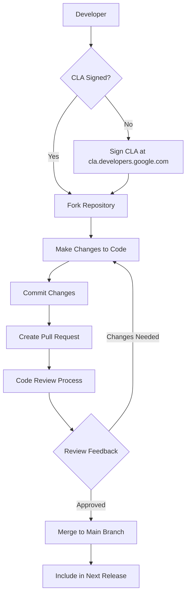
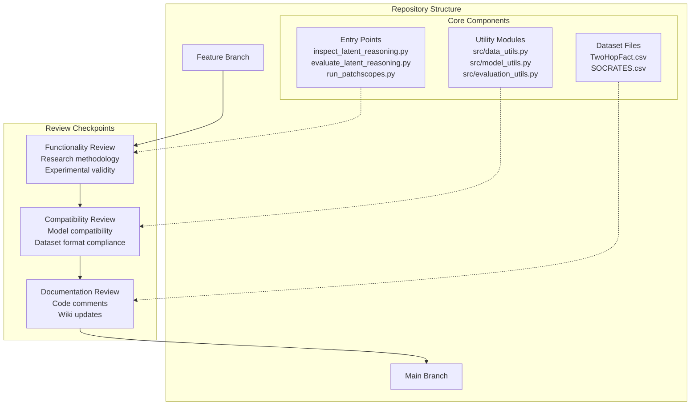

<!-- source: DeepWiki mcp.deepwiki.com · repo google-deepmind/latent-multi-hop-reasoning · page 6 Contributing and License · fetched 2026-10-26 -->

# Contributing and License

Relevant source files

The following files were used as context for generating this wiki page:

- [CONTRIBUTING.md](CONTRIBUTING.md)
- [LICENSE](LICENSE)

This document provides information about contributing to the latent multi-hop reasoning research codebase and the licensing terms that govern its use and distribution. It covers the contribution process, requirements for submitting changes, and the legal framework under which the code is made available.

## Contributing

The codebase follows Google's open source contribution practices, requiring all contributors to agree to a Contributor License Agreement and undergo code review for all submissions.

### Contributor License Agreement

All contributions to this project must be accompanied by a Contributor License Agreement (CLA). The CLA allows contributors to retain copyright to their contributions while granting the project permission to use and redistribute the contributions.

Key CLA requirements:
- Contributors (or their employers) retain copyright to contributions
- The CLA grants permission to use and redistribute contributions as part of the project
- CLAs are typically submitted once and apply across multiple Google projects
- New contributors must sign a CLA at https://cla.developers.google.com/

**Contribution Workflow**

Sources: [CONTRIBUTING.md:1-26]()

### Code Review Process

All submissions, including those by project members, require review through GitHub pull requests. The review process ensures code quality, adherence to project standards, and compatibility with the existing research implementation.

Review requirements:
- All changes must be submitted via GitHub pull requests
- Reviews are required for all contributors, including project maintainers
- Reviews focus on code correctness, research methodology alignment, and documentation quality

**Code Review Integration Points**

Sources: [CONTRIBUTING.md:15-20]()

### Community Guidelines

The project adheres to Google's Open Source Community Guidelines, which establish standards for respectful collaboration and inclusive participation in the open source community.

Community standards include:
- Following Google's Open Source Community Guidelines
- Maintaining respectful and constructive communication
- Supporting collaborative development practices
- Ensuring inclusive participation across diverse contributors

Sources: [CONTRIBUTING.md:22-25]()

## License

The codebase is released under the Apache License 2.0, a permissive open source license that allows for commercial and non-commercial use, modification, and distribution with certain conditions.

### License Terms

The Apache License 2.0 provides the following permissions and requirements:

| Permission | Description |
|------------|-------------|
| **Commercial Use** | Code may be used for commercial purposes |
| **Modification** | Code may be modified and adapted |
| **Distribution** | Code may be distributed in original or modified form |
| **Patent Rights** | Contributors grant patent rights for their contributions |
| **Private Use** | Code may be used privately without disclosure |

| Requirement | Description |
|-------------|-------------|
| **License Notice** | Must include copy of license with distributions |
| **Copyright Notice** | Must preserve original copyright notices |
| **State Changes** | Must indicate if modifications were made |
| **No Trademark Use** | Cannot use project trademarks without permission |

### License Coverage

The Apache License 2.0 applies to all components of the research codebase:

**Licensed Components Structure**

```mermaid
graph TB
    subgraph "Apache License 2.0 Coverage"
        subgraph "Source Code"
            INSPECT["inspect_latent_reasoning.py"]
            EVALUATE["evaluate_latent_reasoning.py"] 
            PATCHSCOPES["run_patchscopes.py"]
            
            subgraph "Utility Modules"
                DATA_UTILS["src/data_utils.py"]
                MODEL_UTILS["src/model_utils.py"]
                EVAL_UTILS["src/evaluation_utils.py"]
                INSPECT_UTILS["src/inspection_utils.py"]
                PATCH_UTILS["src/patchscopes_utils.py"]
                TOKEN_UTILS["src/tokenization_utils.py"]
            end
        end
        
        subgraph "Documentation"
            README["README.md"]
            CONTRIB["CONTRIBUTING.md"]
            WIKI_DOCS["Wiki Documentation"]
        end
        
        subgraph "Configuration"
            REQUIREMENTS["requirements.txt"]
            SETUP_SCRIPTS["Setup Scripts"]
        end
    end
    
    subgraph "License Terms Apply To"
        USE["Usage Rights"]
        MODIFY["Modification Rights"]
        DISTRIBUTE["Distribution Rights"]
        PATENT["Patent Grants"]
    end
    
    INSPECT --> USE
    EVALUATE --> MODIFY
    PATCHSCOPES --> DISTRIBUTE
    DATA_UTILS --> PATENT
    
    README --> USE
    REQUIREMENTS --> MODIFY
```

Sources: [LICENSE:1-203]()

### Key License Provisions

**Grant of Rights**: The license grants perpetual, worldwide, non-exclusive, royalty-free rights to reproduce, prepare derivative works, publicly display, distribute, and use the software ([LICENSE:67-72]()).

**Patent Protection**: Contributors grant patent licenses for any patent claims necessarily infringed by their contributions, with automatic termination if patent litigation is initiated ([LICENSE:74-88]()).

**Distribution Requirements**: Redistributions must include the license, preserve copyright notices, indicate changes made, and include attribution notices ([LICENSE:90-122]()).

**Warranty Disclaimer**: The software is provided "AS IS" without warranties of any kind, and contributors are not liable for damages arising from use ([LICENSE:144-164]()).

**Trademark Restrictions**: The license does not grant permission to use trade names, trademarks, or service marks except for reasonable attribution ([LICENSE:139-142]()).

Sources: [LICENSE:67-203]()