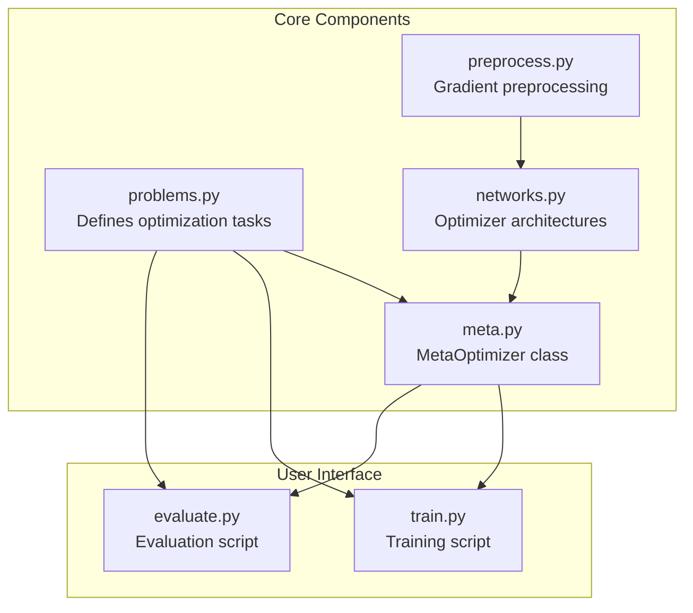
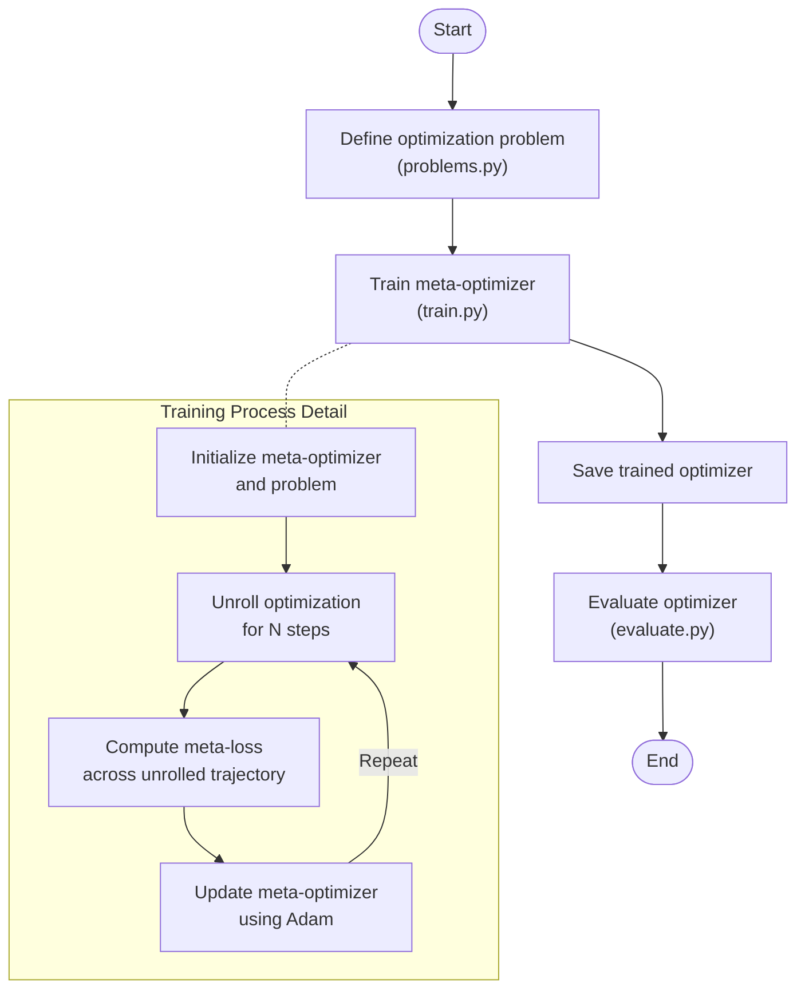
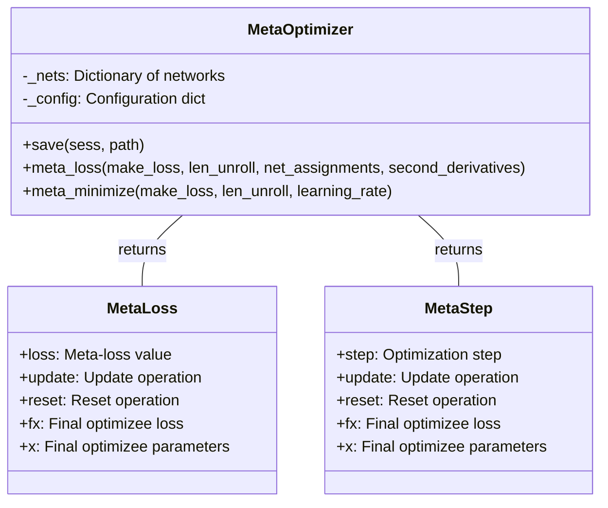
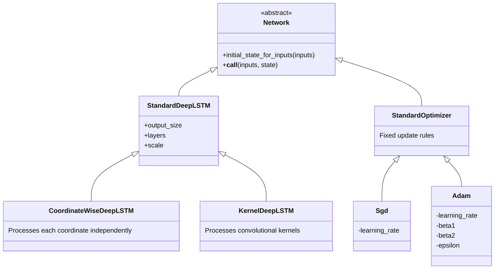
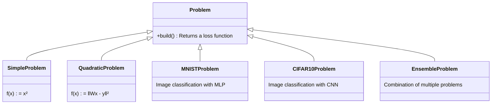
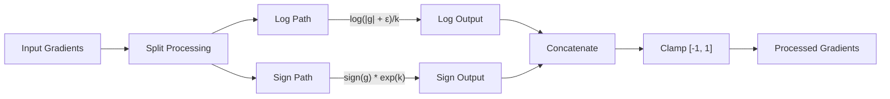

<!-- source: DeepWiki mcp.deepwiki.com · repo google-deepmind/learning-to-learn · page 1 Overview · fetched 2026-10-26 -->

# Overview

Relevant source files

The following files were used as context for generating this wiki page:

- [README.md](README.md)
- [meta.py](meta.py)
- [networks.py](networks.py)
- [problems.py](problems.py)

This page provides a technical overview of the Learning to Learn (L2L) system, a meta-optimization framework implemented in TensorFlow. L2L enables the training of neural network-based optimizers that can learn to optimize other machine learning models, potentially outperforming traditional hand-designed optimization algorithms.

## Learning to Learn Concept

The Learning to Learn (L2L) codebase implements the approach described in the paper ["Learning to Learn by Gradient Descent by Gradient Descent"](https://arxiv.org/abs/1606.04474). The core concept is to replace hand-designed optimization algorithms (like SGD or Adam) with learned optimizers that can adapt to specific problem structures.

In traditional optimization, we use algorithms with fixed update rules to minimize a loss function. In meta-learning for optimization, we:

1. Parameterize the optimizer as a neural network
2. Train this network to perform well across a distribution of optimization tasks
3. Use the trained optimizer to optimize new problems more efficiently

The meta-optimizer learns by "unrolling" optimization steps and computing gradients through the entire optimization process.

Sources: [README.md:1-14](), [meta.py:212-218]()

## System Architecture

The L2L system consists of four core components:

The system is designed to be modular, with clear separation between problem definitions, network architectures, and the meta-optimization process.

Sources: [problems.py:15-16](), [networks.py:15-16](), [meta.py:15-16](), [README.md:10-21]()

## Workflow

The typical workflow for using the L2L system involves:

Throughout this process, the system creates a meta-optimization loop that wraps around traditional optimization, enabling the optimizer itself to be learned.

Sources: [README.md:10-74](), [meta.py:261-402]()

## Core Components

### MetaOptimizer

The central class in the L2L system is the `MetaOptimizer` in [meta.py](), which:

1. Manages the training of neural network-based optimizers
2. Unrolls optimization trajectories to compute meta-gradients
3. Updates the optimizer's parameters to improve its performance

The `meta_loss` method unrolls the optimization for a specified number of steps and computes the sum of losses across the trajectory, while the `meta_minimize` method creates an Adam optimizer to minimize this meta-loss.

Sources: [meta.py:211-402](), [README.md:65-74]()

### Network Architectures

The L2L system provides several network architectures for meta-optimizers:

The most commonly used architecture is the `CoordinateWiseDeepLSTM`, which processes each parameter of the optimizee independently using the same LSTM network. This design provides efficiency and scalability.

Sources: [networks.py:66-378]()

### Problem Definitions

The system includes several problem types for training and evaluating meta-optimizers:

Each problem provides a `build()` function that returns a loss function which can be used by the meta-optimizer. Problems range from simple quadratic functions to complex image classification tasks.

Sources: [problems.py:39-277]()

### Gradient Preprocessing

Gradient preprocessing is crucial for effective meta-optimization. The primary preprocessing technique is `LogAndSign`:

This preprocessing helps normalize gradients across different scales and provides useful signal to the meta-optimizer.

Sources: [networks.py:178-184]()

## Supported Problem Types

The L2L framework supports a variety of optimization problems:

| Problem Type | Description | Implementation |
|--------------|-------------|----------------|
| `simple` | One-variable quadratic function: f(x) = x² | [problems.py:39-51]() |
| `simple_multi_optimizer` | Multi-variable quadratic function with different optimizers | [problems.py:54-68]() |
| `quadratic` | Batched matrix problem: f(x) = ‖Wx - y‖² | [problems.py:71-99]() |
| `mnist` | MNIST classification with a multi-layer perceptron | [problems.py:141-174]() |
| `cifar10` | CIFAR-10 classification with convolutional network | [problems.py:196-277]() |
| `ensemble` | Combination of multiple problems with weights | [problems.py:102-132]() |

These problems provide a diverse set of optimization challenges for training and evaluating meta-optimizers.

Sources: [problems.py:39-277](), [README.md:49-63]()

## Training and Evaluation

The L2L system provides command-line tools for training and evaluating meta-optimizers:

Training involves optimizing the meta-optimizer's parameters by unrolling optimization trajectories, while evaluation compares the performance of trained optimizers against traditional methods like Adam.

Sources: [README.md:10-46](), [meta.py:386-402]()

## Related Topics

For more detailed information about specific components of the L2L system, refer to these wiki pages:

- For detailed explanation of the meta-learning approach, see [Learning to Learn Concept](#1.1)
- For problem definitions and implementations, see [Problems](#2)
- For meta-optimizer implementation details, see [Meta-Optimizer](#3)
- For network architecture specifics, see [Networks](#4)
- For gradient preprocessing techniques, see [Preprocessing](#5)
- For practical usage examples, see [Practical Examples](#7)

---

