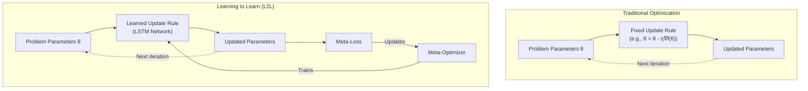
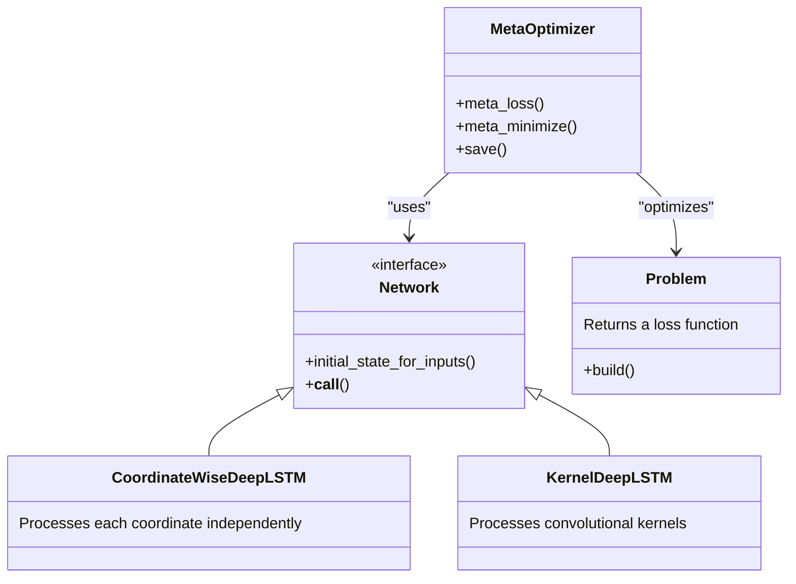
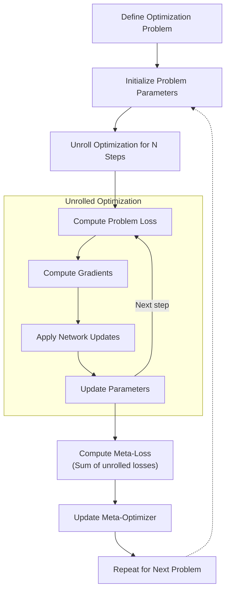
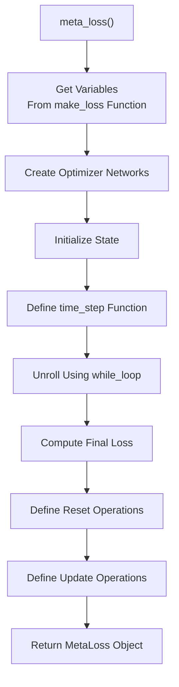
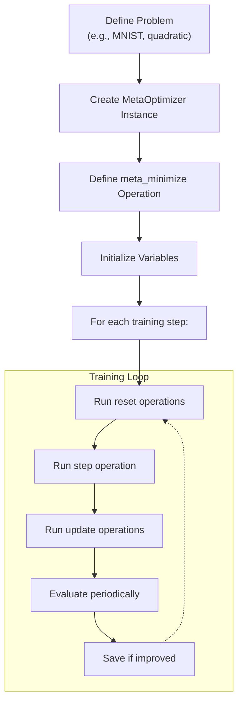

<!-- source: DeepWiki mcp.deepwiki.com · repo google-deepmind/learning-to-learn · page 1.1 Learning to Learn Concept · fetched 2026-10-26 -->

# Learning to Learn Concept

<details>
<summary>Relevant source files</summary>

The following files were used as context for generating this wiki page:

- [README.md](README.md)
- [meta.py](meta.py)

</details>


## Purpose and Scope

This document explains the Learning to Learn (L2L) concept as implemented in this repository. It covers the fundamental principles of meta-learning for optimization, how it differs from traditional optimization methods, and the implementation details within the codebase. For information about the overall system architecture, see [System Architecture](#1.2).

## What is Learning to Learn?

Learning to Learn (L2L), also known as meta-learning, is an approach where an algorithm learns how to optimize other learning algorithms. Instead of using hand-designed optimization algorithms like SGD or Adam, a meta-learning system learns the optimization process itself from data.

In this implementation, neural networks (specifically recurrent neural networks) learn update rules for optimizing parameters of other neural networks or mathematical functions. These learned optimizers can potentially outperform traditional optimization algorithms on specific problem classes.

### Meta-Learning vs Traditional Optimization

**Traditional Optimization Process vs Learning to Learn**



Sources: [meta.py:211-402](), [README.md:1-69]()

The key distinction is that traditional optimizers use fixed, human-designed update rules, while L2L uses learned update rules generated by neural networks that can adapt to specific problem structures.

## Core Components in the L2L Implementation

The L2L approach is implemented through these key components:



Sources: [meta.py:211-220](), [meta.py:261-384](), [meta.py:386-402]()

1. **MetaOptimizer**: The core class that manages the training of optimizer networks and coordinates the meta-learning process
2. **Optimizer Networks**: RNN-based networks (typically LSTMs) that learn to generate parameter updates
3. **Problem Definitions**: Optimization tasks used for training and evaluating the meta-optimizer
4. **Meta-Loss**: A loss function computed over multiple unrolled optimization steps

## The Meta-Optimization Process

The meta-optimization process involves these key steps:



Sources: [meta.py:326-347](), [meta.py:349-364](), [meta.py:386-402]()

This process is centered around the concept of "unrolling" - running multiple optimization steps as part of a single computational graph, then using the cumulative loss to update the meta-optimizer.

## Implementation Details

### Meta-Loss Computation

The meta-loss is computed by unrolling the optimization process for a specified number of steps and summing the losses at each step. This is implemented in the `meta_loss` method:



Sources: [meta.py:261-384]()

The critical `time_step` function [meta.py:326-347]() performs a single optimization step:
1. Compute the current loss using the current parameters
2. Compute gradients of the loss with respect to parameters
3. Use the optimization networks to generate parameter updates
4. Apply the updates to the parameters
5. Update the RNN state

### Optimizer Networks

The optimizer networks take gradients as input and produce parameter updates. Two main types are used:

1. **CoordinateWiseDeepLSTM**: Processes each parameter independently
2. **KernelDeepLSTM**: Specifically designed for convolutional kernels

These networks include preprocessing techniques for the gradients (like the `LogAndSign` preprocessor) which transform raw gradients into more useful representations.

### Training the Meta-Optimizer

The meta-optimizer itself is trained using the Adam optimizer in `meta_minimize`:

```python
def meta_minimize(self, make_loss, len_unroll, learning_rate=0.01, **kwargs):
    info = self.meta_loss(make_loss, len_unroll, **kwargs)
    optimizer = tf.train.AdamOptimizer(learning_rate)
    step = optimizer.minimize(info.loss)
    return MetaStep(step, *info[1:])
```

Sources: [meta.py:386-402]()

This method:
1. Computes the meta-loss using `meta_loss`
2. Creates an Adam optimizer to minimize this meta-loss
3. Returns operations for stepping the optimizer, updating parameters, and resetting state

## Technical Implementation Workflow

The complete workflow for training a meta-optimizer involves:



Sources: [train.py](), [meta.py:386-402]()

## Advantages of Learning to Learn

The Learning to Learn approach offers several technical advantages:

| Advantage | Description |
|-----------|-------------|
| Problem-specific optimization | Learns update rules specialized for particular problem structures |
| Long-term dependencies | Uses RNNs to capture dependencies across optimization steps |
| Automatic feature discovery | Learns to identify and use features of the loss landscape |
| No manual tuning | Potentially reduces need for extensive hyperparameter optimization |

## Conclusion

The Learning to Learn approach implemented in this codebase represents a shift from hand-designed optimization algorithms to learned optimization algorithms. By framing the optimizer itself as a learnable component, this approach opens up possibilities for more adaptive and efficient optimization, particularly for specific classes of problems.

For more detailed information about specific components, see:
- [Meta-Optimizer Class](#3.1)
- [Network Architectures](#4)
- [Problem Definitions](#2)

---

