<!-- source: DeepWiki mcp.deepwiki.com · repo google-deepmind/learning-to-learn · page 1.2 System Architecture · fetched 2026-10-26 -->

# System Architecture

Relevant source files

The following files were used as context for generating this wiki page:

- [README.md](README.md)
- [meta.py](meta.py)
- [networks.py](networks.py)
- [problems.py](problems.py)

## Purpose and Scope

This document describes the overall architecture of the Learning to Learn (L2L) system, explaining the key components, their relationships, and how data flows through the system. It focuses on the structural organization of the codebase and the interactions between different modules. For information about the Learning to Learn concept itself, please see [Learning to Learn Concept](#1.1).

## High-Level Overview

The Learning to Learn (L2L) framework is designed to train meta-optimizers that can learn to optimize other machine learning models. The system employs a modular architecture with clearly separated components for defining optimization problems, creating neural network-based optimizers, and managing the meta-learning process.

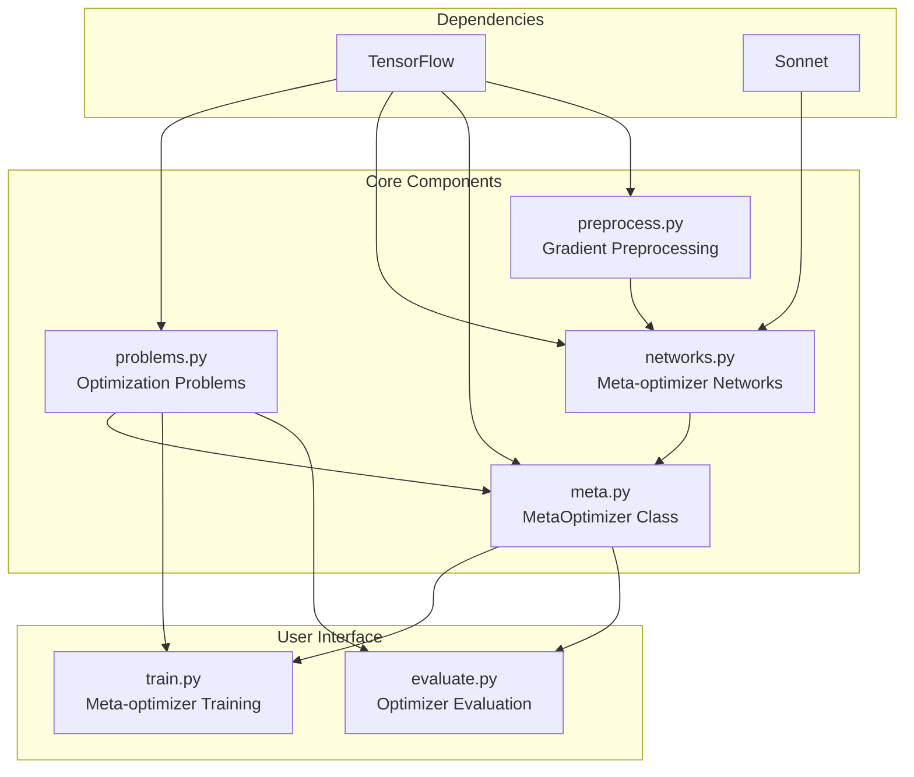

Sources: [problems.py](), [networks.py](), [meta.py](), [README.md]()

## Core Components

The system comprises four main components:

1. **Problem Definitions (problems.py)**: Defines optimization problems used for training and evaluating meta-optimizers.

2. **Network Architectures (networks.py)**: Implements neural network architectures that serve as meta-optimizers.

3. **Meta-Optimizer (meta.py)**: Core class that manages the meta-learning process.

4. **Preprocessing (preprocess.py)**: Handles gradient preprocessing to improve learning stability.

### Component Responsibilities

| Component | Key Classes/Functions | Responsibility |
|-----------|------------------------|----------------|
| problems.py | `simple()`, `quadratic()`, `mnist()`, `cifar10()`, `ensemble()` | Defines loss functions for optimization |
| networks.py | `Network` (base class), `CoordinateWiseDeepLSTM`, `KernelDeepLSTM`, `Adam` | Defines optimizer network architectures |
| meta.py | `MetaOptimizer` | Manages the meta-learning process |
| preprocess.py | `LogAndSign` | Preprocesses gradients for better learning |

Sources: [problems.py:39-277](), [networks.py:66-377](), [meta.py:211-402]()

## Component Interactions

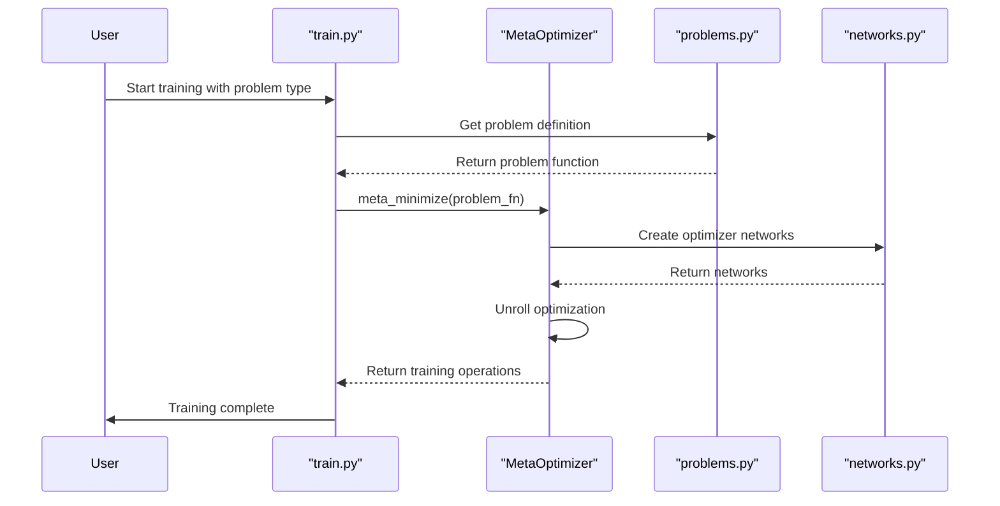

Sources: [meta.py:261-384](), [meta.py:386-402]()

## Data Flow Architecture

The Learning to Learn system implements a unique data flow pattern to enable meta-learning. At its core is the concept of unrolling optimization steps and computing gradients through the entire optimization process.

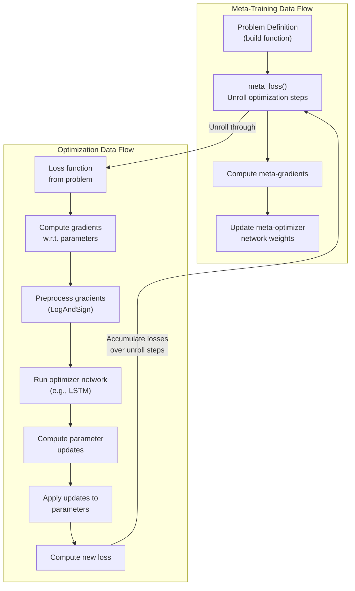

Sources: [meta.py:326-347](), [meta.py:349-358]()

## Meta-Optimizer Architecture

The `MetaOptimizer` class is the central component of the system, coordinating the training and application of learned optimizers.

### Key Concepts

- **Unrolling**: The process of simulating multiple steps of optimization and backpropagating through the entire sequence.
- **Meta-loss**: The sum of losses over all unrolled optimization steps.
- **Network assignments**: The ability to use different optimizers for different parts of a model.

### Implementation Structure

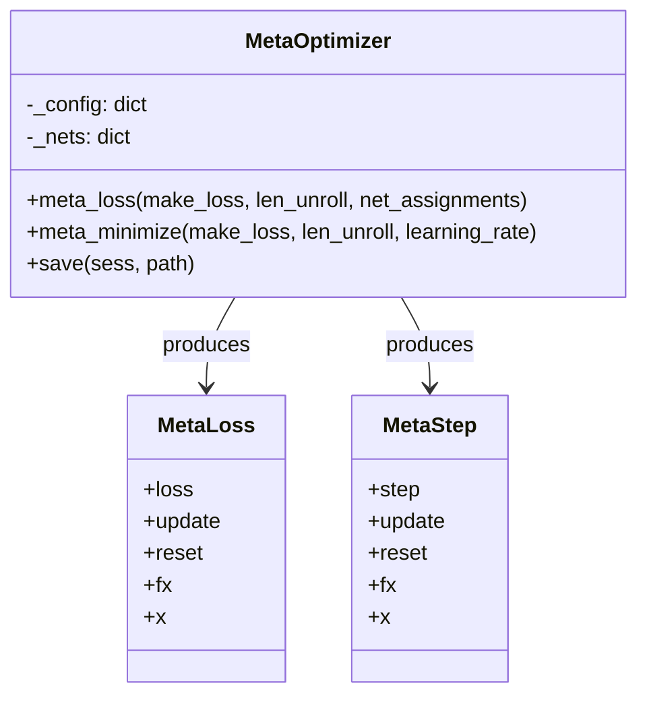

Sources: [meta.py:211-402]()

### Unrolling Process

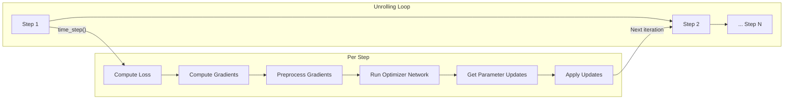

Sources: [meta.py:326-347](), [meta.py:308-324]()

## Problem Types Architecture

The system supports various problem types for training and evaluating optimizers, ranging from simple mathematical functions to complex machine learning tasks.

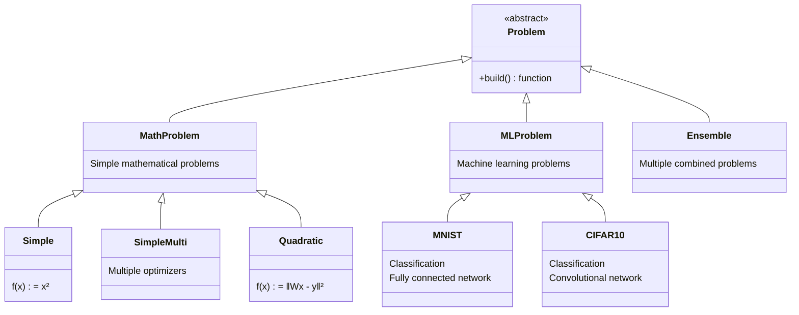

Sources: [problems.py:39-51](), [problems.py:54-68](), [problems.py:71-99](), [problems.py:141-173](), [problems.py:196-276](), [problems.py:102-132]()

## Network Architecture

The system implements various neural network architectures for optimization, organized in a hierarchy with shared functionality.

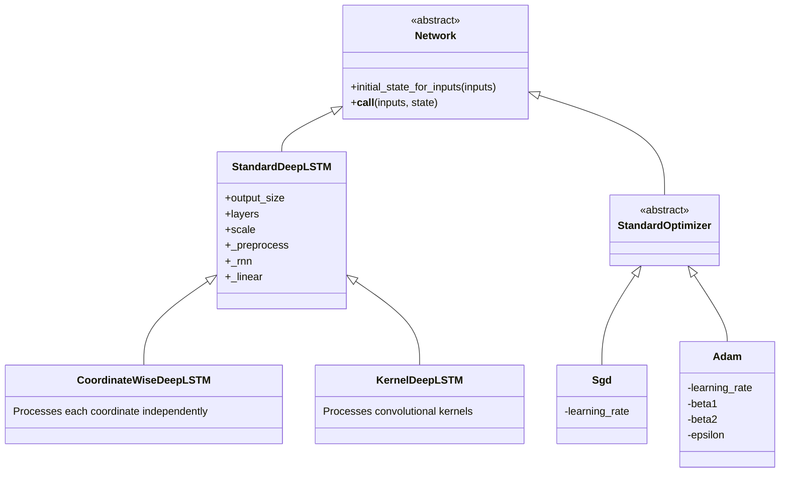

Sources: [networks.py:66-72](), [networks.py:154-217](), [networks.py:220-257](), [networks.py:260-308](), [networks.py:311-328](), [networks.py:339-377]()

## Gradient Preprocessing

Gradient preprocessing is crucial for stable and effective meta-learning. The system implements preprocessing techniques like `LogAndSign` to handle potential gradient issues.

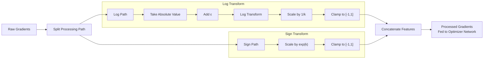

Sources: [networks.py:157-183]()

## System Workflow

The end-to-end workflow involves both training meta-optimizers and evaluating their performance on optimization tasks.

### Training Workflow

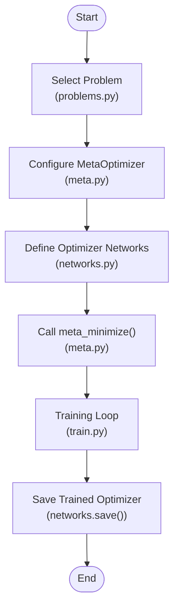

Sources: [meta.py:386-402](), [networks.py:47-62]()

### Evaluation Workflow

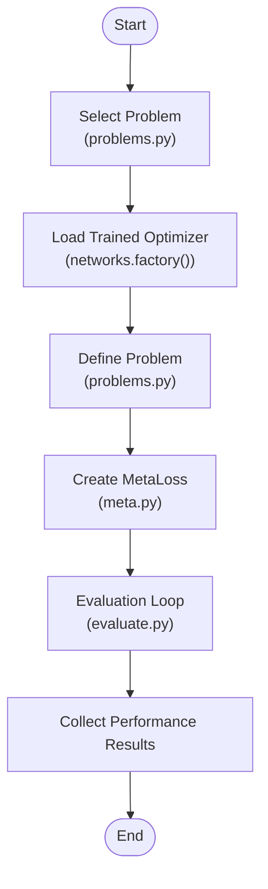

Sources: [networks.py:34-44]()

## Key Implementation Patterns

### TensorFlow Graph Construction

The system creates TensorFlow computation graphs for meta-optimization through careful management of variable scopes and graph operations.

Key patterns include:
- Variable creation tracking through custom getters
- Variable replacement for graph reuse
- Nested state management for RNNs
- Tensor unrolling through while loops

### Network Factory Pattern

The system uses a factory pattern to create optimizer networks:

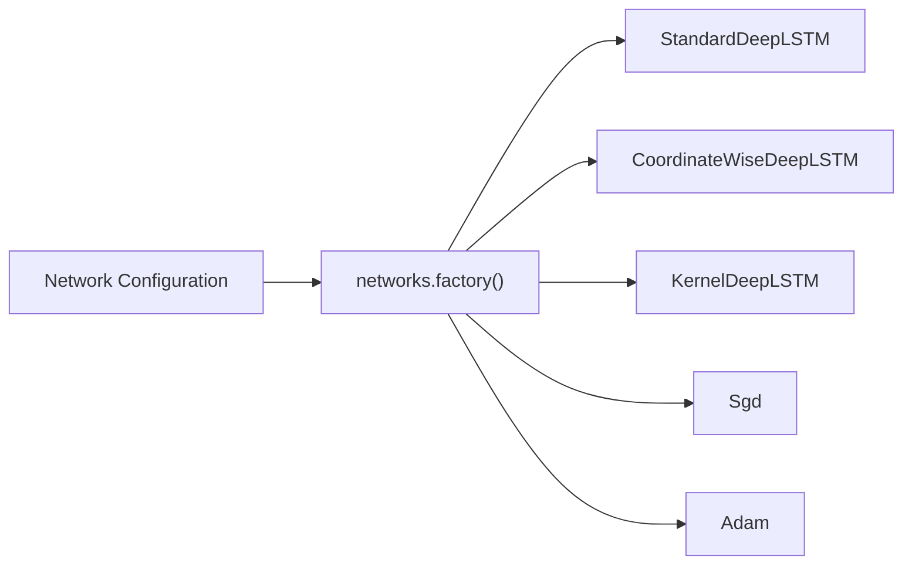

Sources: [networks.py:34-44]()

## Summary

The Learning to Learn system architecture is designed with a clear separation of concerns between problem definitions, network architectures, and the meta-optimization process. This modular design allows for flexibility in experimenting with different problems and optimizer architectures while maintaining a consistent training and evaluation framework.

The core innovation lies in the `MetaOptimizer` class that enables training neural networks to act as optimizers through gradient unrolling and accumulation of meta-loss. The system supports various types of optimizer networks, from LSTM-based designs to standard optimizers like SGD and Adam, and allows them to be trained on a range of problems from simple mathematical functions to complex machine learning tasks.

---

