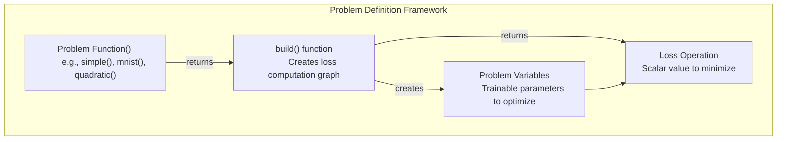
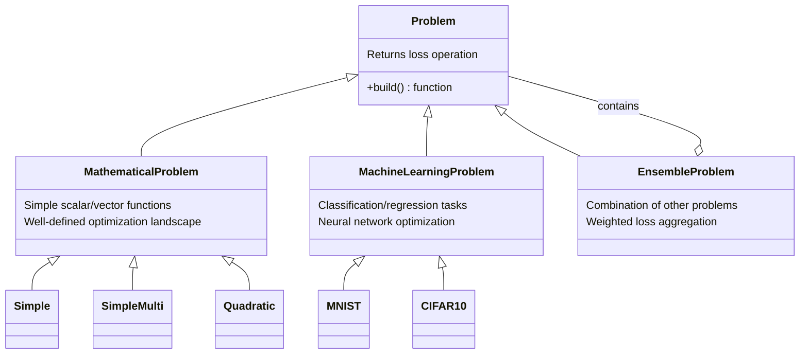
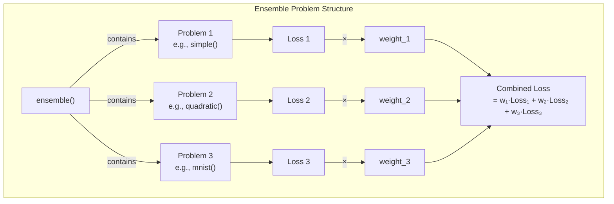
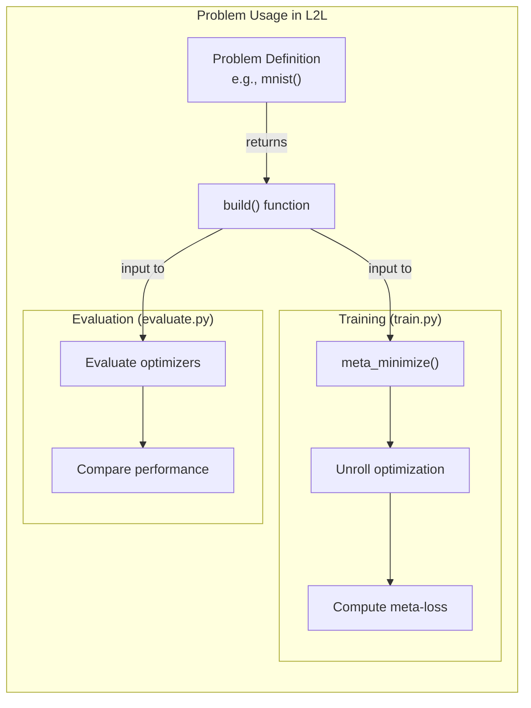

<!-- source: DeepWiki mcp.deepwiki.com · repo google-deepmind/learning-to-learn · page 2 Problems · fetched 2026-10-26 -->

# Problems

<details>
<summary>Relevant source files</summary>

The following files were used as context for generating this wiki page:

- [README.md](README.md)
- [problems.py](problems.py)

</details>


This document provides an overview of the problem definitions in the Learning to Learn (L2L) framework. In L2L, "problems" represent optimization tasks that the meta-optimizer learns to solve. These range from simple mathematical functions to complex machine learning tasks. This page covers the problem framework, available problem types, and how problems are used in the system. For specific implementation details, see [Mathematical Problems](#2.1), [Machine Learning Problems](#2.2), and [Problem Ensembles](#2.3).

## Problem Framework

In L2L, each problem is defined as a function that builds a TensorFlow computation graph representing the loss to be minimized. Problems follow a consistent structure where they return a callable "build" function that constructs the loss computation when invoked.



Sources: [problems.py:39-51](), [problems.py:71-99](), [problems.py:141-174]()

All problem implementations in L2L follow this pattern:
1. A problem function (e.g., `simple()`, `quadratic()`, `mnist()`) that accepts configuration parameters
2. This function returns a nested `build()` function
3. The `build()` function creates TensorFlow variables and operations
4. The `build()` function returns a loss operation that will be minimized

## Problem Types

The L2L framework includes three main categories of problems:



Sources: [problems.py:39-99](), [problems.py:141-277](), [problems.py:102-132]()

### Mathematical Problems

These are simple optimization tasks with well-defined properties, useful for testing and basic training of meta-optimizers.

| Problem Type | Description | Implementation |
|--------------|-------------|----------------|
| Simple | Single variable quadratic function: f(x) = x² | [problems.py:39-51]() |
| SimpleMulti | Multi-variable quadratic function: f(x₁,x₂,...) = x₁² + x₂² + ... | [problems.py:54-68]() |
| Quadratic | Batched matrix problem: f(x) = ‖Wx - y‖² | [problems.py:71-99]() |

For detailed implementation and usage information about mathematical problems, see [Mathematical Problems](#2.1).

### Machine Learning Problems

These problems involve training neural networks on standard datasets, representing more complex and realistic optimization challenges.

| Problem Type | Description | Implementation |
|--------------|-------------|----------------|
| MNIST | MNIST digit classification using a multi-layer perceptron | [problems.py:141-174]() |
| CIFAR10 | CIFAR10 image classification using a convolutional neural network | [problems.py:196-277]() |

For detailed implementation and usage information about machine learning problems, see [Machine Learning Problems](#2.2).

### Problem Ensembles

The L2L framework supports combining multiple problems into an ensemble, where the meta-optimizer learns to optimize a weighted combination of different loss functions.



Sources: [problems.py:102-132]()

The `ensemble()` function takes a list of problem specifications and optional weights, creating a combined problem where the total loss is the (weighted) sum of individual problem losses. This allows for training meta-optimizers that can handle diverse optimization tasks simultaneously.

For detailed implementation and usage information about problem ensembles, see [Problem Ensembles](#2.3).

## Problem Usage in Training and Evaluation

Problems are central to the L2L workflow, providing the optimization tasks for both training the meta-optimizer and evaluating its performance.



Sources: [problems.py](), [README.md:48-64]()

During training:
1. A problem is selected and configured (e.g., `mnist()` with specific layer sizes)
2. The problem's `build()` function is passed to the meta-optimizer's `meta_minimize()` method
3. The meta-optimizer repeatedly invokes this function to generate new loss instances
4. The meta-optimizer learns to minimize these losses efficiently

During evaluation:
1. The same or different problems are used to test the trained meta-optimizer
2. The problem's loss function is optimized using both the learned optimizer and baseline optimizers (e.g., Adam)
3. Performance is compared across different optimizers

## Available Problems

The L2L framework provides the following built-in problem implementations:

| Problem | Description | Configuration Options |
|---------|-------------|------------------------|
| `simple` | One-variable quadratic function: f(x) = x² | None |
| `simple-multi` | Multi-variable quadratic function where variables can be assigned to different optimizers | `num_dims`: Number of dimensions |
| `quadratic` | Batched matrix problem: f(x) = ‖Wx - y‖² | `batch_size`, `num_dims`, `stddev` |
| `mnist` | MNIST classification with a multi-layer perceptron | `layers`, `activation`, `batch_size`, `mode` |
| `cifar` | CIFAR10 classification with a CNN | `conv_channels`, `linear_layers`, `batch_norm`, `batch_size` |
| `ensemble` | Combination of multiple problems | `problems`, `weights` |

Sources: [problems.py](), [README.md:48-64]()

## Creating Custom Problems

The L2L framework is designed to be easily extended with new problem types. To create a custom problem:

1. Define a function that returns a TensorFlow graph-building function
2. The returned function should create all necessary variables and operations
3. The function should return a scalar TensorFlow operation representing the loss to minimize

```python
def my_custom_problem(param1=default1, param2=default2):
    """My custom optimization problem."""
    
    def build():
        """Builds loss graph."""
        # Create variables to optimize
        x = tf.get_variable("x", ...)
        
        # Create any constants or non-trainable variables
        constants = tf.get_variable("constants", ..., trainable=False)
        
        # Build computation graph
        result = some_computation(x, constants)
        
        # Return scalar loss
        return tf.reduce_mean(result)
    
    return build
```

Important considerations when implementing custom problems:
- All operations with Python side effects (e.g., queue creation) must be done outside the `build()` function
- The `build()` function may be called multiple times during meta-optimization
- Variables created within the `build()` function will be optimized by the meta-optimizer

Sources: [README.md:66-74](), [problems.py]()

---

