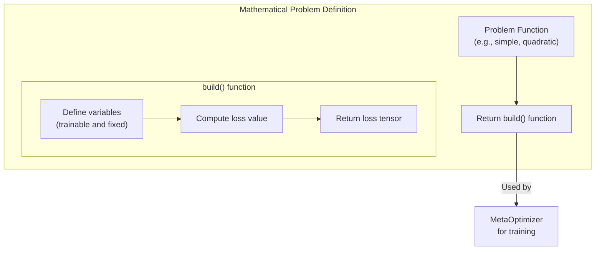
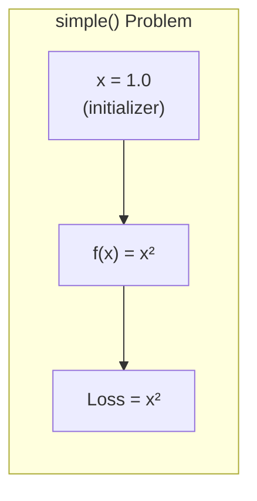
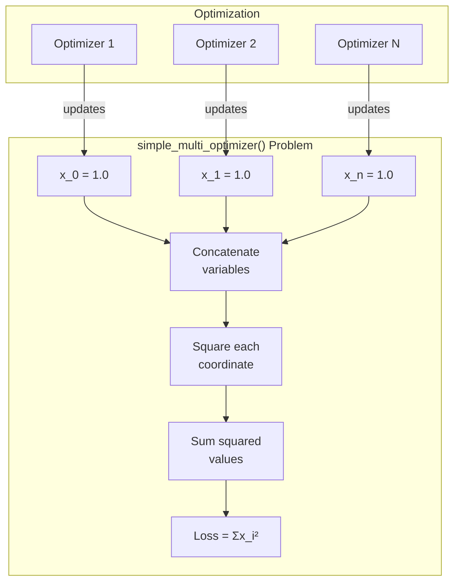
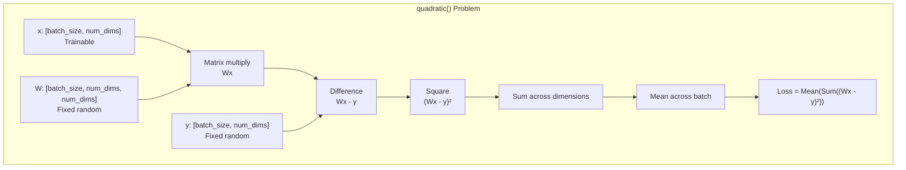
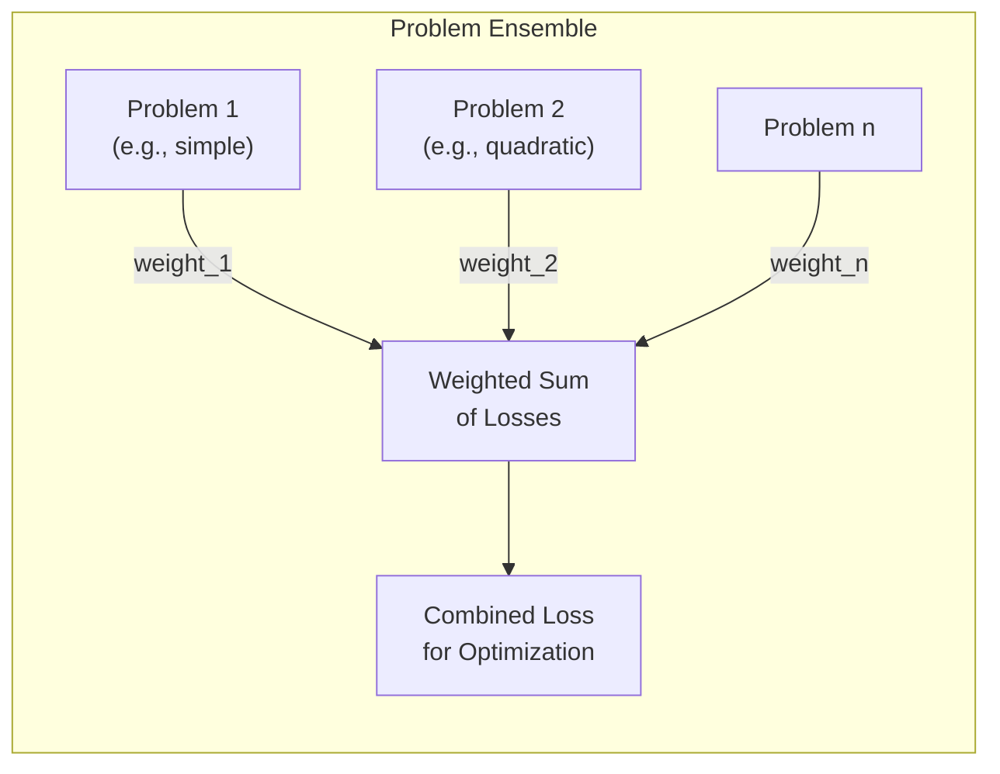
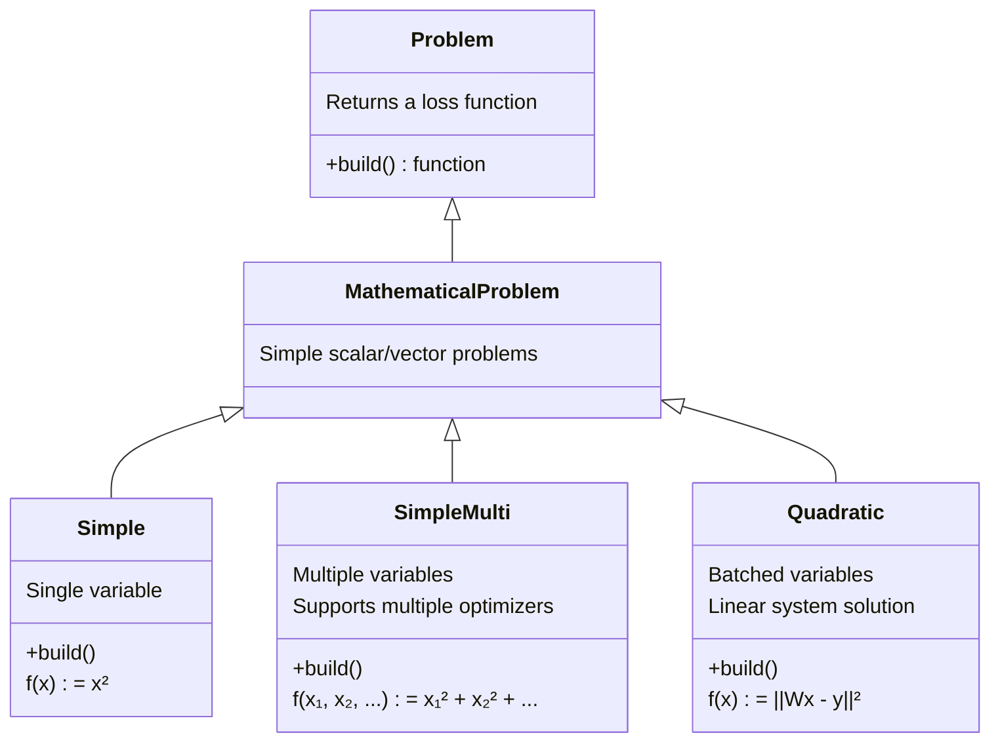
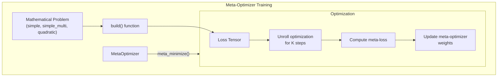

<!-- source: DeepWiki mcp.deepwiki.com · repo google-deepmind/learning-to-learn · page 2.1 Mathematical Problems · fetched 2026-10-26 -->

# Mathematical Problems

<details>
<summary>Relevant source files</summary>

The following files were used as context for generating this wiki page:

- [problems.py](problems.py)

</details>


## Purpose and Scope

This page documents the mathematical optimization problems included in the Learning to Learn (L2L) framework. These problems serve as fundamental test cases for training and evaluating meta-optimizers. They provide simple, well-defined optimization landscapes that are computationally efficient while still offering meaningful challenges for optimizer development. For information about more complex machine learning problems like MNIST and CIFAR10, see [Machine Learning Problems](#2.2).

Sources: [problems.py:15-16]()

## Problem Structure

Mathematical problems in the L2L framework follow a common pattern where each problem is defined as a function that returns a build function. This build function, when called, constructs the TensorFlow computation graph for the problem and returns a loss tensor that can be minimized.



Each mathematical problem implements this pattern, defining variables with specific initializations and a loss function that computes the objective to be minimized.

Sources: [problems.py:39-99]()

## Simple Problem

The simplest optimization problem in the framework is the minimization of f(x) = x².

### Implementation

The `simple()` function defines a problem with a single scalar variable `x` initialized to 1.0, and returns its square as the loss value.



This problem has a global minimum at x = 0, with a convex, smooth optimization landscape. It's an ideal starting point for testing optimization algorithms.

Sources: [problems.py:39-51]()

## Simple Multi-Optimizer Problem

The `simple_multi_optimizer()` function extends the simple problem to multiple dimensions, allowing for experiments with different optimizers on different subsets of parameters.

### Implementation

This problem creates `num_dims` separate variables (default is 2) and computes the sum of their squares as the loss.



### Use Cases

This problem is particularly useful for:
1. Testing multiple optimizers in parallel
2. Comparing different optimization strategies on the same problem
3. Training meta-optimizers that specialize in certain parameter types

Sources: [problems.py:54-68]()

## Quadratic Problem

The `quadratic()` problem implements a more complex mathematical optimization: f(x) = ||Wx - y||², which represents a system of linear equations.

### Implementation

This problem defines:
- `x`: A trainable variable of shape [batch_size, num_dims]
- `W`: A fixed random matrix of shape [batch_size, num_dims, num_dims]
- `y`: A fixed random target vector of shape [batch_size, num_dims]

The loss is the mean squared error between Wx and y across the batch.



### Parameters

| Parameter | Default | Description |
|-----------|---------|-------------|
| batch_size | 128 | Number of independent problem instances in each batch |
| num_dims | 10 | Dimensionality of each problem instance |
| stddev | 0.01 | Standard deviation for initializing `x` |
| dtype | tf.float32 | Data type for variables |

### Key Properties

1. **Batched Optimization**: Unlike the simple problems, quadratic optimizes multiple independent problem instances simultaneously.
2. **Well-Defined Minimum**: For each instance, the optimal solution is x = W⁻¹y (if W is invertible).
3. **Variable Difficulty**: The condition number of W determines how challenging each instance is to optimize.

Sources: [problems.py:71-99]()

## Using Mathematical Problems in Training

Mathematical problems are used to train meta-optimizers by providing them as inputs to the training process. 

### Problem Configuration

Problems can be configured with specific parameters to adjust their difficulty or characteristics:

```python
# Example configuration for quadratic problem
problem_config = {
    "name": "quadratic",
    "options": {
        "batch_size": 128,
        "num_dims": 10
    }
}
```

### Problem Ensembles

Multiple problems can be combined into an ensemble using the `ensemble()` function, which adds flexibility to the training process:



The ensemble function creates a scope for each problem and combines their losses, optionally with specific weights. For more details on problem ensembles, see [Problem Ensembles](#2.3).

Sources: [problems.py:102-132]()

## Mathematical Problem Hierarchy

The mathematical problems form a logical hierarchy in the system design:



Sources: [problems.py:39-99]()

## Integration with Meta-Optimizer Training

The mathematical problems serve as the training grounds for meta-optimizers in the L2L framework:



During training, the meta-optimizer repeatedly optimizes instances of these mathematical problems, learning effective optimization strategies through the process.

Sources: [problems.py:39-99]()

---

