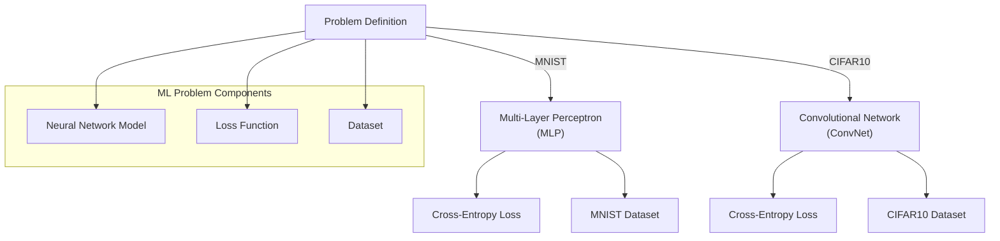
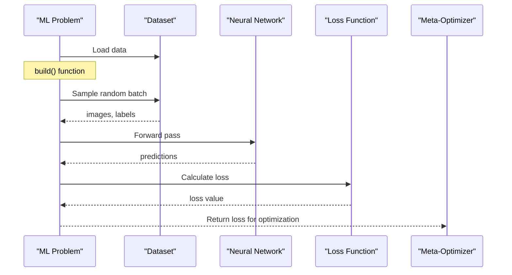
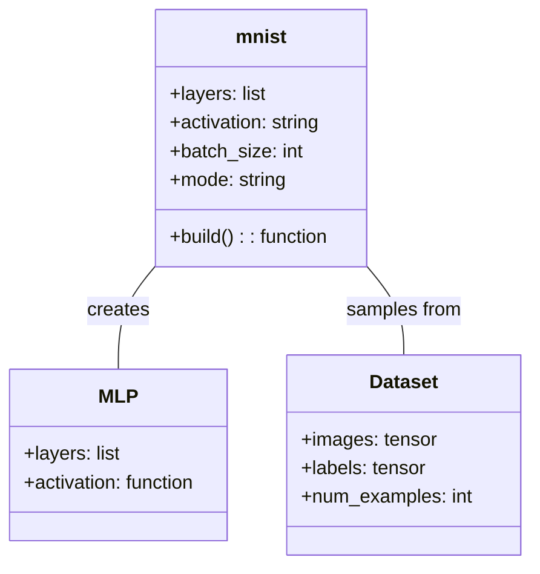
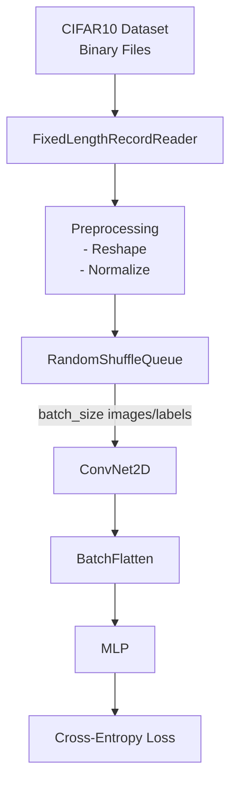
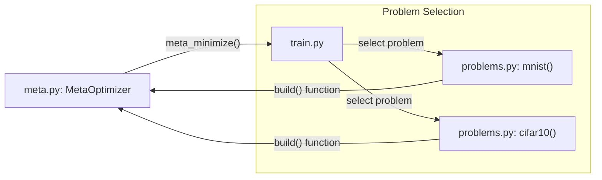

<!-- source: DeepWiki mcp.deepwiki.com · repo google-deepmind/learning-to-learn · page 2.2 Machine Learning Problems · fetched 2026-10-26 -->

# Machine Learning Problems

<details>
<summary>Relevant source files</summary>

The following files were used as context for generating this wiki page:

- [problems.py](problems.py)

</details>


This document describes the machine learning problem definitions implemented in the Learning to Learn (L2L) framework. These problems serve as optimization targets for training and evaluating meta-optimizers. While [Mathematical Problems](#2.1) focus on simple optimization objectives like quadratic functions, this section covers more complex machine learning tasks involving neural networks trained on real-world datasets.

## Overview

The L2L framework implements two standard machine learning classification problems:

1. **MNIST** - Handwritten digit classification using a multi-layer perceptron
2. **CIFAR10** - Image classification using a convolutional neural network

These problems provide realistic optimization challenges that meta-optimizers must learn to solve efficiently. They represent typical supervised learning tasks with different levels of complexity and feature requirements.



Sources: [problems.py:135-276]()

## Common Architecture

Both machine learning problems follow a consistent pattern in the L2L framework:

1. Define a neural network architecture appropriate for the task
2. Load and preprocess the dataset
3. Implement a `build()` function that:
   - Samples random batches from the dataset
   - Passes data through the network
   - Calculates the loss (cross-entropy)
   - Returns the loss value for optimization

The `build()` function serves as the optimization objective that meta-optimizers will learn to minimize. This follows the same pattern as the mathematical problems but with more complex models and real-world data.



Sources: [problems.py:141-174](), [problems.py:196-277]()

## MNIST Classification

The MNIST problem implements handwritten digit classification using a configurable multi-layer perceptron.

### Implementation Details

The MNIST problem is implemented as a function that returns a `build()` function. The `build()` function creates a random batch of MNIST images and labels, passes them through a multi-layer perceptron, and returns the cross-entropy loss.



Sources: [problems.py:141-174]()

### Configuration Options

The MNIST problem takes the following parameters:

| Parameter | Type | Description | Default |
|-----------|------|-------------|---------|
| `layers` | list | List of hidden layer sizes for the MLP | Required |
| `activation` | string | Activation function ("sigmoid" or "relu") | "sigmoid" |
| `batch_size` | int | Number of examples per batch | 128 |
| `mode` | string | Dataset split to use ("train" or "test") | "train" |

Sources: [problems.py:141-145]()

### Network Architecture

The network architecture for MNIST is a multi-layer perceptron with configurable hidden layers:

1. Input layer: 784 neurons (flattened 28×28 images)
2. Hidden layers: Specified by the `layers` parameter
3. Output layer: 10 neurons (one per digit)

The implementation uses Sonnet's MLP module with the specified activation function and standard weight initialization.

Sources: [problems.py:162-166]()

## CIFAR10 Classification

The CIFAR10 problem implements image classification using a convolutional neural network followed by fully connected layers.

### Implementation Details

The CIFAR10 problem is more complex than MNIST, involving:

1. Data loading and preprocessing from binary files
2. A queue-based data pipeline for efficient processing
3. A convolutional neural network architecture
4. Optional batch normalization



Sources: [problems.py:196-277]()

### Configuration Options

The CIFAR10 problem offers extensive configuration options:

| Parameter | Type | Description | Default |
|-----------|------|-------------|---------|
| `path` | string | Path to download/store CIFAR10 data | Required |
| `conv_channels` | list | Number of output channels for each conv layer | Required |
| `linear_layers` | list | List of hidden layer sizes for the MLP | Required |
| `batch_norm` | bool | Whether to use batch normalization | True |
| `batch_size` | int | Number of examples per batch | 128 |
| `num_threads` | int | Number of threads for data loading | 4 |
| `min_queue_examples` | int | Min examples in queue before dequeuing | 1000 |
| `mode` | string | Dataset split to use ("train" or "test") | "train" |

Sources: [problems.py:196-203]()

### Network Architecture

The CIFAR10 network architecture combines convolutional and fully connected layers:

1. Convolutional layers with max pooling and ReLU activation
2. Batch normalization (optional)
3. Flattening operation
4. Fully connected layers with ReLU activation
5. Output layer with 10 neurons (one per class)

Sources: [problems.py:245-268]()

### Data Pipeline

The CIFAR10 implementation includes an efficient data pipeline:

1. Downloads the dataset if not already present
2. Reads binary data files using `FixedLengthRecordReader`
3. Decodes and preprocesses images (normalizes to [0,1] range)
4. Uses a `RandomShuffleQueue` for batch sampling
5. Creates multiple reader threads for better performance

Sources: [problems.py:182-242]()

## Integration with Meta-Optimizer

These machine learning problems integrate with the meta-optimizer through the consistent `build()` function interface. This allows the meta-optimizer to:

1. Unroll optimization steps on these problems
2. Compute gradients and apply updates
3. Measure optimization progress
4. Learn effective optimization strategies for neural networks



Sources: [problems.py:141-174](), [problems.py:196-277]()

## Comparison with Mathematical Problems

Machine learning problems differ from [Mathematical Problems](#2.1) in several important ways:

| Aspect | Mathematical Problems | Machine Learning Problems |
|--------|----------------------|--------------------------|
| Complexity | Simple, well-defined functions | Complex models with many parameters |
| Scale | Few variables (typically <100) | Many variables (thousands to millions) |
| Data | No external data required | Requires dataset loading and processing |
| Network | Simple or none | Neural networks with multiple layers |
| Training | Fast evaluation | More computationally intensive |
| Generalization | Tests optimization ability | Tests both optimization and generalization |

The machine learning problems provide a more realistic test of optimizer performance on real-world tasks, while mathematical problems offer faster experimentation cycles and clearer optimization landscapes.

Sources: [problems.py:39-99](), [problems.py:141-277]()

## Usage Examples

To use these machine learning problems in the L2L framework, you typically:

1. Create a problem instance with desired configuration
2. Pass the problem to the meta-optimizer for training or evaluation

For example, to create an MNIST problem with a 2-layer MLP:

```python
mnist_problem = problems.mnist(layers=[20, 20], activation="relu")
```

Or to create a CIFAR10 problem with a standard CNN architecture:

```python
cifar_problem = problems.cifar10(
    path="./data",
    conv_channels=[16, 32],
    linear_layers=[32],
    batch_norm=True
)
```

These problems can also be combined into an [ensemble](#2.3) to train meta-optimizers on multiple tasks simultaneously.

Sources: [problems.py:141-174](), [problems.py:196-277]()

---

