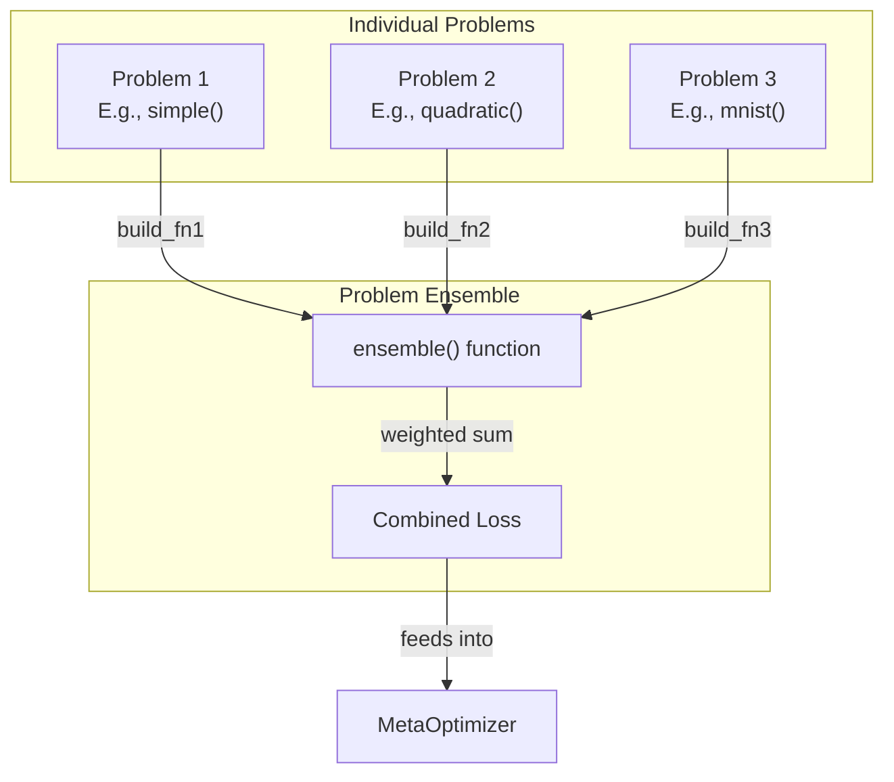
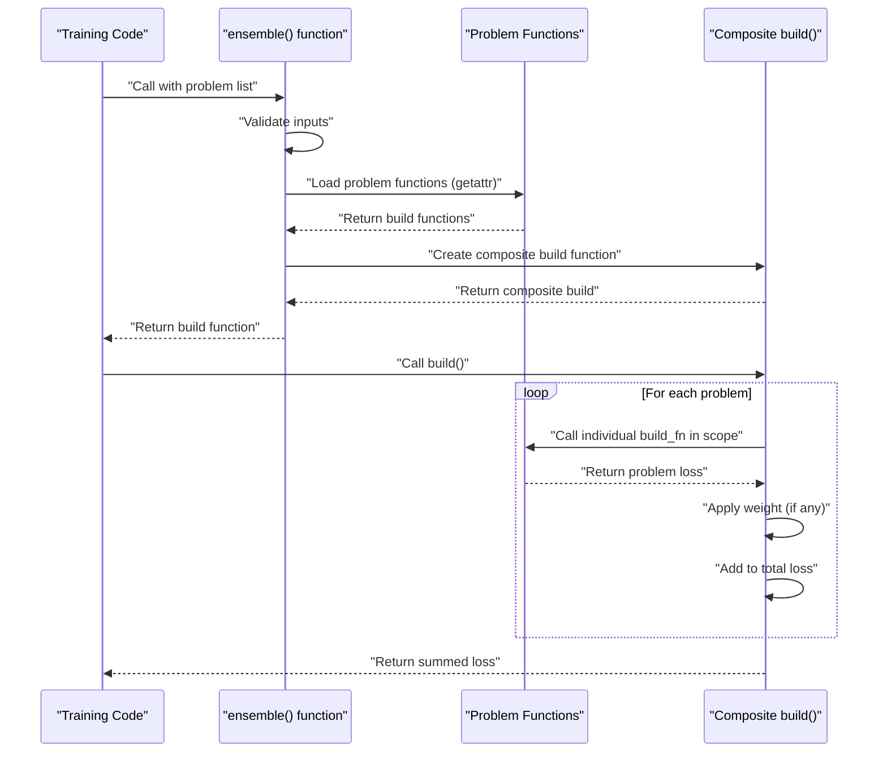
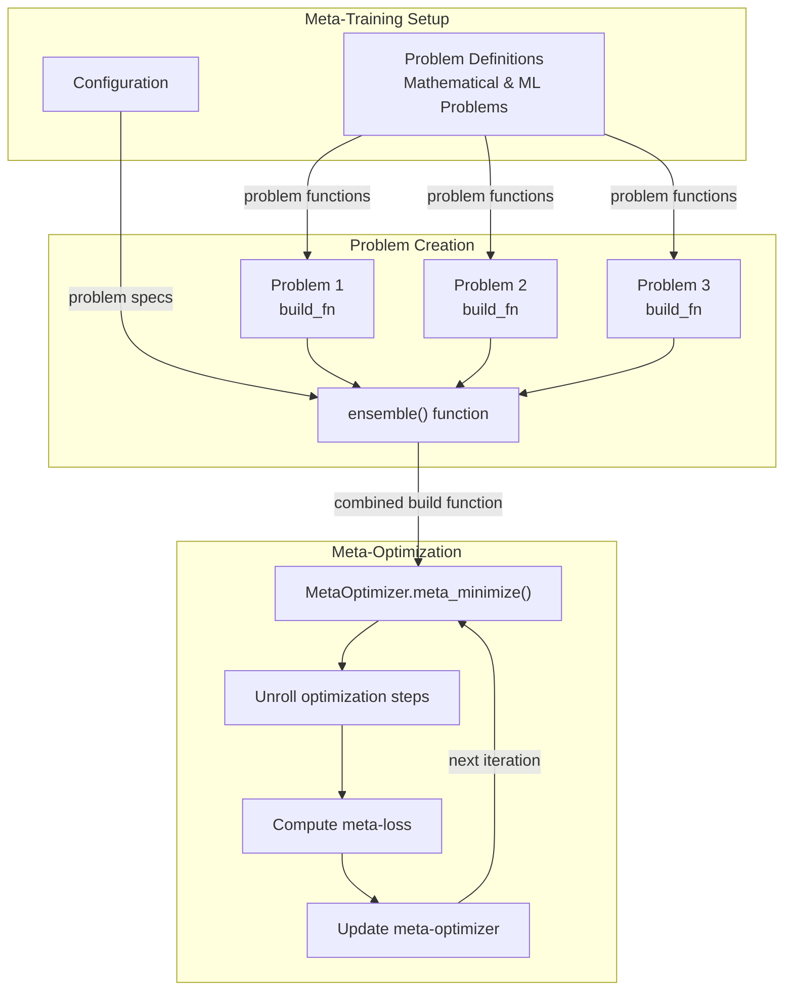

<!-- source: DeepWiki mcp.deepwiki.com · repo google-deepmind/learning-to-learn · page 2.3 Problem Ensembles · fetched 2026-10-26 -->

# Problem Ensembles

<details>
<summary>Relevant source files</summary>

The following files were used as context for generating this wiki page:

- [problems.py](problems.py)

</details>


## Purpose and Scope

This document covers Problem Ensembles in the Learning to Learn (L2L) framework. Problem Ensembles allow multiple optimization problems to be combined into a single training objective for the meta-optimizer. For information about individual problem types, see [Mathematical Problems](#2.1) and [Machine Learning Problems](#2.2).

## Overview

The Problem Ensembles functionality enables the meta-optimizer to train on multiple problem types simultaneously. By combining diverse problems into a weighted ensemble, the meta-optimizer can learn more robust optimization strategies that generalize better across different optimization landscapes.



Sources: [problems.py:102-132]()

## Implementation

The Problem Ensembles feature is implemented through the `ensemble` function in `problems.py`. This function creates a composite problem by combining multiple individual problems, each with its own configuration options and optional weight.

### Function Signature

```python
def ensemble(problems, weights=None):
    """Ensemble of problems.
    
    Args:
      problems: List of problems. Each problem is specified by a dict containing
          the keys 'name' and 'options'.
      weights: Optional list of weights for each problem.
    
    Returns:
      Sum of (weighted) losses.
    
    Raises:
      ValueError: If weights has an incorrect length.
    """
```

Sources: [problems.py:102-115]()

### Internal Architecture

The ensemble function operates by:

1. Validating input parameters
2. Dynamically loading problem functions based on their names
3. Creating problem-specific build functions with appropriate options
4. Returning a composite build function that:
   - Creates each individual problem in its own variable scope
   - Applies weights to individual losses (if specified)
   - Sums the losses to create a single optimization objective



Sources: [problems.py:116-132]()

## Variable Scoping

A key implementation detail is the use of variable scopes to manage the variables from different problems. Each problem is built within its own variable scope named `problem_{i}`, ensuring that variables from different problems don't interfere with each other.

```python
def build():
    loss = 0
    for i, build_fn in enumerate(build_fns):
      with tf.variable_scope("problem_{}".format(i)):
        loss_p = build_fn()
        if weights:
          loss_p *= weights[i]
        loss += loss_p
    return loss
```

Sources: [problems.py:122-132]()

## Usage Example

To create an ensemble of problems, you define a list of problem specifications, each containing a name and options dictionary:

```python
# Example ensemble of simple and quadratic problems
problems = [
    {
        "name": "simple",
        "options": {}
    },
    {
        "name": "quadratic",
        "options": {
            "batch_size": 64,
            "num_dims": 10
        }
    }
]

# Optional weights to prioritize problems
weights = [0.3, 0.7]  # 30% simple, 70% quadratic

# Create the ensemble
problem_fn = ensemble(problems, weights)
```

The resulting `problem_fn` can then be used with the meta-optimizer for training, just like any individual problem function.

## Problem Ensemble in the Optimization Workflow

The following diagram illustrates how Problem Ensembles fit into the overall Learning to Learn optimization workflow:



Sources: [problems.py:102-132](), [meta.py]()

## Technical Benefits of Problem Ensembles

1. **Generalization**: Meta-optimizers trained on diverse problem ensembles learn more general optimization strategies.

2. **Robustness**: Exposure to multiple optimization landscapes helps the meta-optimizer avoid overfitting to specific problem characteristics.

3. **Customization**: Weights allow emphasizing particular problem types based on their importance or difficulty.

4. **Modularity**: New problem types can be easily incorporated into existing ensembles without changing the meta-optimization architecture.

5. **Variable Management**: The variable scoping approach ensures clean separation between problems, preventing variable name collisions.

## Integration with Other Components

Problem Ensembles are designed to integrate seamlessly with the rest of the Learning to Learn framework:

| Component | Integration with Problem Ensembles |
|-----------|-----------------------------------|
| MetaOptimizer | Accepts ensemble build functions like any other problem |
| train.py | Can specify problem ensembles in training configuration |
| evaluate.py | Can evaluate meta-optimizers on ensembles or individual problems |
| Networks | Network architectures can be chosen to handle the characteristics of the problems in the ensemble |

Sources: [problems.py:102-132](), [meta.py](), [train.py](), [evaluate.py]()

## Summary

Problem Ensembles provide a powerful mechanism for combining multiple optimization problems into a unified training objective for meta-optimizers. By exposing the meta-optimizer to diverse optimization landscapes during training, ensembles help develop more robust and generalizable optimization strategies. The implementation in `problems.py` offers a clean, modular approach to creating weighted combinations of problems while maintaining proper variable separation.

---

