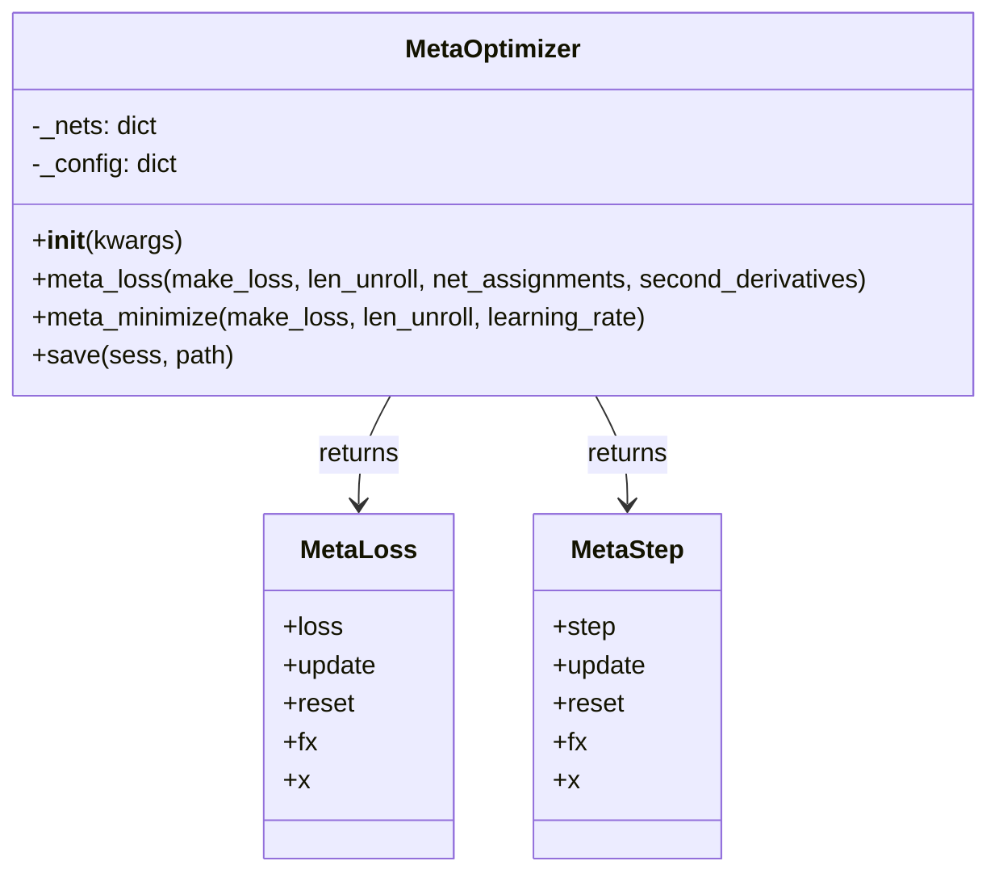
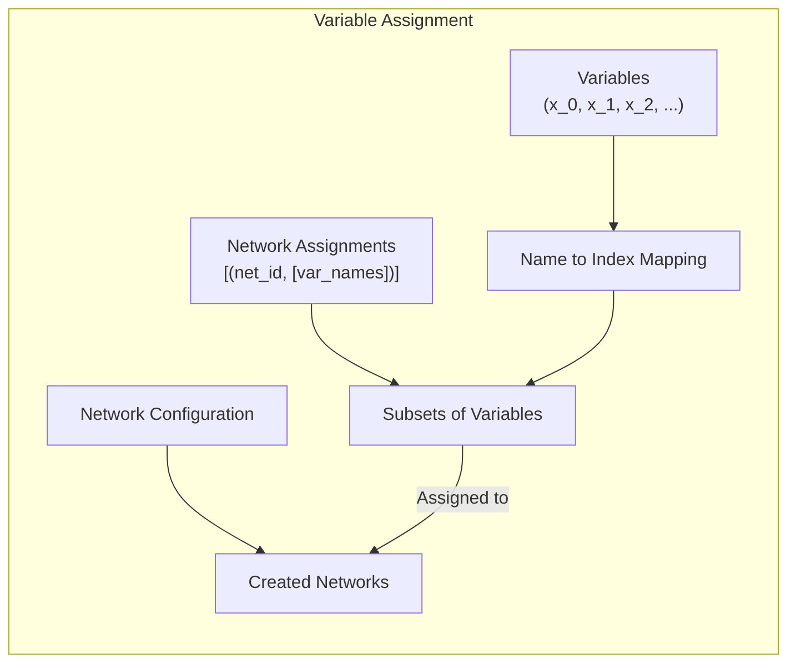
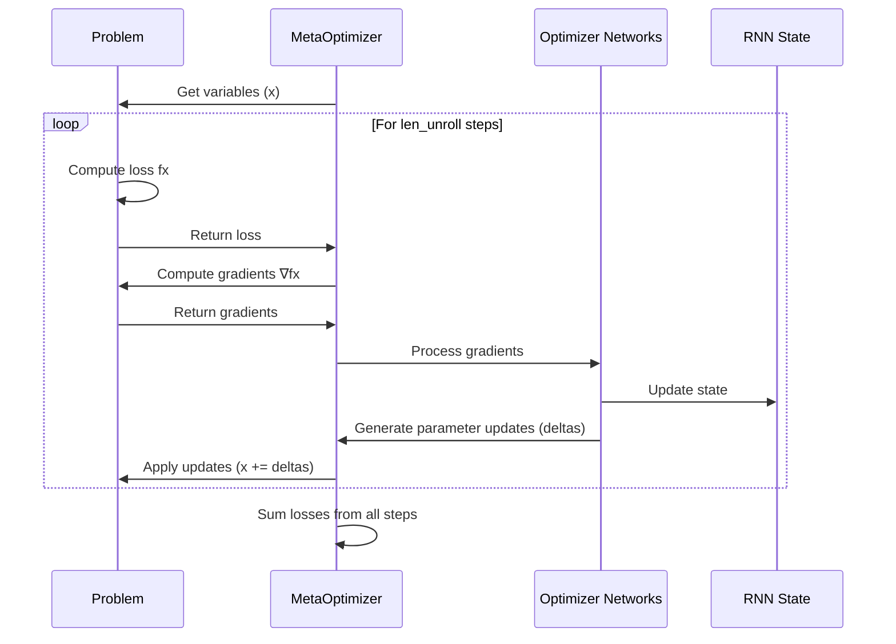

<!-- source: DeepWiki mcp.deepwiki.com · repo google-deepmind/learning-to-learn · page 3 Meta-Optimizer · fetched 2026-10-26 -->

# Meta-Optimizer

<details>
<summary>Relevant source files</summary>

The following files were used as context for generating this wiki page:

- [README.md](README.md)
- [meta.py](meta.py)
- [meta_test.py](meta_test.py)

</details>


The Meta-Optimizer is the core component of the Learning to Learn (L2L) framework that enables neural networks to learn optimization algorithms. Unlike traditional optimizers with fixed update rules (like SGD or Adam), this meta-optimizer uses recurrent neural networks to generate parameter updates by processing gradient information. For information about specific network architectures used within the meta-optimizer, see [Networks](#4).

## Purpose and Scope

This document covers:
- The design and implementation of the `MetaOptimizer` class
- Meta-loss computation and optimization process
- Network assignment mechanisms
- Saving and loading trained optimizers
- Integration with problem definitions

Sources: [meta.py:211-402](https://github.com/google-deepmind/learning-to-learn/blob/master/meta.py:211-402)

## Meta-Optimizer Architecture

The meta-optimizer implements a "learning to learn" approach where an optimizer itself is learned through gradient descent. At its core, the meta-optimizer contains neural networks (typically LSTM-based) that:
1. Take gradients as input
2. Process them through recurrent networks
3. Produce parameter updates as output

```mermaid
flowchart TD
    subgraph "Meta-Optimizer Architecture"
        MetaOpt["MetaOptimizer Class"]
        Networks["Optimizer Networks\n(CoordinateWiseDeepLSTM, etc.)"]
        State["RNN States"]
        
        MetaOpt --> Networks
        MetaOpt --> State
        
        subgraph "Optimization Process"
            Problems["Problem Definition"]
            Gradients["Gradient Calculation"]
            Updates["Parameter Updates"]
            
            Problems --> Gradients
            Gradients --> |"Processed by networks"| Updates
            Updates --> |"New variables"| Problems
        end
        
        Networks <--> "Optimization Process"
        State <--> "Optimization Process"
    end
```

The meta-optimizer maintains state between optimization steps, allowing it to adapt its behavior based on the optimization trajectory.

Sources: [meta.py:211-246](https://github.com/google-deepmind/learning-to-learn/blob/master/meta.py:211-246)

## Core Classes and Functions

### MetaOptimizer Class

The primary class is `MetaOptimizer`, which manages the optimization networks and coordinates the meta-learning process.



The constructor accepts configuration for one or more optimizer networks. If no configuration is provided, it defaults to a `CoordinateWiseDeepLSTM` network.

Sources: [meta.py:211-246](https://github.com/google-deepmind/learning-to-learn/blob/master/meta.py:211-246), [meta.py:150-152](https://github.com/google-deepmind/learning-to-learn/blob/master/meta.py:150-152)

## Meta-Loss Computation

The meta-loss is computed by unrolling the optimization process for a specified number of steps and summing the loss at each step.

```mermaid
flowchart TD
    subgraph "meta_loss Method"
        ML1["Get optimizee variables"]
        ML2["Create optimizer networks"]
        ML3["Initialize optimizer state"]
        ML4["Define unrolled optimization"]
        ML5["Define loss summation"]
        ML6["Define reset/update operations"]
        
        ML1 --> ML2
        ML2 --> ML3
        ML3 --> ML4
        ML4 --> ML5
        ML5 --> ML6
    end
    
    subgraph "Unrolled Optimization"
        UO1["Compute loss fx"]
        UO2["Compute gradients ∇fx"]
        UO3["Process gradients\nthrough network"]
        UO4["Generate parameter updates"]
        UO5["Apply updates to variables"]
        UO6["Update RNN state"]
        
        UO1 --> UO2
        UO2 --> UO3
        UO3 --> UO4
        UO4 --> UO5
        UO5 --> UO6
        UO6 --> |"Next unroll step"| UO1
    end
    
    ML4 --> Unrolled
    Unrolled["tf.while_loop"] --> "Unrolled Optimization"
```

Key components of the meta-loss computation:

1. **Variables Extraction**: The method first extracts variables from the provided loss function using `_get_variables`.
2. **Network Creation**: Optimizer networks are created based on the configuration.
3. **State Initialization**: Initial state for the RNN-based optimizers is created.
4. **Unroll Definition**: A TensorFlow while loop unrolls the optimization process.
5. **Time Step Function**: For each step, the current loss is computed, gradients are calculated, and parameter updates are generated.

Sources: [meta.py:261-384](https://github.com/google-deepmind/learning-to-learn/blob/master/meta.py:261-384)

## Meta-Minimize Operation

The `meta_minimize` method creates an operation that minimizes the meta-loss, effectively training the meta-optimizer itself.

```python
def meta_minimize(self, make_loss, len_unroll, learning_rate=0.01, **kwargs):
    """Returns an operator minimizing the meta-loss."""
    info = self.meta_loss(make_loss, len_unroll, **kwargs)
    optimizer = tf.train.AdamOptimizer(learning_rate)
    step = optimizer.minimize(info.loss)
    return MetaStep(step, *info[1:])
```

This method:
1. Computes the meta-loss using `meta_loss`
2. Creates an Adam optimizer to minimize this loss
3. Returns a `MetaStep` namedtuple containing operations for the optimization process

Sources: [meta.py:386-402](https://github.com/google-deepmind/learning-to-learn/blob/master/meta.py:386-402)

## Network Assignments

The meta-optimizer supports assigning different subsets of variables to different optimizer networks. This allows specialized optimization strategies for different parts of a model.



The assignment logic is implemented in the `_make_nets` function, which:
1. Creates a mapping from variable names to indices
2. Constructs optimizer networks according to configuration
3. Groups variables into subsets assigned to each network

Sources: [meta.py:154-208](https://github.com/google-deepmind/learning-to-learn/blob/master/meta.py:154-208)

## Optimization Flow

The optimization process works through the following steps:



During training, the meta-optimizer's own parameters are updated using the accumulated loss across all unrolled steps.

Sources: [meta.py:326-348](https://github.com/google-deepmind/learning-to-learn/blob/master/meta.py:326-348)

## Saving and Loading Trained Optimizers

The `MetaOptimizer` provides a `save` method to persist trained optimizer networks:

```python
def save(self, sess, path=None):
    """Save meta-optimizer."""
    result = {}
    for k, net in self._nets.items():
        if path is None:
            filename = None
            key = k
        else:
            filename = os.path.join(path, "{}.l2l".format(k))
            key = filename
        net_vars = networks.save(net, sess, filename=filename)
        result[key] = net_vars
    return result
```

This allows trained optimizers to be saved and later loaded for use on new problems.

Sources: [meta.py:247-260](https://github.com/google-deepmind/learning-to-learn/blob/master/meta.py:247-260)

## Usage Example

The meta-optimizer is typically used in the following way:

1. **Create a problem definition**:
   ```python
   def problem_fn():
       x = tf.get_variable("x", shape=[], initializer=tf.ones_initializer())
       return x * x  # Simple quadratic function
   ```

2. **Create and configure a meta-optimizer**:
   ```python
   optimizer = meta.MetaOptimizer(
       net={
           "net": "CoordinateWiseDeepLSTM",
           "net_options": {
               "layers": (20, 20),
               "preprocess_name": "LogAndSign",
               "preprocess_options": {"k": 5},
               "scale": 0.01,
           }
       }
   )
   ```

3. **Create optimization operations**:
   ```python
   minimize_ops = optimizer.meta_minimize(
       make_loss=problem_fn,
       len_unroll=20,
       learning_rate=0.01
   )
   ```

4. **Train the meta-optimizer**:
   ```python
   with tf.Session() as sess:
       sess.run(tf.global_variables_initializer())
       for _ in range(num_epochs):
           sess.run(minimize_ops.reset)
           for _ in range(num_unrolls):
               cost, _, _ = sess.run([minimize_ops.fx, minimize_ops.update, minimize_ops.step])
   ```

5. **Save the trained optimizer**:
   ```python
   optimizer.save(sess, "./trained_optimizer")
   ```

Sources: [meta_test.py:34-44](https://github.com/google-deepmind/learning-to-learn/blob/master/meta_test.py:34-44), [README.md:63-74](https://github.com/google-deepmind/learning-to-learn/blob/master/README.md:63-74)

## Integration with Problem Definitions

The meta-optimizer is designed to work with any differentiable optimization problem. The repository includes several problem definitions in `problems.py`, which can be used with the meta-optimizer:

| Problem Type | Description | Variable Structure |
|--------------|-------------|-------------------|
| Simple | One-variable quadratic function | Single scalar variable |
| Simple-multi | Two-variable quadratic function | Two scalar variables |
| Quadratic | Batched multi-variable quadratic | Vector variables |
| MNIST | MNIST classification | Neural network parameters |
| CIFAR | CIFAR10 classification | CNN parameters |

The problem definition provides a loss function that the meta-optimizer learns to minimize.

Sources: [README.md:49-74](https://github.com/google-deepmind/learning-to-learn/blob/master/README.md:49-74)

## Second-Order Derivatives

The meta-optimizer supports using second-order derivatives through the loss function. This can be enabled with the `second_derivatives` parameter in the `meta_loss` method.

```python
# Stopping the gradient here corresponds to what was done in the
# original L2L NIPS submission. However it looks like things like
# BatchNorm, etc. don't support second-derivatives so we still need
# this term.
if not second_derivatives:
    gradients = [tf.stop_gradient(g) for g in gradients]
```

This can potentially improve the meta-optimizer's performance, but may not be compatible with all operations used in the loss function.

Sources: [meta.py:310-318](https://github.com/google-deepmind/learning-to-learn/blob/master/meta.py:310-318)

---

