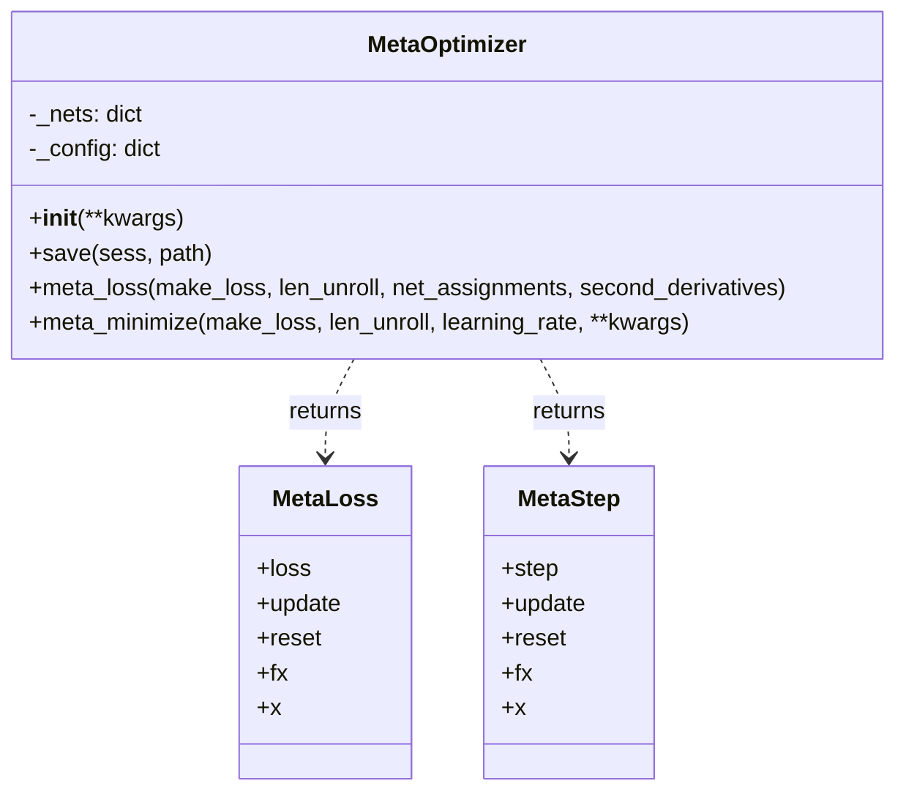
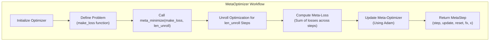
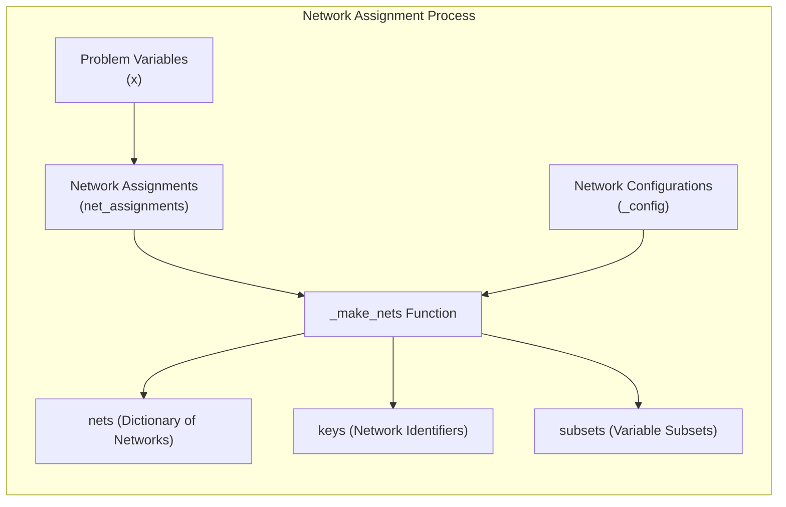
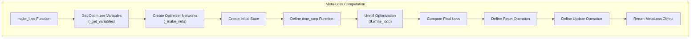
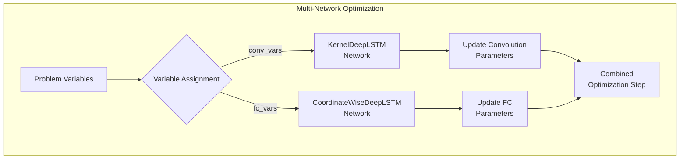
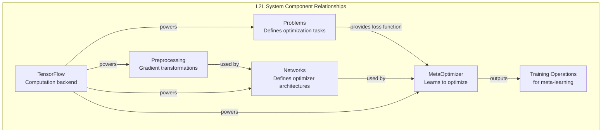

<!-- source: DeepWiki mcp.deepwiki.com · repo google-deepmind/learning-to-learn · page 3.1 MetaOptimizer Class · fetched 2026-10-26 -->

# MetaOptimizer Class

<details>
<summary>Relevant source files</summary>

The following files were used as context for generating this wiki page:

- [meta.py](meta.py)
- [meta_test.py](meta_test.py)

</details>


The `MetaOptimizer` class is a core component of the Learning to Learn (L2L) framework that enables meta-learning for optimization. It implements an optimizer which has an internal recurrent neural network (RNN) that takes the gradient of the function being minimized as input and returns a step direction. This optimizer can be trained to learn effective optimization strategies across a set of tasks.

For general information about the Learning to Learn concept, see [Learning to Learn Concept](#1.1). For details about the network architectures used by the meta-optimizer, see [Networks](#4).

## Class Overview

The `MetaOptimizer` class provides mechanisms to:

1. Define and configure optimization networks
2. Compute meta-losses for training the optimizer
3. Unroll optimization paths to enable learning from optimization trajectories
4. Save and load trained optimizers



Sources: [meta.py:211-219](). [meta.py:150-151]()

## Constructor

The `MetaOptimizer` is initialized with network configurations that define how the optimizer will work:

```python
def __init__(self, **kwargs):
    """Creates a MetaOptimizer.

    Args:
      **kwargs: A set of keyword arguments mapping network identifiers (the
          keys) to parameters that will be passed to networks.Factory (see docs
          for more info).  These can be used to assign different optimizee
          parameters to different optimizers (see net_assignments in the
          meta_loss method).
    """
```

If no kwargs are provided, it uses a default CoordinateWiseDeepLSTM network with LogAndSign preprocessing.

Sources: [meta.py:220-246]()

## Core Workflow

The meta-optimizer operates by unrolling optimization steps for a given problem, computing the loss at each step, and then optimizing itself to improve this optimization trajectory.



Sources: [meta.py:386-402](), [meta.py:261-384]()

## Network Configuration and Assignment

The `MetaOptimizer` can use different network architectures for different variables in the optimization problem. This is configured through the constructor and the `net_assignments` parameter in `meta_loss` or `meta_minimize`.



Sources: [meta.py:154-208]()

### Network Assignment Examples

| Assignment Type | Description | Configuration Example |
|----------------|-------------|------------------------|
| Default | Single network for all variables | `None` (uses single network in config) |
| Explicit Sharing | Explicitly assign variables to one network | `[("net", ["x_0", "x_1"])]` |
| Multiple Networks | Different networks for different variables | `[("net1", ["x_0"]), ("net2", ["x_1"])]` |
| Overlapping | Multiple networks optimizing same variable | `[("net1", ["x_0"]), ("net2", ["x_0"])]` |

Sources: [meta_test.py:71-117](), [meta_test.py:118-126]()

## Meta-Loss Computation

The `meta_loss` method is a central component that computes the loss used to train the meta-optimizer itself:

```python
def meta_loss(self, make_loss, len_unroll, net_assignments=None, 
              second_derivatives=False):
    """Returns an operator computing the meta-loss."""
    # Implementation details...
    return MetaLoss(loss, update, reset, fx_final, x_final)
```

The method unrolls optimization for `len_unroll` steps and computes the sum of losses across these steps.



Sources: [meta.py:261-384]()

### Optimization Unrolling Process

The unrolling process is a key aspect of the meta-optimization. Here's how it works:

1. For each time step:
   - Compute the current loss value
   - Calculate gradients with respect to optimizee variables
   - Apply the optimizer networks to compute parameter updates
   - Update variables and optimizer state
   - Move to next time step

2. After unrolling:
   - Compute the final loss
   - Sum losses across all steps to get the meta-loss
   - Provide operations to update variables and reset state

Sources: [meta.py:326-358]()

## Meta-Minimize Operation

The `meta_minimize` method creates an operation to minimize the meta-loss:

```python
def meta_minimize(self, make_loss, len_unroll, learning_rate=0.01, **kwargs):
    """Returns an operator minimizing the meta-loss."""
    # Implementation details...
    return MetaStep(step, *info[1:])
```

This method:
1. Computes the meta-loss using `meta_loss`
2. Creates an Adam optimizer with the specified learning rate
3. Sets up a minimization operation for the meta-loss
4. Returns a `MetaStep` namedtuple containing the step operation and other information

Sources: [meta.py:386-402]()

## Training with the MetaOptimizer

To train a model using the meta-optimizer, you need to:

1. Create an instance of `MetaOptimizer` with desired network configurations
2. Define a loss function for your problem
3. Call `meta_minimize` to get operations for the training loop
4. Execute the operations in a TensorFlow session

```python
optimizer = meta.MetaOptimizer(net=dict(...))  # Configure networks
minimize_ops = optimizer.meta_minimize(make_loss, len_unroll=20)
step, update, reset, loss_last, x_last = minimize_ops

# In training loop:
sess.run(reset)  # Reset optimizer state at beginning of epoch
for _ in range(num_unrolls):
    cost, final_x, _, _ = sess.run([loss_last, x_last, update, step])
```

Sources: [meta_test.py:34-44]()

## Saving and Loading

The `MetaOptimizer` provides a `save` method to persist trained optimizer networks:

```python
def save(self, sess, path=None):
    """Save meta-optimizer."""
    # Implementation details...
    return result
```

This method saves each optimizer network to a file or returns the network variables, allowing you to reload the optimizer later.

Sources: [meta.py:247-259](), [meta_test.py:190-236]()

## Advanced Usage: Multiple Networks

One of the powerful features of the `MetaOptimizer` is its ability to use different optimization networks for different parts of a model. This is particularly useful for complex models with different types of parameters (e.g., convolutional kernels vs. fully connected weights).



Example configuration for a model with convolutional and fully-connected layers:

```python
net_config = {
    "conv": {
        "net": "KernelDeepLSTM",
        "net_options": {"kernel_shape": [4, 4], "layers": (5,)},
    },
    "fc": {
        "net": "CoordinateWiseDeepLSTM",
        "net_options": {"layers": (20, 20)},
    },
}

net_assignments = [
    ("conv", ["conv_layer/w"]),
    ("fc", ["fc_layer/w", "fc_layer/b"])
]

optimizer = meta.MetaOptimizer(**net_config)
minimize_ops = optimizer.meta_minimize(problem, len_unroll=20, 
                                      net_assignments=net_assignments)
```

Sources: [meta_test.py:140-167](), [meta.py:154-208]()

## Implementation Details

The `MetaOptimizer` uses several helper functions to manage variable creation, tracking, and assignment:

- `_nested_assign`: Creates nested collections of TensorFlow assign operations
- `_nested_variable`: Creates nested collections of TensorFlow variables
- `_wrap_variable_creation`: Provides a custom getter for variable creation
- `_get_variables`: Extracts trainable and non-trainable variables from a function
- `_make_with_custom_variables`: Calls a function with custom variable replacement
- `_make_nets`: Creates optimizer networks and assigns variables to them

These functions enable the meta-optimizer to track and manipulate the variables being optimized during the unrolling process.

Sources: [meta.py:35-208]()

## Relationship to Other Components

The `MetaOptimizer` is a central component in the Learning to Learn (L2L) system, interacting with several other components:



Sources: [meta.py:32](), [meta.py:27]()

For more information about the different types of optimizer networks, see [LSTM-Based Networks](#4.1) and [Standard Optimizers](#4.2). For details on how to train and evaluate meta-optimizers, see [Training Workflow](#6.1) and [Evaluation Methods](#6.2).

---

