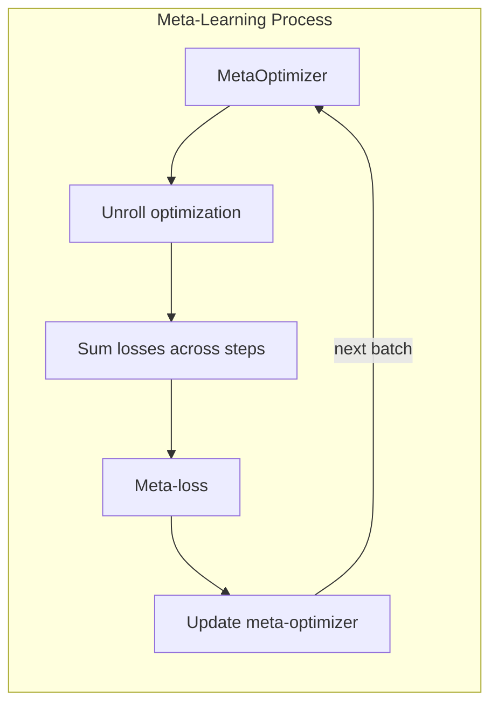
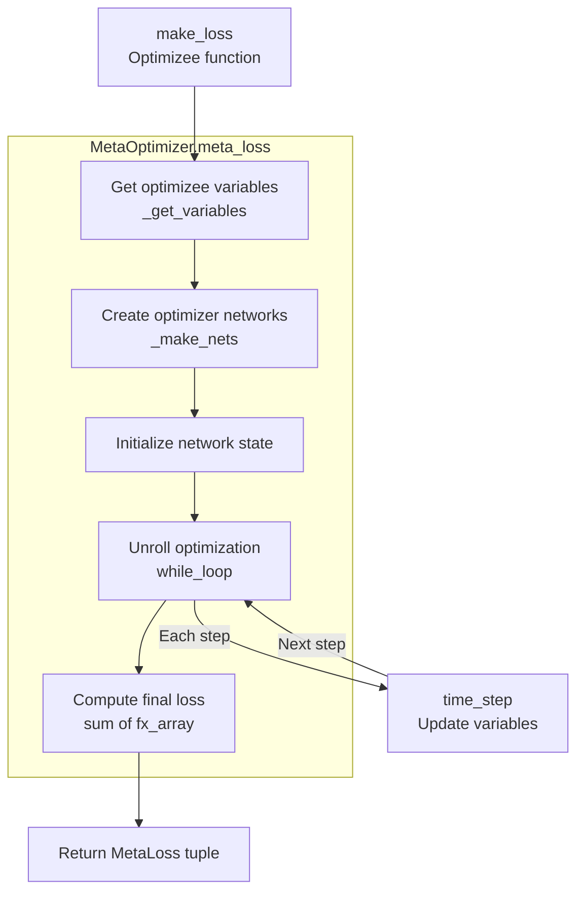
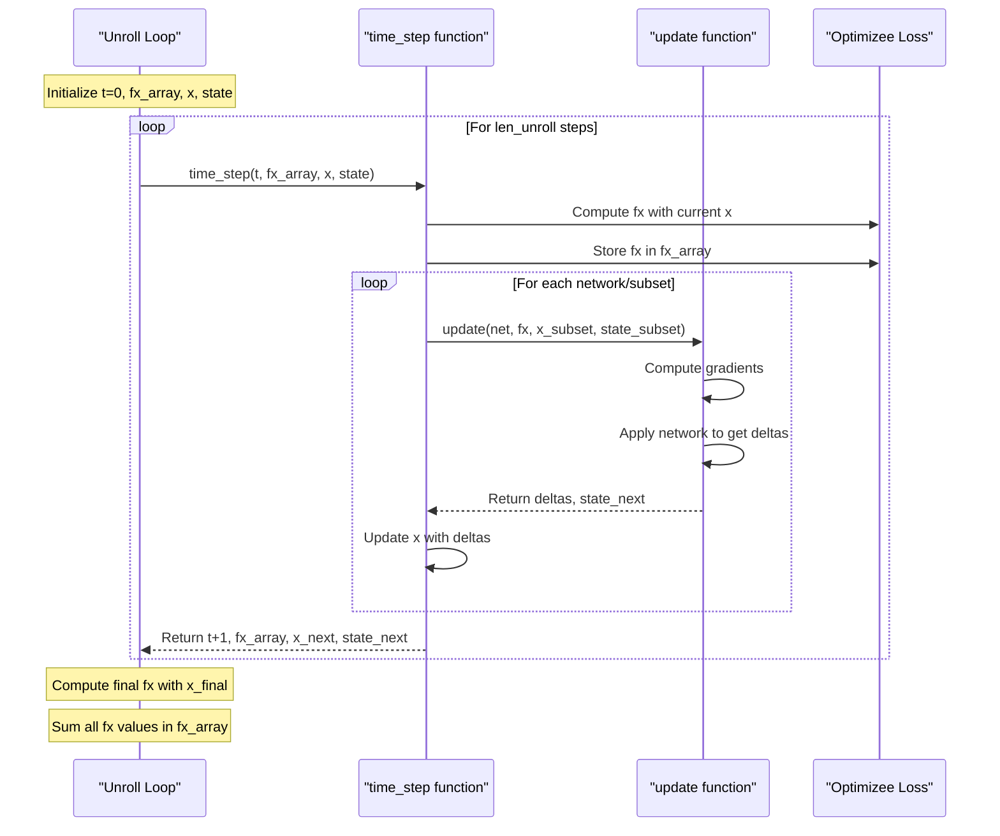
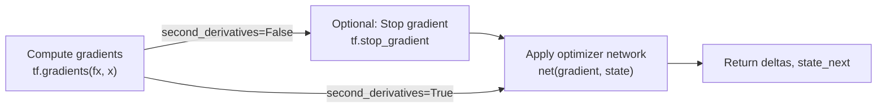
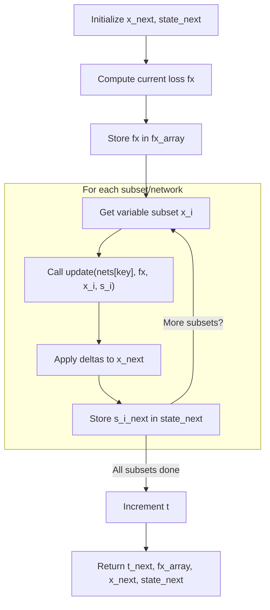
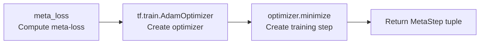
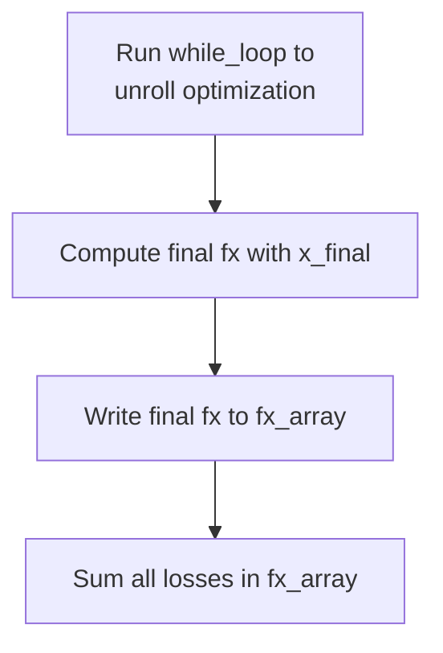
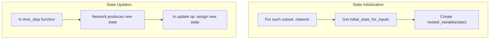
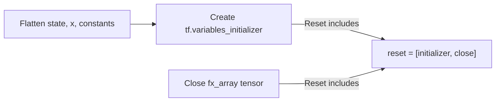

<!-- source: DeepWiki mcp.deepwiki.com · repo google-deepmind/learning-to-learn · page 3.2 Meta-Loss Computation · fetched 2026-10-26 -->

# Meta-Loss Computation

Relevant source files

The following files were used as context for generating this wiki page:

- [meta.py](meta.py)

## Purpose and Scope

This document explains how meta-loss is computed within the Learning to Learn (L2L) framework. Meta-loss is the core evaluation mechanism that enables the meta-optimizer to learn effective optimization strategies. This page covers the computation process, unrolling optimization steps, and how the resulting loss is used to train the meta-optimizer. For details about the MetaOptimizer class architecture, see [MetaOptimizer Class](#3.1), and for network assignments, see [Network Assignments](#3.3).

## Meta-Loss Concept

Meta-loss represents the cumulative performance of an optimizer across multiple optimization steps. Unlike traditional optimization where the loss function directly evaluates a model, meta-loss evaluates how well an optimizer performs by measuring the sum of losses across a series of optimization steps.

**Sources**: [meta.py:261-384]()

## Meta-Loss Computation Architecture

The `meta_loss` method in the `MetaOptimizer` class implements the meta-loss computation. It simulates running an optimizer for a specified number of steps (unrolling) and computes the sum of losses across these steps.

**Sources**: [meta.py:261-266](), [meta.py:349-364]()

## MetaLoss Components

The `meta_loss` method returns a `MetaLoss` named tuple with the following components:

| Component | Purpose |
|-----------|---------|
| `loss`    | The computed meta-loss (sum of losses across unrolled steps) |
| `update`  | Operations to update parameters and RNN state during an epoch |
| `reset`   | Operations to reset the state at the beginning of an epoch |
| `fx_final` | The final loss value after unrolling |
| `x_final` | The final optimizee variables after unrolling |

This structure encapsulates both the evaluation metric (loss) and the operations needed to manage the optimization state.

**Sources**: [meta.py:150](), [meta.py:384]()

## Unrolling the Optimization Process

The meta-loss is computed by unrolling (simulating) multiple optimization steps. This is implemented using TensorFlow's `while_loop` operation, which repeatedly applies the `time_step` function for a specified number of steps.

**Sources**: [meta.py:302-347](), [meta.py:349-364]()

## Parameter and State Updates

The update mechanism consists of two key functions:

1. `update` function: Computes gradient updates for a subset of variables using the corresponding optimizer network.
2. `time_step` function: Coordinates the updates for all variable subsets in one optimization step.

### Update Function Details

**Sources**: [meta.py:308-323]()

### Time Step Function Details

**Sources**: [meta.py:326-347]()

## Integration with Meta-Minimization

The `meta_minimize` method uses the computed meta-loss to create an optimization step that updates the meta-optimizer itself. It applies the Adam optimizer to minimize the meta-loss.

**Sources**: [meta.py:386-402]()

## Computing the Final Meta-Loss

The final meta-loss is computed as the sum of all loss values across the unrolled steps. The last step is to compute the final loss using the final variable values and add it to the accumulated losses.

**Sources**: [meta.py:350-364]()

## Implementation Details

### State Management

The state for each optimizer network is created as a nested structure of non-trainable variables. The initial state is determined by the network based on the input variables.

**Sources**: [meta.py:298-306](), [meta.py:376-377]()

### Reset Operations

The reset operations initialize all variables and states at the beginning of each epoch.

**Sources**: [meta.py:367-371]()

## Conclusion

Meta-loss computation is the core mechanism that enables the Learning to Learn framework to train meta-optimizers. By unrolling multiple optimization steps and computing the sum of losses, the system can evaluate and improve the performance of the meta-optimizer itself. The implementation carefully manages the state of optimizer networks and provides operations for updating, resetting, and evaluating the optimization process.

---

