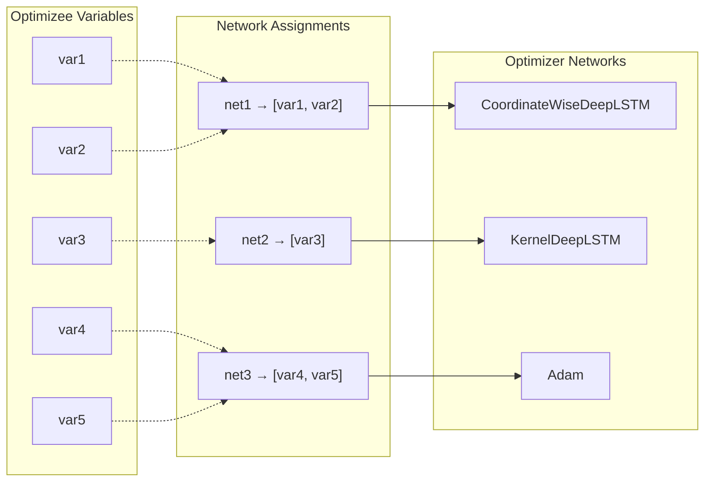
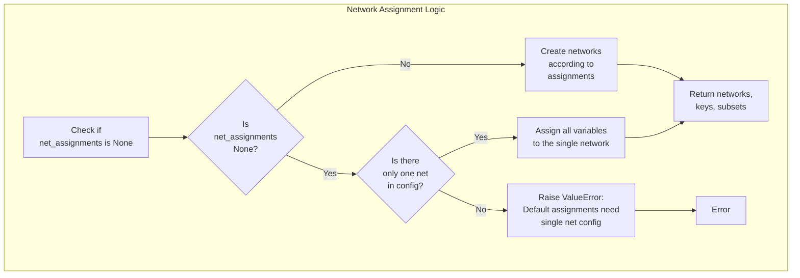
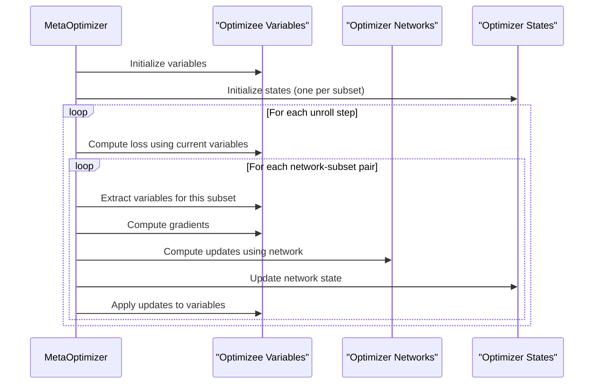

<!-- source: DeepWiki mcp.deepwiki.com · repo google-deepmind/learning-to-learn · page 3.3 Network Assignments · fetched 2026-10-26 -->

# Network Assignments

<details>
<summary>Relevant source files</summary>

The following files were used as context for generating this wiki page:

- [meta.py](meta.py)
- [meta_test.py](meta_test.py)

</details>


## Purpose and Scope

This page documents the network assignment feature in the Learning to Learn (L2L) framework. Network assignments enable the mapping of different variables in an optimization problem to specific meta-optimizer networks. This allows for specialized optimization strategies for different parts of a model, such as using different optimizers for weights versus biases, or specialized optimizers for convolutional layers.

For information about the optimization networks themselves, see [Networks](#4). For details about meta-loss computation, see [Meta-Loss Computation](#3.2).

## Network Assignment Concept

Network assignments provide a mechanism to map specific variables to specific optimizer networks during meta-learning. This allows for a more flexible optimization approach where different parts of a model can be optimized using different strategies.



Sources: [meta.py:154-208](), [meta.py:261-266]()

## Network Assignment Structure

### Format and Specification

Network assignments are specified as a list of tuples, where each tuple contains:
1. A network identifier (key in the optimizer configuration)
2. A list of variable names to assign to that network

```
net_assignments = [
    ("net1", ["var1", "var2"]),
    ("net2", ["var3", "var4"])
]
```

The network identifier must correspond to a key in the configuration dictionary provided during the `MetaOptimizer` instantiation.

Sources: [meta.py:154-176](), [meta.py:261-266]()

### Default Behavior

If `net_assignments` is not specified (set to `None`), all variables are optimized by a single network. This requires that only one network is defined in the configuration dictionary.



Sources: [meta.py:179-191]()

## Implementation Details

### Variable-to-Network Mapping

The system creates a dictionary mapping variable names to their indices in the variable list. This allows for efficient lookup when creating the variable subsets for each network.

```python
name_to_index = dict((v.name.split(":")[0], i) for i, v in enumerate(variables))
```

For each network assignment:
1. A network is created using the specified configuration
2. Variable indices are collected based on the provided names
3. Network keys and variable subsets are stored for use during optimization

Sources: [meta.py:176-204]()

### Optimization Workflow with Multiple Networks

During optimization, each network is applied only to its assigned subset of variables:



Sources: [meta.py:300-347]()

## Example Use Cases

### Basic Variable Assignment

This example shows how to assign different variables to different optimizers:

| Network ID | Network Type | Variables Assigned |
|------------|--------------|-------------------|
| net1 | CoordinateWiseDeepLSTM | x_0 |
| net2 | Adam | x_1 |

```python
net_assignments = [("net1", ["x_0"]), ("net2", ["x_1"])]
net_config = {
    "net1": {
        "net": "CoordinateWiseDeepLSTM",
        "net_options": {"layers": (1,)}
    },
    "net2": {"net": "Adam"}
}
```

Sources: [meta_test.py:92-102]()

### Convolutional Network Optimization

This example shows how to assign a kernel-specific optimizer to convolutional weights:

```python
net_config = {
    "conv": {
        "net": "KernelDeepLSTM",
        "net_options": {
            "kernel_shape": [kernel_shape] * 2,
            "layers": (5,)
        },
    },
}
net_assignments = [("conv", ["conv/w"])]
```

Sources: [meta_test.py:140-167]()

### Shared Optimization

Multiple variables can be assigned to the same optimizer network:

```python
net_assignments = [("net", ["x_0", "x_1"])]
```

Sources: [meta_test.py:83-91]()

## Network Assignment in Meta-Loss Computation

The `meta_loss` method of the `MetaOptimizer` class accepts network assignments as a parameter and passes them to the `_make_nets` function:

```python
def meta_loss(self, make_loss, len_unroll, net_assignments=None, second_derivatives=False):
    # ...
    nets, net_keys, subsets = _make_nets(x, self._config, net_assignments)
    # ...
```

During optimization, the time step function iterates through each network-subset pair and applies the appropriate updates:

```python
for subset, key, s_i in zip(subsets, net_keys, state):
    x_i = [x[j] for j in subset]
    deltas, s_i_next = update(nets[key], fx, x_i, s_i)
    
    for idx, j in enumerate(subset):
        x_next[j] += deltas[idx]
    state_next.append(s_i_next)
```

Sources: [meta.py:292-345]()

## Debugging and Inspection

The system prints information about network assignments during setup to help with debugging:

```
Net: {key}, Subset: {subset}
```

This output shows which network is assigned to which subset of variables.

Sources: [meta.py:204]()

---

