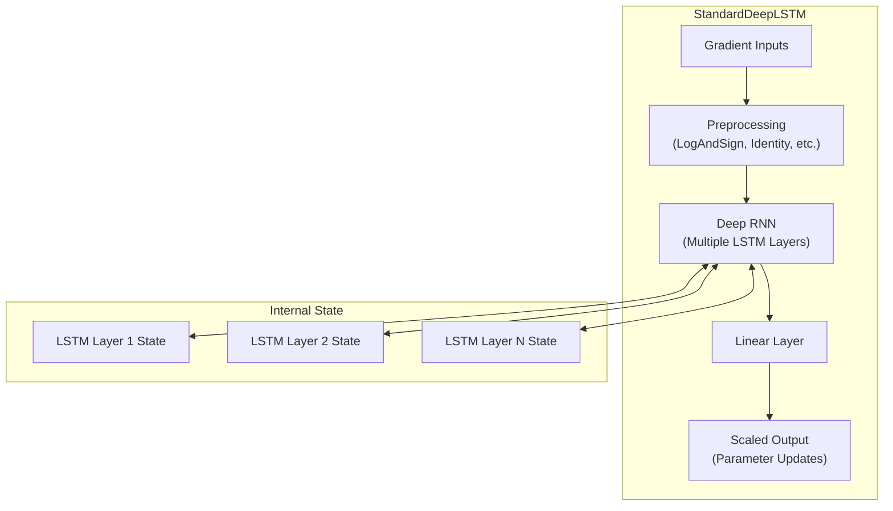
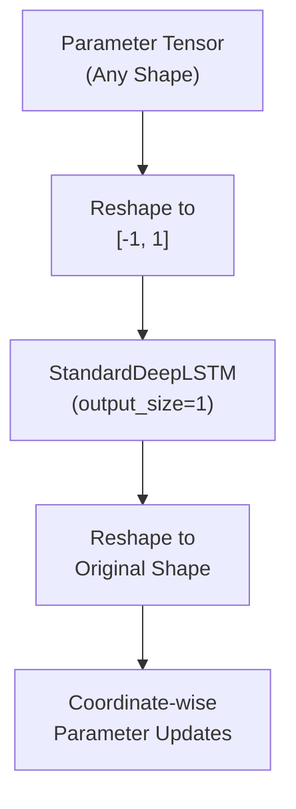
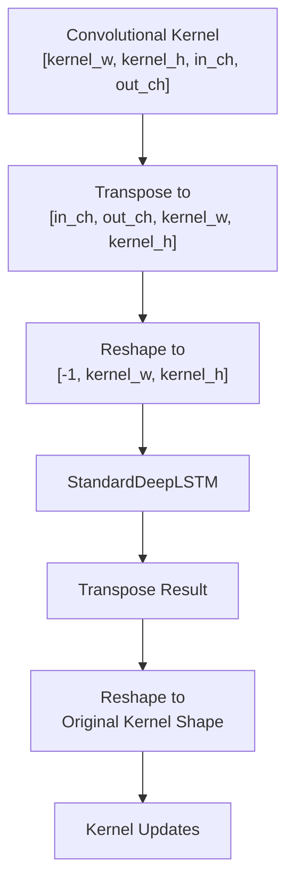
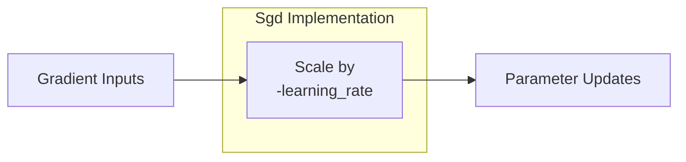
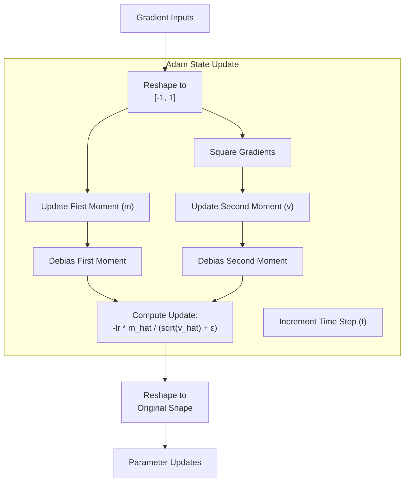
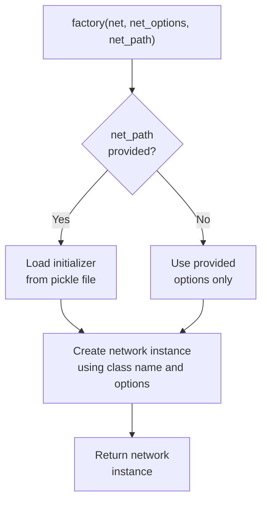
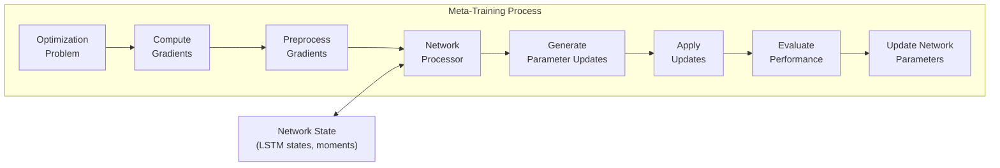

<!-- source: DeepWiki mcp.deepwiki.com · repo google-deepmind/learning-to-learn · page 4 Networks · fetched 2026-10-26 -->

# Networks

<details>
<summary>Relevant source files</summary>

The following files were used as context for generating this wiki page:

- [networks.py](networks.py)
- [networks_test.py](networks_test.py)

</details>


This document explains the network architectures used in the Learning to Learn (L2L) system. These networks function as meta-optimizers that learn to optimize neural networks and other differentiable systems. The networks defined here form a crucial part of the meta-optimization process by transforming gradients into parameter updates.

For information about how these networks are used within the meta-optimizer framework, see [Meta-Optimizer](#3).

Sources: [networks.py:15-16]()

## Network Architecture Overview

The network components in L2L are designed to learn optimization strategies through a recurrent architecture, primarily using LSTMs. These networks process gradients and produce updates for the optimizee parameters.

```mermaid
classDiagram
    class "Network" {
        <<abstract>>
        +initial_state_for_inputs(inputs)
        +__call__(inputs, state)
    }
    
    class "StandardDeepLSTM" {
        +output_size
        +layers
        +scale
        +_preprocess
        +_cores
        +_rnn
        +_linear
    }
    
    class "CoordinateWiseDeepLSTM" {
        <<Processes each coordinate independently>>
        +_reshape_inputs(inputs)
    }
    
    class "KernelDeepLSTM" {
        <<For convolutional kernels>>
        +_kernel_shape
        +_reshape_inputs(inputs)
    }
    
    class "StandardOptimizer" {
        <<Fixed update rules>>
    }
    
    class "Sgd" {
        -_learning_rate
    }
    
    class "Adam" {
        -_learning_rate
        -_beta1
        -_beta2
        -_epsilon
    }
    
    Network <|-- StandardDeepLSTM
    Network <|-- Sgd
    Network <|-- Adam
    
    StandardDeepLSTM <|-- CoordinateWiseDeepLSTM
    StandardDeepLSTM <|-- KernelDeepLSTM
    
    note for StandardDeepLSTM "Multi-layer LSTM with linear output"
    note for CoordinateWiseDeepLSTM "Applied to each parameter independently"
    note for KernelDeepLSTM "Handles convolutional filter structure"
    note for Sgd "Basic gradient descent implementation"
    note for Adam "Adaptive moment estimation"
```

Sources: [networks.py:65-377]()

## Network Base Class

All network architectures inherit from the abstract `Network` class, which is built on top of Sonnet's `RNNCore`. This base class defines the interface that all optimizers must implement.

```mermaid
classDiagram
    class "snt.RNNCore" {
        <<sonnet base class>>
    }
    
    class "Network" {
        <<abstract>>
        +initial_state_for_inputs(inputs, **kwargs)* abstract
        +__call__(inputs, prev_state)
    }
    
    snt.RNNCore <|-- Network
    
    note for Network "Base class requiring state initialization method"
```

The `Network` class requires implementations to:
1. Process inputs (typically gradients)
2. Maintain and update an internal state
3. Produce outputs (parameter updates)

Sources: [networks.py:65-72]()

## LSTM-Based Networks

### StandardDeepLSTM

`StandardDeepLSTM` is the primary LSTM-based network used for meta-optimization. It consists of multiple LSTM layers followed by a linear output layer.



Key components:
- Multiple LSTM layers with configurable sizes
- Optional gradient preprocessing
- Linear output layer
- Scaling factor for outputs

The network is constructed with the following parameters:
- `output_size`: Output dimensions of the final linear layer
- `layers`: A tuple specifying the size of each LSTM layer
- `preprocess_name`: The preprocessing method (defaults to "identity")
- `scale`: Scaling factor for the output gradients

Sources: [networks.py:154-217]()

### CoordinateWiseDeepLSTM

`CoordinateWiseDeepLSTM` extends `StandardDeepLSTM` to process each parameter coordinate independently, allowing the network to learn parameter-specific update rules.



This network:
1. Reshapes the input tensor to process each parameter independently
2. Applies the same LSTM to each parameter
3. Reshapes the output back to the original tensor shape

This approach enables:
- Parameter-independent processing
- Invariance to parameter tensor shapes
- Scalability to different model sizes

Sources: [networks.py:220-257]()

### KernelDeepLSTM

`KernelDeepLSTM` is specialized for convolutional neural networks, handling the specific structure of convolutional kernels.



This network:
- Preserves the spatial structure of convolutional kernels
- Transforms 4D convolutional kernels to be processed by the LSTM
- Handles the specific requirements of updating CNN parameters

Sources: [networks.py:260-308]()

## Standard Optimizers

The L2L framework also includes implementations of standard optimization algorithms. These serve both as baselines for comparison and as potential components in hybrid optimization approaches.

### SGD Optimizer

`Sgd` implements standard stochastic gradient descent with a configurable learning rate.



The SGD optimizer:
- Simply scales gradients by a negative learning rate
- Maintains no internal state
- Provides a baseline for comparing learned optimizers

Sources: [networks.py:311-328]()

### Adam Optimizer

`Adam` implements the Adam optimization algorithm, which adapts learning rates based on first and second moments of gradients.



The Adam optimizer:
- Maintains running averages of first and second moments
- Applies bias correction to these moments
- Computes updates using adaptive learning rates
- Provides a strong baseline optimizer

Sources: [networks.py:339-377]()

## Network Factory and Utilities

The `factory` function provides a convenient way to instantiate network architectures. It can also load pre-trained networks from saved files.



The networks module also includes a `save` function for saving trained networks, which:
- Collects all variables in the network
- Organizes them by module and variable name
- Saves them to a pickle file

These utility functions enable:
- Easy network creation and configuration
- Loading pre-trained optimizers
- Saving optimizer states for later use

Sources: [networks.py:34-62]()

## Using Networks in the L2L Framework

Networks are used by the `MetaOptimizer` (detailed in [MetaOptimizer Class](#3.1)) to generate parameter updates during both meta-training and meta-testing phases.



During meta-training:
1. The network processes gradients and generates parameter updates
2. These updates are applied to the optimizee
3. The performance of the updates is measured
4. The network itself is updated to improve its optimization capabilities

During meta-testing or deployment:
1. The trained network processes gradients
2. It generates parameter updates based on its learned optimization strategy
3. These updates are applied to new optimization problems

Sources: [networks.py:15-16](), [networks.py:65-72]()

## Integration with Preprocessing

Networks typically work with preprocessed gradients. The main preprocessing technique is `LogAndSign`, which is implemented in the `preprocess.py` module (see [Preprocessing](#5)). This preprocessing:

1. Transforms the magnitude of gradients with a logarithmic scale
2. Preserves the sign information
3. Makes gradient distributions more suitable for processing by LSTM networks

The preprocessing is specified during network initialization and is applied automatically before the gradient input reaches the LSTM layers.

Sources: [networks.py:177-183]()

---

