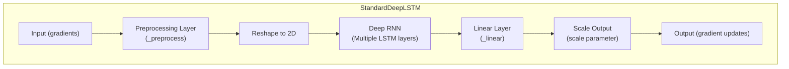
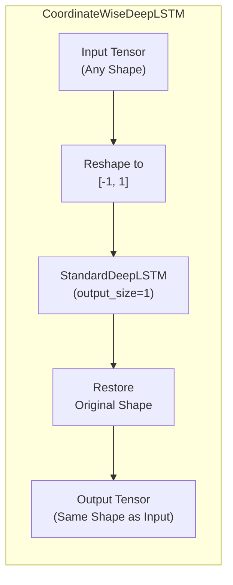
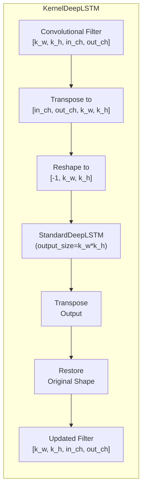
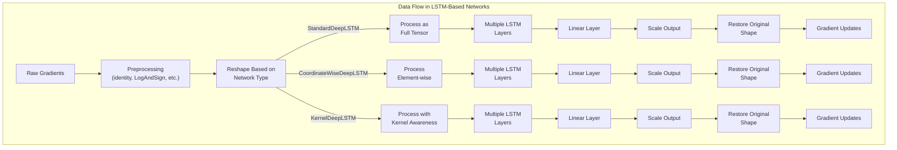
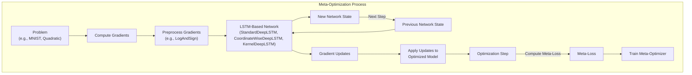

<!-- source: DeepWiki mcp.deepwiki.com · repo google-deepmind/learning-to-learn · page 4.1 LSTM-Based Networks · fetched 2026-10-26 -->

# LSTM-Based Networks

<details>
<summary>Relevant source files</summary>

The following files were used as context for generating this wiki page:

- [networks.py](networks.py)
- [networks_test.py](networks_test.py)

</details>


## Purpose and Scope

This document describes the LSTM-based neural networks used as meta-optimizers in the Learning to Learn (L2L) framework. These networks are the core components that learn how to optimize other machine learning models by processing gradient information. For information about standard optimizers (SGD, Adam) implemented in the framework, see [Standard Optimizers](#4.2).

Sources: [networks.py:15-16]()

## Network Class Hierarchy

The LSTM-based networks follow an inheritance structure that provides increasing levels of specialization for different optimization scenarios:

```mermaid
classDiagram
    class "Network" {
        <<abstract>>
        +initial_state_for_inputs(inputs)
        +__call__(inputs, state)
    }
    
    class "StandardDeepLSTM" {
        +output_size
        +layers
        +scale
        +_preprocess
        +_rnn
        +_linear
        +_build()
        +initial_state_for_inputs()
    }
    
    class "CoordinateWiseDeepLSTM" {
        +_reshape_inputs()
        +_build()
        +initial_state_for_inputs()
    }
    
    class "KernelDeepLSTM" {
        +kernel_shape
        +_reshape_inputs()
        +_build()
        +initial_state_for_inputs()
    }
    
    Network <|-- StandardDeepLSTM
    StandardDeepLSTM <|-- CoordinateWiseDeepLSTM
    StandardDeepLSTM <|-- KernelDeepLSTM
```

Sources: [networks.py:65-72](), [networks.py:154-218](), [networks.py:220-257](), [networks.py:260-308]()

## Base Network Abstract Class

All network implementations derive from the abstract `Network` class, which extends Sonnet's `RNNCore` to provide a common interface for meta-optimizer networks. This base class requires implementation of:

- `initial_state_for_inputs`: Creates the initial state for the RNN based on inputs
- `__call__`: Standard method inherited from `snt.RNNCore` that processes inputs and previous state

Sources: [networks.py:65-72]()

## StandardDeepLSTM

`StandardDeepLSTM` is the main LSTM-based network architecture for meta-optimization. It consists of multiple LSTM layers followed by a linear layer.

### Architecture



Sources: [networks.py:154-218]()

### Implementation Details

`StandardDeepLSTM` takes the following parameters:
- `output_size`: Size of the final linear layer output
- `layers`: List of output sizes for each LSTM layer
- `preprocess_name`: Name of preprocessing function (default: "identity")
- `preprocess_options`: Options for preprocessing
- `scale`: Output scaling factor (default: 1.0)
- `initializer`: Variable initializer for network weights
- `name`: Module name

The network performs the following operations:
1. Preprocesses input gradients with the specified preprocessing function
2. Passes the preprocessed input through a series of LSTM layers
3. Applies a linear transformation to the output of the last LSTM layer
4. Scales the output by the specified scale factor

Sources: [networks.py:157-196](), [networks.py:198-213]()

### Usage Example

The `StandardDeepLSTM` is typically used for dense vector processing and can handle arbitrarily shaped gradients, but does not leverage the specific structure of the input data.

## CoordinateWiseDeepLSTM

`CoordinateWiseDeepLSTM` extends `StandardDeepLSTM` to process each coordinate (element) of the input independently, while sharing weights across all coordinates.

### Architecture and Data Flow



Sources: [networks.py:220-257]()

### Implementation Details

Key characteristics of `CoordinateWiseDeepLSTM`:
- Fixed `output_size` of 1 (processes each coordinate to produce a single output)
- Reshapes inputs to a 2D tensor with shape `[-1, 1]` where each row represents one coordinate
- Processes the reshaped tensor through the underlying `StandardDeepLSTM`
- Reshapes the output back to the original input shape

This approach allows the network to:
- Apply the same learned optimization rule to each coordinate independently
- Efficiently handle inputs of any shape or dimensionality
- Dramatically reduce the number of parameters compared to a fully connected approach

Sources: [networks.py:223-253]()

## KernelDeepLSTM

`KernelDeepLSTM` is specialized for optimizing convolutional filters, taking into account their 4D structure (kernel width, kernel height, input channels, output channels).

### Architecture



Sources: [networks.py:260-308]()

### Implementation Details

Key characteristics of `KernelDeepLSTM`:
- Takes a `kernel_shape` parameter (2D tuple) specifying the dimensions of the convolutional filter
- Sets `output_size` to the product of the kernel dimensions
- Transposes and reshapes the 4D convolutional filter inputs to properly process the kernel structure
- Processes the reshaped tensor through the underlying `StandardDeepLSTM`
- Reshapes and transposes the output back to the original filter shape

This approach leverages the 2D spatial structure of convolutional kernels, allowing the optimizer to:
- Learn optimization patterns specific to convolutional filters
- Maintain the spatial relationships within each filter
- Share optimization parameters across different filters and channels

Sources: [networks.py:268-302]()

## Internal Mechanisms of LSTM-Based Networks

### Data Preprocessing and Flow



Sources: [networks.py:198-213](), [networks.py:235-252](), [networks.py:284-302]()

### State Management

All LSTM-based networks maintain and update state across optimization steps, which allows them to adapt their behavior based on the history of gradients. The state consists of:

- LSTM cell states and hidden states for each layer
- Initial state is created based on input dimensions
- State is passed and updated between optimization steps

This stateful behavior is critical for the meta-optimizer to learn dynamic optimization strategies that can adapt to the optimization landscape.

Sources: [networks.py:215-217](), [networks.py:254-257](), [networks.py:304-308]()

## Network Initialization

The LSTM-based networks support various initialization strategies:

| Initializer Type | Description | Example |
|------------------|-------------|---------|
| String | TensorFlow initializer name | "zeros", "ones" |
| NumPy array | Constant initialization | np.array([0]) |
| TensorFlow initializer | Direct TF initializer | tf.zeros_initializer() |
| Dictionary (per variable) | Specific initializers for different variables | {"w": "zeros", "b": "ones"} |
| Dictionary (per layer) | Specific initializers for different layers | {"lstm_1": {"w_gates": "zeros"}} |

The flexible initialization system allows fine-grained control over the initial state of the meta-optimizer networks.

Sources: [networks.py:75-151]()

## Integration with Meta-Optimizer

The LSTM-based networks are integrated into the meta-optimization process as follows:



Sources: [networks.py:198-213]()

## Technical Implementation Details

### Network Class Implementation

All three LSTM-based networks share a common structure but with specialized components:

1. Each network inherits from the base `Network` class which in turn inherits from `snt.RNNCore`
2. Constructor initializes network components based on parameters
3. Each has a `_build` method that defines the forward pass
4. Each provides an `initial_state_for_inputs` method to initialize the network state

These networks are built on Sonnet (an abstraction layer on top of TensorFlow) which provides the `snt.RNNCore`, `snt.LSTM`, and `snt.Linear` modules.

Sources: [networks.py:154-308]()

### Network Factory

The networks can be instantiated through a factory function that provides a convenient way to create network instances with various configurations:

```python
def factory(net, net_options=(), net_path=None):
  """Network factory."""
  net_class = getattr(sys.modules[__name__], net)
  net_options = dict(net_options)
  if net_path:
    with open(net_path, "rb") as f:
      net_options["initializer"] = pickle.load(f)
  return net_class(**net_options)
```

The factory supports loading pre-trained networks from disk, allowing users to reuse or transfer trained meta-optimizers.

Sources: [networks.py:34-44]()

## Summary

The LSTM-based networks in the Learning to Learn framework serve as the core components that learn to optimize other machine learning models. They come in three main variants:

1. `StandardDeepLSTM`: General-purpose LSTM-based optimizer
2. `CoordinateWiseDeepLSTM`: Processes each coordinate independently with shared weights
3. `KernelDeepLSTM`: Specialized for convolutional filters with awareness of kernel structure

These networks can process gradient information, maintain state across optimization steps, and produce updates to the optimized model parameters. Their flexible architecture allows them to learn complex optimization strategies that can potentially outperform hand-designed optimizers on specific problems.

---

