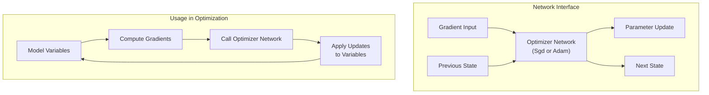
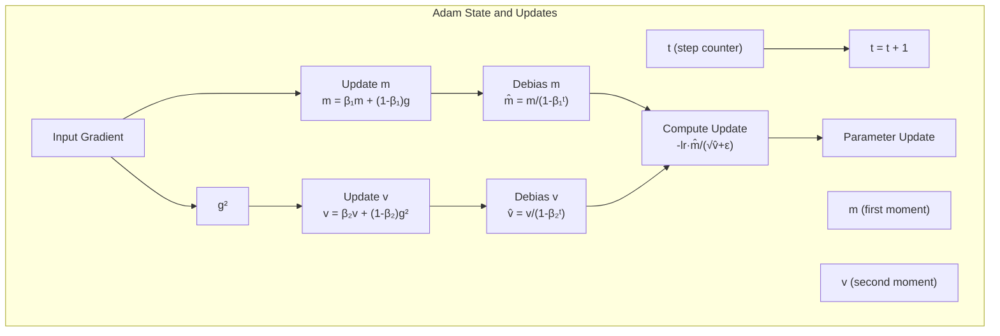

<!-- source: DeepWiki mcp.deepwiki.com · repo google-deepmind/learning-to-learn · page 4.2 Standard Optimizers · fetched 2026-10-26 -->

# Standard Optimizers

<details>
<summary>Relevant source files</summary>

The following files were used as context for generating this wiki page:

- [networks.py](networks.py)
- [networks_test.py](networks_test.py)

</details>


This page documents the standard optimization algorithms implemented within the Learning to Learn (L2L) framework. Unlike the learned optimizers that adapt through meta-learning (see [LSTM-Based Networks](#4.1)), these standard optimizers implement fixed update rules based on well-established optimization algorithms.

## Overview

The standard optimizers in L2L are implemented as `Network` objects to maintain a consistent interface with learned optimizers. This design choice allows both standard and learned optimizers to be used interchangeably within the meta-optimization framework.

```mermaid
classDiagram
    class Network {
        <<abstract>>
        +initial_state_for_inputs(inputs)
        +__call__(inputs, state)
    }
    
    class "StandardOptimizer" {
        "Fixed update rules"
    }
    
    class "LearnedOptimizer" {
        "Learned update rules"
    }
    
    class "Sgd" {
        -learning_rate
        +_build(inputs, _)
        +initial_state_for_inputs(inputs)
    }
    
    class "Adam" {
        -learning_rate
        -beta1
        -beta2
        -epsilon
        +_build(g, prev_state)
        +initial_state_for_inputs(inputs)
    }
    
    Network <|-- "StandardOptimizer"
    Network <|-- "LearnedOptimizer"
    "StandardOptimizer" <|-- "Sgd"
    "StandardOptimizer" <|-- "Adam"
    "LearnedOptimizer" <|-- "CoordinateWiseDeepLSTM"
    "LearnedOptimizer" <|-- "KernelDeepLSTM"
```

Sources: [networks.py:65-72](), [networks.py:311-377]()

## Network Interface

All optimizers in the L2L framework implement the `Network` abstract base class, which extends `snt.RNNCore` from the Sonnet library. This interface requires implementing two key methods:

1. `__call__(inputs, state)` - Processes gradients and produces update values
2. `initial_state_for_inputs(inputs)` - Creates initial state for the optimizer

For standard optimizers, the state is much simpler than for learned optimizers, as it only needs to track algorithm-specific parameters rather than neural network states.



Sources: [networks.py:65-72]()

## SGD Optimizer

The `Sgd` class implements the standard stochastic gradient descent algorithm as a network. It's a simple optimizer that updates parameters in the direction of the negative gradient, scaled by a learning rate.

### Implementation

The `Sgd` implementation is notably straightforward compared to learned optimizers:

- **Constructor**: Takes a `learning_rate` parameter (default: 0.001)
- **State**: Empty list (stateless optimizer)
- **Update rule**: `-learning_rate * inputs`

The `Sgd` network contains no trainable parameters, making it a fixed optimization algorithm.

Sources: [networks.py:311-328](), [networks_test.py:119-152]()

## Adam Optimizer

The `Adam` class implements the Adam optimization algorithm (Adaptive Moment Estimation) as described in the paper "Adam: A Method for Stochastic Optimization" by Kingma and Ba. Adam adapts learning rates for each parameter individually based on estimates of first and second moments of the gradients.

### Implementation

The `Adam` implementation includes:

- **Constructor**: Takes parameters for `learning_rate` (default: 1e-3), `beta1` (default: 0.9), `beta2` (default: 0.999), and `epsilon` (default: 1e-8).
- **State**: Tuple containing (t, m, v)
  - `t`: Iteration counter
  - `m`: First moment estimate (momentum)
  - `v`: Second moment estimate (velocity)
- **Update rule**: Based on the Adam algorithm formula



Like the `Sgd` implementation, `Adam` has no trainable parameters, as confirmed by the tests in `networks_test.py`.

Sources: [networks.py:339-377](), [networks_test.py:154-186]()

## Helper Functions

The Adam implementation utilizes two helper functions:

1. `_update_adam_estimate`: Updates moving averages with the formula `(b * estimate) + ((1 - b) * value)`
2. `_debias_adam_estimate`: Applies debiasing with the formula `estimate / (1 - tf.pow(b, t))`

These functions encapsulate the core mathematical operations of the Adam algorithm.

Sources: [networks.py:331-336]()

## Usage in the L2L Framework

Standard optimizers can be used in two primary ways within the L2L framework:

1. **As baseline optimizers**: To compare performance against learned optimizers
2. **As components in hybrid optimization**: Where some parameters are optimized with standard methods while others use learned optimization

The optimizers can be instantiated using the `factory` function:

```python
# Create an SGD optimizer with learning rate 0.01
sgd_optimizer = networks.factory("Sgd", net_options={"learning_rate": 0.01})

# Create an Adam optimizer with custom parameters
adam_optimizer = networks.factory("Adam", net_options={
    "learning_rate": 0.001,
    "beta1": 0.9,
    "beta2": 0.999
})
```

Sources: [networks.py:34-44]()

## Testing

Both standard optimizers have corresponding test cases in `networks_test.py` that verify:

1. Their shape handling matches input gradient dimensions
2. They contain no trainable variables
3. Their update rules produce expected results:
   - For `Sgd`: updates should equal `-learning_rate * gradients`
   - For `Adam`: updates should be zero when learning rate is zero

Sources: [networks_test.py:119-186]()

## Comparison with Learned Optimizers

The following table summarizes key differences between standard optimizers and learned optimizers in the L2L framework:

| Feature | Standard Optimizers (Sgd, Adam) | Learned Optimizers (LSTM-based) |
|---------|--------------------------------|--------------------------------|
| Update Rules | Fixed mathematical formulas | Learned through meta-training |
| Trainable Parameters | None | LSTM weights and biases |
| State Complexity | Simple (e.g., momentum, velocity) | Complex (LSTM cell states) |
| Adaptability | Fixed behavior with hyperparameters | Can adapt to problem characteristics |
| Implementation Size | Small, concise | Larger, more complex |

Sources: [networks.py:311-377](), [networks.py:154-308]()

## Integration with Meta-Optimizer

Both standard and learned optimizers are used by the `MetaOptimizer` class, which coordinates the optimization process. The consistent interface ensures that any optimizer implementing the `Network` abstract class can be used interchangeably.

Sources: [networks.py:65-72]()

---

