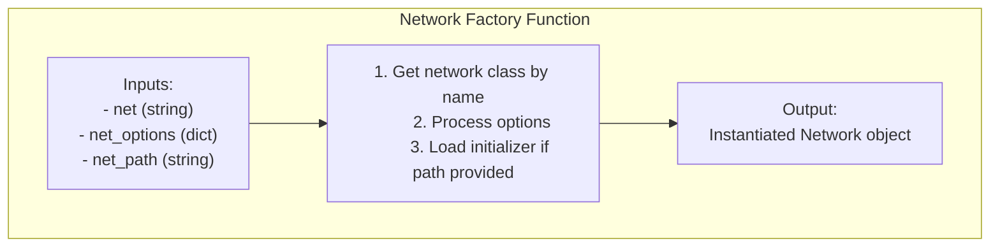
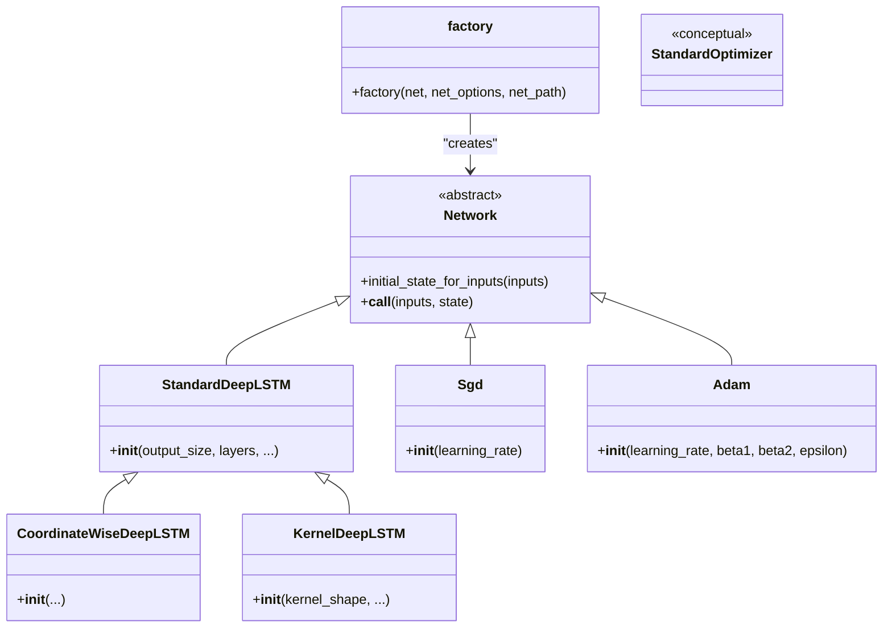
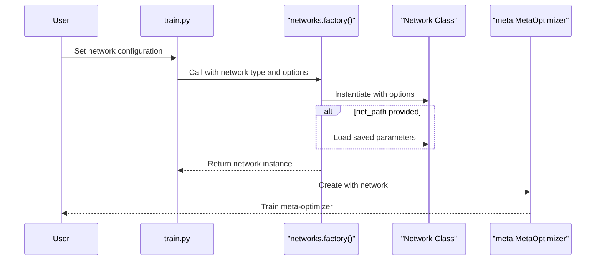
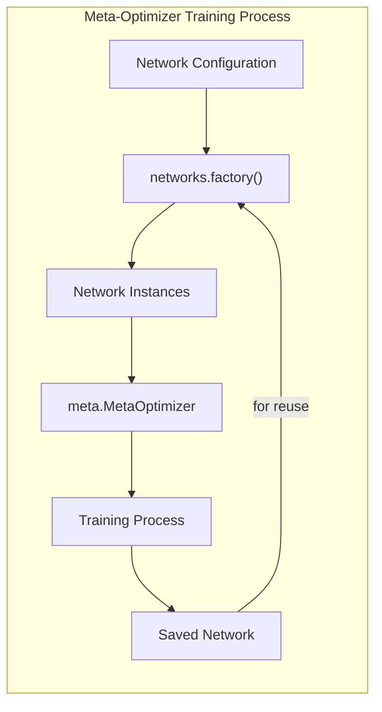

<!-- source: DeepWiki mcp.deepwiki.com · repo google-deepmind/learning-to-learn · page 4.3 Network Factory · fetched 2026-10-26 -->

# Network Factory

<details>
<summary>Relevant source files</summary>

The following files were used as context for generating this wiki page:

- [networks.py](networks.py)

</details>


The Network Factory is a core component of the Learning to Learn (L2L) system that facilitates the dynamic creation and configuration of meta-optimizer networks. It provides a flexible interface for instantiating various types of neural networks used for meta-optimization, including LSTM-based networks and standard optimizers like SGD and Adam.

For information about the specific network architectures available, see [LSTM-Based Networks](#4.1) and [Standard Optimizers](#4.2).

## Purpose and Functionality

The Network Factory is implemented as a function named `factory` in the networks module. Its primary purpose is to:

1. Dynamically instantiate network classes based on a specified network type name
2. Configure networks with customizable options
3. Allow loading of pre-trained network parameters from saved files

Sources: [networks.py:34-44]()



Sources: [networks.py:34-44]()

## Implementation Details

The Network Factory utilizes Python's dynamic attribute lookup to find and instantiate the appropriate network class from the networks module based on the provided string name.



Sources: [networks.py:34-44](), [networks.py:66-72](), [networks.py:154-217](), [networks.py:220-257](), [networks.py:260-308](), [networks.py:311-326](), [networks.py:339-377]()

### Function Signature

```python
def factory(net, net_options=(), net_path=None):
```

**Parameters:**
- `net` (str): The name of the network class to instantiate (e.g., "CoordinateWiseDeepLSTM", "Adam")
- `net_options` (tuple or dict): Options to pass to the network constructor
- `net_path` (str, optional): Path to a file containing serialized network parameters

**Returns:**
- An instance of the specified network class

Sources: [networks.py:34-44]()

## Usage Workflow

The Network Factory is typically used in the training and evaluation pipelines to create the networks needed for meta-optimization. Below is the typical workflow for using the Network Factory:



Sources: [networks.py:34-44]()

## Network Initialization and Serialization

The Network Factory works closely with the network serialization mechanisms provided by the `save` function. This allows:

1. Saving trained networks to disk
2. Loading previously trained networks through the factory

When a `net_path` is provided to the factory, it loads saved parameters (initializers) using the `pickle` module, enabling the reuse of pre-trained networks.

Sources: [networks.py:47-62]()

### Example Usage

The following demonstrates how the Network Factory would be used to create different types of networks:

**Creating a CoordinateWiseDeepLSTM network:**
```python
lstm_net = factory(
    "CoordinateWiseDeepLSTM", 
    {"layers": [20, 20], "preprocess_name": "LogAndSign", "scale": 0.01}
)
```

**Creating an Adam optimizer:**
```python
adam_net = factory("Adam", {"learning_rate": 0.001, "beta1": 0.9, "beta2": 0.999})
```

**Loading a pre-trained network:**
```python
pretrained_net = factory("CoordinateWiseDeepLSTM", {}, "path/to/saved/network")
```

## Integration with Meta-Optimizer

The Network Factory is a key component in the creation of meta-optimizers. The network instances it produces are used by the `MetaOptimizer` class to implement the learned optimization algorithms.



Sources: [networks.py:34-44](), [networks.py:47-62]()

## Relationship to Other System Components

The Network Factory interacts with several other components in the Learning to Learn system:

| Component | Relationship |
|-----------|--------------|
| `MetaOptimizer` | Uses networks created by the factory to implement the meta-optimizer |
| `preprocess` module | Networks created by the factory often utilize preprocessing functions from this module |
| `train.py` | Main script that uses the factory to create networks for training |
| `evaluate.py` | Uses the factory to load trained networks for evaluation |
| Network classes | Instantiated by the factory based on configuration |

Sources: [networks.py:34-44](), [networks.py:177-183]()

## Conclusion

The Network Factory is a fundamental component of the Learning to Learn system that enables:

1. Dynamic instantiation of different network architectures
2. Flexible configuration of network parameters
3. Loading and reusing pre-trained networks
4. Modular design that separates network creation from usage

This design facilitates experimentation with different network architectures and configurations for meta-learning, a key aspect of the Learning to Learn approach.

---

