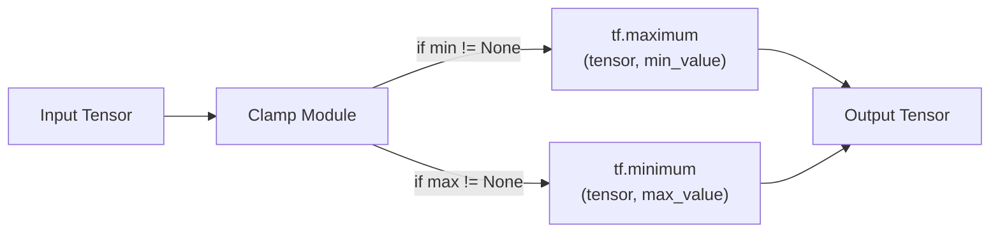
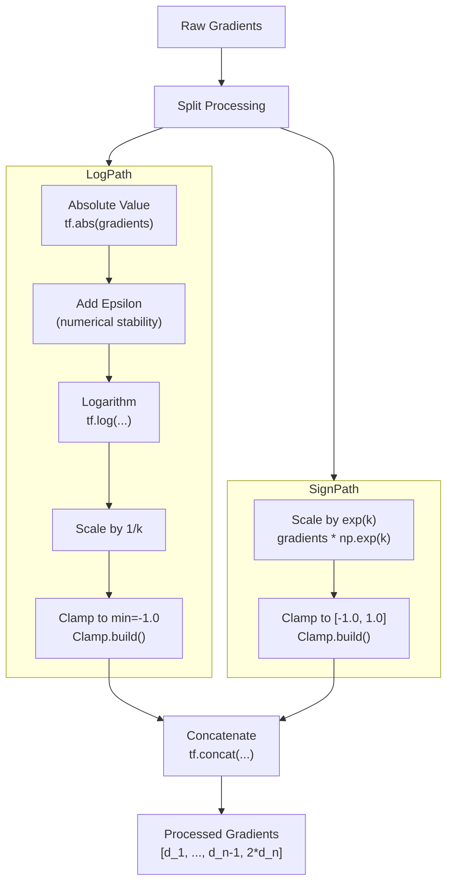
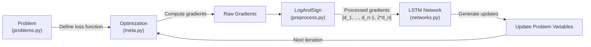

<!-- source: DeepWiki mcp.deepwiki.com · repo google-deepmind/learning-to-learn · page 5 Preprocessing · fetched 2026-10-26 -->

# Preprocessing

<details>
<summary>Relevant source files</summary>

The following files were used as context for generating this wiki page:

- [preprocess.py](preprocess.py)

</details>


## Purpose and Overview

The preprocessing module in the Learning to Learn (L2L) system transforms raw gradients before they are fed into meta-optimizer networks. This transformation is crucial for improving the performance and stability of learned optimizers by normalizing and structuring gradient information in a way that is more amenable to learning.

The preprocessing system primarily consists of gradient transformation techniques that prepare raw gradient values to be effectively processed by the LSTM-based networks defined in the Networks module (see [Networks](#4) for more details). The main preprocessing technique implemented is the "LogAndSign" method, which is described in the original Learning to Learn paper.

Sources: [preprocess.py:15-16]()

## Preprocessing Components

The preprocessing module defines two main components:

1. **Clamp**: A utility module that limits values to specified minimum and maximum bounds
2. **LogAndSign**: The primary preprocessing technique that transforms gradients into a dual-representation format

### Clamp Module

The `Clamp` module is a simple utility that restricts tensor values to specified minimum and maximum bounds.



This module takes two optional parameters:
- `min_value`: Lower bound for clamping (if provided)
- `max_value`: Upper bound for clamping (if provided)

When either bound is unspecified (None), that particular clamping operation is not applied.

Sources: [preprocess.py:26-39]()

### LogAndSign Preprocessing

The `LogAndSign` module implements the preprocessing technique described in Appendix A of the paper ["Learning to learn by gradient descent by gradient descent"](https://arxiv.org/pdf/1606.04474v1.pdf).



The `LogAndSign` technique processes gradients through two transformation paths:

1. **Log Path**: 
   - Takes the absolute value of gradients
   - Adds a small epsilon (numerical stability)
   - Applies logarithm
   - Scales by 1/k (where k is a hyperparameter)
   - Clamps to minimum value of -1.0

2. **Sign Path**:
   - Scales gradients by exp(k)
   - Clamps to the range [-1.0, 1.0]

The outputs from both paths are concatenated along the last dimension, doubling the size of the gradient tensor in that dimension. This provides the neural network with both magnitude information (through the log component) and direction information (through the sign component).

Sources: [preprocess.py:42-70]()

## Gradient Preprocessing in the L2L System

The following diagram shows how gradient preprocessing fits into the overall L2L system:



During the meta-optimization process:

1. Gradients are computed for the problem being optimized
2. These raw gradients are fed through the preprocessing pipeline
3. The processed gradients (with log and sign components) are provided as input to the optimizer network
4. The network generates updates that are applied to the problem variables

This preprocessing step is essential for effective meta-learning, as it normalizes the gradient information and provides a structured representation that the LSTM networks can more easily learn from.

Sources: [preprocess.py:42-70]()

## Implementation Details

### LogAndSign Parameters

The `LogAndSign` class takes a single parameter `k` which controls the scaling factor for both the log and sign components. The module provides the following transformation:

- For a gradient tensor with shape `[d_1, ..., d_n]`, the output tensor has shape `[d_1, ..., d_n-1, 2*d_n]`
- The first `d_n` values along the last dimension correspond to the log component
- The second `d_n` values correspond to the sign component

The epsilon value used in the log computation is automatically determined based on the numeric limits of the gradient's data type, ensuring numerical stability across different precision settings.

### Data Type Handling

The preprocessing module handles numerical precision carefully:

```python
eps = np.finfo(gradients.dtype.as_numpy_dtype).eps
```

This line retrieves the machine epsilon for the specific data type of the gradients tensor, ensuring appropriate numerical stability regardless of whether the computation is done in float32 or float64.

Sources: [preprocess.py:63-63]()

## Technical Considerations

When implementing or modifying the preprocessing module, consider the following:

1. **Concatenation Dimension**: The log and sign components are concatenated along the last dimension (`ndims - 1`), which assumes the gradients are typically shaped with parameters in the last dimension.

2. **Numerical Stability**: The addition of epsilon to the absolute gradient values prevents taking the logarithm of zero, which would result in negative infinity.

3. **Scaling Parameter `k`**: The hyperparameter `k` controls the range of gradient values that are effectively captured. Higher values of `k` compress the log representation further but potentially capture a wider dynamic range.

4. **Memory Footprint**: The preprocessing doubles the size of the gradient tensor in the last dimension, which increases the memory requirements and the number of input features for the optimizer network.

Sources: [preprocess.py:42-70]()

---

