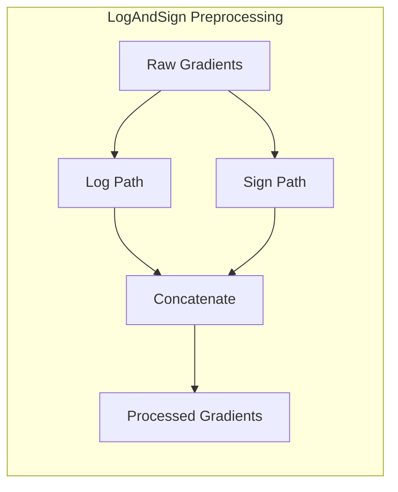
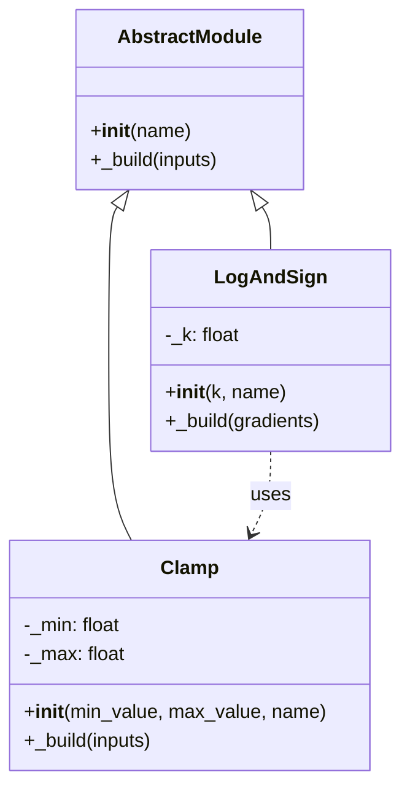
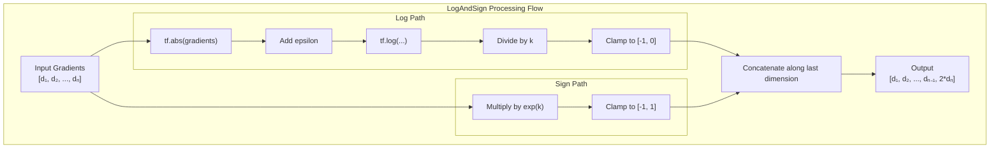
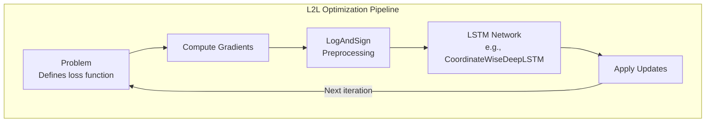
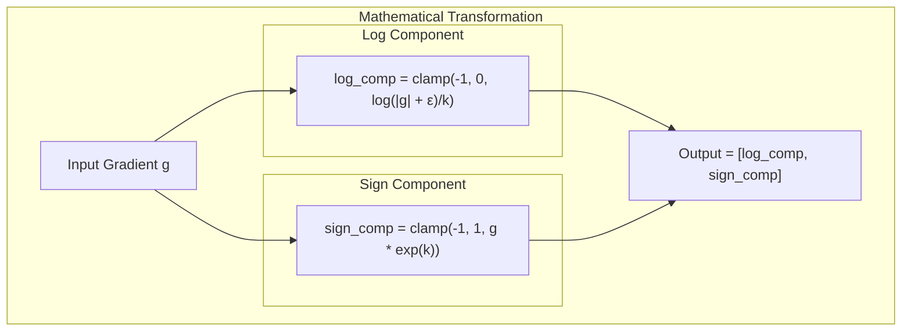

<!-- source: DeepWiki mcp.deepwiki.com · repo google-deepmind/learning-to-learn · page 5.1 LogAndSign Preprocessing · fetched 2026-10-26 -->

# LogAndSign Preprocessing

Relevant source files

The following files were used as context for generating this wiki page:

- [preprocess.py](preprocess.py)

## Purpose and Scope

This document details the LogAndSign preprocessing technique used in the Learning to Learn (L2L) system. This preprocessing module transforms raw gradients into a more suitable representation for meta-optimizer networks to consume. LogAndSign applies log and sign transformations to gradients, making optimization more stable across various scales and helping the meta-optimizer adapt to different problem characteristics.

For information about other preprocessing utilities, see [Clamping and Other Utilities](#5.2).

Sources: [preprocess.py:42-70]()

## Overview

LogAndSign preprocessing applies two parallel transformations to input gradients:

1. **Log Transformation** - Handles the gradient magnitude
2. **Sign Transformation** - Preserves gradient direction

These transformations help stabilize learning by normalizing gradients and providing both magnitude and directional information to the optimizer network in a consistent range.

Sources: [preprocess.py:42-70]()

## Implementation Details

The LogAndSign module is implemented as a Sonnet module that inherits from `snt.AbstractModule`. It's defined with a scaling parameter `k` that controls the sensitivity of the transformations.

Sources: [preprocess.py:26-70]()

### Detailed Transformation Process

When gradients are passed through the LogAndSign module, the following steps occur:

1. **Log Transformation Path**:
   - Calculate absolute value of gradients
   - Add small epsilon (machine precision) to avoid log(0)
   - Apply logarithm function
   - Scale by 1/k
   - Clamp to [-1, 0] range

2. **Sign Transformation Path**:
   - Scale gradients by exp(k)
   - Clamp to [-1, 1] range

3. **Concatenation**:
   - Combine both transformed representations along the last dimension

This process expands the input dimension by a factor of 2 along the last axis.

Sources: [preprocess.py:52-70]()

### Key Implementation Code

The core transformation logic is implemented in the `_build` method of the LogAndSign class:

- The epsilon value is determined dynamically based on the gradient data type
- The `Clamp` module is used to enforce value constraints
- The final output is produced by concatenating the log and sign components

Sources: [preprocess.py:52-70]()

## Integration with L2L System

LogAndSign preprocessing is a crucial component in the gradient processing pipeline of the Learning to Learn system. It transforms raw gradients before they're fed into LSTM-based meta-optimizer networks.

Sources: [preprocess.py:42-70]()

## Mathematical Foundation

The LogAndSign preprocessing is based on the technique described in the paper "Learning to Learn by Gradient Descent by Gradient Descent" (Appendix A). The transformations help address two key challenges in meta-optimization:

1. **Gradient Scale Variability**: Gradients can span many orders of magnitude during optimization
2. **Gradient Direction Information**: The sign of gradients provides essential information about the optimization direction

By applying these transformations, the meta-optimizer receives normalized inputs that retain both magnitude and directional information, making learning more stable.

Sources: [preprocess.py:42-70]()

## Practical Considerations

When using LogAndSign preprocessing:

1. **Choosing k**: The parameter `k` controls the scaling sensitivity. Typical values range from 1 to 10.
2. **Output Dimensionality**: LogAndSign doubles the final dimension of the input tensor.
3. **Numerical Stability**: The implementation handles potential numerical issues with small gradients by adding an epsilon value.

This preprocessing technique is particularly valuable when training meta-optimizers on a diverse set of problems with different gradient characteristics.

Sources: [preprocess.py:42-70]()

## Summary

LogAndSign preprocessing is a dual-transformation technique that:
- Converts raw gradients into normalized representations suitable for meta-optimizer networks
- Preserves both magnitude information (via log transform) and directional information (via sign transform)
- Stabilizes meta-optimization by providing consistently scaled inputs
- Doubles the input dimension along the last axis

This preprocessing module plays a critical role in the Learning to Learn system by enabling meta-optimizers to generalize across problems with varying gradient scales and characteristics.

Sources: [preprocess.py:42-70]()

---

