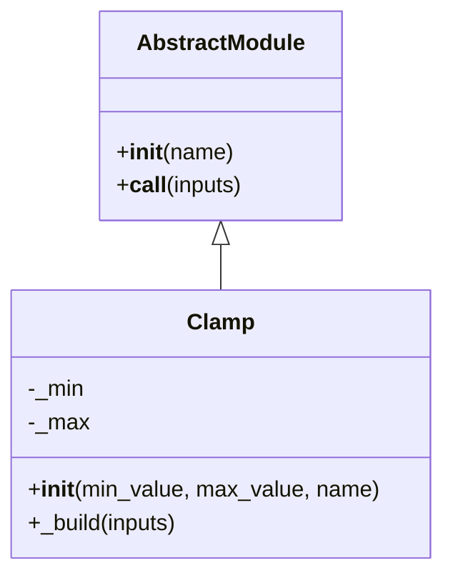
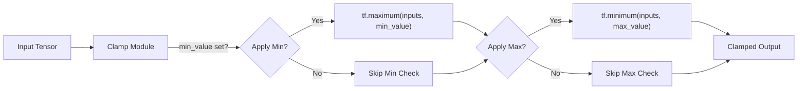
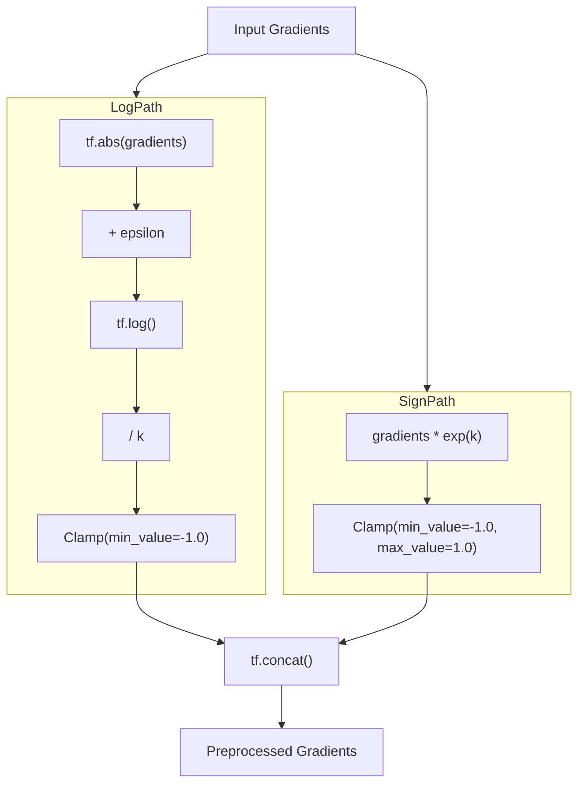
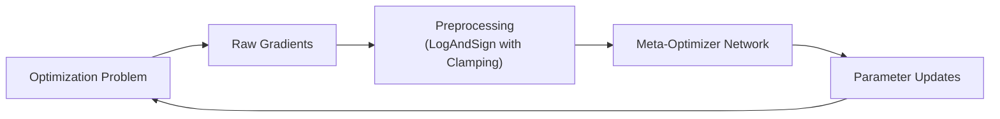

<!-- source: DeepWiki mcp.deepwiki.com · repo google-deepmind/learning-to-learn · page 5.2 Clamping and Other Utilities · fetched 2026-10-26 -->

# Clamping and Other Utilities

Relevant source files

The following files were used as context for generating this wiki page:

- [preprocess.py](preprocess.py)

## Purpose and Scope

This document details the utility components used in the Learning to Learn (L2L) preprocessing pipeline, focusing primarily on the `Clamp` module and related functionality. These utilities are essential for controlling the range of values in gradients before they are fed into meta-optimizer networks. For information about the main `LogAndSign` preprocessing technique, see [LogAndSign Preprocessing](#5.1).

## The Clamp Module

The `Clamp` module provides a simple but crucial function in the preprocessing pipeline: limiting tensor values to specified minimum and/or maximum bounds. This prevents extreme values from destabilizing the learning process.

### Implementation

The `Clamp` module is implemented as a Sonnet module that inherits from `snt.AbstractModule`. It performs element-wise clamping operations on input tensors.

The module constructor takes optional minimum and maximum values, which can be used independently:
- When only `min_value` is provided, values below this threshold are clipped to the minimum
- When only `max_value` is provided, values above this threshold are clipped to the maximum
- When both are provided, values are restricted to the range [`min_value`, `max_value`]

The core implementation is straightforward:

Sources: [preprocess.py:26-39]()

### Operational Flow

The following diagram illustrates how the `Clamp` module processes input data:

Sources: [preprocess.py:33-39]()

## Usage in Preprocessing Pipeline

The `Clamp` module plays a key role in the gradient preprocessing pipeline, specifically within the `LogAndSign` preprocessor. It's used in two critical places:

1. For clamping the logarithm of gradient magnitudes
2. For clamping the scaled gradient signs

### Integration with LogAndSign

The following diagram shows how `Clamp` is integrated into the `LogAndSign` preprocessing pipeline:

Sources: [preprocess.py:52-70]()

## Numerical Stability Utilities

In addition to the `Clamp` module, the preprocessing code includes a utility for handling numerical stability:

### Epsilon Handling

A small epsilon value is added before taking the logarithm of gradient magnitudes to prevent numerical instability when gradients are close to or equal to zero:

The epsilon value is dynamically determined based on the data type of the input gradients, ensuring appropriate precision for different numeric types.

Sources: [preprocess.py:63-66]()

## Clamping Configuration in LogAndSign

The `LogAndSign` preprocessor uses specific clamping configurations:

| Preprocessing Path | Clamping Configuration | Purpose |
|--------------------|------------------------|---------|
| Log Path | `min_value=-1.0` | Ensures log values aren't too negative |
| Sign Path | `min_value=-1.0, max_value=1.0` | Bounds scaled gradients to [-1, 1] |

The clamping parameters are crucial for ensuring that the inputs to the meta-optimizer networks stay within a reasonable range, which helps with optimization stability and convergence.

Sources: [preprocess.py:67-68]()

## Role in the Overall System

The clamping utilities ensure that gradient information is provided to the meta-optimizer networks in a controlled form, preventing extreme values from destabilizing the learning process. This is particularly important since the meta-optimizer is essentially learning how to interpret these signals.

By applying appropriate clamping, the system helps the meta-optimizer networks focus on the most relevant aspects of the gradient information rather than being overwhelmed by outlier values.

Sources: [preprocess.py:42-70]()

---

