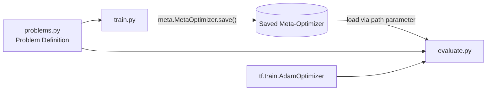
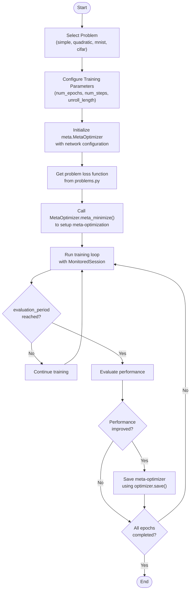
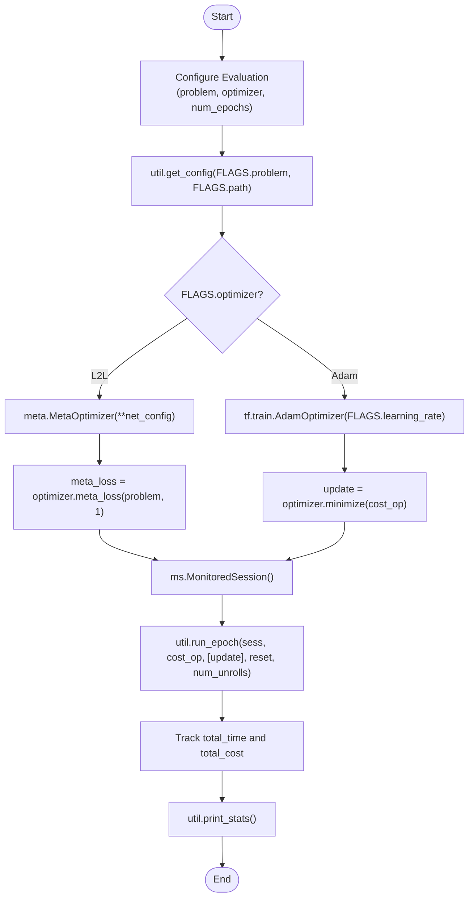
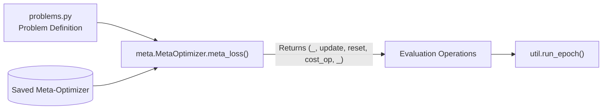
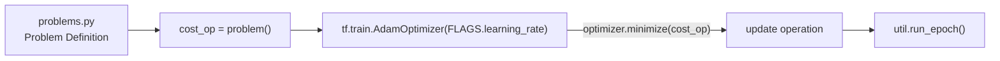
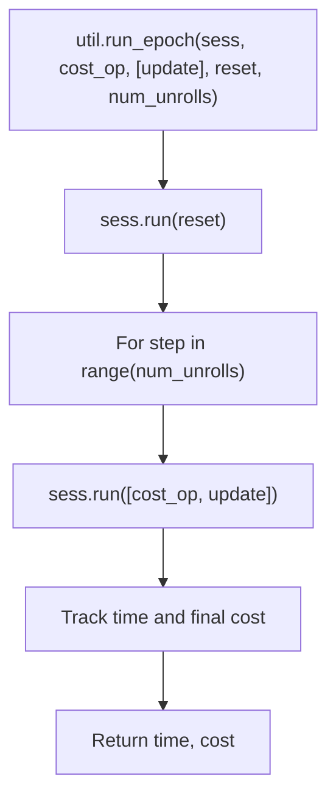

<!-- source: DeepWiki mcp.deepwiki.com · repo google-deepmind/learning-to-learn · page 6 Training and Evaluation · fetched 2026-10-26 -->

# Training and Evaluation

<details>
<summary>Relevant source files</summary>

The following files were used as context for generating this wiki page:

- [README.md](README.md)
- [convergence_test.py](convergence_test.py)
- [evaluate.py](evaluate.py)

</details>


This document covers the training and evaluation workflows in the Learning to Learn (L2L) system. It explains how to train meta-optimizers on optimization problems, evaluate their performance, and compare them with standard optimizers like Adam.

For details on the meta-optimizer implementation, see [Meta-Optimizer](#3). For information about problem definitions, see [Problems](#2).

## System Overview

The L2L framework provides two main scripts for working with meta-optimizers:

1. `train.py`: Trains a meta-optimizer on a specified problem
2. `evaluate.py`: Evaluates optimizer performance (either L2L or Adam) on a problem

The typical workflow involves training a meta-optimizer on a problem, saving it, and then evaluating it against standard optimizers.

### Training and Evaluation Workflow



Sources: [README.md:9-47](), [evaluate.py:15-40]()

## Training Process

The training process uses `train.py` to train a meta-optimizer on a specified problem. The meta-optimizer learns how to optimize the parameters of the target problem through meta-learning.

### Training Workflow



Sources: [README.md:10-29](), [convergence_test.py:28-38]()

### Command-line Options

The `train.py` script accepts various command-line flags to configure the training process:

| Flag | Description | Default |
|------|-------------|---------|
| `--problem` | Problem to train on (simple, quadratic, mnist, cifar) | - |
| `--save_path` | Path to save the meta-optimizer | None |
| `--num_epochs` | Number of training epochs | - |
| `--log_period` | Epochs before reporting performance and time | - |
| `--evaluation_period` | Epochs before evaluating the optimizer | - |
| `--evaluation_epochs` | Number of evaluation epochs | - |
| `--num_steps` | Number of optimization steps | - |
| `--unroll_length` | Number of unroll steps for the optimizer | - |
| `--learning_rate` | Learning rate for meta-optimization | - |
| `--second_derivatives` | Whether to compute second derivatives | false |

Sources: [README.md:16-29]()

### Training Example

To train a meta-optimizer on the MNIST problem and save it to the `./mnist` directory:

```
python train.py --problem=mnist --save_path=./mnist
```

Sources: [README.md:12-14]()

## Evaluation Process

The evaluation process uses `evaluate.py` to assess the performance of either a trained meta-optimizer or a standard optimizer like Adam on a specified problem.

### Evaluation Workflow



Sources: [evaluate.py:45-90]()

### Command-line Options

The `evaluate.py` script accepts various command-line flags to configure the evaluation:

| Flag | Description | Default |
|------|-------------|---------|
| `--optimizer` | Optimizer to use (`L2L` or `Adam`) | `"L2L"` |
| `--path` | Path to saved meta-optimizer (for L2L) | None |
| `--num_epochs` | Number of evaluation epochs | 100 |
| `--seed` | Seed for TensorFlow's RNG | None |
| `--problem` | Problem to evaluate on | `"simple"` |
| `--num_steps` | Number of optimization steps per epoch | 100 |
| `--learning_rate` | Learning rate (for Adam) | 0.001 |

Sources: [README.md:38-46](), [evaluate.py:33-42]()

### Evaluation Example

To evaluate a trained meta-optimizer on the MNIST problem:

```
python evaluate.py --problem=mnist --optimizer=L2L --path=./mnist
```

To evaluate the Adam optimizer for comparison:

```
python evaluate.py --problem=mnist --optimizer=Adam --learning_rate=0.001
```

Sources: [README.md:34-36]()

## Optimizer Implementation

The evaluation system supports two types of optimizers:

### L2L Meta-Optimizer

When using the L2L optimizer, the system:
1. Loads a meta-optimizer with specified network configuration
2. Retrieves the problem and network assignments
3. Calls `optimizer.meta_loss()` to get optimization operations
4. Uses these operations in evaluation



Sources: [evaluate.py:66-71]()

### Adam Optimizer

When using the Adam optimizer, the system:
1. Creates a standard TensorFlow Adam optimizer
2. Gets the problem cost operation
3. Creates an update operation with `optimizer.minimize(cost_op)`
4. Uses these operations in evaluation



Sources: [evaluate.py:57-65]()

## Running an Evaluation Epoch

The evaluation system uses the `util.run_epoch()` function to run a single evaluation epoch. This function:

1. Resets the problem and optimizer state
2. Runs the optimization operations for the specified number of steps
3. Tracks the time taken and final cost
4. Returns these metrics for reporting



Sources: [evaluate.py:83-84](), [convergence_test.py:28-38]()

## Implementation Notes

### Training Component

The training script (`train.py`) relies on `meta.py` to:
1. Create a `MetaOptimizer` instance based on network configuration
2. Call `meta_minimize()` to setup the meta-optimization process
3. Execute the optimization in a TensorFlow session
4. Periodically evaluate and save the meta-optimizer

Key operations include:
- Unrolling the optimization process for a fixed number of steps
- Computing a meta-loss based on the optimization performance
- Updating the meta-optimizer parameters based on this loss

### Evaluation Component

The evaluation script (`evaluate.py`) provides a uniform interface for comparing:
1. Trained meta-optimizers (L2L)
2. Standard optimizers (Adam)

The evaluation metrics include:
- Final loss achieved
- Time taken for optimization
- Convergence behavior over multiple epochs

This allows for objective comparison between different optimization approaches.

Sources: [evaluate.py:45-90](), [README.md:32-46]()

---

