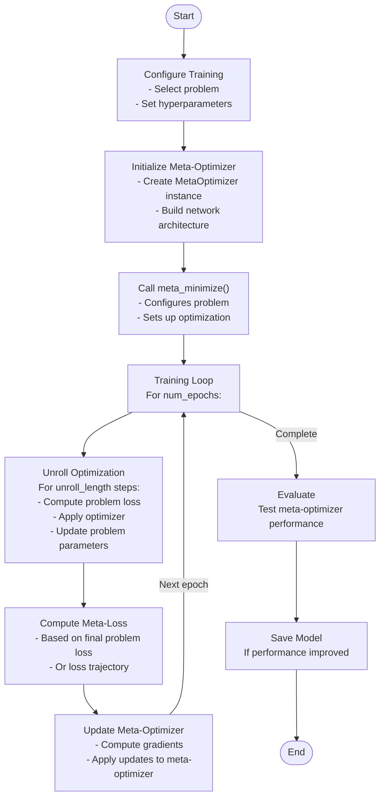
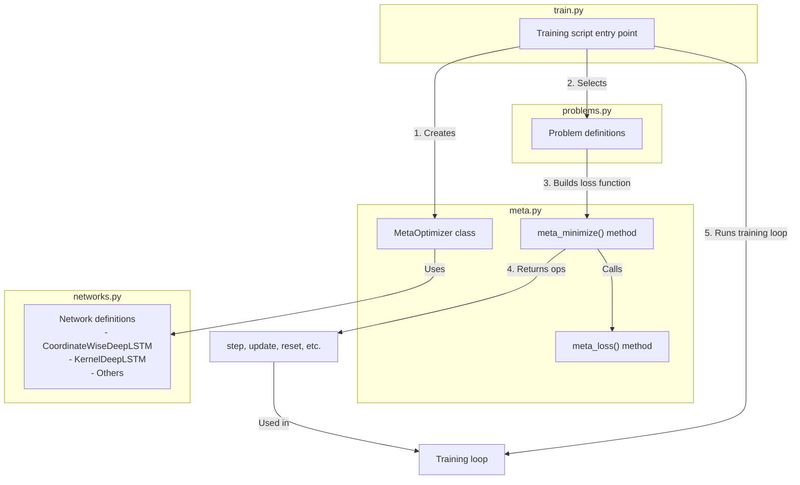
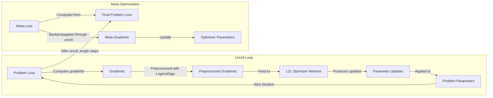
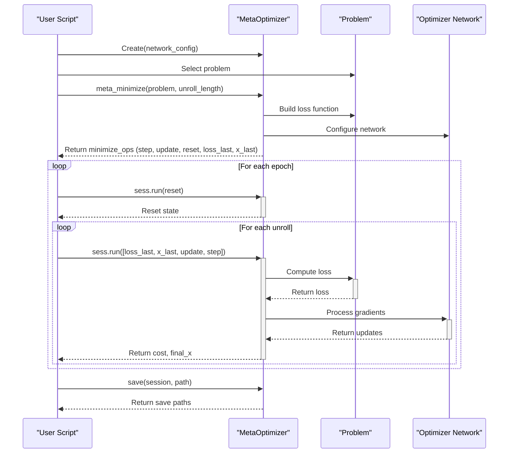
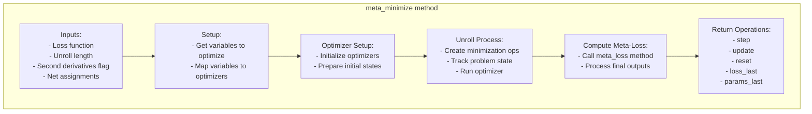
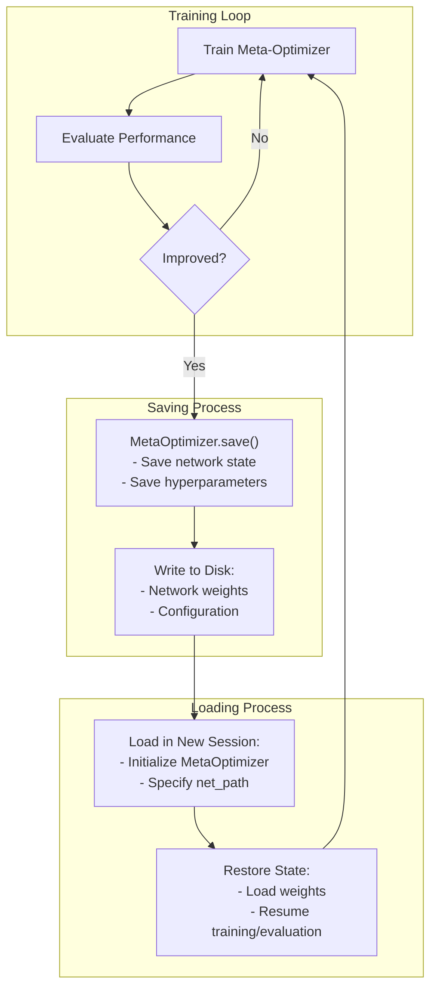

<!-- source: DeepWiki mcp.deepwiki.com · repo google-deepmind/learning-to-learn · page 6.1 Training Workflow · fetched 2026-10-26 -->

# Training Workflow

<details>
<summary>Relevant source files</summary>

The following files were used as context for generating this wiki page:

- [README.md](README.md)
- [meta_test.py](meta_test.py)

</details>


This document explains the training workflow for meta-optimizers in the Learning to Learn (L2L) framework. It covers how to train a meta-optimizer using the `train.py` script, the key configuration options, and the internal training process flow. For information about evaluating trained optimizers, see [Evaluation Methods](#6.2). For details on saving and loading models, see [Saving and Loading Models](#6.3).

## Training Process Overview

The meta-optimizer training process involves training an optimizer (typically an LSTM network) to optimize other machine learning models. The workflow runs for multiple epochs, where during each epoch the meta-optimizer is used to optimize a target problem for a specified number of steps. The performance of the meta-optimizer is then improved by computing gradients of the final loss with respect to the meta-optimizer parameters.



Sources: [train.py](), [meta_test.py:34-44](), [README.md:10-29]()

## Command-Line Interface

The training process is initiated using the `train.py` script with various command-line options to customize the training behavior.

### Basic Usage

```
python train.py --problem=mnist --save_path=./mnist
```

This command trains a meta-optimizer on the MNIST problem and saves it to the specified directory.

### Command-Line Options

The following table lists the important command-line arguments for `train.py`:

| Argument | Description | Default |
|----------|-------------|---------|
| `--problem` | Problem to train on (e.g., simple, quadratic, mnist, cifar) | - |
| `--save_path` | Path to save the optimizer when performance improves | None |
| `--num_epochs` | Number of training epochs | - |
| `--log_period` | Number of epochs before reporting mean performance | - |
| `--evaluation_period` | Number of epochs before evaluating the optimizer | - |
| `--evaluation_epochs` | Number of epochs during evaluation | - |
| `--num_steps` | Number of optimization steps | - |
| `--unroll_length` | Number of unroll steps for the optimizer | - |
| `--learning_rate` | Learning rate for meta-optimization | - |
| `--second_derivatives` | Whether to compute second derivatives | False |

Sources: [README.md:10-29]()

## Training Process Details

The training process involves several key components and steps that work together to train the meta-optimizer.

### Components Interaction



Sources: [train.py](), [meta.py](), [meta_test.py:34-44]()

### Optimization Unrolling

A key concept in the L2L framework is "unrolling" the optimization process. This involves running the target optimization problem for multiple steps while tracking the computation graph to compute meta-gradients.



Sources: [meta.py](), [meta_test.py:34-44]()

## Meta-Optimizer Training Example

Below is a simplified example of how training is performed in `meta_test.py`, which illustrates the core components of the training workflow:



Sources: [meta_test.py:34-44](), [meta_test.py:190-236]()

## The MetaOptimizer.meta_minimize Method

The `meta_minimize` method is the core of the training workflow, setting up the optimization process to be unrolled:



Sources: [meta.py](), [meta_test.py:59-62]()

## Saving and Loading

During training, the meta-optimizer can be saved to disk when its performance improves. The saved model can later be loaded for continued training or evaluation.



Sources: [meta_test.py:190-236](), [README.md:16-19]()

## Practical Example

Here's a practical example of the training workflow for a simple problem:

1. Choose a problem (simple, quadratic, MNIST, etc.)
2. Configure the meta-optimizer with a suitable network architecture
3. Call `meta_minimize` to set up the optimization process
4. Run the training loop for multiple epochs
5. Save the meta-optimizer when performance improves

The `meta_test.py` file contains examples of different training scenarios, including:
- Training with a simple problem
- Training with multiple optimizers
- Training with second derivatives
- Training with convolutional problems
- Saving and loading meta-optimizers

Sources: [meta_test.py:50-70](), [meta_test.py:190-236]()

---

