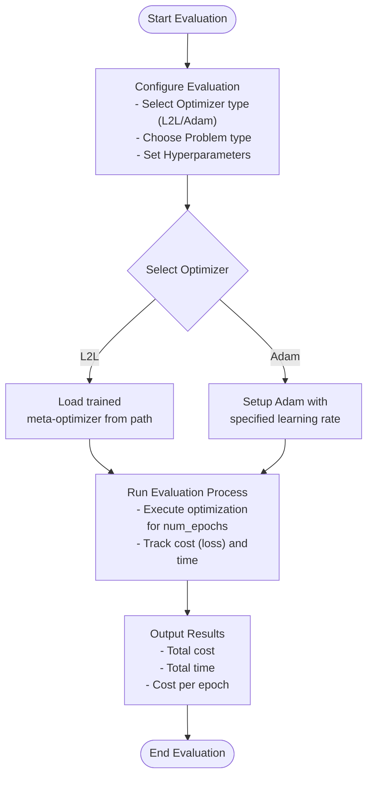
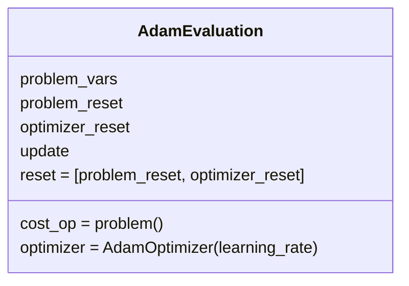
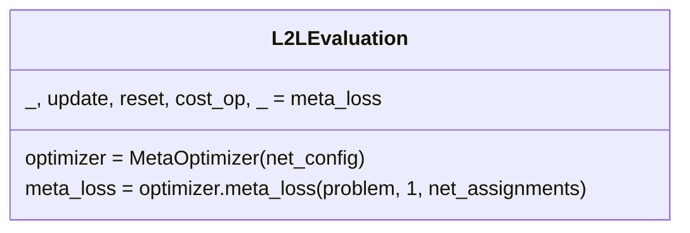
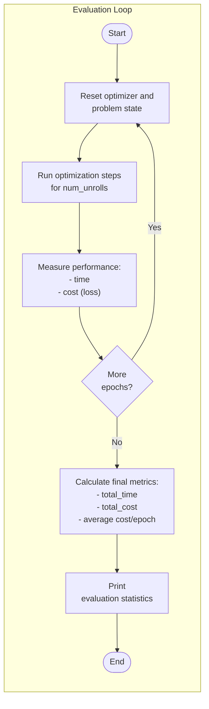
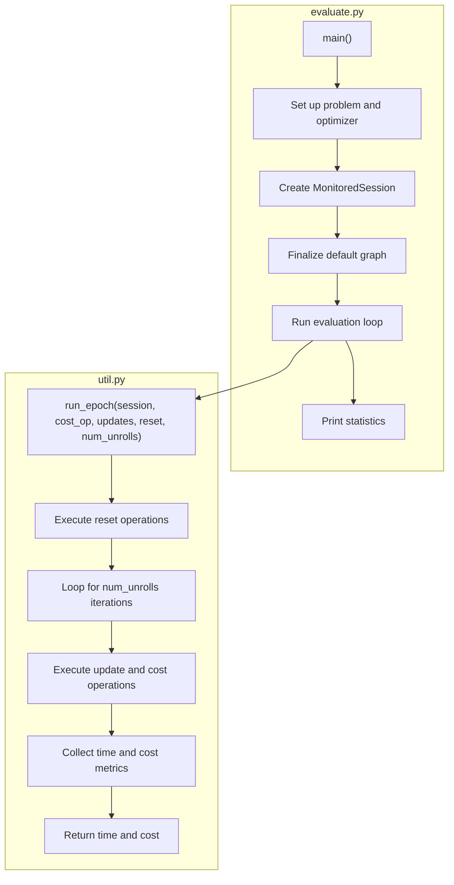

<!-- source: DeepWiki mcp.deepwiki.com · repo google-deepmind/learning-to-learn · page 6.2 Evaluation Methods · fetched 2026-10-26 -->

# Evaluation Methods

<details>
<summary>Relevant source files</summary>

The following files were used as context for generating this wiki page:

- [README.md](README.md)
- [convergence_test.py](convergence_test.py)
- [evaluate.py](evaluate.py)

</details>


This document outlines the evaluation methods used to assess the performance of trained meta-optimizers in the Learning to Learn (L2L) framework. It covers how to evaluate both learned (L2L) and baseline (Adam) optimizers, configure evaluation parameters, and interpret results. For information about training meta-optimizers, see [Training Workflow](#6.1). For details on saving and loading trained models, see [Saving and Loading Models](#6.3).

## Evaluation Overview

The Learning to Learn framework provides a systematic approach to compare the performance of learned meta-optimizers against standard optimization algorithms like Adam. Evaluation involves measuring how effectively an optimizer can minimize a given problem's loss function over a specified number of steps and epochs.



**Diagram: Evaluation Workflow**

Sources: [evaluate.py:14-94](), [README.md:32-46]()

## Evaluation Configuration

The evaluation process is configurable through several command-line flags that control how optimizers are evaluated.

### Key Configuration Parameters

| Parameter | Flag | Description | Default |
|-----------|------|-------------|---------|
| Optimizer type | `--optimizer` | Specifies which optimizer to evaluate (`L2L` or `Adam`) | `L2L` |
| Model path | `--path` | Path to saved meta-optimizer network (required for L2L) | None |
| Number of epochs | `--num_epochs` | Number of evaluation epochs to run | 100 |
| Random seed | `--seed` | Seed for TensorFlow's random number generator | None |
| Problem type | `--problem` | Type of problem to evaluate on (e.g., `simple`, `mnist`) | `simple` |
| Optimization steps | `--num_steps` | Number of optimization steps per epoch | 100 |
| Learning rate | `--learning_rate` | Learning rate (used for Adam optimizer) | 0.001 |

Sources: [evaluate.py:33-42](), [README.md:38-46]()

## Optimizer Setup

The evaluation script supports two types of optimizers:

### Adam Optimizer

When using the standard Adam optimizer (`--optimizer=Adam`), the system:
1. Creates the problem and its cost operation
2. Collects problem variables
3. Initializes the Adam optimizer with the specified learning rate
4. Creates operations for updating variables and resetting optimizer state



**Diagram: Adam Optimizer Evaluation Setup**

Sources: [evaluate.py:57-65]()

### L2L Meta-Optimizer

When using the learned meta-optimizer (`--optimizer=L2L`), the system:
1. Loads the meta-optimizer from the specified path
2. Sets up the meta-optimizer with the network configuration
3. Creates the meta-loss for evaluation
4. Extracts update, reset, and cost operations



**Diagram: L2L Meta-Optimizer Evaluation Setup**

Sources: [evaluate.py:66-71]()

## Evaluation Process

The evaluation process executes optimization steps for the specified number of epochs and measures performance metrics.



**Diagram: Evaluation Execution Flow**

Sources: [evaluate.py:75-90]()

### Execution Process

1. The `run_epoch` function from the `util` module executes a single epoch of optimization:
   - Resets the problem and optimizer state
   - Performs `num_unrolls` (or `num_steps`) optimization steps
   - Records the time taken and final cost

2. The main evaluation loop:
   - Runs `num_epochs` evaluation epochs
   - Accumulates total time and total cost 
   - Prints final statistics

Sources: [evaluate.py:81-90](), [convergence_test.py:28-38]()

## Running Evaluation

To evaluate an optimizer, use the `evaluate.py` script with appropriate command-line arguments.

### Example Commands

1. Evaluating a trained L2L optimizer on MNIST:
```bash
python evaluate.py --problem=mnist --optimizer=L2L --path=./mnist
```

2. Evaluating Adam optimizer on a quadratic problem with a custom learning rate:
```bash
python evaluate.py --problem=quadratic --optimizer=Adam --learning_rate=0.01 --num_epochs=50
```

3. Comparing L2L against Adam on CIFAR:
```bash
# First run L2L evaluation
python evaluate.py --problem=cifar --optimizer=L2L --path=./cifar_optimizer

# Then run Adam evaluation
python evaluate.py --problem=cifar --optimizer=Adam --learning_rate=0.001
```

Sources: [README.md:34-46](), [evaluate.py:45-94]()

## Interpreting Results

The evaluation process reports several key metrics:

| Metric | Description |
|--------|-------------|
| Total cost | Sum of loss values across all epochs |
| Total time | Total time taken for evaluation (in seconds) |
| Cost per epoch | Average loss value per epoch |

When comparing optimizers, lower costs indicate better optimization performance. The evaluation framework allows for direct comparison between learned meta-optimizers and traditional optimizers like Adam, providing insights into whether the meta-learning approach offers advantages for specific problems.

### Performance Comparison

The goal of evaluation is typically to compare:
1. Whether a trained L2L optimizer outperforms standard optimizers like Adam
2. How quickly each optimizer converges to a low-cost solution
3. The stability of optimization (consistency of results across runs)

For convergence testing, a successful meta-optimizer should be able to solve simple problems in fewer iterations than traditional methods, as demonstrated in the convergence test which verifies that L2L can solve a simple problem in less than 500 epochs.

Sources: [evaluate.py:87-90](), [convergence_test.py:41-59]()

## Evaluation for Different Problem Types

The evaluation framework supports all problem types defined in the L2L system:

| Problem | Description | Evaluation Considerations |
|---------|-------------|---------------------------|
| `simple` | One-variable quadratic function | Tests basic optimization capability |
| `simple-multi` | Two-variable quadratic function with split optimization | Tests multi-optimizer coordination |
| `quadratic` | Batched ten-variable quadratic function | Tests performance on higher-dimensional spaces |
| `mnist` | MNIST classification with a two-layer network | Tests performance on real-world classification |
| `cifar` | CIFAR10 classification with CNN | Tests performance on complex image recognition |
| `cifar-multi` | CIFAR10 with separate optimizers for conv and FC layers | Tests specialized optimizers for different layer types |

Sources: [README.md:49-63]()

## Technical Implementation

The evaluation system utilizes TensorFlow's `MonitoredSession` for running operations and handles variable initialization and finalization appropriately.



**Diagram: Technical Implementation of Evaluation**

Sources: [evaluate.py:74-90]()

---

