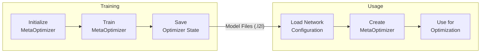
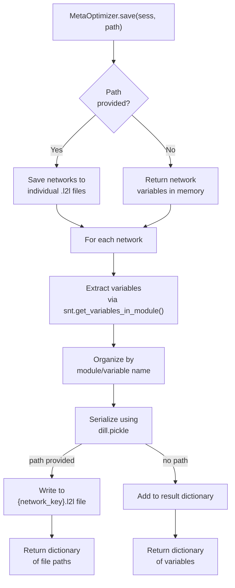
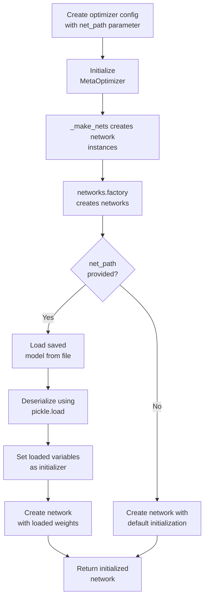

<!-- source: DeepWiki mcp.deepwiki.com · repo google-deepmind/learning-to-learn · page 6.3 Saving and Loading Models · fetched 2026-10-26 -->

# Saving and Loading Models

<details>
<summary>Relevant source files</summary>

The following files were used as context for generating this wiki page:

- [meta.py](meta.py)
- [meta_test.py](meta_test.py)
- [networks.py](networks.py)

</details>


This document explains how to save trained meta-optimizer models and load them for later use in the Learning to Learn (L2L) system. It covers the API methods, file formats, and typical usage patterns when persisting optimizers. For information about training models, see [Training Workflow](#6.1), and for evaluating saved models, see [Evaluation Methods](#6.2).

## Overview

The L2L framework provides mechanisms to save trained meta-optimizers to disk and load them for future use. This is essential for:

1. Using trained meta-optimizers without retraining
2. Transfer learning between similar optimization tasks
3. Comparing multiple meta-optimizer architectures
4. Checkpointing during long training runs

The saving and loading system works with the hierarchical network architecture of the meta-optimizer, handling both simple and complex optimizers with multiple network components.

Sources: [networks.py:47-62](), [meta.py:247-259]()

## Save/Load Workflow



Sources: [meta_test.py:190-236]()

## Saving Meta-Optimizers

The `MetaOptimizer` class provides a `save` method that persists the state of all optimizer networks:



### Key Points About Saving:

1. The `save` method takes two parameters:
   - `sess`: The TensorFlow session containing the model variables
   - `path` (optional): Directory to save the model files

2. When a path is provided, each optimizer network is saved to a separate file with the `.l2l` extension in the specified directory.

3. The method returns a dictionary mapping network keys to their saved variables (or filenames if saved to disk).

4. Under the hood, `networks.save()` is used to extract and serialize the variables of each network.

Sources: [meta.py:247-259](), [networks.py:47-62]()

## Loading Meta-Optimizers

Loading a saved meta-optimizer is done during the initialization of a new `MetaOptimizer` by specifying the path to the saved model in the configuration:



### Loading Process:

1. When creating a new `MetaOptimizer`, provide the path to the saved model in the network configuration options:
   ```python
   optimizer = meta.MetaOptimizer(net=dict(
       net="CoordinateWiseDeepLSTM",
       net_options=net_options,
       net_path="/path/to/saved/model.l2l"))
   ```

2. The `factory` function in `networks.py` handles loading the saved variables and using them to initialize the new network.

3. When the `meta_minimize` method is called on the loaded optimizer, it will use the loaded weights instead of random initialization.

Sources: [networks.py:34-44](), [meta_test.py:218-224]()

## File Format and Structure

When saving to disk, the L2L system uses the following conventions:

1. Model files use the `.l2l` extension
2. Each network in a meta-optimizer is saved as a separate file
3. File names follow the pattern `{network_key}.l2l` where `network_key` is the key used in the optimizer configuration

### Internal Structure:

The saved files contain a pickled Python dictionary with the following structure:

```
{
  "module_name": {
    "variable_name": variable_value_array,
    ...
  },
  ...
}
```

For example, for a `CoordinateWiseDeepLSTM` optimizer, the structure might look like:

```
{
  "lstm_1": {
    "w_gates": [...],
    "b_gates": [...]
  },
  "linear": {
    "w": [...],
    "b": [...]
  }
}
```

Sources: [networks.py:49-60]()

## Usage Examples

### Basic Save and Load Example

Here's a typical workflow for saving and loading a meta-optimizer:

1. **Train and save a meta-optimizer:**
   ```python
   # Create and train optimizer
   optimizer = meta.MetaOptimizer(net=dict(
       net="CoordinateWiseDeepLSTM",
       net_options={"layers": (20, 20)}))
   minimize_ops = optimizer.meta_minimize(problem, 3)
   
   # Train the optimizer
   with tf.Session() as sess:
       sess.run(tf.global_variables_initializer())
       # ... training loop ...
       
       # Save optimizer
       save_result = optimizer.save(sess, path="/path/to/save/dir")
   ```

2. **Load and use the saved optimizer:**
   ```python
   # Get path from save_result or construct manually
   net_path = "/path/to/save/dir/coordinatewise.l2l"
   
   # Create optimizer with saved weights
   optimizer = meta.MetaOptimizer(net=dict(
       net="CoordinateWiseDeepLSTM",
       net_options={"layers": (20, 20)},
       net_path=net_path))
   
   # Use optimizer as normal
   minimize_ops = optimizer.meta_minimize(problem, 3)
   ```

### Multi-Optimizer Save and Load

For optimizers with multiple network components:

```python
# Create and train a multi-network optimizer
optimizer = meta.MetaOptimizer(
    net1={"net": "CoordinateWiseDeepLSTM", "net_options": {"layers": (20, 20)}},
    net2={"net": "KernelDeepLSTM", "net_options": {"kernel_shape": [4, 4], "layers": (20,)}}
)

# After training, save all networks
with tf.Session() as sess:
    # ... training ...
    save_paths = optimizer.save(sess, path="/path/to/save/dir")
    # save_paths will contain paths for both net1 and net2

# To load, specify paths for each network
optimizer = meta.MetaOptimizer(
    net1={
        "net": "CoordinateWiseDeepLSTM", 
        "net_options": {"layers": (20, 20)},
        "net_path": "/path/to/save/dir/net1.l2l"
    },
    net2={
        "net": "KernelDeepLSTM", 
        "net_options": {"kernel_shape": [4, 4], "layers": (20,)},
        "net_path": "/path/to/save/dir/net2.l2l"
    }
)
```

Sources: [meta_test.py:190-236]()

## Best Practices

1. **Consistent Network Configuration**: When loading a saved optimizer, ensure that the network architecture (type and options) matches what was used during training.

2. **Directory Organization**: Use a structured directory naming scheme:
   ```
   models/
   ├── problem_name/
   │   ├── network_type/
   │   │   ├── parameters/
   │   │   │   ├── coordinatewise.l2l
   │   │   │   └── ...
   ```

3. **Version Tracking**: Include training parameters and version information:
   ```
   models/
   ├── simple_quadratic/
   │   ├── CoordinateWiseDeepLSTM/
   │   │   ├── 2x20_lr0.001_unroll10/
   │   │   │   ├── coordinatewise.l2l
   ```

4. **Metadata**: Consider saving additional metadata alongside the model:
   - Training hyperparameters
   - Problem description
   - Performance metrics

Sources: [meta.py:247-259](), [networks.py:47-62]()

## Technical Details

### Variable Extraction Mechanism

The saving process extracts variables using Sonnet's `snt.get_variables_in_module()` function, which finds all TensorFlow variables associated with a module. The variables are organized by:

1. **Module Name**: The second-to-last element in the variable name path
2. **Variable Name**: The last element in the variable name path

For example, a variable with the name `vars_optimizer/deep_rnn/lstm_1/w_gates:0` would be organized under:
- Module Name: `lstm_1`
- Variable Name: `w_gates`

### Serialization Process

The saving process uses the `dill` library (an extension of Python's `pickle`) to serialize the TensorFlow variable values. This preserves NumPy arrays efficiently while maintaining Python object structure.

Sources: [networks.py:47-62]()

## Limitations and Considerations

1. **TensorFlow Version Compatibility**: Saved models may not be compatible across different major versions of TensorFlow.

2. **Network Structure**: The loaded network must have the same structure as the saved one. Changes to network architecture will cause loading errors.

3. **Pickle Security**: Since the system uses pickle for serialization, only load models from trusted sources to avoid security risks.

4. **Variable Naming**: If TensorFlow's variable naming scheme changes in future versions, the variable extraction logic may need to be updated.

Sources: [networks.py:52-56]()

---

