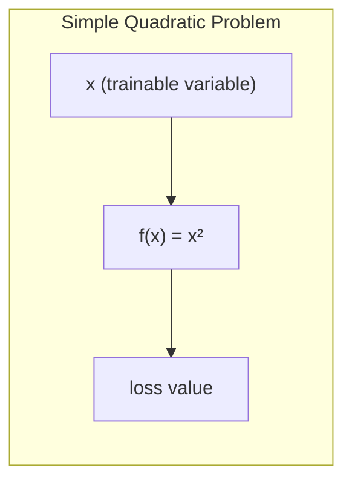
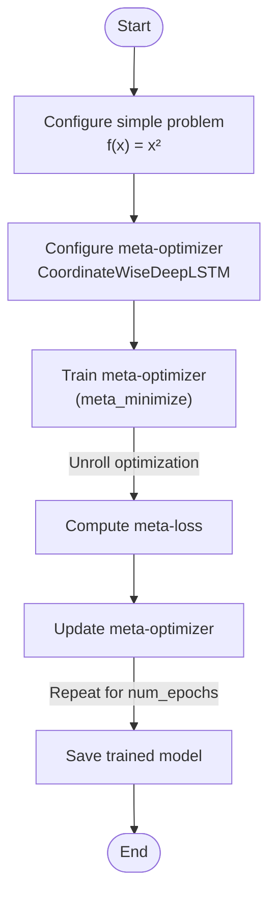
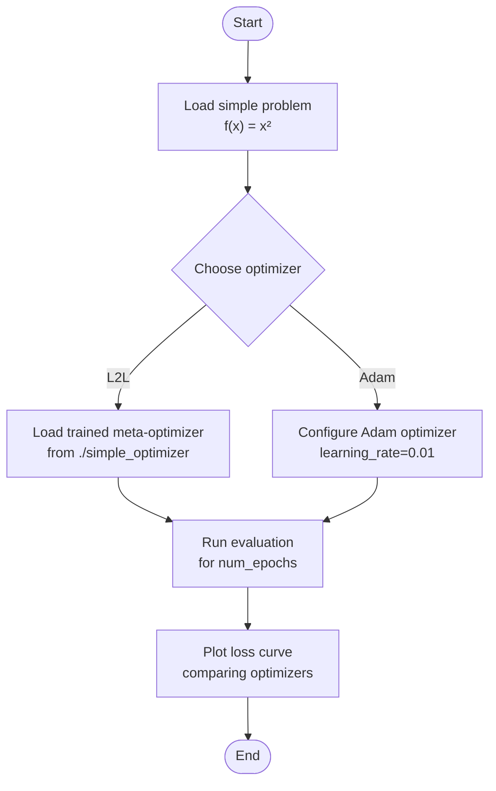
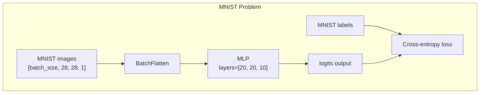
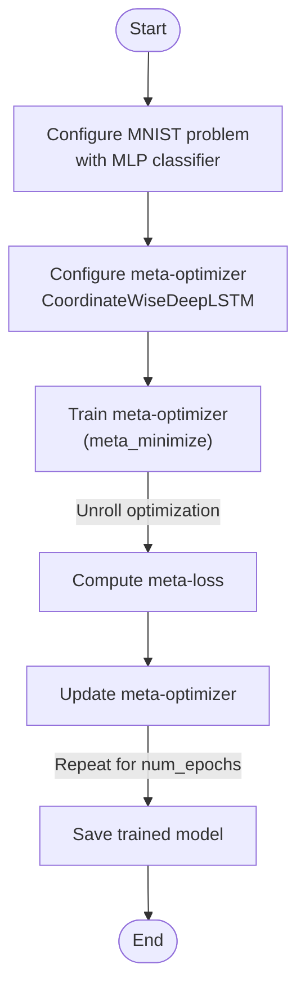
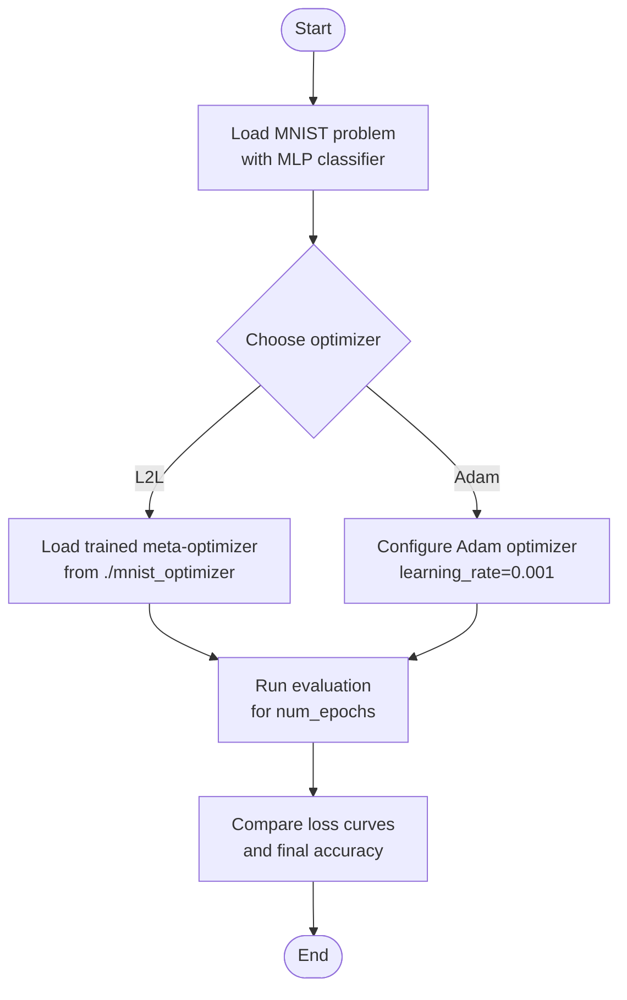
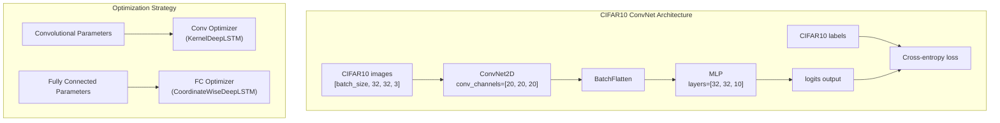
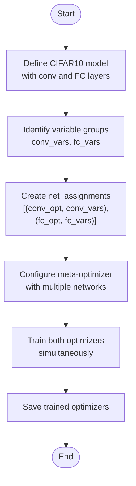
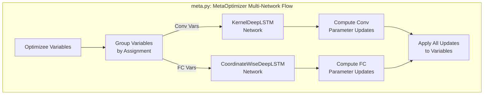
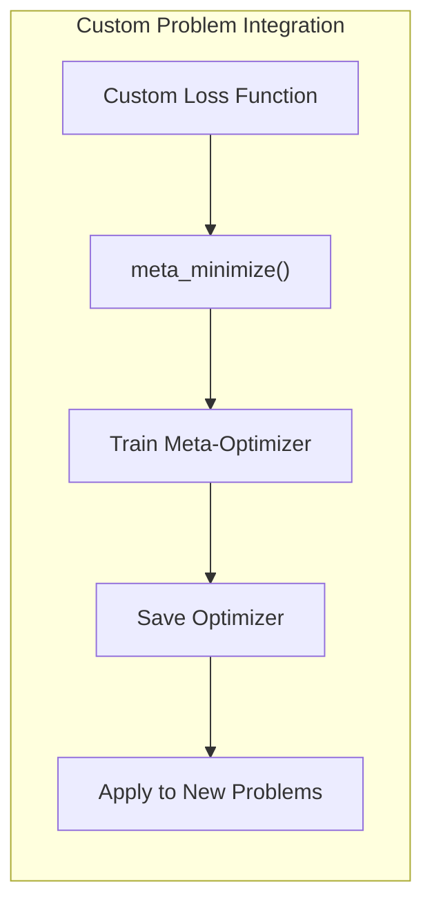

<!-- source: DeepWiki mcp.deepwiki.com · repo google-deepmind/learning-to-learn · page 7 Practical Examples · fetched 2026-10-26 -->

# Practical Examples

<details>
<summary>Relevant source files</summary>

The following files were used as context for generating this wiki page:

- [README.md](README.md)
- [meta.py](meta.py)
- [problems.py](problems.py)

</details>


This page provides concrete examples of how to use the Learning to Learn (L2L) framework for different optimization scenarios. These examples illustrate how to train meta-optimizers, apply them to various problems, and compare their performance with standard optimizers. For conceptual understanding of the L2L approach, see [Overview](#1) and [Meta-Optimizer](#3).

## 7.1 Simple Optimization Example

This section demonstrates how to train a meta-optimizer on a simple quadratic function and then use it to optimize the same function.

### Problem Definition

The simple problem is defined as minimizing `f(x) = x²`, a one-variable quadratic function.



Sources: [problems.py:39-51]()

### Training the Meta-Optimizer

To train a meta-optimizer on this simple problem:

1. Define the problem
2. Configure the meta-optimizer
3. Run the training process



Sources: [meta.py:385-402](), [problems.py:39-51]()

#### Command-line Example

```
python train.py --problem=simple --save_path=./simple_optimizer --num_epochs=10000 --num_steps=100 --learning_rate=0.001
```

Key parameters:
| Parameter | Value | Description |
|-----------|-------|-------------|
| problem | simple | The simple quadratic problem |
| save_path | ./simple_optimizer | Path to save the trained optimizer |
| num_epochs | 10000 | Number of training epochs |
| num_steps | 100 | Number of optimization steps per epoch |
| learning_rate | 0.001 | Learning rate for meta-optimizer training |

Sources: [README.md:10-30]()

### Evaluating the Meta-Optimizer

After training, you can evaluate the meta-optimizer on the same problem and compare it with standard optimizers:

```
python evaluate.py --problem=simple --optimizer=L2L --path=./simple_optimizer
python evaluate.py --problem=simple --optimizer=Adam --learning_rate=0.01
```

The evaluation will show how quickly each optimizer reaches the optimal solution (x=0).



Sources: [README.md:32-47]()

## 7.2 MNIST Classification Example

This example shows how to train a meta-optimizer on the MNIST image classification task and then use it to optimize a fully connected neural network.

### Problem Definition

The MNIST problem trains a multi-layer perceptron to classify handwritten digits.



Sources: [problems.py:141-174]()

### Training the Meta-Optimizer

Training a meta-optimizer for MNIST involves more computation than the simple example:



#### Command-line Example

```
python train.py --problem=mnist --save_path=./mnist_optimizer --num_epochs=100 --num_steps=100 --learning_rate=0.001
```

Key parameters:
| Parameter | Value | Description |
|-----------|-------|-------------|
| problem | mnist | MNIST classification problem |
| save_path | ./mnist_optimizer | Path to save the trained optimizer |
| num_epochs | 100 | Number of training epochs |
| num_steps | 100 | Number of optimization steps per epoch |
| learning_rate | 0.001 | Learning rate for meta-optimizer training |

Sources: [README.md:10-30]()

### Evaluating the Meta-Optimizer

After training, evaluate the meta-optimizer on the MNIST problem:

```
python evaluate.py --problem=mnist --optimizer=L2L --path=./mnist_optimizer
python evaluate.py --problem=mnist --optimizer=Adam --learning_rate=0.001
```

The evaluation will compare the L2L optimizer with Adam on optimization speed and final accuracy.



Sources: [README.md:32-47]()

## 7.3 Multi-Optimizer Example

This example demonstrates how to use multiple optimizers for different parts of a model, which is particularly useful for complex architectures like convolutional neural networks.

### Problem Definition: CIFAR-Multi

The CIFAR-multi problem uses two independent optimizers: one for convolutional layer parameters and another for fully connected layer parameters.



Sources: [problems.py:196-277]()

### Setting Up Multiple Optimizers

The key to using multiple optimizers is the `net_assignments` parameter in the `meta_loss` or `meta_minimize` method, which maps variable names to specific optimizers.



Sources: [meta.py:154-208]()

#### Command-line Example

```
python train.py --problem=cifar-multi --save_path=./cifar_multi_optimizer --num_epochs=200 --num_steps=100
```

Key parameters:
| Parameter | Value | Description |
|-----------|-------|-------------|
| problem | cifar-multi | CIFAR10 with multiple optimizers |
| save_path | ./cifar_multi_optimizer | Path to save the trained optimizers |
| num_epochs | 200 | Number of training epochs |
| num_steps | 100 | Number of optimization steps per epoch |

Sources: [README.md:10-30](), [README.md:60-63]()

### Implementation Details

For multi-optimizer problems, the `MetaOptimizer` class handles the internal mapping of variables to optimizer networks:

1. Variables are grouped based on their names or patterns
2. Different network configurations are created for each group
3. During optimization, gradients for each group are processed by their assigned optimizer



Sources: [meta.py:212-246](), [meta.py:261-384]()

### Evaluating Multiple Optimizers

Evaluation for multi-optimizer scenarios is similar to single-optimizer cases, but internal processes differ:

```
python evaluate.py --problem=cifar-multi --optimizer=L2L --path=./cifar_multi_optimizer
```

When evaluating, the system:
1. Loads each trained optimizer from the specified path
2. Applies them to their respective variable groups
3. Computes and applies updates coordinated through the `MetaOptimizer` framework

You can compare this against standard optimizers like Adam, which would apply the same optimization algorithm to all variables.

Sources: [meta.py:247-259](), [README.md:32-47]()

## Using L2L in Custom Projects

The L2L framework can be extended to custom optimization problems beyond the provided examples:

1. Define a function that returns a TensorFlow operation generating the loss to be minimized
2. Ensure all operations with Python side effects (e.g., queue creation) are done outside the function
3. Pass this function to the `meta_minimize` method of the `MetaOptimizer` class
4. Configure unrolling length, learning rate, and other parameters as needed



Sources: [README.md:66-74](), [meta.py:385-402]()

### Key Considerations for Custom Problems

When creating custom problems, consider:

1. Problem complexity relative to meta-optimizer capacity
2. Number of variables and their structure
3. Whether to use multiple optimizers for different variable groups
4. Preprocessing options for gradients
5. Unrolling length based on optimization difficulty

Sources: [README.md:66-74]()

---

