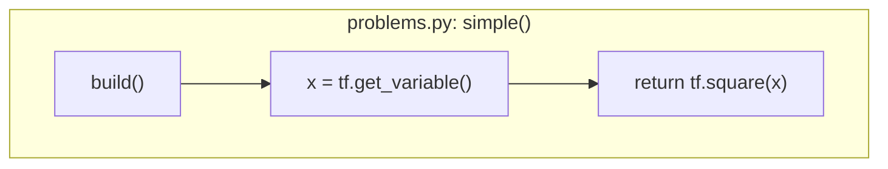
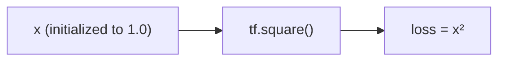
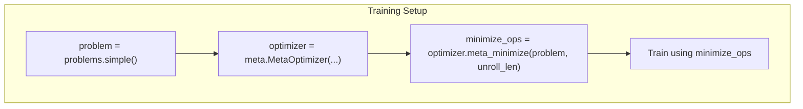
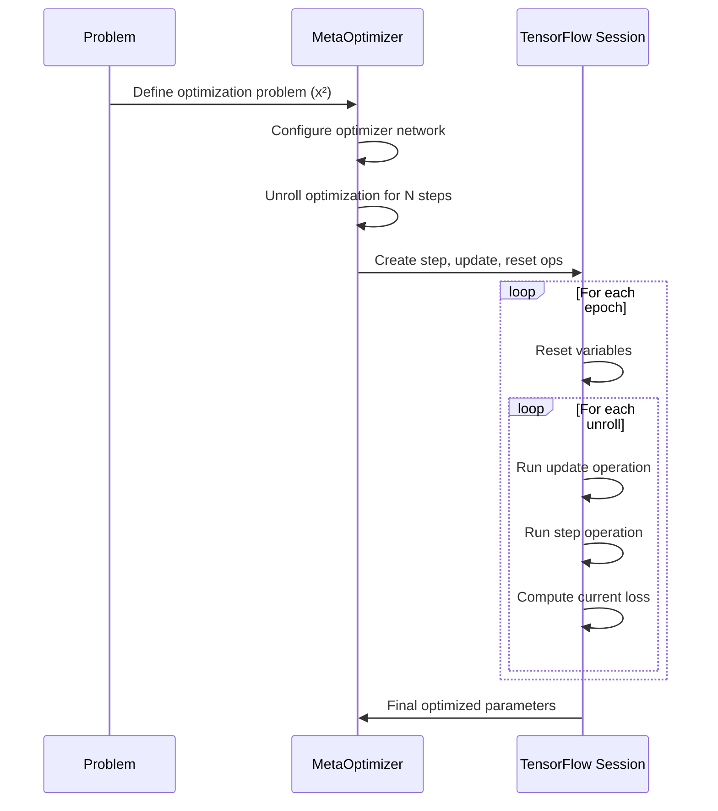
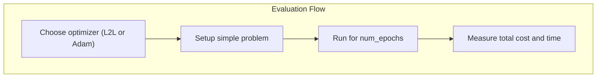
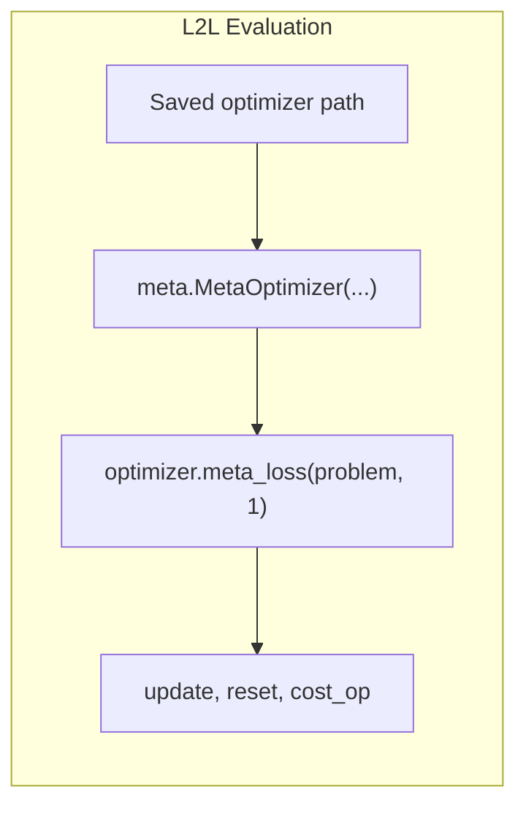
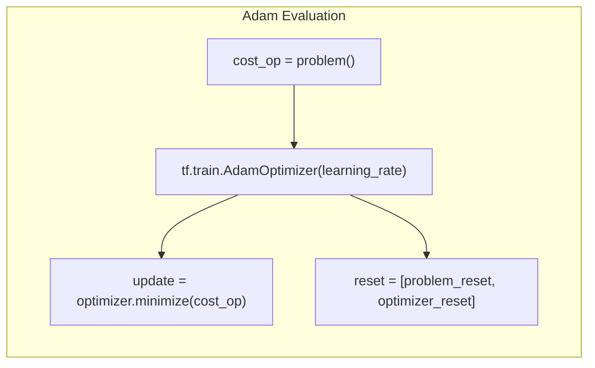
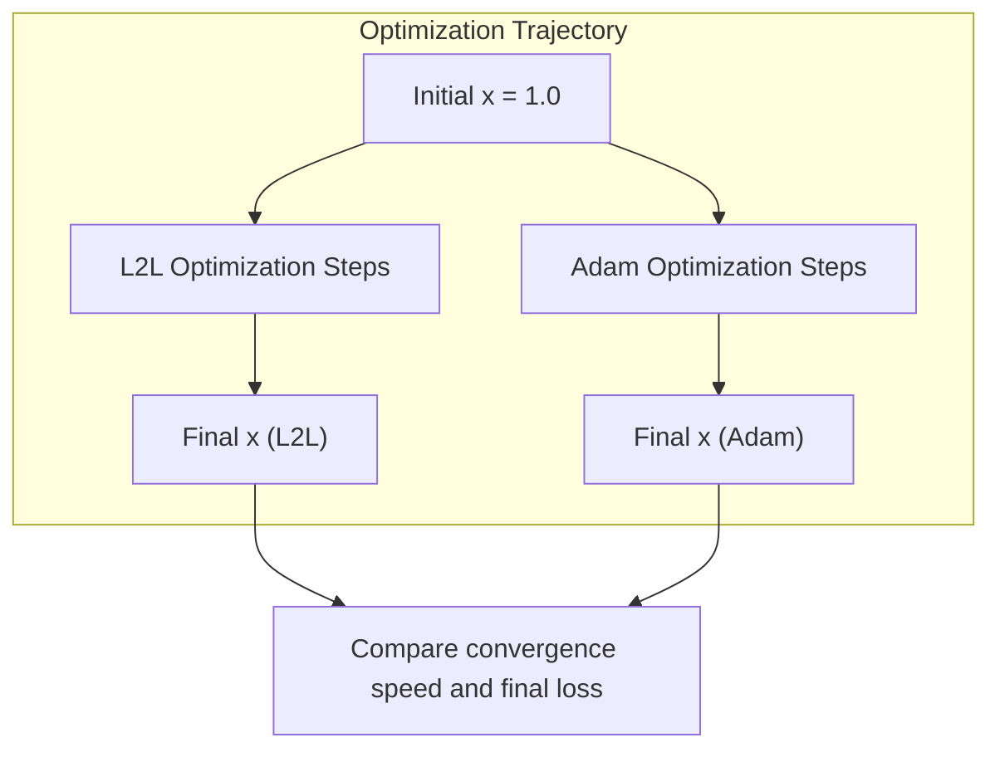
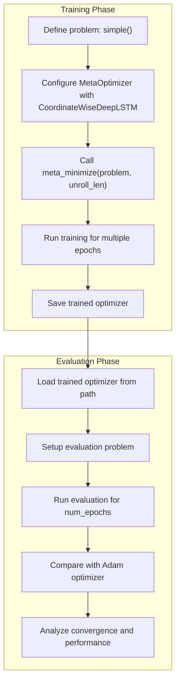

<!-- source: DeepWiki mcp.deepwiki.com · repo google-deepmind/learning-to-learn · page 7.1 Simple Optimization Example · fetched 2026-10-26 -->

# Simple Optimization Example

<details>
<summary>Relevant source files</summary>

The following files were used as context for generating this wiki page:

- [convergence_test.py](convergence_test.py)
- [evaluate.py](evaluate.py)
- [meta_test.py](meta_test.py)
- [problems.py](problems.py)

</details>


This page provides a step-by-step walkthrough of training and evaluating a meta-optimizer on a simple problem in the Learning to Learn (L2L) framework. This example serves as an entry point to understanding how the L2L system works using the most basic optimization problem (`f(x) = x²`), making it ideal for beginners. For more complex examples, see [MNIST Classification Example](#7.2) or [Multi-Optimizer Example](#7.3).

## Overview of the Simple Problem

The "simple" problem provided in the L2L framework is a one-dimensional quadratic function:

```
f(x) = x²
```

This elementary optimization problem has a global minimum at x = 0 with a value of 0. While trivial to solve analytically, it provides an excellent test case for optimizers since we know the expected result.

### Problem Definition



Sources: [problems.py:39-51]()

The `simple()` function in `problems.py` returns a function builder that:
1. Creates a single scalar TensorFlow variable `x` initialized to 1.0
2. Returns the square of this variable as the loss

This problem is implemented as:



Sources: [problems.py:39-51]()

## Training a Meta-Optimizer on the Simple Problem

Training a meta-optimizer involves configuring the optimizer network, defining the optimization problem, and running the training process.

### Setup and Configuration



Sources: [meta_test.py:44-59](), [convergence_test.py:44-58]()

### Training Process

The training process for the meta-optimizer on this simple problem involves:

1. **Create the problem**: Use `problems.simple()` to get the problem builder
2. **Configure the meta-optimizer**: Create a `MetaOptimizer` with an appropriate network configuration
3. **Setup meta-minimization**: Call `meta_minimize()` to set up the optimization process
4. **Execute training**: Run the training loop using TensorFlow session operations



Sources: [meta_test.py:34-44](), [convergence_test.py:28-38]()

## Evaluating the Trained Optimizer

After training, we can evaluate how well our meta-optimizer performs on the simple problem and compare it against traditional optimizers like Adam.

### Evaluation Process



Sources: [evaluate.py:45-91]()

### L2L Optimizer Setup for Evaluation



Sources: [evaluate.py:66-71]()

### Adam Optimizer Setup for Evaluation



Sources: [evaluate.py:57-65]()

## Convergence Comparison

The simple problem provides a clear benchmark for comparing optimizer performance. For the `x²` problem, we can measure how quickly different optimizers converge to the optimal solution (x = 0).



Sources: [convergence_test.py:44-59]()

## Complete Example Workflow

Here's the complete workflow for training and evaluating a meta-optimizer on the simple problem:



Sources: [meta_test.py:34-44](), [meta_test.py:190-236](), [evaluate.py:45-91]()

## Example Code Parameters

The following table shows typical parameters used for training and evaluating the meta-optimizer on the simple problem:

| Parameter | Training Value | Evaluation Value | Description |
|-----------|---------------|-----------------|-------------|
| Learning rate | 1e-2 | 0.001 | Step size for Adam or meta-optimizer |
| Unroll length | 20 | 100 | Number of optimization steps per epoch |
| Num epochs | 500 | 100 | Number of training/evaluation epochs |
| Network type | CoordinateWiseDeepLSTM | Same as training | Type of neural network used |
| Layers | Empty tuple () | Same as training | Network layers configuration |
| Initializer | "zeros" | Same as training | Network weight initialization |

Sources: [convergence_test.py:44-59](), [evaluate.py:34-42]()

## Performance Expectations

When properly trained, the L2L meta-optimizer should be able to solve the simple problem in significantly fewer iterations than traditional optimizers. A well-trained meta-optimizer should achieve a loss below 1e-5 in less than 500 epochs on this problem.

Sources: [convergence_test.py:55-59]()

## Conclusion

This simple optimization example demonstrates the basic workflow of the Learning to Learn (L2L) system:

1. Define a problem (in this case, minimizing x²)
2. Configure and train a meta-optimizer
3. Evaluate the trained optimizer against traditional methods

While this example uses an extremely simple function, the same principles apply to more complex optimization problems like neural network training. The next steps would be to explore the [MNIST Classification Example](#7.2) or the [Multi-Optimizer Example](#7.3) for more advanced applications.

---

