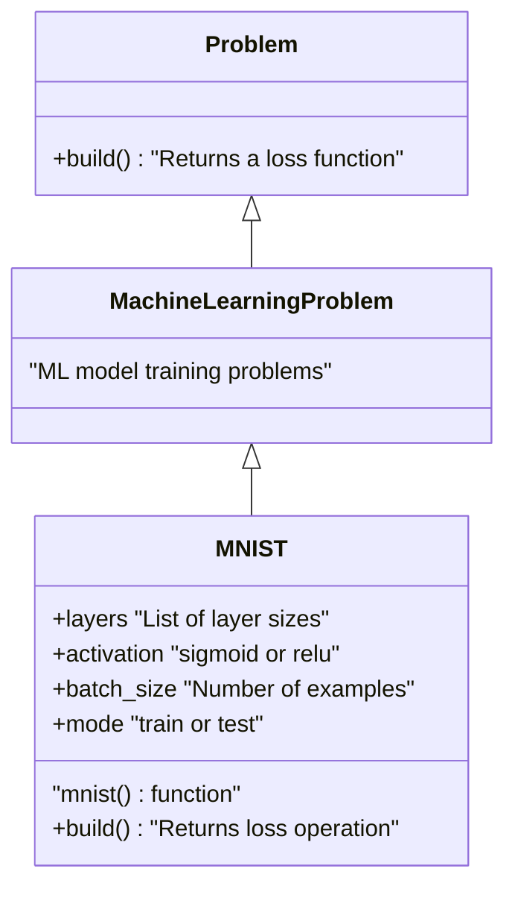
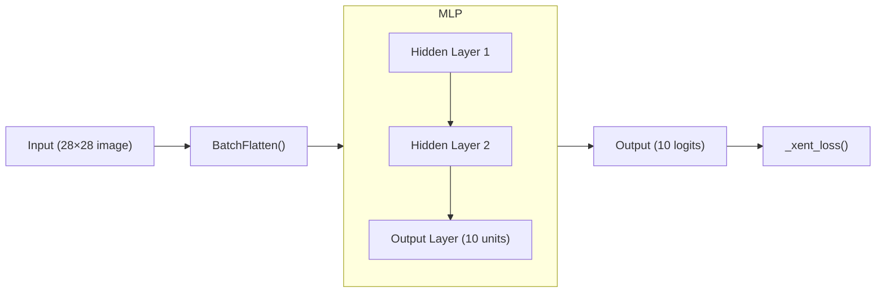
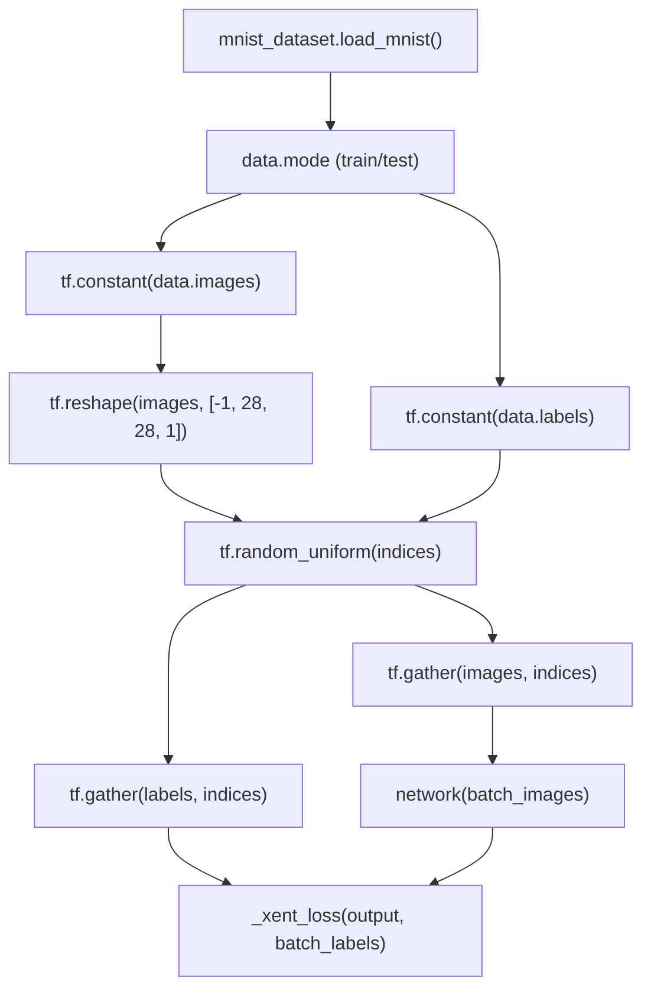
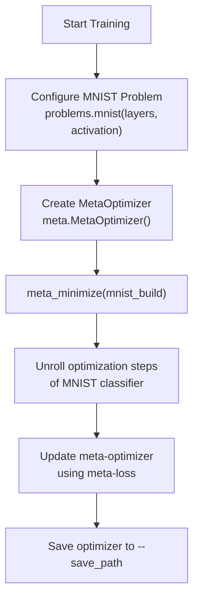
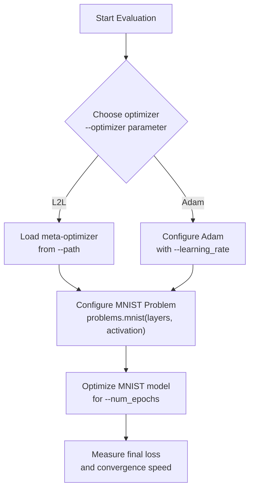

<!-- source: DeepWiki mcp.deepwiki.com · repo google-deepmind/learning-to-learn · page 7.2 MNIST Classification Example · fetched 2026-10-26 -->

# MNIST Classification Example

<details>
<summary>Relevant source files</summary>

The following files were used as context for generating this wiki page:

- [README.md](README.md)
- [problems.py](problems.py)

</details>


## Purpose and Scope

This document details the MNIST Classification Example in the Learning to Learn (L2L) framework. It demonstrates how the meta-learning system can optimize a neural network for image classification using the MNIST handwritten digit dataset. Unlike the [Simple Optimization Example](#7.1) which focuses on mathematical functions, this example addresses a practical machine learning task, providing a realistic scenario for training and evaluating meta-optimizers.

Sources: [problems.py:141-174](), [README.md:58-59]()

## Problem Definition

The MNIST problem is implemented in the `mnist` function within `problems.py`. This function creates a problem that trains a multi-layer perceptron to classify MNIST digits by building a TensorFlow graph that loads data, creates a network, and defines a cross-entropy loss function.



The `mnist` function accepts the following parameters:

| Parameter | Description | Default |
|-----------|-------------|---------|
| `layers` | List of hidden layer sizes | Required |
| `activation` | Activation function ("sigmoid" or "relu") | "sigmoid" |
| `batch_size` | Number of examples in each batch | 128 |
| `mode` | Dataset to use ("train" or "test") | "train" |

The function returns a build function that generates a TensorFlow operation representing the cross-entropy loss.

Sources: [problems.py:141-174]()

## Network Architecture

The network architecture for MNIST classification is a multi-layer perceptron implemented using DeepMind's Sonnet library.



The network construction occurs in the following steps:
1. A `snt.BatchFlatten` layer flattens the 28×28 MNIST images into vectors
2. An `snt.nets.MLP` with configurable hidden layers and an output layer with 10 units (one per digit)
3. The `_xent_loss` function computes the sparse softmax cross-entropy loss

The network initializes weights and biases using random normal initializers with mean 0 and standard deviation 0.01, as defined in `_nn_initializers`.

Sources: [problems.py:33-36](), [problems.py:135-138](), [problems.py:162-166]()

## Data Handling

The MNIST dataset is loaded using TensorFlow's built-in dataset utilities. The following diagram illustrates the data flow:



Key steps in the data handling process:
1. Load MNIST data using `mnist_dataset.load_mnist()`
2. Select train or test set based on the `mode` parameter
3. Convert images and labels to TensorFlow constants
4. Reshape images to the proper dimensions
5. Select random batches during training using `tf.random_uniform` to generate indices
6. Process batched data through the network and compute the loss

Sources: [problems.py:154-172]()

## Training Process

To train a meta-optimizer on the MNIST problem, use the `train.py` script with the `--problem=mnist` flag:

```
python train.py --problem=mnist --save_path=./mnist
```

The following diagram illustrates the training workflow:



During training, the meta-optimizer learns to generate parameter updates that minimize the cross-entropy loss of the MNIST classifier. The system unrolls multiple optimization steps to compute the meta-loss, which is then used to update the meta-optimizer itself.

Sources: [README.md:10-14](), [README.md:58-59]()

## Evaluation Process

To evaluate an optimizer on the MNIST problem, use the `evaluate.py` script:

```
python evaluate.py --problem=mnist --optimizer=L2L --path=./mnist
```

The diagram below illustrates the evaluation workflow:



The evaluation allows comparing the learned optimizer against standard optimizers like Adam, providing insights into the effectiveness of the meta-learning approach.

Sources: [README.md:32-46](), [README.md:58-59]()

## Performance Considerations

When using the MNIST problem for meta-learning, consider the following factors:

| Consideration | Impact |
|---------------|--------|
| Network size | Larger `layers` values create more complex optimization problems but require more computational resources |
| Activation function | The choice between "sigmoid" and "relu" affects the optimization landscape |
| Batch size | Larger batch sizes give more stable gradients but require more memory |
| Unroll length | How many optimization steps to unroll affects how far the meta-optimizer can look ahead |

The MNIST problem provides a good balance between complexity and computational requirements, making it well-suited for experimenting with meta-learning approaches.

Sources: [problems.py:141-174]()

## Example Use Case

A typical workflow for using the MNIST Classification Example might include:

1. **Training a meta-optimizer**:
   ```
   python train.py --problem=mnist --num_epochs=10000 --evaluation_period=1000 --unroll_length=20 --save_path=./mnist_optimizer
   ```

2. **Evaluating the trained optimizer**:
   ```
   python evaluate.py --problem=mnist --optimizer=L2L --path=./mnist_optimizer --num_epochs=100
   ```

3. **Comparing with traditional optimizers**:
   ```
   python evaluate.py --problem=mnist --optimizer=Adam --learning_rate=0.001 --num_epochs=100
   ```

This allows researchers to assess whether the meta-learned optimizer can converge faster or achieve better final performance than traditional optimization methods on the MNIST classification task.

Sources: [README.md:10-30](), [README.md:32-46]()

---

