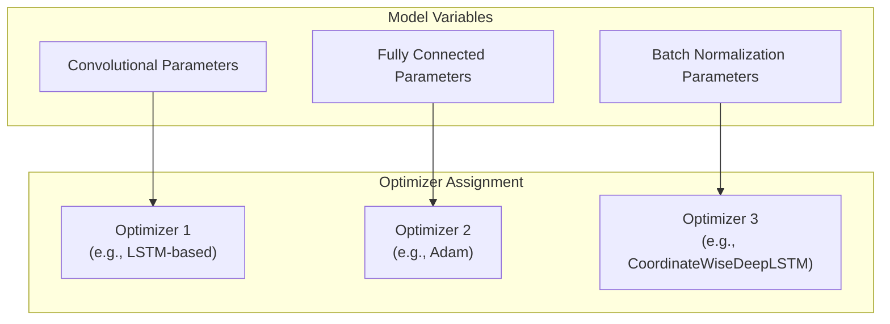
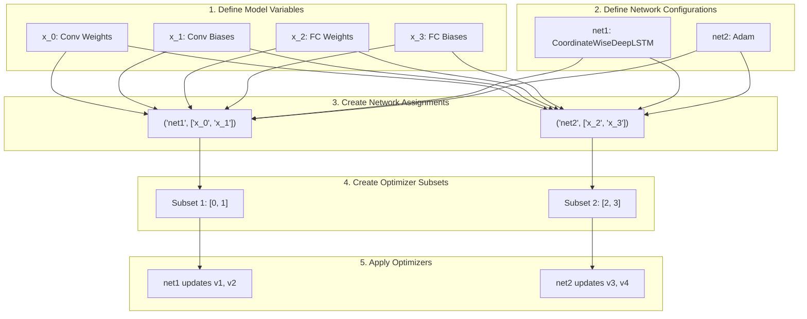
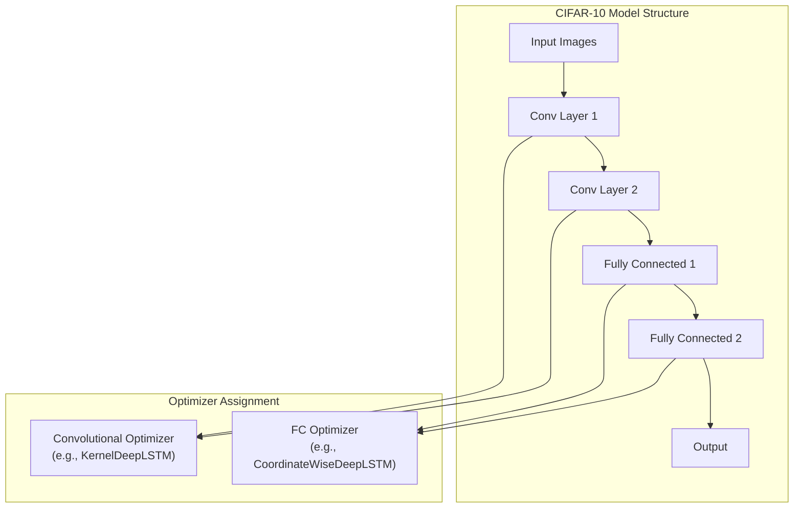
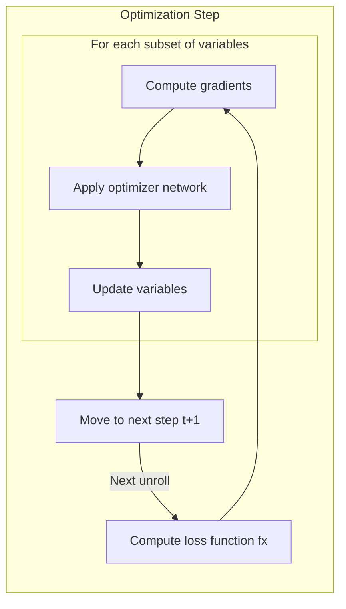

<!-- source: DeepWiki mcp.deepwiki.com · repo google-deepmind/learning-to-learn · page 7.3 Multi-Optimizer Example · fetched 2026-10-26 -->

# Multi-Optimizer Example

<details>
<summary>Relevant source files</summary>

The following files were used as context for generating this wiki page:

- [README.md](README.md)
- [meta.py](meta.py)
- [meta_test.py](meta_test.py)

</details>


This page explains how to use multiple optimizers for different parts of a model in the Learning to Learn (L2L) framework. You'll learn how to configure and implement training scenarios where different optimization algorithms are applied to different subsets of model variables. For information about basic optimization using a single optimizer, see [Simple Optimization Example](#7.1).

## Multi-Optimizer Concept

The L2L framework allows you to assign different optimizers to different parts of your model. This is particularly useful when:

1. Different components of your model may benefit from different optimization strategies
2. You want to compare the performance of different optimizers in a single training run
3. You need to apply specialized optimization algorithms to specific types of layers



Sources: [README.md:55-63](), [meta.py:261-266]()

## Multi-Optimizer Implementation

In the Learning to Learn framework, multiple optimizers are implemented through the `net_assignments` parameter in the `meta_loss` and `meta_minimize` methods of the `MetaOptimizer` class. This parameter lets you map specific variables to specific optimizer networks.

```mermaid
classDiagram
    class MetaOptimizer {
        -_config: Dict
        -_nets: Dict
        +meta_loss(make_loss, len_unroll, net_assignments)
        +meta_minimize(make_loss, len_unroll, net_assignments)
        +save(sess, path)
    }
    
    class _make_nets {
        <<function>>
        +variables: List
        +config: Dict
        +net_assignments: List[(netid, var_names)]
        Returns nets, keys, subsets
    }
    
    MetaOptimizer --> _make_nets : uses
    _make_nets --> "networks.factory()" : creates optimizer networks
```

Sources: [meta.py:154-208](), [meta.py:261-266]()

### Implementation Details

The `net_assignments` parameter is a list of tuples, where each tuple contains:
1. A network identifier (`netid`) that matches a key in the optimizer configuration
2. A list of variable names to be optimized by that network

When processing these assignments:

1. The system first maps variable names to their indices in the variable list
2. For each network assignment, it creates the specified optimizer
3. It then builds subsets of variable indices for each optimizer
4. During optimization, each optimizer processes only its assigned subset of variables

Sources: [meta.py:154-208]()

## Configuring Multi-Optimizer Systems

To use multiple optimizers, you need to configure both:
1. The optimizer networks (in the `MetaOptimizer` constructor)
2. The variable assignments (in the `meta_loss` or `meta_minimize` method call)

### Step 1: Configure Optimizer Networks

```python
optimizer = meta.MetaOptimizer(
    net1={
        "net": "CoordinateWiseDeepLSTM",
        "net_options": {"layers": (20, 20)}
    },
    net2={
        "net": "Adam"
    }
)
```

Each key-value pair in the constructor defines a different optimizer network that can be referenced later in the assignments.

### Step 2: Assign Variables to Optimizers

```python
net_assignments = [
    ("net1", ["conv1/weights", "conv1/biases"]),
    ("net2", ["fc/weights", "fc/biases"])
]
```

Then use these assignments when calling `meta_minimize`:

```python
min_ops = optimizer.meta_minimize(
    problem, 
    len_unroll=20,
    net_assignments=net_assignments
)
```

Sources: [meta.py:261-266](), [meta_test.py:92-116]()

## Variable Assignment Process

The following diagram illustrates how variables are assigned to different optimizers:



Sources: [meta.py:154-208](), [meta.py:326-347]()

## Practical Examples

The L2L framework provides two built-in multi-optimizer examples:

### 1. Simple Multi-Optimizer Example

This example uses a two-variable quadratic function where:
- One variable is optimized using a learned optimizer
- The other is optimized using Adam

```python
# From util.py (problem creation)
problem = problems.simple_multi_optimizer(num_dims=2)

# Multi-optimizer configuration
optimizer = meta.MetaOptimizer(
    net1={
        "net": "CoordinateWiseDeepLSTM",
        "net_options": {"layers": (10, 10)}
    },
    net2={
        "net": "Adam"
    }
)

# Variable assignments
net_assignments = [
    ("net1", ["x_0"]),  # First variable uses LSTM optimizer
    ("net2", ["x_1"])   # Second variable uses Adam
]

# Create optimization operations
minimize_ops = optimizer.meta_minimize(
    problem, 
    len_unroll=20,
    net_assignments=net_assignments
)
```

Sources: [README.md:55-57](), [meta_test.py:92-116]()

### 2. CIFAR-Multi Example

This example applies different optimizers to different layer types in a convolutional neural network:



The configuration for this setup would be:

```python
# Create optimizers
optimizer = meta.MetaOptimizer(
    conv_opt={
        "net": "KernelDeepLSTM",
        "net_options": {
            "kernel_shape": [5, 5],  # Matching CNN kernel size
            "layers": (20, 20)
        }
    },
    fc_opt={
        "net": "CoordinateWiseDeepLSTM",
        "net_options": {"layers": (20, 20)}
    }
)

# Assign variables to optimizers
net_assignments = [
    ("conv_opt", ["conv1/w", "conv1/b", "conv2/w", "conv2/b"]),
    ("fc_opt", ["fc1/w", "fc1/b", "fc2/w", "fc2/b"])
]
```

Sources: [README.md:60-63](), [meta_test.py:140-167]()

## Internal Implementation Details

When using multiple optimizers, the L2L framework processes each optimization step as follows:



The key code that implements this multi-optimizer logic is in the `time_step` function within `meta_loss`:

```python
for subset, key, s_i in zip(subsets, net_keys, state):
    x_i = [x[j] for j in subset]  # Get variables for this optimizer
    deltas, s_i_next = update(nets[key], fx, x_i, s_i)  # Compute updates
    
    for idx, j in enumerate(subset):
        x_next[j] += deltas[idx]  # Apply updates to variables
    state_next.append(s_i_next)  # Update optimizer state
```

Sources: [meta.py:326-347]()

## Best Practices for Multi-Optimizer Usage

When using multiple optimizers in your L2L setup:

1. **Choose appropriate optimizer types** for different variable groups:
   - KernelDeepLSTM for convolutional layers
   - CoordinateWiseDeepLSTM for fully connected layers
   - Standard optimizers (like Adam) when appropriate

2. **Group variables logically** by their function in the network:
   - Convolutional parameters
   - Fully connected parameters
   - Normalization parameters

3. **Avoid overlaps in variable assignments** unless specifically testing multiple optimizers on the same variable

4. **Check variable names carefully** when creating assignments to ensure all model parameters are covered

5. **Monitor the performance** of each optimizer independently if possible to understand which one contributes most to improvements

Sources: [meta.py:261-266](), [meta_test.py:92-116]()

## Testing Multi-Optimizer Configurations

The L2L codebase includes tests for different multi-optimizer scenarios in `meta_test.py`:

| Scenario | Configuration | Purpose |
|----------|--------------|---------|
| Shared optimizer | `None` for net_assignments | Default case where one optimizer handles all variables |
| Explicit sharing | `[("net", ["x_0", "x_1"])]` | Explicitly assigning multiple variables to one optimizer |
| Different optimizers | `[("net1", ["x_0"]), ("net2", ["x_1"])]` | Using different optimizer types for different variables |
| Multiple optimizers per variable | `[("net1", ["x_0"]), ("net2", ["x_0"])]` | Testing multiple optimizers for the same variable |

You can use these test cases as templates for your own multi-optimizer configurations.

Sources: [meta_test.py:71-126]()