# Page: Overview

# Overview

<details>
<summary>Relevant source files</summary>

The following files were used as context for generating this wiki page:

- [README.md](README.md)
- [meta.py](meta.py)
- [networks.py](networks.py)
- [problems.py](problems.py)

</details>


This page provides a technical overview of the Learning to Learn (L2L) system, a meta-optimization framework implemented in TensorFlow. L2L enables the training of neural network-based optimizers that can learn to optimize other machine learning models, potentially outperforming traditional hand-designed optimization algorithms.

## Learning to Learn Concept

The Learning to Learn (L2L) codebase implements the approach described in the paper ["Learning to Learn by Gradient Descent by Gradient Descent"](https://arxiv.org/abs/1606.04474). The core concept is to replace hand-designed optimization algorithms (like SGD or Adam) with learned optimizers that can adapt to specific problem structures.

In traditional optimization, we use algorithms with fixed update rules to minimize a loss function. In meta-learning for optimization, we:

1. Parameterize the optimizer as a neural network
2. Train this network to perform well across a distribution of optimization tasks
3. Use the trained optimizer to optimize new problems more efficiently

The meta-optimizer learns by "unrolling" optimization steps and computing gradients through the entire optimization process.

Sources: [README.md:1-14](), [meta.py:212-218]()

## System Architecture

The L2L system consists of four core components:

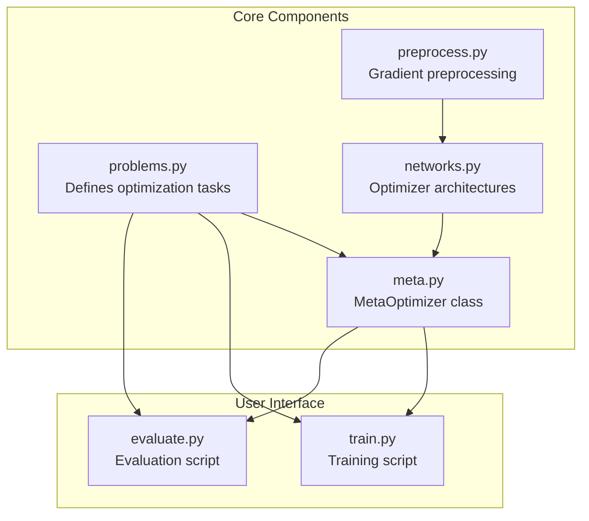

The system is designed to be modular, with clear separation between problem definitions, network architectures, and the meta-optimization process.

Sources: [problems.py:15-16](), [networks.py:15-16](), [meta.py:15-16](), [README.md:10-21]()

## Workflow

The typical workflow for using the L2L system involves:

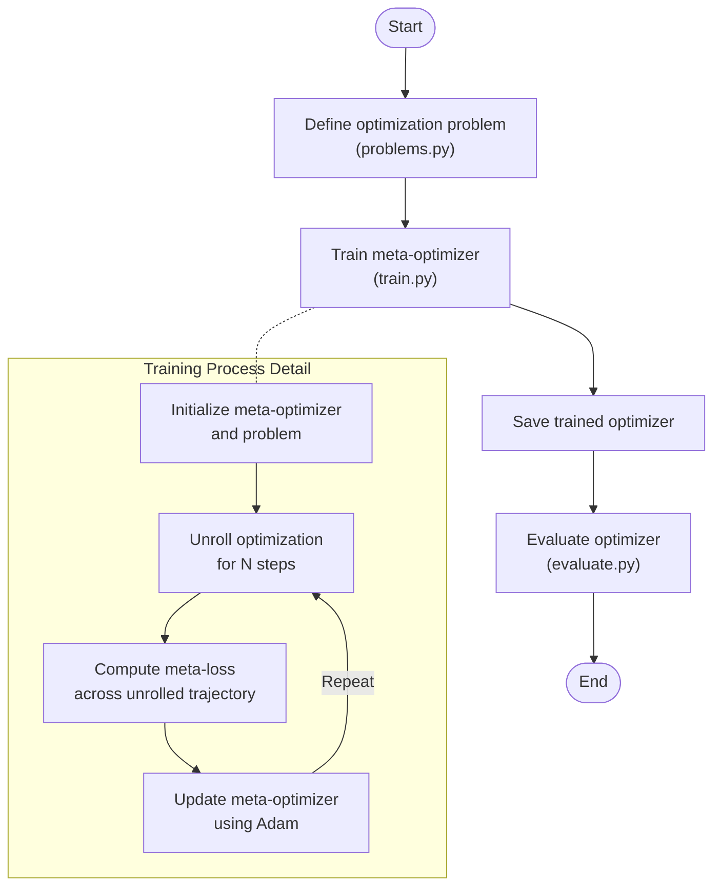

Throughout this process, the system creates a meta-optimization loop that wraps around traditional optimization, enabling the optimizer itself to be learned.

Sources: [README.md:10-74](), [meta.py:261-402]()

## Core Components

### MetaOptimizer

The central class in the L2L system is the `MetaOptimizer` in [meta.py](), which:

1. Manages the training of neural network-based optimizers
2. Unrolls optimization trajectories to compute meta-gradients
3. Updates the optimizer's parameters to improve its performance

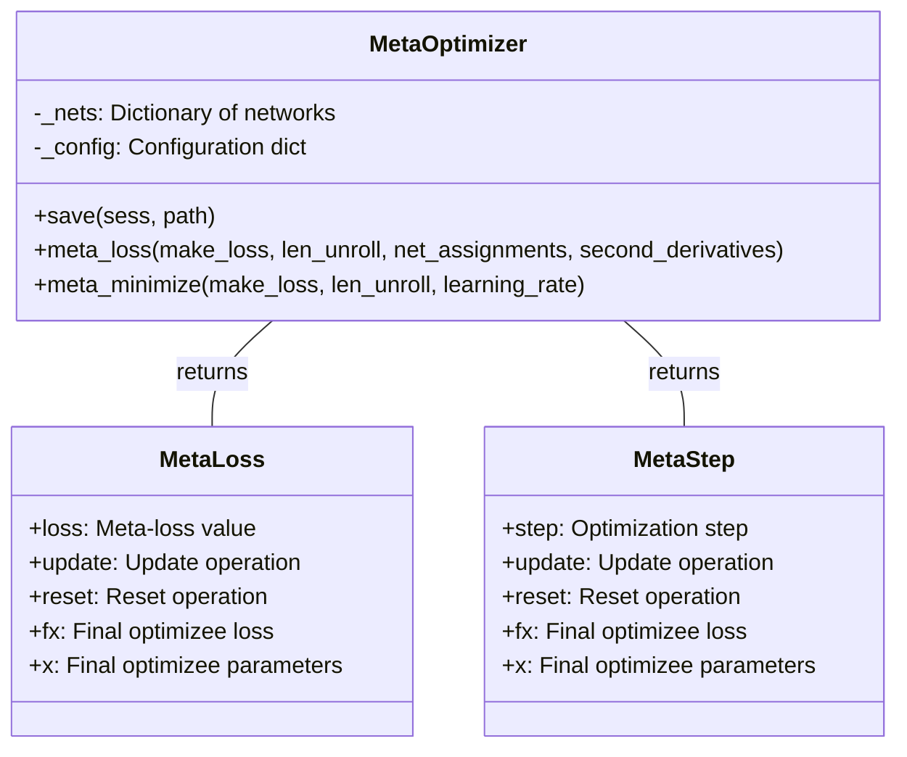

The `meta_loss` method unrolls the optimization for a specified number of steps and computes the sum of losses across the trajectory, while the `meta_minimize` method creates an Adam optimizer to minimize this meta-loss.

Sources: [meta.py:211-402](), [README.md:65-74]()

### Network Architectures

The L2L system provides several network architectures for meta-optimizers:

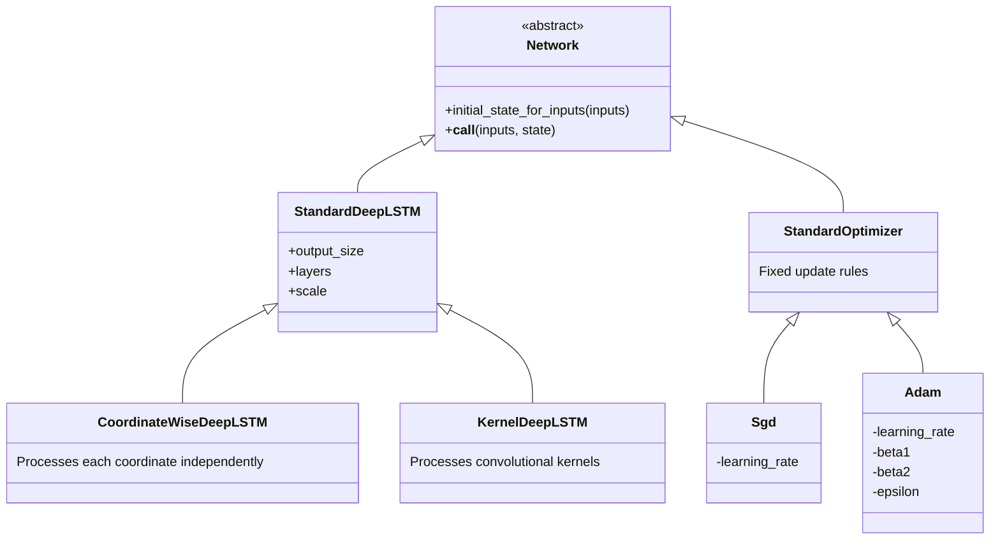

The most commonly used architecture is the `CoordinateWiseDeepLSTM`, which processes each parameter of the optimizee independently using the same LSTM network. This design provides efficiency and scalability.

Sources: [networks.py:66-378]()

### Problem Definitions

The system includes several problem types for training and evaluating meta-optimizers:

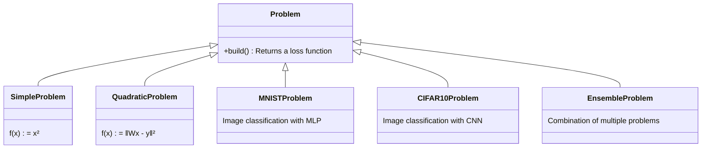

Each problem provides a `build()` function that returns a loss function which can be used by the meta-optimizer. Problems range from simple quadratic functions to complex image classification tasks.

Sources: [problems.py:39-277]()

### Gradient Preprocessing

Gradient preprocessing is crucial for effective meta-optimization. The primary preprocessing technique is `LogAndSign`:

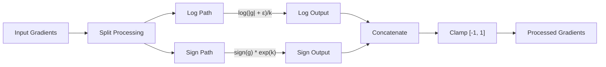

This preprocessing helps normalize gradients across different scales and provides useful signal to the meta-optimizer.

Sources: [networks.py:178-184]()

## Supported Problem Types

The L2L framework supports a variety of optimization problems:

| Problem Type | Description | Implementation |
|--------------|-------------|----------------|
| `simple` | One-variable quadratic function: f(x) = x² | [problems.py:39-51]() |
| `simple_multi_optimizer` | Multi-variable quadratic function with different optimizers | [problems.py:54-68]() |
| `quadratic` | Batched matrix problem: f(x) = ‖Wx - y‖² | [problems.py:71-99]() |
| `mnist` | MNIST classification with a multi-layer perceptron | [problems.py:141-174]() |
| `cifar10` | CIFAR-10 classification with convolutional network | [problems.py:196-277]() |
| `ensemble` | Combination of multiple problems with weights | [problems.py:102-132]() |

These problems provide a diverse set of optimization challenges for training and evaluating meta-optimizers.

Sources: [problems.py:39-277](), [README.md:49-63]()

## Training and Evaluation

The L2L system provides command-line tools for training and evaluating meta-optimizers:


Training involves optimizing the meta-optimizer's parameters by unrolling optimization trajectories, while evaluation compares the performance of trained optimizers against traditional methods like Adam.

Sources: [README.md:10-46](), [meta.py:386-402]()

## Related Topics

For more detailed information about specific components of the L2L system, refer to these wiki pages:

- For detailed explanation of the meta-learning approach, see [Learning to Learn Concept](#1.1)
- For problem definitions and implementations, see [Problems](#2)
- For meta-optimizer implementation details, see [Meta-Optimizer](#3)
- For network architecture specifics, see [Networks](#4)
- For gradient preprocessing techniques, see [Preprocessing](#5)
- For practical usage examples, see [Practical Examples](#7)

---

# Page: Learning to Learn Concept

# Learning to Learn Concept

<details>
<summary>Relevant source files</summary>

The following files were used as context for generating this wiki page:

- [README.md](README.md)
- [meta.py](meta.py)

</details>


## Purpose and Scope

This document explains the Learning to Learn (L2L) concept as implemented in this repository. It covers the fundamental principles of meta-learning for optimization, how it differs from traditional optimization methods, and the implementation details within the codebase. For information about the overall system architecture, see [System Architecture](#1.2).

## What is Learning to Learn?

Learning to Learn (L2L), also known as meta-learning, is an approach where an algorithm learns how to optimize other learning algorithms. Instead of using hand-designed optimization algorithms like SGD or Adam, a meta-learning system learns the optimization process itself from data.

In this implementation, neural networks (specifically recurrent neural networks) learn update rules for optimizing parameters of other neural networks or mathematical functions. These learned optimizers can potentially outperform traditional optimization algorithms on specific problem classes.

### Meta-Learning vs Traditional Optimization

**Traditional Optimization Process vs Learning to Learn**

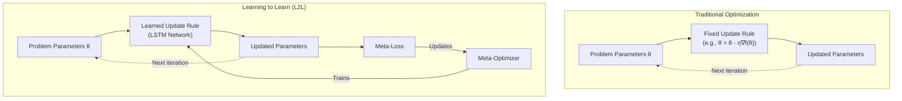

Sources: [meta.py:211-402](), [README.md:1-69]()

The key distinction is that traditional optimizers use fixed, human-designed update rules, while L2L uses learned update rules generated by neural networks that can adapt to specific problem structures.

## Core Components in the L2L Implementation

The L2L approach is implemented through these key components:

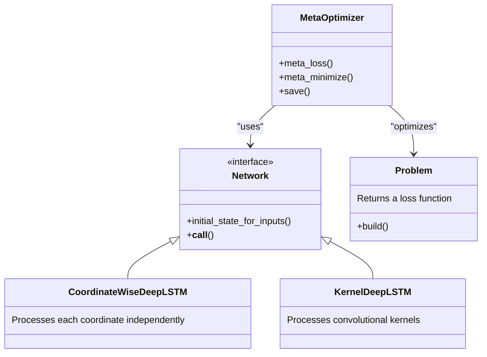

Sources: [meta.py:211-220](), [meta.py:261-384](), [meta.py:386-402]()

1. **MetaOptimizer**: The core class that manages the training of optimizer networks and coordinates the meta-learning process
2. **Optimizer Networks**: RNN-based networks (typically LSTMs) that learn to generate parameter updates
3. **Problem Definitions**: Optimization tasks used for training and evaluating the meta-optimizer
4. **Meta-Loss**: A loss function computed over multiple unrolled optimization steps

## The Meta-Optimization Process

The meta-optimization process involves these key steps:

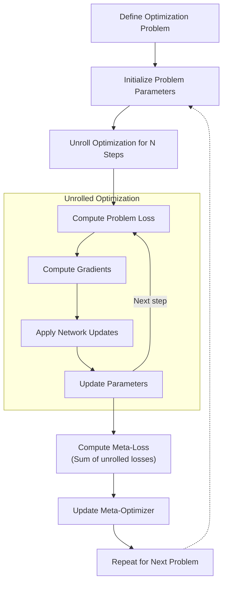

Sources: [meta.py:326-347](), [meta.py:349-364](), [meta.py:386-402]()

This process is centered around the concept of "unrolling" - running multiple optimization steps as part of a single computational graph, then using the cumulative loss to update the meta-optimizer.

## Implementation Details

### Meta-Loss Computation

The meta-loss is computed by unrolling the optimization process for a specified number of steps and summing the losses at each step. This is implemented in the `meta_loss` method:

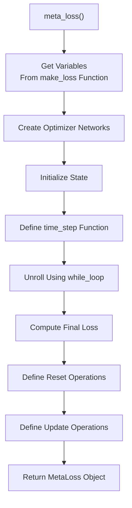

Sources: [meta.py:261-384]()

The critical `time_step` function [meta.py:326-347]() performs a single optimization step:
1. Compute the current loss using the current parameters
2. Compute gradients of the loss with respect to parameters
3. Use the optimization networks to generate parameter updates
4. Apply the updates to the parameters
5. Update the RNN state

### Optimizer Networks

The optimizer networks take gradients as input and produce parameter updates. Two main types are used:

1. **CoordinateWiseDeepLSTM**: Processes each parameter independently
2. **KernelDeepLSTM**: Specifically designed for convolutional kernels

These networks include preprocessing techniques for the gradients (like the `LogAndSign` preprocessor) which transform raw gradients into more useful representations.

### Training the Meta-Optimizer

The meta-optimizer itself is trained using the Adam optimizer in `meta_minimize`:

```python
def meta_minimize(self, make_loss, len_unroll, learning_rate=0.01, **kwargs):
    info = self.meta_loss(make_loss, len_unroll, **kwargs)
    optimizer = tf.train.AdamOptimizer(learning_rate)
    step = optimizer.minimize(info.loss)
    return MetaStep(step, *info[1:])
```

Sources: [meta.py:386-402]()

This method:
1. Computes the meta-loss using `meta_loss`
2. Creates an Adam optimizer to minimize this meta-loss
3. Returns operations for stepping the optimizer, updating parameters, and resetting state

## Technical Implementation Workflow

The complete workflow for training a meta-optimizer involves:

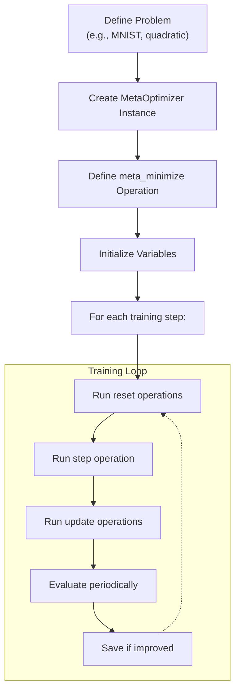

Sources: [train.py](), [meta.py:386-402]()

## Advantages of Learning to Learn

The Learning to Learn approach offers several technical advantages:

| Advantage | Description |
|-----------|-------------|
| Problem-specific optimization | Learns update rules specialized for particular problem structures |
| Long-term dependencies | Uses RNNs to capture dependencies across optimization steps |
| Automatic feature discovery | Learns to identify and use features of the loss landscape |
| No manual tuning | Potentially reduces need for extensive hyperparameter optimization |

## Conclusion

The Learning to Learn approach implemented in this codebase represents a shift from hand-designed optimization algorithms to learned optimization algorithms. By framing the optimizer itself as a learnable component, this approach opens up possibilities for more adaptive and efficient optimization, particularly for specific classes of problems.

For more detailed information about specific components, see:
- [Meta-Optimizer Class](#3.1)
- [Network Architectures](#4)
- [Problem Definitions](#2)

---

# Page: System Architecture

# System Architecture

<details>
<summary>Relevant source files</summary>

The following files were used as context for generating this wiki page:

- [README.md](README.md)
- [meta.py](meta.py)
- [networks.py](networks.py)
- [problems.py](problems.py)

</details>


## Purpose and Scope

This document describes the overall architecture of the Learning to Learn (L2L) system, explaining the key components, their relationships, and how data flows through the system. It focuses on the structural organization of the codebase and the interactions between different modules. For information about the Learning to Learn concept itself, please see [Learning to Learn Concept](#1.1).

## High-Level Overview

The Learning to Learn (L2L) framework is designed to train meta-optimizers that can learn to optimize other machine learning models. The system employs a modular architecture with clearly separated components for defining optimization problems, creating neural network-based optimizers, and managing the meta-learning process.

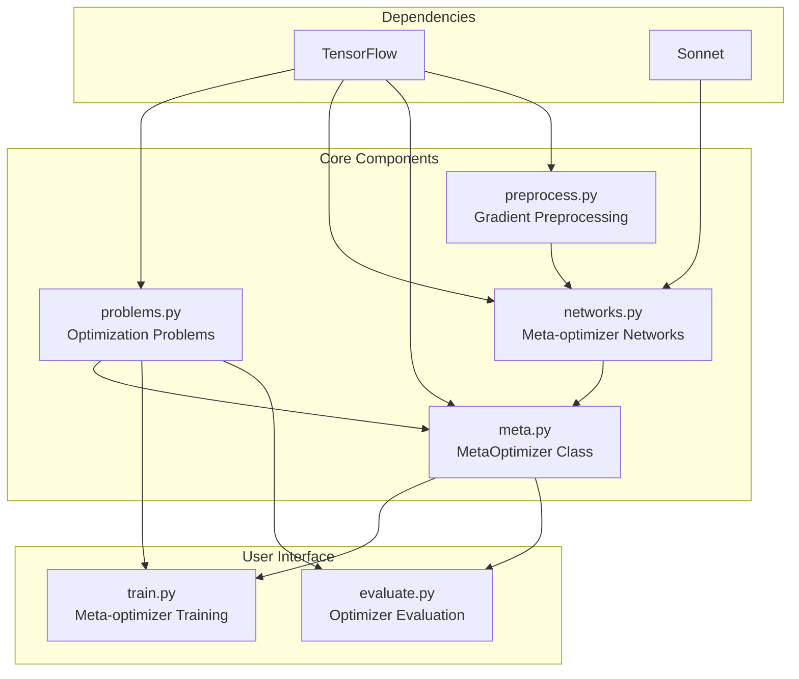

Sources: [problems.py](), [networks.py](), [meta.py](), [README.md]()

## Core Components

The system comprises four main components:

1. **Problem Definitions (problems.py)**: Defines optimization problems used for training and evaluating meta-optimizers.

2. **Network Architectures (networks.py)**: Implements neural network architectures that serve as meta-optimizers.

3. **Meta-Optimizer (meta.py)**: Core class that manages the meta-learning process.

4. **Preprocessing (preprocess.py)**: Handles gradient preprocessing to improve learning stability.

### Component Responsibilities

| Component | Key Classes/Functions | Responsibility |
|-----------|------------------------|----------------|
| problems.py | `simple()`, `quadratic()`, `mnist()`, `cifar10()`, `ensemble()` | Defines loss functions for optimization |
| networks.py | `Network` (base class), `CoordinateWiseDeepLSTM`, `KernelDeepLSTM`, `Adam` | Defines optimizer network architectures |
| meta.py | `MetaOptimizer` | Manages the meta-learning process |
| preprocess.py | `LogAndSign` | Preprocesses gradients for better learning |

Sources: [problems.py:39-277](), [networks.py:66-377](), [meta.py:211-402]()

## Component Interactions

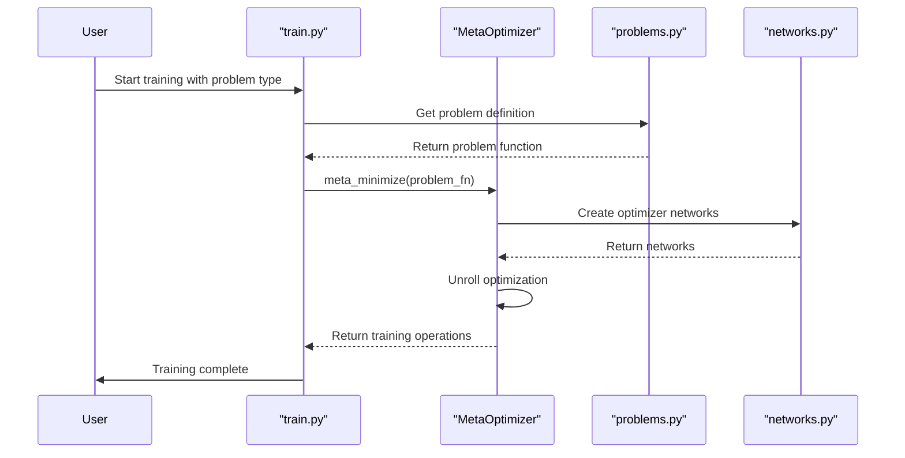

Sources: [meta.py:261-384](), [meta.py:386-402]()

## Data Flow Architecture

The Learning to Learn system implements a unique data flow pattern to enable meta-learning. At its core is the concept of unrolling optimization steps and computing gradients through the entire optimization process.

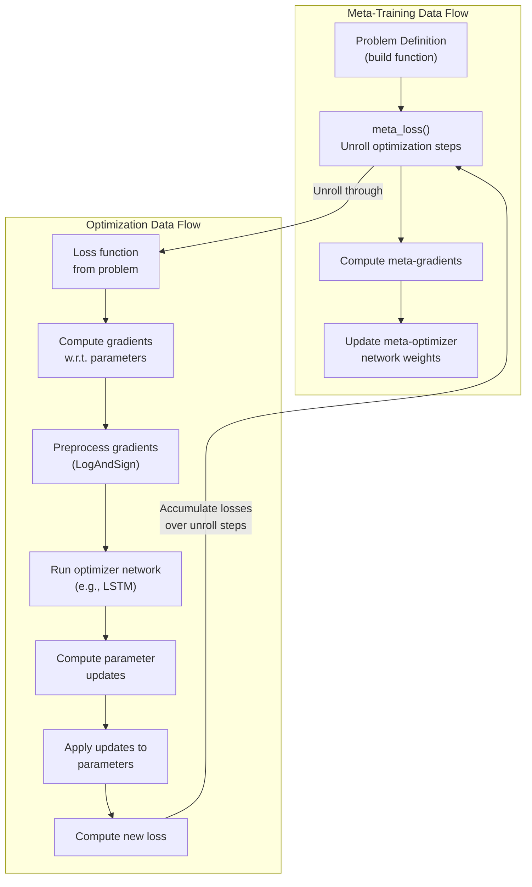

Sources: [meta.py:326-347](), [meta.py:349-358]()

## Meta-Optimizer Architecture

The `MetaOptimizer` class is the central component of the system, coordinating the training and application of learned optimizers.

### Key Concepts

- **Unrolling**: The process of simulating multiple steps of optimization and backpropagating through the entire sequence.
- **Meta-loss**: The sum of losses over all unrolled optimization steps.
- **Network assignments**: The ability to use different optimizers for different parts of a model.

### Implementation Structure

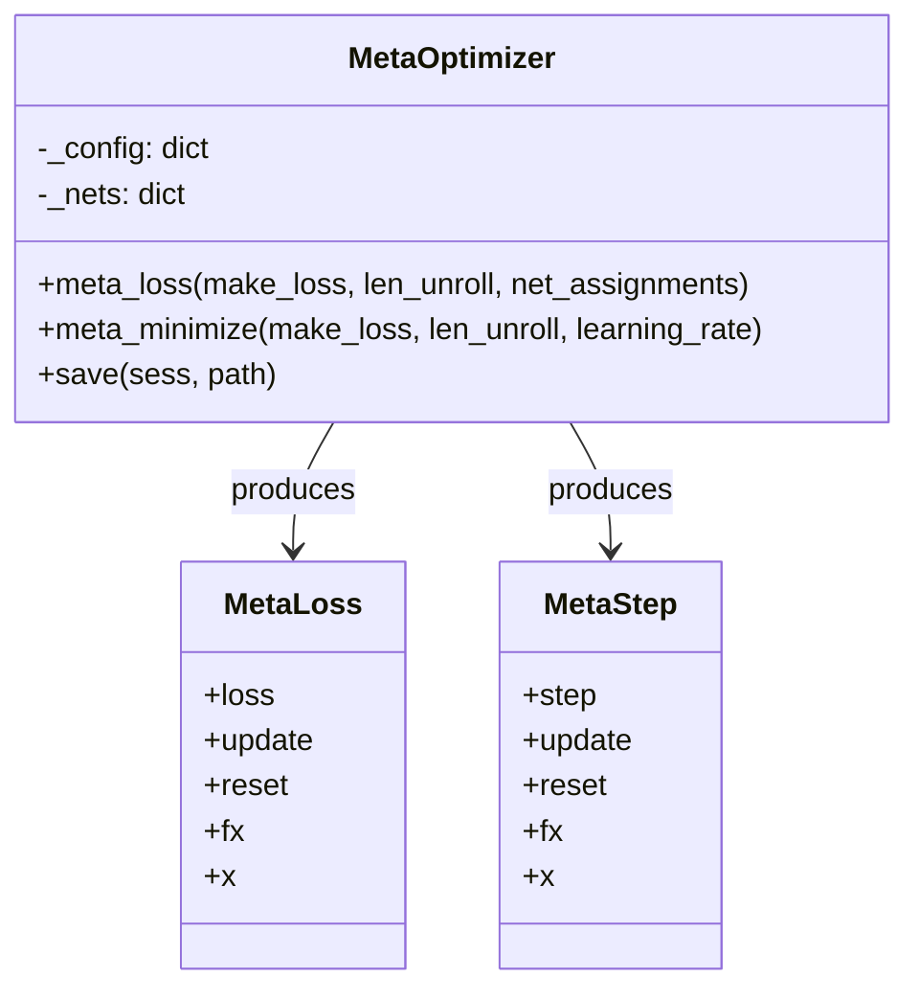

Sources: [meta.py:211-402]()

### Unrolling Process

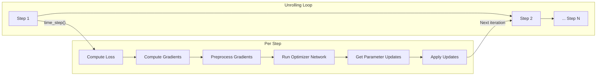

Sources: [meta.py:326-347](), [meta.py:308-324]()

## Problem Types Architecture

The system supports various problem types for training and evaluating optimizers, ranging from simple mathematical functions to complex machine learning tasks.

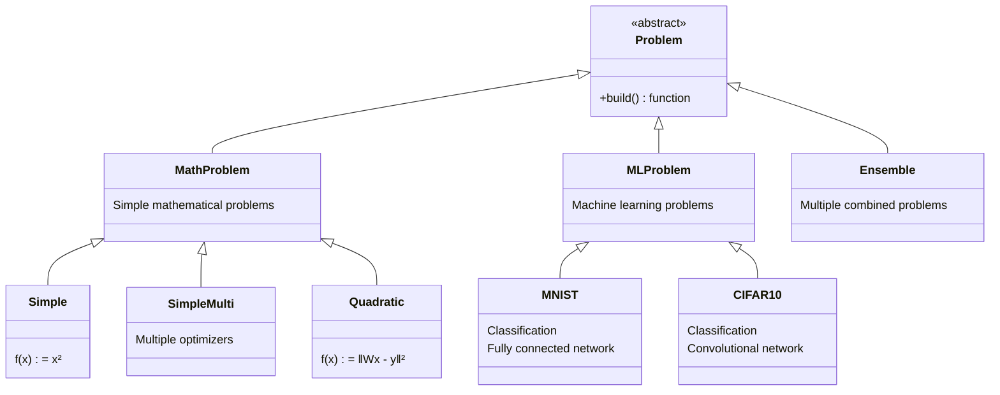

Sources: [problems.py:39-51](), [problems.py:54-68](), [problems.py:71-99](), [problems.py:141-173](), [problems.py:196-276](), [problems.py:102-132]()

## Network Architecture

The system implements various neural network architectures for optimization, organized in a hierarchy with shared functionality.

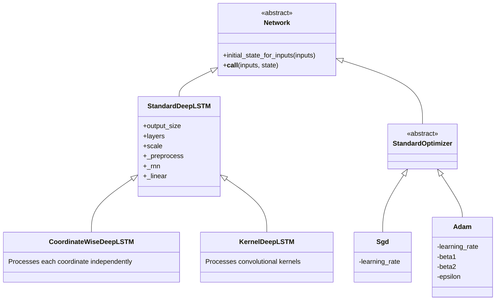

Sources: [networks.py:66-72](), [networks.py:154-217](), [networks.py:220-257](), [networks.py:260-308](), [networks.py:311-328](), [networks.py:339-377]()

## Gradient Preprocessing

Gradient preprocessing is crucial for stable and effective meta-learning. The system implements preprocessing techniques like `LogAndSign` to handle potential gradient issues.

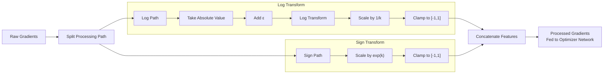

Sources: [networks.py:157-183]()

## System Workflow

The end-to-end workflow involves both training meta-optimizers and evaluating their performance on optimization tasks.

### Training Workflow

```mermaid
flowchart TD
    Start([Start]) --> SelectProblem["Select Problem\n(problems.py)"]
    SelectProblem --> ConfigureMetaOpt["Configure MetaOptimizer\n(meta.py)"]
    ConfigureMetaOpt --> DefineNetworks["Define Optimizer Networks\n(networks.py)"]
    DefineNetworks --> MetaMinimize["Call meta_minimize()\n(meta.py)"]
    MetaMinimize --> TrainLoop["Training Loop\n(train.py)"]
    TrainLoop --> SaveOptimizer["Save Trained Optimizer\n(networks.save())"]
    SaveOptimizer --> End([End])
```

Sources: [meta.py:386-402](), [networks.py:47-62]()

### Evaluation Workflow

```mermaid
flowchart TD
    Start([Start]) --> SelectProblem["Select Problem\n(problems.py)"]
    SelectProblem --> LoadOptimizer["Load Trained Optimizer\n(networks.factory())"]
    LoadOptimizer --> DefineProblem["Define Problem\n(problems.py)"]
    DefineProblem --> MetaLoss["Create MetaLoss\n(meta.py)"]
    MetaLoss --> EvalLoop["Evaluation Loop\n(evaluate.py)"]
    EvalLoop --> CollectResults["Collect Performance Results"]
    CollectResults --> End([End])
```

Sources: [networks.py:34-44]()

## Key Implementation Patterns

### TensorFlow Graph Construction

The system creates TensorFlow computation graphs for meta-optimization through careful management of variable scopes and graph operations.

Key patterns include:
- Variable creation tracking through custom getters
- Variable replacement for graph reuse
- Nested state management for RNNs
- Tensor unrolling through while loops

### Network Factory Pattern

The system uses a factory pattern to create optimizer networks:

```mermaid
flowchart LR
    Config["Network Configuration"] --> Factory["networks.factory()"]
    Factory --> Network1["StandardDeepLSTM"]
    Factory --> Network2["CoordinateWiseDeepLSTM"]
    Factory --> Network3["KernelDeepLSTM"]
    Factory --> Network4["Sgd"]
    Factory --> Network5["Adam"]
```

Sources: [networks.py:34-44]()

## Summary

The Learning to Learn system architecture is designed with a clear separation of concerns between problem definitions, network architectures, and the meta-optimization process. This modular design allows for flexibility in experimenting with different problems and optimizer architectures while maintaining a consistent training and evaluation framework.

The core innovation lies in the `MetaOptimizer` class that enables training neural networks to act as optimizers through gradient unrolling and accumulation of meta-loss. The system supports various types of optimizer networks, from LSTM-based designs to standard optimizers like SGD and Adam, and allows them to be trained on a range of problems from simple mathematical functions to complex machine learning tasks.

---

# Page: Problems

# Problems

<details>
<summary>Relevant source files</summary>

The following files were used as context for generating this wiki page:

- [README.md](README.md)
- [problems.py](problems.py)

</details>


This document provides an overview of the problem definitions in the Learning to Learn (L2L) framework. In L2L, "problems" represent optimization tasks that the meta-optimizer learns to solve. These range from simple mathematical functions to complex machine learning tasks. This page covers the problem framework, available problem types, and how problems are used in the system. For specific implementation details, see [Mathematical Problems](#2.1), [Machine Learning Problems](#2.2), and [Problem Ensembles](#2.3).

## Problem Framework

In L2L, each problem is defined as a function that builds a TensorFlow computation graph representing the loss to be minimized. Problems follow a consistent structure where they return a callable "build" function that constructs the loss computation when invoked.

```mermaid
flowchart TB
    subgraph "Problem Definition Framework"
        ProblemFunc["Problem Function() 
        e.g., simple(), mnist(), quadratic()"]
        BuildFunc["build() function
        Creates loss computation graph"]
        Variables["Problem Variables
        Trainable parameters to optimize"]
        LossOp["Loss Operation
        Scalar value to minimize"]
        
        ProblemFunc --> |"returns"| BuildFunc
        BuildFunc --> |"creates"| Variables
        BuildFunc --> |"returns"| LossOp
        Variables --> LossOp
    end
```

Sources: [problems.py:39-51](), [problems.py:71-99](), [problems.py:141-174]()

All problem implementations in L2L follow this pattern:
1. A problem function (e.g., `simple()`, `quadratic()`, `mnist()`) that accepts configuration parameters
2. This function returns a nested `build()` function
3. The `build()` function creates TensorFlow variables and operations
4. The `build()` function returns a loss operation that will be minimized

## Problem Types

The L2L framework includes three main categories of problems:

```mermaid
classDiagram
    class Problem {
        +build() function
        Returns loss operation
    }
    
    class MathematicalProblem {
        Simple scalar/vector functions
        Well-defined optimization landscape
    }
    
    class MachineLearningProblem {
        Classification/regression tasks
        Neural network optimization
    }
    
    class EnsembleProblem {
        Combination of other problems
        Weighted loss aggregation
    }
    
    Problem <|-- MathematicalProblem
    Problem <|-- MachineLearningProblem
    Problem <|-- EnsembleProblem
    
    MathematicalProblem <|-- Simple
    MathematicalProblem <|-- SimpleMulti
    MathematicalProblem <|-- Quadratic
    
    MachineLearningProblem <|-- MNIST
    MachineLearningProblem <|-- CIFAR10
    
    EnsembleProblem o-- Problem : contains
```

Sources: [problems.py:39-99](), [problems.py:141-277](), [problems.py:102-132]()

### Mathematical Problems

These are simple optimization tasks with well-defined properties, useful for testing and basic training of meta-optimizers.

| Problem Type | Description | Implementation |
|--------------|-------------|----------------|
| Simple | Single variable quadratic function: f(x) = x² | [problems.py:39-51]() |
| SimpleMulti | Multi-variable quadratic function: f(x₁,x₂,...) = x₁² + x₂² + ... | [problems.py:54-68]() |
| Quadratic | Batched matrix problem: f(x) = ‖Wx - y‖² | [problems.py:71-99]() |

For detailed implementation and usage information about mathematical problems, see [Mathematical Problems](#2.1).

### Machine Learning Problems

These problems involve training neural networks on standard datasets, representing more complex and realistic optimization challenges.

| Problem Type | Description | Implementation |
|--------------|-------------|----------------|
| MNIST | MNIST digit classification using a multi-layer perceptron | [problems.py:141-174]() |
| CIFAR10 | CIFAR10 image classification using a convolutional neural network | [problems.py:196-277]() |

For detailed implementation and usage information about machine learning problems, see [Machine Learning Problems](#2.2).

### Problem Ensembles

The L2L framework supports combining multiple problems into an ensemble, where the meta-optimizer learns to optimize a weighted combination of different loss functions.

```mermaid
flowchart TD
    subgraph "Ensemble Problem Structure"
        EnsembleFunc["ensemble()"]
        Problem1["Problem 1
        e.g., simple()"]
        Problem2["Problem 2
        e.g., quadratic()"]
        Problem3["Problem 3
        e.g., mnist()"]
        
        Weight1["weight_1"]
        Weight2["weight_2"]
        Weight3["weight_3"]
        
        Loss1["Loss 1"]
        Loss2["Loss 2"]
        Loss3["Loss 3"]
        
        CombinedLoss["Combined Loss
        = w₁·Loss₁ + w₂·Loss₂ + w₃·Loss₃"]
        
        EnsembleFunc --> |"contains"| Problem1
        EnsembleFunc --> |"contains"| Problem2
        EnsembleFunc --> |"contains"| Problem3
        
        Problem1 --> Loss1
        Problem2 --> Loss2
        Problem3 --> Loss3
        
        Loss1 --> |"×"| Weight1
        Loss2 --> |"×"| Weight2
        Loss3 --> |"×"| Weight3
        
        Weight1 --> CombinedLoss
        Weight2 --> CombinedLoss
        Weight3 --> CombinedLoss
    end
```

Sources: [problems.py:102-132]()

The `ensemble()` function takes a list of problem specifications and optional weights, creating a combined problem where the total loss is the (weighted) sum of individual problem losses. This allows for training meta-optimizers that can handle diverse optimization tasks simultaneously.

For detailed implementation and usage information about problem ensembles, see [Problem Ensembles](#2.3).

## Problem Usage in Training and Evaluation

Problems are central to the L2L workflow, providing the optimization tasks for both training the meta-optimizer and evaluating its performance.

```mermaid
flowchart LR
    subgraph "Problem Usage in L2L"
        ProblemDef["Problem Definition
        e.g., mnist()"]
        BuildFunc["build() function"]
        
        subgraph "Training (train.py)"
            MetaMin["meta_minimize()"]
            Unroll["Unroll optimization"]
            MetaLoss["Compute meta-loss"]
        end
        
        subgraph "Evaluation (evaluate.py)"
            EvalOpt["Evaluate optimizers"]
            Compare["Compare performance"]
        end
        
        ProblemDef --> |"returns"| BuildFunc
        BuildFunc --> |"input to"| MetaMin
        MetaMin --> Unroll
        Unroll --> MetaLoss
        
        BuildFunc --> |"input to"| EvalOpt
        EvalOpt --> Compare
    end
```

Sources: [problems.py](), [README.md:48-64]()

During training:
1. A problem is selected and configured (e.g., `mnist()` with specific layer sizes)
2. The problem's `build()` function is passed to the meta-optimizer's `meta_minimize()` method
3. The meta-optimizer repeatedly invokes this function to generate new loss instances
4. The meta-optimizer learns to minimize these losses efficiently

During evaluation:
1. The same or different problems are used to test the trained meta-optimizer
2. The problem's loss function is optimized using both the learned optimizer and baseline optimizers (e.g., Adam)
3. Performance is compared across different optimizers

## Available Problems

The L2L framework provides the following built-in problem implementations:

| Problem | Description | Configuration Options |
|---------|-------------|------------------------|
| `simple` | One-variable quadratic function: f(x) = x² | None |
| `simple-multi` | Multi-variable quadratic function where variables can be assigned to different optimizers | `num_dims`: Number of dimensions |
| `quadratic` | Batched matrix problem: f(x) = ‖Wx - y‖² | `batch_size`, `num_dims`, `stddev` |
| `mnist` | MNIST classification with a multi-layer perceptron | `layers`, `activation`, `batch_size`, `mode` |
| `cifar` | CIFAR10 classification with a CNN | `conv_channels`, `linear_layers`, `batch_norm`, `batch_size` |
| `ensemble` | Combination of multiple problems | `problems`, `weights` |

Sources: [problems.py](), [README.md:48-64]()

## Creating Custom Problems

The L2L framework is designed to be easily extended with new problem types. To create a custom problem:

1. Define a function that returns a TensorFlow graph-building function
2. The returned function should create all necessary variables and operations
3. The function should return a scalar TensorFlow operation representing the loss to minimize

```python
def my_custom_problem(param1=default1, param2=default2):
    """My custom optimization problem."""
    
    def build():
        """Builds loss graph."""
        # Create variables to optimize
        x = tf.get_variable("x", ...)
        
        # Create any constants or non-trainable variables
        constants = tf.get_variable("constants", ..., trainable=False)
        
        # Build computation graph
        result = some_computation(x, constants)
        
        # Return scalar loss
        return tf.reduce_mean(result)
    
    return build
```

Important considerations when implementing custom problems:
- All operations with Python side effects (e.g., queue creation) must be done outside the `build()` function
- The `build()` function may be called multiple times during meta-optimization
- Variables created within the `build()` function will be optimized by the meta-optimizer

Sources: [README.md:66-74](), [problems.py]()

---

# Page: Mathematical Problems

# Mathematical Problems

<details>
<summary>Relevant source files</summary>

The following files were used as context for generating this wiki page:

- [problems.py](problems.py)

</details>


## Purpose and Scope

This page documents the mathematical optimization problems included in the Learning to Learn (L2L) framework. These problems serve as fundamental test cases for training and evaluating meta-optimizers. They provide simple, well-defined optimization landscapes that are computationally efficient while still offering meaningful challenges for optimizer development. For information about more complex machine learning problems like MNIST and CIFAR10, see [Machine Learning Problems](#2.2).

Sources: [problems.py:15-16]()

## Problem Structure

Mathematical problems in the L2L framework follow a common pattern where each problem is defined as a function that returns a build function. This build function, when called, constructs the TensorFlow computation graph for the problem and returns a loss tensor that can be minimized.

```mermaid
flowchart TD
    subgraph "Mathematical Problem Definition"
        Problem["Problem Function\n(e.g., simple, quadratic)"] --> ReturnBuild["Return build() function"]
        
        subgraph "build() function"
            DefineVars["Define variables\n(trainable and fixed)"]
            ComputeLoss["Compute loss value"]
            ReturnLoss["Return loss tensor"]
            
            DefineVars --> ComputeLoss --> ReturnLoss
        end
    end
    
    ReturnBuild --> |"Used by"| MetaOpt["MetaOptimizer\nfor training"]
```

Each mathematical problem implements this pattern, defining variables with specific initializations and a loss function that computes the objective to be minimized.

Sources: [problems.py:39-99]()

## Simple Problem

The simplest optimization problem in the framework is the minimization of f(x) = x².

### Implementation

The `simple()` function defines a problem with a single scalar variable `x` initialized to 1.0, and returns its square as the loss value.

```mermaid
flowchart LR
    subgraph "simple() Problem"
        Init["x = 1.0\n(initializer)"] --> Square["f(x) = x²"] --> Loss["Loss = x²"]
    end
```

This problem has a global minimum at x = 0, with a convex, smooth optimization landscape. It's an ideal starting point for testing optimization algorithms.

Sources: [problems.py:39-51]()

## Simple Multi-Optimizer Problem

The `simple_multi_optimizer()` function extends the simple problem to multiple dimensions, allowing for experiments with different optimizers on different subsets of parameters.

### Implementation

This problem creates `num_dims` separate variables (default is 2) and computes the sum of their squares as the loss.

```mermaid
flowchart TD
    subgraph "simple_multi_optimizer() Problem"
        x0["x_0 = 1.0"]
        x1["x_1 = 1.0"]
        xn["x_n = 1.0"]
        
        x0 --> Concat["Concatenate\nvariables"]
        x1 --> Concat
        xn --> Concat
        
        Concat --> Square["Square each\ncoordinate"]
        Square --> Sum["Sum squared\nvalues"]
        Sum --> Loss["Loss = Σx_i²"]
    end
    
    subgraph "Optimization"
        Opt1["Optimizer 1"] --> |"updates"| x0
        Opt2["Optimizer 2"] --> |"updates"| x1
        OptN["Optimizer N"] --> |"updates"| xn
    end
```

### Use Cases

This problem is particularly useful for:
1. Testing multiple optimizers in parallel
2. Comparing different optimization strategies on the same problem
3. Training meta-optimizers that specialize in certain parameter types

Sources: [problems.py:54-68]()

## Quadratic Problem

The `quadratic()` problem implements a more complex mathematical optimization: f(x) = ||Wx - y||², which represents a system of linear equations.

### Implementation

This problem defines:
- `x`: A trainable variable of shape [batch_size, num_dims]
- `W`: A fixed random matrix of shape [batch_size, num_dims, num_dims]
- `y`: A fixed random target vector of shape [batch_size, num_dims]

The loss is the mean squared error between Wx and y across the batch.

```mermaid
flowchart TD
    subgraph "quadratic() Problem"
        x["x: [batch_size, num_dims]\nTrainable"] 
        W["W: [batch_size, num_dims, num_dims]\nFixed random"]
        y["y: [batch_size, num_dims]\nFixed random"]
        
        x --> MatMul["Matrix multiply\nWx"]
        W --> MatMul
        
        MatMul --> Diff["Difference\nWx - y"]
        y --> Diff
        
        Diff --> Square["Square\n(Wx - y)²"]
        Square --> Sum["Sum across dimensions"]
        Sum --> Mean["Mean across batch"]
        Mean --> Loss["Loss = Mean(Sum((Wx - y)²))"]
    end
```

### Parameters

| Parameter | Default | Description |
|-----------|---------|-------------|
| batch_size | 128 | Number of independent problem instances in each batch |
| num_dims | 10 | Dimensionality of each problem instance |
| stddev | 0.01 | Standard deviation for initializing `x` |
| dtype | tf.float32 | Data type for variables |

### Key Properties

1. **Batched Optimization**: Unlike the simple problems, quadratic optimizes multiple independent problem instances simultaneously.
2. **Well-Defined Minimum**: For each instance, the optimal solution is x = W⁻¹y (if W is invertible).
3. **Variable Difficulty**: The condition number of W determines how challenging each instance is to optimize.

Sources: [problems.py:71-99]()

## Using Mathematical Problems in Training

Mathematical problems are used to train meta-optimizers by providing them as inputs to the training process. 

### Problem Configuration

Problems can be configured with specific parameters to adjust their difficulty or characteristics:

```python
# Example configuration for quadratic problem
problem_config = {
    "name": "quadratic",
    "options": {
        "batch_size": 128,
        "num_dims": 10
    }
}
```

### Problem Ensembles

Multiple problems can be combined into an ensemble using the `ensemble()` function, which adds flexibility to the training process:

```mermaid
flowchart LR
    subgraph "Problem Ensemble"
        P1["Problem 1\n(e.g., simple)"] --> |"weight_1"| Sum["Weighted Sum\nof Losses"]
        P2["Problem 2\n(e.g., quadratic)"] --> |"weight_2"| Sum
        Pn["Problem n"] --> |"weight_n"| Sum
        
        Sum --> TotalLoss["Combined Loss\nfor Optimization"]
    end
```

The ensemble function creates a scope for each problem and combines their losses, optionally with specific weights. For more details on problem ensembles, see [Problem Ensembles](#2.3).

Sources: [problems.py:102-132]()

## Mathematical Problem Hierarchy

The mathematical problems form a logical hierarchy in the system design:

```mermaid
classDiagram
    class Problem {
        +build() function
        Returns a loss function
    }
    
    class MathematicalProblem {
        Simple scalar/vector problems
    }
    
    class Simple {
        +build()
        f(x) = x²
        Single variable
    }
    
    class SimpleMulti {
        +build()
        f(x₁, x₂, ...) = x₁² + x₂² + ...
        Multiple variables
        Supports multiple optimizers
    }
    
    class Quadratic {
        +build()
        f(x) = ||Wx - y||²
        Batched variables
        Linear system solution
    }
    
    Problem <|-- MathematicalProblem
    MathematicalProblem <|-- Simple
    MathematicalProblem <|-- SimpleMulti
    MathematicalProblem <|-- Quadratic
```

Sources: [problems.py:39-99]()

## Integration with Meta-Optimizer Training

The mathematical problems serve as the training grounds for meta-optimizers in the L2L framework:

```mermaid
flowchart TD
    subgraph "Meta-Optimizer Training"
        ProblemDef["Mathematical Problem\n(simple, simple_multi, quadratic)"] --> BuildFn["build() function"]
        BuildFn --> Loss["Loss Tensor"]
        
        MetaOpt["MetaOptimizer"] --> |"meta_minimize()"| Optimization
        
        subgraph "Optimization"
            Loss --> Unroll["Unroll optimization\nfor K steps"]
            Unroll --> MetaLoss["Compute meta-loss"]
            MetaLoss --> UpdateOpt["Update meta-optimizer\nweights"]
        end
    end
```

During training, the meta-optimizer repeatedly optimizes instances of these mathematical problems, learning effective optimization strategies through the process.

Sources: [problems.py:39-99]()

---

# Page: Machine Learning Problems

# Machine Learning Problems

<details>
<summary>Relevant source files</summary>

The following files were used as context for generating this wiki page:

- [problems.py](problems.py)

</details>


This document describes the machine learning problem definitions implemented in the Learning to Learn (L2L) framework. These problems serve as optimization targets for training and evaluating meta-optimizers. While [Mathematical Problems](#2.1) focus on simple optimization objectives like quadratic functions, this section covers more complex machine learning tasks involving neural networks trained on real-world datasets.

## Overview

The L2L framework implements two standard machine learning classification problems:

1. **MNIST** - Handwritten digit classification using a multi-layer perceptron
2. **CIFAR10** - Image classification using a convolutional neural network

These problems provide realistic optimization challenges that meta-optimizers must learn to solve efficiently. They represent typical supervised learning tasks with different levels of complexity and feature requirements.

```mermaid
flowchart TD
    problem["Problem Definition"]
    network["Neural Network Model"]
    loss["Loss Function"]
    dataset["Dataset"]
    problem --> network
    problem --> loss
    problem --> dataset
    subgraph "ML Problem Components"
        network
        loss
        dataset
    end
    
    problem -- "MNIST" --> mlp["Multi-Layer Perceptron\n(MLP)"]
    problem -- "CIFAR10" --> convnet["Convolutional Network\n(ConvNet)"]
    
    mlp --> xent1["Cross-Entropy Loss"]
    convnet --> xent2["Cross-Entropy Loss"]
    
    mlp --> mnist_data["MNIST Dataset"]
    convnet --> cifar_data["CIFAR10 Dataset"]
```

Sources: [problems.py:135-276]()

## Common Architecture

Both machine learning problems follow a consistent pattern in the L2L framework:

1. Define a neural network architecture appropriate for the task
2. Load and preprocess the dataset
3. Implement a `build()` function that:
   - Samples random batches from the dataset
   - Passes data through the network
   - Calculates the loss (cross-entropy)
   - Returns the loss value for optimization

The `build()` function serves as the optimization objective that meta-optimizers will learn to minimize. This follows the same pattern as the mathematical problems but with more complex models and real-world data.

```mermaid
sequenceDiagram
    participant Problem as "ML Problem"
    participant Dataset as "Dataset"
    participant Network as "Neural Network"
    participant Loss as "Loss Function"
    participant Optimizer as "Meta-Optimizer"
    
    Problem->>Dataset: Load data
    
    Note over Problem: build() function
    Problem->>Dataset: Sample random batch
    Dataset-->>Problem: images, labels
    Problem->>Network: Forward pass
    Network-->>Problem: predictions
    Problem->>Loss: Calculate loss
    Loss-->>Problem: loss value
    Problem-->>Optimizer: Return loss for optimization
```

Sources: [problems.py:141-174](), [problems.py:196-277]()

## MNIST Classification

The MNIST problem implements handwritten digit classification using a configurable multi-layer perceptron.

### Implementation Details

The MNIST problem is implemented as a function that returns a `build()` function. The `build()` function creates a random batch of MNIST images and labels, passes them through a multi-layer perceptron, and returns the cross-entropy loss.

```mermaid
classDiagram
    class mnist {
        +layers: list
        +activation: string
        +batch_size: int
        +mode: string
        +build(): function
    }
    
    class MLP {
        +layers: list
        +activation: function
    }
    
    class Dataset {
        +images: tensor
        +labels: tensor
        +num_examples: int
    }
    
    mnist -- MLP: creates
    mnist -- Dataset: samples from
```

Sources: [problems.py:141-174]()

### Configuration Options

The MNIST problem takes the following parameters:

| Parameter | Type | Description | Default |
|-----------|------|-------------|---------|
| `layers` | list | List of hidden layer sizes for the MLP | Required |
| `activation` | string | Activation function ("sigmoid" or "relu") | "sigmoid" |
| `batch_size` | int | Number of examples per batch | 128 |
| `mode` | string | Dataset split to use ("train" or "test") | "train" |

Sources: [problems.py:141-145]()

### Network Architecture

The network architecture for MNIST is a multi-layer perceptron with configurable hidden layers:

1. Input layer: 784 neurons (flattened 28×28 images)
2. Hidden layers: Specified by the `layers` parameter
3. Output layer: 10 neurons (one per digit)

The implementation uses Sonnet's MLP module with the specified activation function and standard weight initialization.

Sources: [problems.py:162-166]()

## CIFAR10 Classification

The CIFAR10 problem implements image classification using a convolutional neural network followed by fully connected layers.

### Implementation Details

The CIFAR10 problem is more complex than MNIST, involving:

1. Data loading and preprocessing from binary files
2. A queue-based data pipeline for efficient processing
3. A convolutional neural network architecture
4. Optional batch normalization

```mermaid
flowchart TD
    dataset["CIFAR10 Dataset\nBinary Files"]
    reader["FixedLengthRecordReader"]
    queue["RandomShuffleQueue"]
    preprocess["Preprocessing\n- Reshape\n- Normalize"]
    convnet["ConvNet2D"]
    flatten["BatchFlatten"]
    mlp["MLP"]
    loss["Cross-Entropy Loss"]
    
    dataset --> reader
    reader --> preprocess
    preprocess --> queue
    queue -- "batch_size images/labels" --> convnet
    convnet --> flatten
    flatten --> mlp
    mlp --> loss
```

Sources: [problems.py:196-277]()

### Configuration Options

The CIFAR10 problem offers extensive configuration options:

| Parameter | Type | Description | Default |
|-----------|------|-------------|---------|
| `path` | string | Path to download/store CIFAR10 data | Required |
| `conv_channels` | list | Number of output channels for each conv layer | Required |
| `linear_layers` | list | List of hidden layer sizes for the MLP | Required |
| `batch_norm` | bool | Whether to use batch normalization | True |
| `batch_size` | int | Number of examples per batch | 128 |
| `num_threads` | int | Number of threads for data loading | 4 |
| `min_queue_examples` | int | Min examples in queue before dequeuing | 1000 |
| `mode` | string | Dataset split to use ("train" or "test") | "train" |

Sources: [problems.py:196-203]()

### Network Architecture

The CIFAR10 network architecture combines convolutional and fully connected layers:

1. Convolutional layers with max pooling and ReLU activation
2. Batch normalization (optional)
3. Flattening operation
4. Fully connected layers with ReLU activation
5. Output layer with 10 neurons (one per class)

Sources: [problems.py:245-268]()

### Data Pipeline

The CIFAR10 implementation includes an efficient data pipeline:

1. Downloads the dataset if not already present
2. Reads binary data files using `FixedLengthRecordReader`
3. Decodes and preprocesses images (normalizes to [0,1] range)
4. Uses a `RandomShuffleQueue` for batch sampling
5. Creates multiple reader threads for better performance

Sources: [problems.py:182-242]()

## Integration with Meta-Optimizer

These machine learning problems integrate with the meta-optimizer through the consistent `build()` function interface. This allows the meta-optimizer to:

1. Unroll optimization steps on these problems
2. Compute gradients and apply updates
3. Measure optimization progress
4. Learn effective optimization strategies for neural networks

```mermaid
flowchart LR
    meta["meta.py: MetaOptimizer"]
    mnist["problems.py: mnist()"]
    cifar["problems.py: cifar10()"]
    train["train.py"]
    
    mnist --> |"build() function"| meta
    cifar --> |"build() function"| meta
    meta --> |"meta_minimize()"| train
    
    subgraph "Problem Selection"
        train --> |"select problem"| mnist
        train --> |"select problem"| cifar
    end
```

Sources: [problems.py:141-174](), [problems.py:196-277]()

## Comparison with Mathematical Problems

Machine learning problems differ from [Mathematical Problems](#2.1) in several important ways:

| Aspect | Mathematical Problems | Machine Learning Problems |
|--------|----------------------|--------------------------|
| Complexity | Simple, well-defined functions | Complex models with many parameters |
| Scale | Few variables (typically <100) | Many variables (thousands to millions) |
| Data | No external data required | Requires dataset loading and processing |
| Network | Simple or none | Neural networks with multiple layers |
| Training | Fast evaluation | More computationally intensive |
| Generalization | Tests optimization ability | Tests both optimization and generalization |

The machine learning problems provide a more realistic test of optimizer performance on real-world tasks, while mathematical problems offer faster experimentation cycles and clearer optimization landscapes.

Sources: [problems.py:39-99](), [problems.py:141-277]()

## Usage Examples

To use these machine learning problems in the L2L framework, you typically:

1. Create a problem instance with desired configuration
2. Pass the problem to the meta-optimizer for training or evaluation

For example, to create an MNIST problem with a 2-layer MLP:

```python
mnist_problem = problems.mnist(layers=[20, 20], activation="relu")
```

Or to create a CIFAR10 problem with a standard CNN architecture:

```python
cifar_problem = problems.cifar10(
    path="./data",
    conv_channels=[16, 32],
    linear_layers=[32],
    batch_norm=True
)
```

These problems can also be combined into an [ensemble](#2.3) to train meta-optimizers on multiple tasks simultaneously.

Sources: [problems.py:141-174](), [problems.py:196-277]()

---

# Page: Problem Ensembles

# Problem Ensembles

<details>
<summary>Relevant source files</summary>

The following files were used as context for generating this wiki page:

- [problems.py](problems.py)

</details>


## Purpose and Scope

This document covers Problem Ensembles in the Learning to Learn (L2L) framework. Problem Ensembles allow multiple optimization problems to be combined into a single training objective for the meta-optimizer. For information about individual problem types, see [Mathematical Problems](#2.1) and [Machine Learning Problems](#2.2).

## Overview

The Problem Ensembles functionality enables the meta-optimizer to train on multiple problem types simultaneously. By combining diverse problems into a weighted ensemble, the meta-optimizer can learn more robust optimization strategies that generalize better across different optimization landscapes.

```mermaid
flowchart TB
    subgraph "Problem Ensemble"
        Ensemble["ensemble() function"]
        Loss["Combined Loss"]
    end
    
    subgraph "Individual Problems"
        Problem1["Problem 1\nE.g., simple()"]
        Problem2["Problem 2\nE.g., quadratic()"]
        Problem3["Problem 3\nE.g., mnist()"]
    end
    
    Problem1 --> |"build_fn1"| Ensemble
    Problem2 --> |"build_fn2"| Ensemble
    Problem3 --> |"build_fn3"| Ensemble
    
    Ensemble --> |"weighted sum"| Loss
    
    Loss --> |"feeds into"| MetaOpt["MetaOptimizer"]
```

Sources: [problems.py:102-132]()

## Implementation

The Problem Ensembles feature is implemented through the `ensemble` function in `problems.py`. This function creates a composite problem by combining multiple individual problems, each with its own configuration options and optional weight.

### Function Signature

```python
def ensemble(problems, weights=None):
    """Ensemble of problems.
    
    Args:
      problems: List of problems. Each problem is specified by a dict containing
          the keys 'name' and 'options'.
      weights: Optional list of weights for each problem.
    
    Returns:
      Sum of (weighted) losses.
    
    Raises:
      ValueError: If weights has an incorrect length.
    """
```

Sources: [problems.py:102-115]()

### Internal Architecture

The ensemble function operates by:

1. Validating input parameters
2. Dynamically loading problem functions based on their names
3. Creating problem-specific build functions with appropriate options
4. Returning a composite build function that:
   - Creates each individual problem in its own variable scope
   - Applies weights to individual losses (if specified)
   - Sums the losses to create a single optimization objective

```mermaid
sequenceDiagram
    participant Main as "Training Code"
    participant Ensemble as "ensemble() function"
    participant Problems as "Problem Functions"
    participant Build as "Composite build()"
    
    Main->>Ensemble: "Call with problem list"
    Ensemble->>Ensemble: "Validate inputs"
    Ensemble->>Problems: "Load problem functions (getattr)"
    Problems-->>Ensemble: "Return build functions"
    Ensemble->>Build: "Create composite build function"
    Build-->>Ensemble: "Return composite build"
    Ensemble-->>Main: "Return build function"
    
    Main->>Build: "Call build()"
    loop For each problem
        Build->>Problems: "Call individual build_fn in scope"
        Problems-->>Build: "Return problem loss"
        Build->>Build: "Apply weight (if any)"
        Build->>Build: "Add to total loss"
    end
    Build-->>Main: "Return summed loss"
```

Sources: [problems.py:116-132]()

## Variable Scoping

A key implementation detail is the use of variable scopes to manage the variables from different problems. Each problem is built within its own variable scope named `problem_{i}`, ensuring that variables from different problems don't interfere with each other.

```python
def build():
    loss = 0
    for i, build_fn in enumerate(build_fns):
      with tf.variable_scope("problem_{}".format(i)):
        loss_p = build_fn()
        if weights:
          loss_p *= weights[i]
        loss += loss_p
    return loss
```

Sources: [problems.py:122-132]()

## Usage Example

To create an ensemble of problems, you define a list of problem specifications, each containing a name and options dictionary:

```python
# Example ensemble of simple and quadratic problems
problems = [
    {
        "name": "simple",
        "options": {}
    },
    {
        "name": "quadratic",
        "options": {
            "batch_size": 64,
            "num_dims": 10
        }
    }
]

# Optional weights to prioritize problems
weights = [0.3, 0.7]  # 30% simple, 70% quadratic

# Create the ensemble
problem_fn = ensemble(problems, weights)
```

The resulting `problem_fn` can then be used with the meta-optimizer for training, just like any individual problem function.

## Problem Ensemble in the Optimization Workflow

The following diagram illustrates how Problem Ensembles fit into the overall Learning to Learn optimization workflow:

```mermaid
flowchart TD
    subgraph "Meta-Training Setup"
        Config["Configuration"]
        ProblemDefs["Problem Definitions\nMathematical & ML Problems"]
    end
    
    subgraph "Problem Creation"
        Ensemble["ensemble() function"]
        P1["Problem 1\nbuild_fn"]
        P2["Problem 2\nbuild_fn"]
        P3["Problem 3\nbuild_fn"]
    end
    
    subgraph "Meta-Optimization"
        MetaOpt["MetaOptimizer.meta_minimize()"]
        Unroll["Unroll optimization steps"]
        Loss["Compute meta-loss"]
        Update["Update meta-optimizer"]
    end
    
    Config --> |"problem specs"| Ensemble
    ProblemDefs --> |"problem functions"| P1
    ProblemDefs --> |"problem functions"| P2
    ProblemDefs --> |"problem functions"| P3
    
    P1 --> Ensemble
    P2 --> Ensemble
    P3 --> Ensemble
    
    Ensemble --> |"combined build function"| MetaOpt
    MetaOpt --> Unroll
    Unroll --> Loss
    Loss --> Update
    Update --> |"next iteration"| MetaOpt
```

Sources: [problems.py:102-132](), [meta.py]()

## Technical Benefits of Problem Ensembles

1. **Generalization**: Meta-optimizers trained on diverse problem ensembles learn more general optimization strategies.

2. **Robustness**: Exposure to multiple optimization landscapes helps the meta-optimizer avoid overfitting to specific problem characteristics.

3. **Customization**: Weights allow emphasizing particular problem types based on their importance or difficulty.

4. **Modularity**: New problem types can be easily incorporated into existing ensembles without changing the meta-optimization architecture.

5. **Variable Management**: The variable scoping approach ensures clean separation between problems, preventing variable name collisions.

## Integration with Other Components

Problem Ensembles are designed to integrate seamlessly with the rest of the Learning to Learn framework:

| Component | Integration with Problem Ensembles |
|-----------|-----------------------------------|
| MetaOptimizer | Accepts ensemble build functions like any other problem |
| train.py | Can specify problem ensembles in training configuration |
| evaluate.py | Can evaluate meta-optimizers on ensembles or individual problems |
| Networks | Network architectures can be chosen to handle the characteristics of the problems in the ensemble |

Sources: [problems.py:102-132](), [meta.py](), [train.py](), [evaluate.py]()

## Summary

Problem Ensembles provide a powerful mechanism for combining multiple optimization problems into a unified training objective for meta-optimizers. By exposing the meta-optimizer to diverse optimization landscapes during training, ensembles help develop more robust and generalizable optimization strategies. The implementation in `problems.py` offers a clean, modular approach to creating weighted combinations of problems while maintaining proper variable separation.

---

# Page: Meta-Optimizer

# Meta-Optimizer

<details>
<summary>Relevant source files</summary>

The following files were used as context for generating this wiki page:

- [README.md](README.md)
- [meta.py](meta.py)
- [meta_test.py](meta_test.py)

</details>


The Meta-Optimizer is the core component of the Learning to Learn (L2L) framework that enables neural networks to learn optimization algorithms. Unlike traditional optimizers with fixed update rules (like SGD or Adam), this meta-optimizer uses recurrent neural networks to generate parameter updates by processing gradient information. For information about specific network architectures used within the meta-optimizer, see [Networks](#4).

## Purpose and Scope

This document covers:
- The design and implementation of the `MetaOptimizer` class
- Meta-loss computation and optimization process
- Network assignment mechanisms
- Saving and loading trained optimizers
- Integration with problem definitions

Sources: [meta.py:211-402](https://github.com/google-deepmind/learning-to-learn/blob/master/meta.py:211-402)

## Meta-Optimizer Architecture

The meta-optimizer implements a "learning to learn" approach where an optimizer itself is learned through gradient descent. At its core, the meta-optimizer contains neural networks (typically LSTM-based) that:
1. Take gradients as input
2. Process them through recurrent networks
3. Produce parameter updates as output

```mermaid
flowchart TD
    subgraph "Meta-Optimizer Architecture"
        MetaOpt["MetaOptimizer Class"]
        Networks["Optimizer Networks\n(CoordinateWiseDeepLSTM, etc.)"]
        State["RNN States"]
        
        MetaOpt --> Networks
        MetaOpt --> State
        
        subgraph "Optimization Process"
            Problems["Problem Definition"]
            Gradients["Gradient Calculation"]
            Updates["Parameter Updates"]
            
            Problems --> Gradients
            Gradients --> |"Processed by networks"| Updates
            Updates --> |"New variables"| Problems
        end
        
        Networks <--> "Optimization Process"
        State <--> "Optimization Process"
    end
```

The meta-optimizer maintains state between optimization steps, allowing it to adapt its behavior based on the optimization trajectory.

Sources: [meta.py:211-246](https://github.com/google-deepmind/learning-to-learn/blob/master/meta.py:211-246)

## Core Classes and Functions

### MetaOptimizer Class

The primary class is `MetaOptimizer`, which manages the optimization networks and coordinates the meta-learning process.

```mermaid
classDiagram
    class MetaOptimizer {
        -_nets: dict
        -_config: dict
        +__init__(kwargs)
        +meta_loss(make_loss, len_unroll, net_assignments, second_derivatives)
        +meta_minimize(make_loss, len_unroll, learning_rate)
        +save(sess, path)
    }
    
    class MetaLoss {
        +loss
        +update
        +reset
        +fx
        +x
    }
    
    class MetaStep {
        +step
        +update
        +reset
        +fx
        +x
    }
    
    MetaOptimizer --> MetaLoss: returns
    MetaOptimizer --> MetaStep: returns
```

The constructor accepts configuration for one or more optimizer networks. If no configuration is provided, it defaults to a `CoordinateWiseDeepLSTM` network.

Sources: [meta.py:211-246](https://github.com/google-deepmind/learning-to-learn/blob/master/meta.py:211-246), [meta.py:150-152](https://github.com/google-deepmind/learning-to-learn/blob/master/meta.py:150-152)

## Meta-Loss Computation

The meta-loss is computed by unrolling the optimization process for a specified number of steps and summing the loss at each step.

```mermaid
flowchart TD
    subgraph "meta_loss Method"
        ML1["Get optimizee variables"]
        ML2["Create optimizer networks"]
        ML3["Initialize optimizer state"]
        ML4["Define unrolled optimization"]
        ML5["Define loss summation"]
        ML6["Define reset/update operations"]
        
        ML1 --> ML2
        ML2 --> ML3
        ML3 --> ML4
        ML4 --> ML5
        ML5 --> ML6
    end
    
    subgraph "Unrolled Optimization"
        UO1["Compute loss fx"]
        UO2["Compute gradients ∇fx"]
        UO3["Process gradients\nthrough network"]
        UO4["Generate parameter updates"]
        UO5["Apply updates to variables"]
        UO6["Update RNN state"]
        
        UO1 --> UO2
        UO2 --> UO3
        UO3 --> UO4
        UO4 --> UO5
        UO5 --> UO6
        UO6 --> |"Next unroll step"| UO1
    end
    
    ML4 --> Unrolled
    Unrolled["tf.while_loop"] --> "Unrolled Optimization"
```

Key components of the meta-loss computation:

1. **Variables Extraction**: The method first extracts variables from the provided loss function using `_get_variables`.
2. **Network Creation**: Optimizer networks are created based on the configuration.
3. **State Initialization**: Initial state for the RNN-based optimizers is created.
4. **Unroll Definition**: A TensorFlow while loop unrolls the optimization process.
5. **Time Step Function**: For each step, the current loss is computed, gradients are calculated, and parameter updates are generated.

Sources: [meta.py:261-384](https://github.com/google-deepmind/learning-to-learn/blob/master/meta.py:261-384)

## Meta-Minimize Operation

The `meta_minimize` method creates an operation that minimizes the meta-loss, effectively training the meta-optimizer itself.

```python
def meta_minimize(self, make_loss, len_unroll, learning_rate=0.01, **kwargs):
    """Returns an operator minimizing the meta-loss."""
    info = self.meta_loss(make_loss, len_unroll, **kwargs)
    optimizer = tf.train.AdamOptimizer(learning_rate)
    step = optimizer.minimize(info.loss)
    return MetaStep(step, *info[1:])
```

This method:
1. Computes the meta-loss using `meta_loss`
2. Creates an Adam optimizer to minimize this loss
3. Returns a `MetaStep` namedtuple containing operations for the optimization process

Sources: [meta.py:386-402](https://github.com/google-deepmind/learning-to-learn/blob/master/meta.py:386-402)

## Network Assignments

The meta-optimizer supports assigning different subsets of variables to different optimizer networks. This allows specialized optimization strategies for different parts of a model.

```mermaid
flowchart LR
    subgraph "Variable Assignment"
        VA1["Variables\n(x_0, x_1, x_2, ...)"]
        VA2["Network Assignments\n[(net_id, [var_names])]"]
        VA3["Name to Index Mapping"]
        VA4["Subsets of Variables"]
        VA5["Network Configuration"]
        VA6["Created Networks"]
        
        VA1 --> VA3
        VA2 --> VA4
        VA3 --> VA4
        VA5 --> VA6
        VA4 --> |"Assigned to"| VA6
    end
```

The assignment logic is implemented in the `_make_nets` function, which:
1. Creates a mapping from variable names to indices
2. Constructs optimizer networks according to configuration
3. Groups variables into subsets assigned to each network

Sources: [meta.py:154-208](https://github.com/google-deepmind/learning-to-learn/blob/master/meta.py:154-208)

## Optimization Flow

The optimization process works through the following steps:

```mermaid
sequenceDiagram
    participant P as Problem
    participant MO as MetaOptimizer
    participant Net as Optimizer Networks
    participant State as RNN State
    
    MO->>P: Get variables (x)
    loop For len_unroll steps
        P->>P: Compute loss fx
        P->>MO: Return loss
        MO->>P: Compute gradients ∇fx
        P->>MO: Return gradients
        MO->>Net: Process gradients
        Net->>State: Update state
        Net->>MO: Generate parameter updates (deltas)
        MO->>P: Apply updates (x += deltas)
    end
    MO->>MO: Sum losses from all steps
```

During training, the meta-optimizer's own parameters are updated using the accumulated loss across all unrolled steps.

Sources: [meta.py:326-348](https://github.com/google-deepmind/learning-to-learn/blob/master/meta.py:326-348)

## Saving and Loading Trained Optimizers

The `MetaOptimizer` provides a `save` method to persist trained optimizer networks:

```python
def save(self, sess, path=None):
    """Save meta-optimizer."""
    result = {}
    for k, net in self._nets.items():
        if path is None:
            filename = None
            key = k
        else:
            filename = os.path.join(path, "{}.l2l".format(k))
            key = filename
        net_vars = networks.save(net, sess, filename=filename)
        result[key] = net_vars
    return result
```

This allows trained optimizers to be saved and later loaded for use on new problems.

Sources: [meta.py:247-260](https://github.com/google-deepmind/learning-to-learn/blob/master/meta.py:247-260)

## Usage Example

The meta-optimizer is typically used in the following way:

1. **Create a problem definition**:
   ```python
   def problem_fn():
       x = tf.get_variable("x", shape=[], initializer=tf.ones_initializer())
       return x * x  # Simple quadratic function
   ```

2. **Create and configure a meta-optimizer**:
   ```python
   optimizer = meta.MetaOptimizer(
       net={
           "net": "CoordinateWiseDeepLSTM",
           "net_options": {
               "layers": (20, 20),
               "preprocess_name": "LogAndSign",
               "preprocess_options": {"k": 5},
               "scale": 0.01,
           }
       }
   )
   ```

3. **Create optimization operations**:
   ```python
   minimize_ops = optimizer.meta_minimize(
       make_loss=problem_fn,
       len_unroll=20,
       learning_rate=0.01
   )
   ```

4. **Train the meta-optimizer**:
   ```python
   with tf.Session() as sess:
       sess.run(tf.global_variables_initializer())
       for _ in range(num_epochs):
           sess.run(minimize_ops.reset)
           for _ in range(num_unrolls):
               cost, _, _ = sess.run([minimize_ops.fx, minimize_ops.update, minimize_ops.step])
   ```

5. **Save the trained optimizer**:
   ```python
   optimizer.save(sess, "./trained_optimizer")
   ```

Sources: [meta_test.py:34-44](https://github.com/google-deepmind/learning-to-learn/blob/master/meta_test.py:34-44), [README.md:63-74](https://github.com/google-deepmind/learning-to-learn/blob/master/README.md:63-74)

## Integration with Problem Definitions

The meta-optimizer is designed to work with any differentiable optimization problem. The repository includes several problem definitions in `problems.py`, which can be used with the meta-optimizer:

| Problem Type | Description | Variable Structure |
|--------------|-------------|-------------------|
| Simple | One-variable quadratic function | Single scalar variable |
| Simple-multi | Two-variable quadratic function | Two scalar variables |
| Quadratic | Batched multi-variable quadratic | Vector variables |
| MNIST | MNIST classification | Neural network parameters |
| CIFAR | CIFAR10 classification | CNN parameters |

The problem definition provides a loss function that the meta-optimizer learns to minimize.

Sources: [README.md:49-74](https://github.com/google-deepmind/learning-to-learn/blob/master/README.md:49-74)

## Second-Order Derivatives

The meta-optimizer supports using second-order derivatives through the loss function. This can be enabled with the `second_derivatives` parameter in the `meta_loss` method.

```python
# Stopping the gradient here corresponds to what was done in the
# original L2L NIPS submission. However it looks like things like
# BatchNorm, etc. don't support second-derivatives so we still need
# this term.
if not second_derivatives:
    gradients = [tf.stop_gradient(g) for g in gradients]
```

This can potentially improve the meta-optimizer's performance, but may not be compatible with all operations used in the loss function.

Sources: [meta.py:310-318](https://github.com/google-deepmind/learning-to-learn/blob/master/meta.py:310-318)

---

# Page: MetaOptimizer Class

# MetaOptimizer Class

<details>
<summary>Relevant source files</summary>

The following files were used as context for generating this wiki page:

- [meta.py](meta.py)
- [meta_test.py](meta_test.py)

</details>


The `MetaOptimizer` class is a core component of the Learning to Learn (L2L) framework that enables meta-learning for optimization. It implements an optimizer which has an internal recurrent neural network (RNN) that takes the gradient of the function being minimized as input and returns a step direction. This optimizer can be trained to learn effective optimization strategies across a set of tasks.

For general information about the Learning to Learn concept, see [Learning to Learn Concept](#1.1). For details about the network architectures used by the meta-optimizer, see [Networks](#4).

## Class Overview

The `MetaOptimizer` class provides mechanisms to:

1. Define and configure optimization networks
2. Compute meta-losses for training the optimizer
3. Unroll optimization paths to enable learning from optimization trajectories
4. Save and load trained optimizers

```mermaid
classDiagram
    class MetaOptimizer {
        -_nets: dict
        -_config: dict
        +__init__(**kwargs)
        +save(sess, path)
        +meta_loss(make_loss, len_unroll, net_assignments, second_derivatives)
        +meta_minimize(make_loss, len_unroll, learning_rate, **kwargs)
    }
    
    class MetaLoss {
        +loss
        +update
        +reset
        +fx
        +x
    }
    
    class MetaStep {
        +step
        +update
        +reset
        +fx
        +x
    }
    
    MetaOptimizer ..> MetaLoss : returns
    MetaOptimizer ..> MetaStep : returns
```

Sources: [meta.py:211-219](). [meta.py:150-151]()

## Constructor

The `MetaOptimizer` is initialized with network configurations that define how the optimizer will work:

```python
def __init__(self, **kwargs):
    """Creates a MetaOptimizer.

    Args:
      **kwargs: A set of keyword arguments mapping network identifiers (the
          keys) to parameters that will be passed to networks.Factory (see docs
          for more info).  These can be used to assign different optimizee
          parameters to different optimizers (see net_assignments in the
          meta_loss method).
    """
```

If no kwargs are provided, it uses a default CoordinateWiseDeepLSTM network with LogAndSign preprocessing.

Sources: [meta.py:220-246]()

## Core Workflow

The meta-optimizer operates by unrolling optimization steps for a given problem, computing the loss at each step, and then optimizing itself to improve this optimization trajectory.

```mermaid
flowchart TD
    subgraph "MetaOptimizer Workflow"
        A["Initialize Optimizer"] --> B["Define Problem\n(make_loss function)"]
        B --> C["Call meta_minimize(make_loss, len_unroll)"]
        C --> D["Unroll Optimization for len_unroll Steps"]
        D --> E["Compute Meta-Loss\n(Sum of losses across steps)"]
        E --> F["Update Meta-Optimizer\n(Using Adam)"]
        F --> G["Return MetaStep\n(step, update, reset, fx, x)"]
    end
```

Sources: [meta.py:386-402](), [meta.py:261-384]()

## Network Configuration and Assignment

The `MetaOptimizer` can use different network architectures for different variables in the optimization problem. This is configured through the constructor and the `net_assignments` parameter in `meta_loss` or `meta_minimize`.

```mermaid
flowchart LR
    subgraph "Network Assignment Process"
        A["Problem Variables\n(x)"] --> B["Network Assignments\n(net_assignments)"]
        B --> C["_make_nets Function"]
        C --> D["nets (Dictionary of Networks)"]
        C --> E["keys (Network Identifiers)"]
        C --> F["subsets (Variable Subsets)"]
        
        G["Network Configurations\n(_config)"] --> C
    end
```

Sources: [meta.py:154-208]()

### Network Assignment Examples

| Assignment Type | Description | Configuration Example |
|----------------|-------------|------------------------|
| Default | Single network for all variables | `None` (uses single network in config) |
| Explicit Sharing | Explicitly assign variables to one network | `[("net", ["x_0", "x_1"])]` |
| Multiple Networks | Different networks for different variables | `[("net1", ["x_0"]), ("net2", ["x_1"])]` |
| Overlapping | Multiple networks optimizing same variable | `[("net1", ["x_0"]), ("net2", ["x_0"])]` |

Sources: [meta_test.py:71-117](), [meta_test.py:118-126]()

## Meta-Loss Computation

The `meta_loss` method is a central component that computes the loss used to train the meta-optimizer itself:

```python
def meta_loss(self, make_loss, len_unroll, net_assignments=None, 
              second_derivatives=False):
    """Returns an operator computing the meta-loss."""
    # Implementation details...
    return MetaLoss(loss, update, reset, fx_final, x_final)
```

The method unrolls optimization for `len_unroll` steps and computes the sum of losses across these steps.

```mermaid
flowchart TD
    subgraph "Meta-Loss Computation"
        A["make_loss Function"] --> B["Get Optimizee Variables\n(_get_variables)"]
        B --> C["Create Optimizer Networks\n(_make_nets)"]
        C --> D["Create Initial State"]
        D --> E["Define time_step Function"]
        E --> F["Unroll Optimization\n(tf.while_loop)"]
        F --> G["Compute Final Loss"]
        G --> H["Define Reset Operation"]
        H --> I["Define Update Operation"]
        I --> J["Return MetaLoss Object"]
    end
```

Sources: [meta.py:261-384]()

### Optimization Unrolling Process

The unrolling process is a key aspect of the meta-optimization. Here's how it works:

1. For each time step:
   - Compute the current loss value
   - Calculate gradients with respect to optimizee variables
   - Apply the optimizer networks to compute parameter updates
   - Update variables and optimizer state
   - Move to next time step

2. After unrolling:
   - Compute the final loss
   - Sum losses across all steps to get the meta-loss
   - Provide operations to update variables and reset state

Sources: [meta.py:326-358]()

## Meta-Minimize Operation

The `meta_minimize` method creates an operation to minimize the meta-loss:

```python
def meta_minimize(self, make_loss, len_unroll, learning_rate=0.01, **kwargs):
    """Returns an operator minimizing the meta-loss."""
    # Implementation details...
    return MetaStep(step, *info[1:])
```

This method:
1. Computes the meta-loss using `meta_loss`
2. Creates an Adam optimizer with the specified learning rate
3. Sets up a minimization operation for the meta-loss
4. Returns a `MetaStep` namedtuple containing the step operation and other information

Sources: [meta.py:386-402]()

## Training with the MetaOptimizer

To train a model using the meta-optimizer, you need to:

1. Create an instance of `MetaOptimizer` with desired network configurations
2. Define a loss function for your problem
3. Call `meta_minimize` to get operations for the training loop
4. Execute the operations in a TensorFlow session

```python
optimizer = meta.MetaOptimizer(net=dict(...))  # Configure networks
minimize_ops = optimizer.meta_minimize(make_loss, len_unroll=20)
step, update, reset, loss_last, x_last = minimize_ops

# In training loop:
sess.run(reset)  # Reset optimizer state at beginning of epoch
for _ in range(num_unrolls):
    cost, final_x, _, _ = sess.run([loss_last, x_last, update, step])
```

Sources: [meta_test.py:34-44]()

## Saving and Loading

The `MetaOptimizer` provides a `save` method to persist trained optimizer networks:

```python
def save(self, sess, path=None):
    """Save meta-optimizer."""
    # Implementation details...
    return result
```

This method saves each optimizer network to a file or returns the network variables, allowing you to reload the optimizer later.

Sources: [meta.py:247-259](), [meta_test.py:190-236]()

## Advanced Usage: Multiple Networks

One of the powerful features of the `MetaOptimizer` is its ability to use different optimization networks for different parts of a model. This is particularly useful for complex models with different types of parameters (e.g., convolutional kernels vs. fully connected weights).

```mermaid
flowchart TD
    subgraph "Multi-Network Optimization"
        A["Problem Variables"] --> B{"Variable Assignment"}
        B -->|"conv_vars"| C["KernelDeepLSTM\nNetwork"]
        B -->|"fc_vars"| D["CoordinateWiseDeepLSTM\nNetwork"]
        C --> E["Update Convolution\nParameters"]
        D --> F["Update FC\nParameters"]
        E --> G["Combined\nOptimization Step"]
        F --> G
    end
```

Example configuration for a model with convolutional and fully-connected layers:

```python
net_config = {
    "conv": {
        "net": "KernelDeepLSTM",
        "net_options": {"kernel_shape": [4, 4], "layers": (5,)},
    },
    "fc": {
        "net": "CoordinateWiseDeepLSTM",
        "net_options": {"layers": (20, 20)},
    },
}

net_assignments = [
    ("conv", ["conv_layer/w"]),
    ("fc", ["fc_layer/w", "fc_layer/b"])
]

optimizer = meta.MetaOptimizer(**net_config)
minimize_ops = optimizer.meta_minimize(problem, len_unroll=20, 
                                      net_assignments=net_assignments)
```

Sources: [meta_test.py:140-167](), [meta.py:154-208]()

## Implementation Details

The `MetaOptimizer` uses several helper functions to manage variable creation, tracking, and assignment:

- `_nested_assign`: Creates nested collections of TensorFlow assign operations
- `_nested_variable`: Creates nested collections of TensorFlow variables
- `_wrap_variable_creation`: Provides a custom getter for variable creation
- `_get_variables`: Extracts trainable and non-trainable variables from a function
- `_make_with_custom_variables`: Calls a function with custom variable replacement
- `_make_nets`: Creates optimizer networks and assigns variables to them

These functions enable the meta-optimizer to track and manipulate the variables being optimized during the unrolling process.

Sources: [meta.py:35-208]()

## Relationship to Other Components

The `MetaOptimizer` is a central component in the Learning to Learn (L2L) system, interacting with several other components:

```mermaid
flowchart TD
    subgraph "L2L System Component Relationships"
        A["Problems\nDefines optimization tasks"] -->|"provides loss function"| B["MetaOptimizer\nLearns to optimize"]
        C["Networks\nDefines optimizer architectures"] -->|"used by"| B
        D["Preprocessing\nGradient transformations"] -->|"used by"| C
        B -->|"outputs"| E["Training Operations\nfor meta-learning"]
        F["TensorFlow\nComputation backend"] -->|"powers"| A
        F -->|"powers"| B
        F -->|"powers"| C
        F -->|"powers"| D
    end
```

Sources: [meta.py:32](), [meta.py:27]()

For more information about the different types of optimizer networks, see [LSTM-Based Networks](#4.1) and [Standard Optimizers](#4.2). For details on how to train and evaluate meta-optimizers, see [Training Workflow](#6.1) and [Evaluation Methods](#6.2).

---

# Page: Meta-Loss Computation

# Meta-Loss Computation

<details>
<summary>Relevant source files</summary>

The following files were used as context for generating this wiki page:

- [meta.py](meta.py)

</details>


## Purpose and Scope

This document explains how meta-loss is computed within the Learning to Learn (L2L) framework. Meta-loss is the core evaluation mechanism that enables the meta-optimizer to learn effective optimization strategies. This page covers the computation process, unrolling optimization steps, and how the resulting loss is used to train the meta-optimizer. For details about the MetaOptimizer class architecture, see [MetaOptimizer Class](#3.1), and for network assignments, see [Network Assignments](#3.3).

## Meta-Loss Concept

Meta-loss represents the cumulative performance of an optimizer across multiple optimization steps. Unlike traditional optimization where the loss function directly evaluates a model, meta-loss evaluates how well an optimizer performs by measuring the sum of losses across a series of optimization steps.

```mermaid
flowchart LR
    subgraph "Meta-Learning Process"
        MetaOpt["MetaOptimizer"]
        Unroll["Unroll optimization"]
        Sum["Sum losses across steps"]
        MetaLoss["Meta-loss"]
        TrainMetaOpt["Update meta-optimizer"]
    end
    
    MetaOpt --> Unroll
    Unroll --> Sum
    Sum --> MetaLoss
    MetaLoss --> TrainMetaOpt
    TrainMetaOpt --> |next batch| MetaOpt
```

**Sources**: [meta.py:261-384]()

## Meta-Loss Computation Architecture

The `meta_loss` method in the `MetaOptimizer` class implements the meta-loss computation. It simulates running an optimizer for a specified number of steps (unrolling) and computes the sum of losses across these steps.

```mermaid
flowchart TD
    makeLoss["make_loss\nOptimizee function"] --> vars["Get optimizee variables\n_get_variables"]
    vars --> nets["Create optimizer networks\n_make_nets"]
    nets --> state["Initialize network state"]
    state --> unroll["Unroll optimization\nwhile_loop"]
    unroll --> computeLoss["Compute final loss\nsum of fx_array"]
    
    subgraph "MetaOptimizer.meta_loss"
        vars
        nets
        state
        unroll
        computeLoss
    end
    
    unroll --> |"Each step"| timeStep["time_step\nUpdate variables"]
    timeStep --> |"Next step"| unroll
    
    computeLoss --> output["Return MetaLoss tuple"]
```

**Sources**: [meta.py:261-266](), [meta.py:349-364]()

## MetaLoss Components

The `meta_loss` method returns a `MetaLoss` named tuple with the following components:

| Component | Purpose |
|-----------|---------|
| `loss`    | The computed meta-loss (sum of losses across unrolled steps) |
| `update`  | Operations to update parameters and RNN state during an epoch |
| `reset`   | Operations to reset the state at the beginning of an epoch |
| `fx_final` | The final loss value after unrolling |
| `x_final` | The final optimizee variables after unrolling |

This structure encapsulates both the evaluation metric (loss) and the operations needed to manage the optimization state.

**Sources**: [meta.py:150](), [meta.py:384]()

## Unrolling the Optimization Process

The meta-loss is computed by unrolling (simulating) multiple optimization steps. This is implemented using TensorFlow's `while_loop` operation, which repeatedly applies the `time_step` function for a specified number of steps.

```mermaid
sequenceDiagram
    participant Unroll as "Unroll Loop"
    participant TimeStep as "time_step function"
    participant Update as "update function"
    participant fx as "Optimizee Loss"
    
    Note over Unroll: Initialize t=0, fx_array, x, state
    loop For len_unroll steps
        Unroll->>TimeStep: time_step(t, fx_array, x, state)
        TimeStep->>fx: Compute fx with current x
        TimeStep->>fx: Store fx in fx_array
        
        loop For each network/subset
            TimeStep->>Update: update(net, fx, x_subset, state_subset)
            Update->>Update: Compute gradients
            Update->>Update: Apply network to get deltas
            Update-->>TimeStep: Return deltas, state_next
            TimeStep->>TimeStep: Update x with deltas
        end
        
        TimeStep-->>Unroll: Return t+1, fx_array, x_next, state_next
    end
    
    Note over Unroll: Compute final fx with x_final
    Note over Unroll: Sum all fx values in fx_array
```

**Sources**: [meta.py:302-347](), [meta.py:349-364]()

## Parameter and State Updates

The update mechanism consists of two key functions:

1. `update` function: Computes gradient updates for a subset of variables using the corresponding optimizer network.
2. `time_step` function: Coordinates the updates for all variable subsets in one optimization step.

### Update Function Details

```mermaid
flowchart LR
    grad["Compute gradients\ntf.gradients(fx, x)"]
    stopgrad["Optional: Stop gradient\ntf.stop_gradient"]
    network["Apply optimizer network\nnet(gradient, state)"]
    return["Return deltas, state_next"]
    
    grad --> |"second_derivatives=False"| stopgrad --> network --> return
    grad --> |"second_derivatives=True"| network
```

**Sources**: [meta.py:308-323]()

### Time Step Function Details

```mermaid
flowchart TD
    init["Initialize x_next, state_next"]
    computefx["Compute current loss fx"]
    storefx["Store fx in fx_array"]
    
    subgraph "For each subset/network"
        getSubset["Get variable subset x_i"]
        callUpdate["Call update(nets[key], fx, x_i, s_i)"]
        applyDeltas["Apply deltas to x_next"]
        storeState["Store s_i_next in state_next"]
    end
    
    increment["Increment t"]
    return["Return t_next, fx_array, x_next, state_next"]
    
    init --> computefx --> storefx
    storefx --> getSubset --> callUpdate --> applyDeltas --> storeState
    storeState --> |"More subsets?"| getSubset
    storeState --> |"All subsets done"| increment --> return
```

**Sources**: [meta.py:326-347]()

## Integration with Meta-Minimization

The `meta_minimize` method uses the computed meta-loss to create an optimization step that updates the meta-optimizer itself. It applies the Adam optimizer to minimize the meta-loss.

```mermaid
flowchart LR
    metaloss["meta_loss\nCompute meta-loss"]
    adam["tf.train.AdamOptimizer\nCreate optimizer"]
    minimize["optimizer.minimize\nCreate training step"]
    return["Return MetaStep tuple"]
    
    metaloss --> adam --> minimize --> return
```

**Sources**: [meta.py:386-402]()

## Computing the Final Meta-Loss

The final meta-loss is computed as the sum of all loss values across the unrolled steps. The last step is to compute the final loss using the final variable values and add it to the accumulated losses.

```mermaid
flowchart TD
    unroll["Run while_loop to\nunroll optimization"]
    finalfx["Compute final fx with x_final"]
    write["Write final fx to fx_array"]
    sum["Sum all losses in fx_array"]
    
    unroll --> finalfx --> write --> sum
```

**Sources**: [meta.py:350-364]()

## Implementation Details

### State Management

The state for each optimizer network is created as a nested structure of non-trainable variables. The initial state is determined by the network based on the input variables.

```mermaid
flowchart TD
    subgraph "State Initialization"
        direction LR
        for["For each subset, network"]
        initial["Get initial_state_for_inputs"]
        create["Create nested_variable(state)"]
    end
    
    subgraph "State Updates"
        direction LR
        timeStep["In time_step function"]
        network["Network produces new state"]
        assign["In update op: assign new state"]
    end
    
    for --> initial --> create
    timeStep --> network --> assign
```

**Sources**: [meta.py:298-306](), [meta.py:376-377]()

### Reset Operations

The reset operations initialize all variables and states at the beginning of each epoch.

```mermaid
flowchart LR
    flatten["Flatten state, x, constants"]
    init["Create tf.variables_initializer"]
    close["Close fx_array tensor"]
    
    flatten --> init
    init --> |"Reset includes"| reset["reset = [initializer, close]"]
    close --> |"Reset includes"| reset
```

**Sources**: [meta.py:367-371]()

## Conclusion

Meta-loss computation is the core mechanism that enables the Learning to Learn framework to train meta-optimizers. By unrolling multiple optimization steps and computing the sum of losses, the system can evaluate and improve the performance of the meta-optimizer itself. The implementation carefully manages the state of optimizer networks and provides operations for updating, resetting, and evaluating the optimization process.

---

# Page: Network Assignments

# Network Assignments

<details>
<summary>Relevant source files</summary>

The following files were used as context for generating this wiki page:

- [meta.py](meta.py)
- [meta_test.py](meta_test.py)

</details>


## Purpose and Scope

This page documents the network assignment feature in the Learning to Learn (L2L) framework. Network assignments enable the mapping of different variables in an optimization problem to specific meta-optimizer networks. This allows for specialized optimization strategies for different parts of a model, such as using different optimizers for weights versus biases, or specialized optimizers for convolutional layers.

For information about the optimization networks themselves, see [Networks](#4). For details about meta-loss computation, see [Meta-Loss Computation](#3.2).

## Network Assignment Concept

Network assignments provide a mechanism to map specific variables to specific optimizer networks during meta-learning. This allows for a more flexible optimization approach where different parts of a model can be optimized using different strategies.

```mermaid
flowchart LR
    subgraph Network_Assignments["Network Assignments"]
        A1["net1 → [var1, var2]"]
        A2["net2 → [var3]"]
        A3["net3 → [var4, var5]"]
    end
    
    subgraph Optimizee_Variables["Optimizee Variables"]
        V1["var1"]
        V2["var2"]
        V3["var3"]
        V4["var4"]
        V5["var5"]
    end
    
    subgraph Optimizer_Networks["Optimizer Networks"]
        N1["CoordinateWiseDeepLSTM"]
        N2["KernelDeepLSTM"]
        N3["Adam"]
    end
    
    A1 --> N1
    A2 --> N2
    A3 --> N3
    
    V1 -.-> A1
    V2 -.-> A1
    V3 -.-> A2
    V4 -.-> A3
    V5 -.-> A3
```

Sources: [meta.py:154-208](), [meta.py:261-266]()

## Network Assignment Structure

### Format and Specification

Network assignments are specified as a list of tuples, where each tuple contains:
1. A network identifier (key in the optimizer configuration)
2. A list of variable names to assign to that network

```
net_assignments = [
    ("net1", ["var1", "var2"]),
    ("net2", ["var3", "var4"])
]
```

The network identifier must correspond to a key in the configuration dictionary provided during the `MetaOptimizer` instantiation.

Sources: [meta.py:154-176](), [meta.py:261-266]()

### Default Behavior

If `net_assignments` is not specified (set to `None`), all variables are optimized by a single network. This requires that only one network is defined in the configuration dictionary.

```mermaid
flowchart TD
    subgraph Net_Assignments_Logic["Network Assignment Logic"]
        Start["`Check if 
        net_assignments is None`"] --> Decision{"Is 
        net_assignments 
        None?"}
        Decision -->|"Yes"| SingleCheck{"Is there 
        only one net 
        in config?"}
        Decision -->|"No"| CustomAssignment["Create networks
        according to
        assignments"]
        
        SingleCheck -->|"Yes"| DefaultAssignment["Assign all variables
        to the single network"]
        SingleCheck -->|"No"| Error["Raise ValueError:
        Default assignments need
        single net config"]
        
        DefaultAssignment --> End["Return networks,
        keys, subsets"]
        CustomAssignment --> End
        Error --> EndError["Error"]
    end
```

Sources: [meta.py:179-191]()

## Implementation Details

### Variable-to-Network Mapping

The system creates a dictionary mapping variable names to their indices in the variable list. This allows for efficient lookup when creating the variable subsets for each network.

```python
name_to_index = dict((v.name.split(":")[0], i) for i, v in enumerate(variables))
```

For each network assignment:
1. A network is created using the specified configuration
2. Variable indices are collected based on the provided names
3. Network keys and variable subsets are stored for use during optimization

Sources: [meta.py:176-204]()

### Optimization Workflow with Multiple Networks

During optimization, each network is applied only to its assigned subset of variables:

```mermaid
sequenceDiagram
    participant MetaOptimizer
    participant Variables as "Optimizee Variables"
    participant Networks as "Optimizer Networks"
    participant States as "Optimizer States"

    MetaOptimizer->>Variables: Initialize variables
    MetaOptimizer->>States: Initialize states (one per subset)
    
    loop For each unroll step
        MetaOptimizer->>Variables: Compute loss using current variables
        
        loop For each network-subset pair
            MetaOptimizer->>Variables: Extract variables for this subset
            MetaOptimizer->>Variables: Compute gradients
            MetaOptimizer->>Networks: Compute updates using network
            MetaOptimizer->>States: Update network state
            MetaOptimizer->>Variables: Apply updates to variables
        end
    end
```

Sources: [meta.py:300-347]()

## Example Use Cases

### Basic Variable Assignment

This example shows how to assign different variables to different optimizers:

| Network ID | Network Type | Variables Assigned |
|------------|--------------|-------------------|
| net1 | CoordinateWiseDeepLSTM | x_0 |
| net2 | Adam | x_1 |

```python
net_assignments = [("net1", ["x_0"]), ("net2", ["x_1"])]
net_config = {
    "net1": {
        "net": "CoordinateWiseDeepLSTM",
        "net_options": {"layers": (1,)}
    },
    "net2": {"net": "Adam"}
}
```

Sources: [meta_test.py:92-102]()

### Convolutional Network Optimization

This example shows how to assign a kernel-specific optimizer to convolutional weights:

```python
net_config = {
    "conv": {
        "net": "KernelDeepLSTM",
        "net_options": {
            "kernel_shape": [kernel_shape] * 2,
            "layers": (5,)
        },
    },
}
net_assignments = [("conv", ["conv/w"])]
```

Sources: [meta_test.py:140-167]()

### Shared Optimization

Multiple variables can be assigned to the same optimizer network:

```python
net_assignments = [("net", ["x_0", "x_1"])]
```

Sources: [meta_test.py:83-91]()

## Network Assignment in Meta-Loss Computation

The `meta_loss` method of the `MetaOptimizer` class accepts network assignments as a parameter and passes them to the `_make_nets` function:

```python
def meta_loss(self, make_loss, len_unroll, net_assignments=None, second_derivatives=False):
    # ...
    nets, net_keys, subsets = _make_nets(x, self._config, net_assignments)
    # ...
```

During optimization, the time step function iterates through each network-subset pair and applies the appropriate updates:

```python
for subset, key, s_i in zip(subsets, net_keys, state):
    x_i = [x[j] for j in subset]
    deltas, s_i_next = update(nets[key], fx, x_i, s_i)
    
    for idx, j in enumerate(subset):
        x_next[j] += deltas[idx]
    state_next.append(s_i_next)
```

Sources: [meta.py:292-345]()

## Debugging and Inspection

The system prints information about network assignments during setup to help with debugging:

```
Net: {key}, Subset: {subset}
```

This output shows which network is assigned to which subset of variables.

Sources: [meta.py:204]()

---

# Page: Networks

# Networks

<details>
<summary>Relevant source files</summary>

The following files were used as context for generating this wiki page:

- [networks.py](networks.py)
- [networks_test.py](networks_test.py)

</details>


This document explains the network architectures used in the Learning to Learn (L2L) system. These networks function as meta-optimizers that learn to optimize neural networks and other differentiable systems. The networks defined here form a crucial part of the meta-optimization process by transforming gradients into parameter updates.

For information about how these networks are used within the meta-optimizer framework, see [Meta-Optimizer](#3).

Sources: [networks.py:15-16]()

## Network Architecture Overview

The network components in L2L are designed to learn optimization strategies through a recurrent architecture, primarily using LSTMs. These networks process gradients and produce updates for the optimizee parameters.

```mermaid
classDiagram
    class "Network" {
        <<abstract>>
        +initial_state_for_inputs(inputs)
        +__call__(inputs, state)
    }
    
    class "StandardDeepLSTM" {
        +output_size
        +layers
        +scale
        +_preprocess
        +_cores
        +_rnn
        +_linear
    }
    
    class "CoordinateWiseDeepLSTM" {
        <<Processes each coordinate independently>>
        +_reshape_inputs(inputs)
    }
    
    class "KernelDeepLSTM" {
        <<For convolutional kernels>>
        +_kernel_shape
        +_reshape_inputs(inputs)
    }
    
    class "StandardOptimizer" {
        <<Fixed update rules>>
    }
    
    class "Sgd" {
        -_learning_rate
    }
    
    class "Adam" {
        -_learning_rate
        -_beta1
        -_beta2
        -_epsilon
    }
    
    Network <|-- StandardDeepLSTM
    Network <|-- Sgd
    Network <|-- Adam
    
    StandardDeepLSTM <|-- CoordinateWiseDeepLSTM
    StandardDeepLSTM <|-- KernelDeepLSTM
    
    note for StandardDeepLSTM "Multi-layer LSTM with linear output"
    note for CoordinateWiseDeepLSTM "Applied to each parameter independently"
    note for KernelDeepLSTM "Handles convolutional filter structure"
    note for Sgd "Basic gradient descent implementation"
    note for Adam "Adaptive moment estimation"
```

Sources: [networks.py:65-377]()

## Network Base Class

All network architectures inherit from the abstract `Network` class, which is built on top of Sonnet's `RNNCore`. This base class defines the interface that all optimizers must implement.

```mermaid
classDiagram
    class "snt.RNNCore" {
        <<sonnet base class>>
    }
    
    class "Network" {
        <<abstract>>
        +initial_state_for_inputs(inputs, **kwargs)* abstract
        +__call__(inputs, prev_state)
    }
    
    snt.RNNCore <|-- Network
    
    note for Network "Base class requiring state initialization method"
```

The `Network` class requires implementations to:
1. Process inputs (typically gradients)
2. Maintain and update an internal state
3. Produce outputs (parameter updates)

Sources: [networks.py:65-72]()

## LSTM-Based Networks

### StandardDeepLSTM

`StandardDeepLSTM` is the primary LSTM-based network used for meta-optimization. It consists of multiple LSTM layers followed by a linear output layer.

```mermaid
flowchart TD
    subgraph "StandardDeepLSTM"
        Input["Gradient Inputs"] --> Preprocess["Preprocessing\n(LogAndSign, Identity, etc.)"]
        Preprocess --> DeepRNN["Deep RNN\n(Multiple LSTM Layers)"]
        DeepRNN --> Linear["Linear Layer"]
        Linear --> Output["Scaled Output\n(Parameter Updates)"]
    end
    
    subgraph "Internal State"
        LSTMState1["LSTM Layer 1 State"]
        LSTMState2["LSTM Layer 2 State"]
        LSTMStateN["LSTM Layer N State"]
    end
    
    DeepRNN <--> LSTMState1
    DeepRNN <--> LSTMState2
    DeepRNN <--> LSTMStateN
```

Key components:
- Multiple LSTM layers with configurable sizes
- Optional gradient preprocessing
- Linear output layer
- Scaling factor for outputs

The network is constructed with the following parameters:
- `output_size`: Output dimensions of the final linear layer
- `layers`: A tuple specifying the size of each LSTM layer
- `preprocess_name`: The preprocessing method (defaults to "identity")
- `scale`: Scaling factor for the output gradients

Sources: [networks.py:154-217]()

### CoordinateWiseDeepLSTM

`CoordinateWiseDeepLSTM` extends `StandardDeepLSTM` to process each parameter coordinate independently, allowing the network to learn parameter-specific update rules.

```mermaid
flowchart TD
    Input["Parameter Tensor\n(Any Shape)"] --> Reshape["Reshape to\n[-1, 1]"]
    Reshape --> DeepLSTM["StandardDeepLSTM\n(output_size=1)"]
    DeepLSTM --> ReshapeBack["Reshape to\nOriginal Shape"]
    ReshapeBack --> Output["Coordinate-wise\nParameter Updates"]
```

This network:
1. Reshapes the input tensor to process each parameter independently
2. Applies the same LSTM to each parameter
3. Reshapes the output back to the original tensor shape

This approach enables:
- Parameter-independent processing
- Invariance to parameter tensor shapes
- Scalability to different model sizes

Sources: [networks.py:220-257]()

### KernelDeepLSTM

`KernelDeepLSTM` is specialized for convolutional neural networks, handling the specific structure of convolutional kernels.

```mermaid
flowchart TD
    Input["Convolutional Kernel\n[kernel_w, kernel_h, in_ch, out_ch]"] --> Transpose["Transpose to\n[in_ch, out_ch, kernel_w, kernel_h]"]
    Transpose --> Reshape["Reshape to\n[-1, kernel_w, kernel_h]"]
    Reshape --> DeepLSTM["StandardDeepLSTM"]
    DeepLSTM --> Trans2["Transpose Result"]
    Trans2 --> ReshapeBack["Reshape to\nOriginal Kernel Shape"]
    ReshapeBack --> Output["Kernel Updates"]
```

This network:
- Preserves the spatial structure of convolutional kernels
- Transforms 4D convolutional kernels to be processed by the LSTM
- Handles the specific requirements of updating CNN parameters

Sources: [networks.py:260-308]()

## Standard Optimizers

The L2L framework also includes implementations of standard optimization algorithms. These serve both as baselines for comparison and as potential components in hybrid optimization approaches.

### SGD Optimizer

`Sgd` implements standard stochastic gradient descent with a configurable learning rate.

```mermaid
flowchart LR
    Input["Gradient Inputs"] --> Scale["Scale by\n-learning_rate"]
    Scale --> Output["Parameter Updates"]
    
    subgraph "Sgd Implementation"
        Scale
    end
```

The SGD optimizer:
- Simply scales gradients by a negative learning rate
- Maintains no internal state
- Provides a baseline for comparing learned optimizers

Sources: [networks.py:311-328]()

### Adam Optimizer

`Adam` implements the Adam optimization algorithm, which adapts learning rates based on first and second moments of gradients.

```mermaid
flowchart TD
    Input["Gradient Inputs"] --> Reshape["Reshape to\n[-1, 1]"]
    
    subgraph "Adam State Update"
        Reshape --> UpdateM["Update First Moment (m)"]
        Reshape --> Square["Square Gradients"]
        Square --> UpdateV["Update Second Moment (v)"]
        UpdateM --> DebiasM["Debias First Moment"]
        UpdateV --> DebiasV["Debias Second Moment"]
        DebiasM --> ComputeUpdate["Compute Update:\n-lr * m_hat / (sqrt(v_hat) + ε)"]
        DebiasV --> ComputeUpdate
        UpdateCounter["Increment Time Step (t)"]
    end
    
    ComputeUpdate --> ReshapeBack["Reshape to\nOriginal Shape"]
    ReshapeBack --> Output["Parameter Updates"]
```

The Adam optimizer:
- Maintains running averages of first and second moments
- Applies bias correction to these moments
- Computes updates using adaptive learning rates
- Provides a strong baseline optimizer

Sources: [networks.py:339-377]()

## Network Factory and Utilities

The `factory` function provides a convenient way to instantiate network architectures. It can also load pre-trained networks from saved files.

```mermaid
flowchart TD
    Start["factory(net, net_options, net_path)"] --> CheckPath{"net_path\nprovided?"}
    
    CheckPath -- Yes --> LoadFile["Load initializer\nfrom pickle file"]
    CheckPath -- No --> Skip["Use provided\noptions only"]
    
    LoadFile --> CreateInstance["Create network instance\nusing class name and options"]
    Skip --> CreateInstance
    
    CreateInstance --> Return["Return network\ninstance"]
```

The networks module also includes a `save` function for saving trained networks, which:
- Collects all variables in the network
- Organizes them by module and variable name
- Saves them to a pickle file

These utility functions enable:
- Easy network creation and configuration
- Loading pre-trained optimizers
- Saving optimizer states for later use

Sources: [networks.py:34-62]()

## Using Networks in the L2L Framework

Networks are used by the `MetaOptimizer` (detailed in [MetaOptimizer Class](#3.1)) to generate parameter updates during both meta-training and meta-testing phases.

```mermaid
flowchart LR
    subgraph "Meta-Training Process"
        Problem["Optimization\nProblem"] --> Gradients["Compute\nGradients"]
        Gradients --> Preprocess["Preprocess\nGradients"]
        Preprocess --> Network["Network\nProcessor"]
        Network --> Updates["Generate\nParameter Updates"]
        Updates --> ApplyUpdates["Apply\nUpdates"]
        ApplyUpdates --> EvalPerformance["Evaluate\nPerformance"]
        EvalPerformance --> UpdateNetwork["Update Network\nParameters"]
    end
    
    State["Network State\n(LSTM states, moments)"] <--> Network
```

During meta-training:
1. The network processes gradients and generates parameter updates
2. These updates are applied to the optimizee
3. The performance of the updates is measured
4. The network itself is updated to improve its optimization capabilities

During meta-testing or deployment:
1. The trained network processes gradients
2. It generates parameter updates based on its learned optimization strategy
3. These updates are applied to new optimization problems

Sources: [networks.py:15-16](), [networks.py:65-72]()

## Integration with Preprocessing

Networks typically work with preprocessed gradients. The main preprocessing technique is `LogAndSign`, which is implemented in the `preprocess.py` module (see [Preprocessing](#5)). This preprocessing:

1. Transforms the magnitude of gradients with a logarithmic scale
2. Preserves the sign information
3. Makes gradient distributions more suitable for processing by LSTM networks

The preprocessing is specified during network initialization and is applied automatically before the gradient input reaches the LSTM layers.

Sources: [networks.py:177-183]()

---

# Page: LSTM-Based Networks

# LSTM-Based Networks

<details>
<summary>Relevant source files</summary>

The following files were used as context for generating this wiki page:

- [networks.py](networks.py)
- [networks_test.py](networks_test.py)

</details>


## Purpose and Scope

This document describes the LSTM-based neural networks used as meta-optimizers in the Learning to Learn (L2L) framework. These networks are the core components that learn how to optimize other machine learning models by processing gradient information. For information about standard optimizers (SGD, Adam) implemented in the framework, see [Standard Optimizers](#4.2).

Sources: [networks.py:15-16]()

## Network Class Hierarchy

The LSTM-based networks follow an inheritance structure that provides increasing levels of specialization for different optimization scenarios:

```mermaid
classDiagram
    class "Network" {
        <<abstract>>
        +initial_state_for_inputs(inputs)
        +__call__(inputs, state)
    }
    
    class "StandardDeepLSTM" {
        +output_size
        +layers
        +scale
        +_preprocess
        +_rnn
        +_linear
        +_build()
        +initial_state_for_inputs()
    }
    
    class "CoordinateWiseDeepLSTM" {
        +_reshape_inputs()
        +_build()
        +initial_state_for_inputs()
    }
    
    class "KernelDeepLSTM" {
        +kernel_shape
        +_reshape_inputs()
        +_build()
        +initial_state_for_inputs()
    }
    
    Network <|-- StandardDeepLSTM
    StandardDeepLSTM <|-- CoordinateWiseDeepLSTM
    StandardDeepLSTM <|-- KernelDeepLSTM
```

Sources: [networks.py:65-72](), [networks.py:154-218](), [networks.py:220-257](), [networks.py:260-308]()

## Base Network Abstract Class

All network implementations derive from the abstract `Network` class, which extends Sonnet's `RNNCore` to provide a common interface for meta-optimizer networks. This base class requires implementation of:

- `initial_state_for_inputs`: Creates the initial state for the RNN based on inputs
- `__call__`: Standard method inherited from `snt.RNNCore` that processes inputs and previous state

Sources: [networks.py:65-72]()

## StandardDeepLSTM

`StandardDeepLSTM` is the main LSTM-based network architecture for meta-optimization. It consists of multiple LSTM layers followed by a linear layer.

### Architecture

```mermaid
flowchart TD
    subgraph "StandardDeepLSTM"
        input["Input (gradients)"] --> preprocess["Preprocessing Layer\n(_preprocess)"]
        preprocess --> reshape["Reshape to 2D"]
        reshape --> rnn["Deep RNN\n(Multiple LSTM layers)"]
        rnn --> linear["Linear Layer\n(_linear)"]
        linear --> scale["Scale Output\n(scale parameter)"]
        scale --> output["Output (gradient updates)"]
    end
```

Sources: [networks.py:154-218]()

### Implementation Details

`StandardDeepLSTM` takes the following parameters:
- `output_size`: Size of the final linear layer output
- `layers`: List of output sizes for each LSTM layer
- `preprocess_name`: Name of preprocessing function (default: "identity")
- `preprocess_options`: Options for preprocessing
- `scale`: Output scaling factor (default: 1.0)
- `initializer`: Variable initializer for network weights
- `name`: Module name

The network performs the following operations:
1. Preprocesses input gradients with the specified preprocessing function
2. Passes the preprocessed input through a series of LSTM layers
3. Applies a linear transformation to the output of the last LSTM layer
4. Scales the output by the specified scale factor

Sources: [networks.py:157-196](), [networks.py:198-213]()

### Usage Example

The `StandardDeepLSTM` is typically used for dense vector processing and can handle arbitrarily shaped gradients, but does not leverage the specific structure of the input data.

## CoordinateWiseDeepLSTM

`CoordinateWiseDeepLSTM` extends `StandardDeepLSTM` to process each coordinate (element) of the input independently, while sharing weights across all coordinates.

### Architecture and Data Flow

```mermaid
flowchart LR
    subgraph "CoordinateWiseDeepLSTM"
        direction TB
        input["Input Tensor\n(Any Shape)"] --> reshape["Reshape to\n[-1, 1]"]
        reshape --> deep["StandardDeepLSTM\n(output_size=1)"]
        deep --> restore["Restore\nOriginal Shape"]
        restore --> output["Output Tensor\n(Same Shape as Input)"]
    end
```

Sources: [networks.py:220-257]()

### Implementation Details

Key characteristics of `CoordinateWiseDeepLSTM`:
- Fixed `output_size` of 1 (processes each coordinate to produce a single output)
- Reshapes inputs to a 2D tensor with shape `[-1, 1]` where each row represents one coordinate
- Processes the reshaped tensor through the underlying `StandardDeepLSTM`
- Reshapes the output back to the original input shape

This approach allows the network to:
- Apply the same learned optimization rule to each coordinate independently
- Efficiently handle inputs of any shape or dimensionality
- Dramatically reduce the number of parameters compared to a fully connected approach

Sources: [networks.py:223-253]()

## KernelDeepLSTM

`KernelDeepLSTM` is specialized for optimizing convolutional filters, taking into account their 4D structure (kernel width, kernel height, input channels, output channels).

### Architecture

```mermaid
flowchart LR
    subgraph "KernelDeepLSTM"
        direction TB
        input["Convolutional Filter\n[k_w, k_h, in_ch, out_ch]"] --> transpose["Transpose to\n[in_ch, out_ch, k_w, k_h]"]
        transpose --> reshape["Reshape to\n[-1, k_w, k_h]"]
        reshape --> deep["StandardDeepLSTM\n(output_size=k_w*k_h)"]
        deep --> transpose2["Transpose\nOutput"]
        transpose2 --> restore["Restore\nOriginal Shape"]
        restore --> output["Updated Filter\n[k_w, k_h, in_ch, out_ch]"]
    end
```

Sources: [networks.py:260-308]()

### Implementation Details

Key characteristics of `KernelDeepLSTM`:
- Takes a `kernel_shape` parameter (2D tuple) specifying the dimensions of the convolutional filter
- Sets `output_size` to the product of the kernel dimensions
- Transposes and reshapes the 4D convolutional filter inputs to properly process the kernel structure
- Processes the reshaped tensor through the underlying `StandardDeepLSTM`
- Reshapes and transposes the output back to the original filter shape

This approach leverages the 2D spatial structure of convolutional kernels, allowing the optimizer to:
- Learn optimization patterns specific to convolutional filters
- Maintain the spatial relationships within each filter
- Share optimization parameters across different filters and channels

Sources: [networks.py:268-302]()

## Internal Mechanisms of LSTM-Based Networks

### Data Preprocessing and Flow

```mermaid
flowchart TD
    subgraph "Data Flow in LSTM-Based Networks"
        gradients["Raw Gradients"] --> preprocess["Preprocessing\n(identity, LogAndSign, etc.)"]
        preprocess --> reshape["Reshape Based on\nNetwork Type"]
        
        reshape --> |"StandardDeepLSTM"| std["Process as\nFull Tensor"]
        reshape --> |"CoordinateWiseDeepLSTM"| coord["Process\nElement-wise"]
        reshape --> |"KernelDeepLSTM"| kernel["Process with\nKernel Awareness"]
        
        std --> lstm1["Multiple LSTM\nLayers"]
        coord --> lstm2["Multiple LSTM\nLayers"]
        kernel --> lstm3["Multiple LSTM\nLayers"]
        
        lstm1 --> linear1["Linear Layer"]
        lstm2 --> linear2["Linear Layer"]
        lstm3 --> linear3["Linear Layer"]
        
        linear1 --> scale1["Scale Output"]
        linear2 --> scale2["Scale Output"]
        linear3 --> scale3["Scale Output"]
        
        scale1 --> reshapeOut1["Restore Original\nShape"]
        scale2 --> reshapeOut2["Restore Original\nShape"]
        scale3 --> reshapeOut3["Restore Original\nShape"]
        
        reshapeOut1 --> update1["Gradient Updates"]
        reshapeOut2 --> update2["Gradient Updates"]
        reshapeOut3 --> update3["Gradient Updates"]
    end
```

Sources: [networks.py:198-213](), [networks.py:235-252](), [networks.py:284-302]()

### State Management

All LSTM-based networks maintain and update state across optimization steps, which allows them to adapt their behavior based on the history of gradients. The state consists of:

- LSTM cell states and hidden states for each layer
- Initial state is created based on input dimensions
- State is passed and updated between optimization steps

This stateful behavior is critical for the meta-optimizer to learn dynamic optimization strategies that can adapt to the optimization landscape.

Sources: [networks.py:215-217](), [networks.py:254-257](), [networks.py:304-308]()

## Network Initialization

The LSTM-based networks support various initialization strategies:

| Initializer Type | Description | Example |
|------------------|-------------|---------|
| String | TensorFlow initializer name | "zeros", "ones" |
| NumPy array | Constant initialization | np.array([0]) |
| TensorFlow initializer | Direct TF initializer | tf.zeros_initializer() |
| Dictionary (per variable) | Specific initializers for different variables | {"w": "zeros", "b": "ones"} |
| Dictionary (per layer) | Specific initializers for different layers | {"lstm_1": {"w_gates": "zeros"}} |

The flexible initialization system allows fine-grained control over the initial state of the meta-optimizer networks.

Sources: [networks.py:75-151]()

## Integration with Meta-Optimizer

The LSTM-based networks are integrated into the meta-optimization process as follows:

```mermaid
flowchart TB
    subgraph "Meta-Optimization Process"
        problem["Problem\n(e.g., MNIST, Quadratic)"] --> gradients["Compute Gradients"]
        gradients --> preprocess["Preprocess Gradients\n(e.g., LogAndSign)"]
        
        preprocess --> network["LSTM-Based Network\n(StandardDeepLSTM, CoordinateWiseDeepLSTM, KernelDeepLSTM)"]
        prevState["Previous Network State"] --> network
        
        network --> updates["Gradient Updates"]
        network --> newState["New Network State"]
        
        updates --> apply["Apply Updates to\nOptimized Model"]
        apply --> optimize["Optimization Step"]
        newState --> |"Next Step"| prevState
        
        optimize --> |"Compute Meta-Loss"| metaLoss["Meta-Loss"]
        metaLoss --> trainMeta["Train Meta-Optimizer"]
    end
```

Sources: [networks.py:198-213]()

## Technical Implementation Details

### Network Class Implementation

All three LSTM-based networks share a common structure but with specialized components:

1. Each network inherits from the base `Network` class which in turn inherits from `snt.RNNCore`
2. Constructor initializes network components based on parameters
3. Each has a `_build` method that defines the forward pass
4. Each provides an `initial_state_for_inputs` method to initialize the network state

These networks are built on Sonnet (an abstraction layer on top of TensorFlow) which provides the `snt.RNNCore`, `snt.LSTM`, and `snt.Linear` modules.

Sources: [networks.py:154-308]()

### Network Factory

The networks can be instantiated through a factory function that provides a convenient way to create network instances with various configurations:

```python
def factory(net, net_options=(), net_path=None):
  """Network factory."""
  net_class = getattr(sys.modules[__name__], net)
  net_options = dict(net_options)
  if net_path:
    with open(net_path, "rb") as f:
      net_options["initializer"] = pickle.load(f)
  return net_class(**net_options)
```

The factory supports loading pre-trained networks from disk, allowing users to reuse or transfer trained meta-optimizers.

Sources: [networks.py:34-44]()

## Summary

The LSTM-based networks in the Learning to Learn framework serve as the core components that learn to optimize other machine learning models. They come in three main variants:

1. `StandardDeepLSTM`: General-purpose LSTM-based optimizer
2. `CoordinateWiseDeepLSTM`: Processes each coordinate independently with shared weights
3. `KernelDeepLSTM`: Specialized for convolutional filters with awareness of kernel structure

These networks can process gradient information, maintain state across optimization steps, and produce updates to the optimized model parameters. Their flexible architecture allows them to learn complex optimization strategies that can potentially outperform hand-designed optimizers on specific problems.

---

# Page: Standard Optimizers

# Standard Optimizers

<details>
<summary>Relevant source files</summary>

The following files were used as context for generating this wiki page:

- [networks.py](networks.py)
- [networks_test.py](networks_test.py)

</details>


This page documents the standard optimization algorithms implemented within the Learning to Learn (L2L) framework. Unlike the learned optimizers that adapt through meta-learning (see [LSTM-Based Networks](#4.1)), these standard optimizers implement fixed update rules based on well-established optimization algorithms.

## Overview

The standard optimizers in L2L are implemented as `Network` objects to maintain a consistent interface with learned optimizers. This design choice allows both standard and learned optimizers to be used interchangeably within the meta-optimization framework.

```mermaid
classDiagram
    class Network {
        <<abstract>>
        +initial_state_for_inputs(inputs)
        +__call__(inputs, state)
    }
    
    class "StandardOptimizer" {
        "Fixed update rules"
    }
    
    class "LearnedOptimizer" {
        "Learned update rules"
    }
    
    class "Sgd" {
        -learning_rate
        +_build(inputs, _)
        +initial_state_for_inputs(inputs)
    }
    
    class "Adam" {
        -learning_rate
        -beta1
        -beta2
        -epsilon
        +_build(g, prev_state)
        +initial_state_for_inputs(inputs)
    }
    
    Network <|-- "StandardOptimizer"
    Network <|-- "LearnedOptimizer"
    "StandardOptimizer" <|-- "Sgd"
    "StandardOptimizer" <|-- "Adam"
    "LearnedOptimizer" <|-- "CoordinateWiseDeepLSTM"
    "LearnedOptimizer" <|-- "KernelDeepLSTM"
```

Sources: [networks.py:65-72](), [networks.py:311-377]()

## Network Interface

All optimizers in the L2L framework implement the `Network` abstract base class, which extends `snt.RNNCore` from the Sonnet library. This interface requires implementing two key methods:

1. `__call__(inputs, state)` - Processes gradients and produces update values
2. `initial_state_for_inputs(inputs)` - Creates initial state for the optimizer

For standard optimizers, the state is much simpler than for learned optimizers, as it only needs to track algorithm-specific parameters rather than neural network states.

```mermaid
flowchart TD
    subgraph "Network Interface"
        Gradient["Gradient Input"] --> Optimizer["Optimizer Network\n(Sgd or Adam)"]
        State["Previous State"] --> Optimizer
        Optimizer --> Update["Parameter Update"]
        Optimizer --> NextState["Next State"]
    end

    subgraph "Usage in Optimization"
        Variables["Model Variables"] --> ComputeGrad["Compute Gradients"]
        ComputeGrad --> CallOptimizer["Call Optimizer Network"]
        CallOptimizer --> ApplyUpdates["Apply Updates\nto Variables"]
        ApplyUpdates --> Variables
    end
```

Sources: [networks.py:65-72]()

## SGD Optimizer

The `Sgd` class implements the standard stochastic gradient descent algorithm as a network. It's a simple optimizer that updates parameters in the direction of the negative gradient, scaled by a learning rate.

### Implementation

The `Sgd` implementation is notably straightforward compared to learned optimizers:

- **Constructor**: Takes a `learning_rate` parameter (default: 0.001)
- **State**: Empty list (stateless optimizer)
- **Update rule**: `-learning_rate * inputs`

The `Sgd` network contains no trainable parameters, making it a fixed optimization algorithm.

Sources: [networks.py:311-328](), [networks_test.py:119-152]()

## Adam Optimizer

The `Adam` class implements the Adam optimization algorithm (Adaptive Moment Estimation) as described in the paper "Adam: A Method for Stochastic Optimization" by Kingma and Ba. Adam adapts learning rates for each parameter individually based on estimates of first and second moments of the gradients.

### Implementation

The `Adam` implementation includes:

- **Constructor**: Takes parameters for `learning_rate` (default: 1e-3), `beta1` (default: 0.9), `beta2` (default: 0.999), and `epsilon` (default: 1e-8).
- **State**: Tuple containing (t, m, v)
  - `t`: Iteration counter
  - `m`: First moment estimate (momentum)
  - `v`: Second moment estimate (velocity)
- **Update rule**: Based on the Adam algorithm formula

```mermaid
flowchart TD
    subgraph "Adam State and Updates"
        g["Input Gradient"]
        t["t (step counter)"]
        m["m (first moment)"]
        v["v (second moment)"]
        
        g --> UpdateM["Update m\nm = β₁m + (1-β₁)g"]
        g --> SquareG["g²"]
        SquareG --> UpdateV["Update v\nv = β₂v + (1-β₂)g²"]
        
        t --> IncT["t = t + 1"]
        
        UpdateM --> DebiasM["Debias m\nm̂ = m/(1-β₁ᵗ)"]
        UpdateV --> DebiasV["Debias v\nv̂ = v/(1-β₂ᵗ)"]
        
        DebiasM --> ComputeUpdate["Compute Update\n-lr·m̂/(√v̂+ε)"]
        DebiasV --> ComputeUpdate
        
        ComputeUpdate --> Update["Parameter Update"]
    end
```

Like the `Sgd` implementation, `Adam` has no trainable parameters, as confirmed by the tests in `networks_test.py`.

Sources: [networks.py:339-377](), [networks_test.py:154-186]()

## Helper Functions

The Adam implementation utilizes two helper functions:

1. `_update_adam_estimate`: Updates moving averages with the formula `(b * estimate) + ((1 - b) * value)`
2. `_debias_adam_estimate`: Applies debiasing with the formula `estimate / (1 - tf.pow(b, t))`

These functions encapsulate the core mathematical operations of the Adam algorithm.

Sources: [networks.py:331-336]()

## Usage in the L2L Framework

Standard optimizers can be used in two primary ways within the L2L framework:

1. **As baseline optimizers**: To compare performance against learned optimizers
2. **As components in hybrid optimization**: Where some parameters are optimized with standard methods while others use learned optimization

The optimizers can be instantiated using the `factory` function:

```python
# Create an SGD optimizer with learning rate 0.01
sgd_optimizer = networks.factory("Sgd", net_options={"learning_rate": 0.01})

# Create an Adam optimizer with custom parameters
adam_optimizer = networks.factory("Adam", net_options={
    "learning_rate": 0.001,
    "beta1": 0.9,
    "beta2": 0.999
})
```

Sources: [networks.py:34-44]()

## Testing

Both standard optimizers have corresponding test cases in `networks_test.py` that verify:

1. Their shape handling matches input gradient dimensions
2. They contain no trainable variables
3. Their update rules produce expected results:
   - For `Sgd`: updates should equal `-learning_rate * gradients`
   - For `Adam`: updates should be zero when learning rate is zero

Sources: [networks_test.py:119-186]()

## Comparison with Learned Optimizers

The following table summarizes key differences between standard optimizers and learned optimizers in the L2L framework:

| Feature | Standard Optimizers (Sgd, Adam) | Learned Optimizers (LSTM-based) |
|---------|--------------------------------|--------------------------------|
| Update Rules | Fixed mathematical formulas | Learned through meta-training |
| Trainable Parameters | None | LSTM weights and biases |
| State Complexity | Simple (e.g., momentum, velocity) | Complex (LSTM cell states) |
| Adaptability | Fixed behavior with hyperparameters | Can adapt to problem characteristics |
| Implementation Size | Small, concise | Larger, more complex |

Sources: [networks.py:311-377](), [networks.py:154-308]()

## Integration with Meta-Optimizer

Both standard and learned optimizers are used by the `MetaOptimizer` class, which coordinates the optimization process. The consistent interface ensures that any optimizer implementing the `Network` abstract class can be used interchangeably.

Sources: [networks.py:65-72]()

---

# Page: Network Factory

# Network Factory

<details>
<summary>Relevant source files</summary>

The following files were used as context for generating this wiki page:

- [networks.py](networks.py)

</details>


The Network Factory is a core component of the Learning to Learn (L2L) system that facilitates the dynamic creation and configuration of meta-optimizer networks. It provides a flexible interface for instantiating various types of neural networks used for meta-optimization, including LSTM-based networks and standard optimizers like SGD and Adam.

For information about the specific network architectures available, see [LSTM-Based Networks](#4.1) and [Standard Optimizers](#4.2).

## Purpose and Functionality

The Network Factory is implemented as a function named `factory` in the networks module. Its primary purpose is to:

1. Dynamically instantiate network classes based on a specified network type name
2. Configure networks with customizable options
3. Allow loading of pre-trained network parameters from saved files

Sources: [networks.py:34-44]()

```mermaid
flowchart TD
    subgraph "Network Factory Function"
        Input["Inputs:
        - net (string)
        - net_options (dict)
        - net_path (string)"]
        
        Process["1. Get network class by name
        2. Process options
        3. Load initializer if path provided"]
        
        Output["Output:
        Instantiated Network object"]
    end
    
    Input --> Process --> Output
```

Sources: [networks.py:34-44]()

## Implementation Details

The Network Factory utilizes Python's dynamic attribute lookup to find and instantiate the appropriate network class from the networks module based on the provided string name.

```mermaid
classDiagram
    class factory {
        +factory(net, net_options, net_path)
    }
    
    class Network {
        <<abstract>>
        +initial_state_for_inputs(inputs)
        +__call__(inputs, state)
    }
    
    class StandardDeepLSTM {
        +__init__(output_size, layers, ...)
    }
    
    class CoordinateWiseDeepLSTM {
        +__init__(...)
    }
    
    class KernelDeepLSTM {
        +__init__(kernel_shape, ...)
    }
    
    class StandardOptimizer {
        <<conceptual>>
    }
    
    class Sgd {
        +__init__(learning_rate)
    }
    
    class Adam {
        +__init__(learning_rate, beta1, beta2, epsilon)
    }
    
    factory --> Network : "creates"
    Network <|-- StandardDeepLSTM
    Network <|-- Sgd
    Network <|-- Adam
    StandardDeepLSTM <|-- CoordinateWiseDeepLSTM
    StandardDeepLSTM <|-- KernelDeepLSTM
```

Sources: [networks.py:34-44](), [networks.py:66-72](), [networks.py:154-217](), [networks.py:220-257](), [networks.py:260-308](), [networks.py:311-326](), [networks.py:339-377]()

### Function Signature

```python
def factory(net, net_options=(), net_path=None):
```

**Parameters:**
- `net` (str): The name of the network class to instantiate (e.g., "CoordinateWiseDeepLSTM", "Adam")
- `net_options` (tuple or dict): Options to pass to the network constructor
- `net_path` (str, optional): Path to a file containing serialized network parameters

**Returns:**
- An instance of the specified network class

Sources: [networks.py:34-44]()

## Usage Workflow

The Network Factory is typically used in the training and evaluation pipelines to create the networks needed for meta-optimization. Below is the typical workflow for using the Network Factory:

```mermaid
sequenceDiagram
    participant User
    participant train.py
    participant factory as "networks.factory()"
    participant Network as "Network Class"
    participant MetaOptimizer as "meta.MetaOptimizer"
    
    User->>train.py: Set network configuration
    train.py->>factory: Call with network type and options
    factory->>Network: Instantiate with options
    
    alt net_path provided
        factory->>Network: Load saved parameters
    end
    
    factory-->>train.py: Return network instance
    train.py->>MetaOptimizer: Create with network
    MetaOptimizer-->>User: Train meta-optimizer
```

Sources: [networks.py:34-44]()

## Network Initialization and Serialization

The Network Factory works closely with the network serialization mechanisms provided by the `save` function. This allows:

1. Saving trained networks to disk
2. Loading previously trained networks through the factory

When a `net_path` is provided to the factory, it loads saved parameters (initializers) using the `pickle` module, enabling the reuse of pre-trained networks.

Sources: [networks.py:47-62]()

### Example Usage

The following demonstrates how the Network Factory would be used to create different types of networks:

**Creating a CoordinateWiseDeepLSTM network:**
```python
lstm_net = factory(
    "CoordinateWiseDeepLSTM", 
    {"layers": [20, 20], "preprocess_name": "LogAndSign", "scale": 0.01}
)
```

**Creating an Adam optimizer:**
```python
adam_net = factory("Adam", {"learning_rate": 0.001, "beta1": 0.9, "beta2": 0.999})
```

**Loading a pre-trained network:**
```python
pretrained_net = factory("CoordinateWiseDeepLSTM", {}, "path/to/saved/network")
```

## Integration with Meta-Optimizer

The Network Factory is a key component in the creation of meta-optimizers. The network instances it produces are used by the `MetaOptimizer` class to implement the learned optimization algorithms.

```mermaid
flowchart LR
    subgraph "Meta-Optimizer Training Process"
        Config["Network Configuration"]
        Factory["networks.factory()"]
        Networks["Network Instances"]
        MetaOpt["meta.MetaOptimizer"]
        Training["Training Process"]
        SavedNet["Saved Network"]
    end
    
    Config --> Factory
    Factory --> Networks
    Networks --> MetaOpt
    MetaOpt --> Training
    Training --> SavedNet
    SavedNet --> |for reuse| Factory
```

Sources: [networks.py:34-44](), [networks.py:47-62]()

## Relationship to Other System Components

The Network Factory interacts with several other components in the Learning to Learn system:

| Component | Relationship |
|-----------|--------------|
| `MetaOptimizer` | Uses networks created by the factory to implement the meta-optimizer |
| `preprocess` module | Networks created by the factory often utilize preprocessing functions from this module |
| `train.py` | Main script that uses the factory to create networks for training |
| `evaluate.py` | Uses the factory to load trained networks for evaluation |
| Network classes | Instantiated by the factory based on configuration |

Sources: [networks.py:34-44](), [networks.py:177-183]()

## Conclusion

The Network Factory is a fundamental component of the Learning to Learn system that enables:

1. Dynamic instantiation of different network architectures
2. Flexible configuration of network parameters
3. Loading and reusing pre-trained networks
4. Modular design that separates network creation from usage

This design facilitates experimentation with different network architectures and configurations for meta-learning, a key aspect of the Learning to Learn approach.

---

# Page: Preprocessing

# Preprocessing

<details>
<summary>Relevant source files</summary>

The following files were used as context for generating this wiki page:

- [preprocess.py](preprocess.py)

</details>


## Purpose and Overview

The preprocessing module in the Learning to Learn (L2L) system transforms raw gradients before they are fed into meta-optimizer networks. This transformation is crucial for improving the performance and stability of learned optimizers by normalizing and structuring gradient information in a way that is more amenable to learning.

The preprocessing system primarily consists of gradient transformation techniques that prepare raw gradient values to be effectively processed by the LSTM-based networks defined in the Networks module (see [Networks](#4) for more details). The main preprocessing technique implemented is the "LogAndSign" method, which is described in the original Learning to Learn paper.

Sources: [preprocess.py:15-16]()

## Preprocessing Components

The preprocessing module defines two main components:

1. **Clamp**: A utility module that limits values to specified minimum and maximum bounds
2. **LogAndSign**: The primary preprocessing technique that transforms gradients into a dual-representation format

### Clamp Module

The `Clamp` module is a simple utility that restricts tensor values to specified minimum and maximum bounds.

```mermaid
flowchart LR
    Input["Input Tensor"] --> Clamp["Clamp Module"]
    Clamp --> |"if min != None"| Max["tf.maximum\n(tensor, min_value)"]
    Clamp --> |"if max != None"| Min["tf.minimum\n(tensor, max_value)"]
    Max --> Output["Output Tensor"]
    Min --> Output
```

This module takes two optional parameters:
- `min_value`: Lower bound for clamping (if provided)
- `max_value`: Upper bound for clamping (if provided)

When either bound is unspecified (None), that particular clamping operation is not applied.

Sources: [preprocess.py:26-39]()

### LogAndSign Preprocessing

The `LogAndSign` module implements the preprocessing technique described in Appendix A of the paper ["Learning to learn by gradient descent by gradient descent"](https://arxiv.org/pdf/1606.04474v1.pdf).

```mermaid
flowchart TD
    Gradients["Raw Gradients"] --> Split["Split Processing"]
    Split --> LogPath["Log Path"]
    Split --> SignPath["Sign Path"]
    
    subgraph LogPath
        Abs["Absolute Value\ntf.abs(gradients)"] --> AddEps["Add Epsilon\n(numerical stability)"]
        AddEps --> Log["Logarithm\ntf.log(...)"]
        Log --> ScaleLog["Scale by 1/k"]
        ScaleLog --> ClampLog["Clamp to min=-1.0\nClamp.build()"]
    end
    
    subgraph SignPath
        Scale["Scale by exp(k)\ngradients * np.exp(k)"] --> ClampSign["Clamp to [-1.0, 1.0]\nClamp.build()"]
    end
    
    ClampLog --> Concat["Concatenate\ntf.concat(...)"]
    ClampSign --> Concat
    
    Concat --> ProcessedGradients["Processed Gradients\n[d_1, ..., d_n-1, 2*d_n]"]
```

The `LogAndSign` technique processes gradients through two transformation paths:

1. **Log Path**: 
   - Takes the absolute value of gradients
   - Adds a small epsilon (numerical stability)
   - Applies logarithm
   - Scales by 1/k (where k is a hyperparameter)
   - Clamps to minimum value of -1.0

2. **Sign Path**:
   - Scales gradients by exp(k)
   - Clamps to the range [-1.0, 1.0]

The outputs from both paths are concatenated along the last dimension, doubling the size of the gradient tensor in that dimension. This provides the neural network with both magnitude information (through the log component) and direction information (through the sign component).

Sources: [preprocess.py:42-70]()

## Gradient Preprocessing in the L2L System

The following diagram shows how gradient preprocessing fits into the overall L2L system:

```mermaid
flowchart LR
    Problem["Problem\n(problems.py)"] --> |"Define loss function"| Optimization["Optimization\n(meta.py)"]
    Optimization --> |"Compute gradients"| RawGradients["Raw Gradients"]
    RawGradients --> Preprocessing["LogAndSign\n(preprocess.py)"]
    Preprocessing --> |"Processed gradients\n[d_1, ..., d_n-1, 2*d_n]"| Network["LSTM Network\n(networks.py)"]
    Network --> |"Generate updates"| VariableUpdate["Update Problem Variables"]
    VariableUpdate --> |"Next iteration"| Optimization
```

During the meta-optimization process:

1. Gradients are computed for the problem being optimized
2. These raw gradients are fed through the preprocessing pipeline
3. The processed gradients (with log and sign components) are provided as input to the optimizer network
4. The network generates updates that are applied to the problem variables

This preprocessing step is essential for effective meta-learning, as it normalizes the gradient information and provides a structured representation that the LSTM networks can more easily learn from.

Sources: [preprocess.py:42-70]()

## Implementation Details

### LogAndSign Parameters

The `LogAndSign` class takes a single parameter `k` which controls the scaling factor for both the log and sign components. The module provides the following transformation:

- For a gradient tensor with shape `[d_1, ..., d_n]`, the output tensor has shape `[d_1, ..., d_n-1, 2*d_n]`
- The first `d_n` values along the last dimension correspond to the log component
- The second `d_n` values correspond to the sign component

The epsilon value used in the log computation is automatically determined based on the numeric limits of the gradient's data type, ensuring numerical stability across different precision settings.

### Data Type Handling

The preprocessing module handles numerical precision carefully:

```python
eps = np.finfo(gradients.dtype.as_numpy_dtype).eps
```

This line retrieves the machine epsilon for the specific data type of the gradients tensor, ensuring appropriate numerical stability regardless of whether the computation is done in float32 or float64.

Sources: [preprocess.py:63-63]()

## Technical Considerations

When implementing or modifying the preprocessing module, consider the following:

1. **Concatenation Dimension**: The log and sign components are concatenated along the last dimension (`ndims - 1`), which assumes the gradients are typically shaped with parameters in the last dimension.

2. **Numerical Stability**: The addition of epsilon to the absolute gradient values prevents taking the logarithm of zero, which would result in negative infinity.

3. **Scaling Parameter `k`**: The hyperparameter `k` controls the range of gradient values that are effectively captured. Higher values of `k` compress the log representation further but potentially capture a wider dynamic range.

4. **Memory Footprint**: The preprocessing doubles the size of the gradient tensor in the last dimension, which increases the memory requirements and the number of input features for the optimizer network.

Sources: [preprocess.py:42-70]()

---

# Page: LogAndSign Preprocessing

# LogAndSign Preprocessing

<details>
<summary>Relevant source files</summary>

The following files were used as context for generating this wiki page:

- [preprocess.py](preprocess.py)

</details>


## Purpose and Scope

This document details the LogAndSign preprocessing technique used in the Learning to Learn (L2L) system. This preprocessing module transforms raw gradients into a more suitable representation for meta-optimizer networks to consume. LogAndSign applies log and sign transformations to gradients, making optimization more stable across various scales and helping the meta-optimizer adapt to different problem characteristics.

For information about other preprocessing utilities, see [Clamping and Other Utilities](#5.2).

Sources: [preprocess.py:42-70]()

## Overview

LogAndSign preprocessing applies two parallel transformations to input gradients:

1. **Log Transformation** - Handles the gradient magnitude
2. **Sign Transformation** - Preserves gradient direction

These transformations help stabilize learning by normalizing gradients and providing both magnitude and directional information to the optimizer network in a consistent range.

```mermaid
flowchart LR
    subgraph "LogAndSign Preprocessing"
        raw["Raw Gradients"] --> log["Log Path"]
        raw --> sign["Sign Path"]
        
        log --> concat["Concatenate"]
        sign --> concat
        
        concat --> processed["Processed Gradients"]
    end
```

Sources: [preprocess.py:42-70]()

## Implementation Details

The LogAndSign module is implemented as a Sonnet module that inherits from `snt.AbstractModule`. It's defined with a scaling parameter `k` that controls the sensitivity of the transformations.

```mermaid
classDiagram
    class AbstractModule {
        +__init__(name)
        +_build(inputs)
    }
    
    class LogAndSign {
        -_k: float
        +__init__(k, name)
        +_build(gradients)
    }
    
    class Clamp {
        -_min: float
        -_max: float
        +__init__(min_value, max_value, name)
        +_build(inputs)
    }
    
    AbstractModule <|-- LogAndSign
    AbstractModule <|-- Clamp
    LogAndSign ..> Clamp : uses
```

Sources: [preprocess.py:26-70]()

### Detailed Transformation Process

When gradients are passed through the LogAndSign module, the following steps occur:

1. **Log Transformation Path**:
   - Calculate absolute value of gradients
   - Add small epsilon (machine precision) to avoid log(0)
   - Apply logarithm function
   - Scale by 1/k
   - Clamp to [-1, 0] range

2. **Sign Transformation Path**:
   - Scale gradients by exp(k)
   - Clamp to [-1, 1] range

3. **Concatenation**:
   - Combine both transformed representations along the last dimension

This process expands the input dimension by a factor of 2 along the last axis.

```mermaid
flowchart TD
    subgraph "LogAndSign Processing Flow"
        input["Input Gradients\n[d₁, d₂, ..., dₙ]"]
        
        subgraph "Log Path"
            abs["tf.abs(gradients)"]
            addEps["Add epsilon"]
            log["tf.log(...)"]
            scale["Divide by k"]
            clampLog["Clamp to [-1, 0]"]
        end
        
        subgraph "Sign Path"
            multiply["Multiply by exp(k)"]
            clampSign["Clamp to [-1, 1]"]
        end
        
        concat["Concatenate along last dimension"]
        output["Output\n[d₁, d₂, ..., dₙ₋₁, 2*dₙ]"]
        
        input --> abs
        input --> multiply
        
        abs --> addEps
        addEps --> log
        log --> scale
        scale --> clampLog
        
        multiply --> clampSign
        
        clampLog --> concat
        clampSign --> concat
        
        concat --> output
    end
```

Sources: [preprocess.py:52-70]()

### Key Implementation Code

The core transformation logic is implemented in the `_build` method of the LogAndSign class:

- The epsilon value is determined dynamically based on the gradient data type
- The `Clamp` module is used to enforce value constraints
- The final output is produced by concatenating the log and sign components

Sources: [preprocess.py:52-70]()

## Integration with L2L System

LogAndSign preprocessing is a crucial component in the gradient processing pipeline of the Learning to Learn system. It transforms raw gradients before they're fed into LSTM-based meta-optimizer networks.

```mermaid
flowchart LR
    subgraph "L2L Optimization Pipeline"
        direction LR
        problem["Problem\nDefines loss function"]
        compute["Compute Gradients"]
        preprocess["LogAndSign\nPreprocessing"]
        network["LSTM Network\ne.g., CoordinateWiseDeepLSTM"]
        apply["Apply Updates"]
        
        problem --> compute
        compute --> preprocess
        preprocess --> network
        network --> apply
        apply --> |"Next iteration"| problem
    end
```

Sources: [preprocess.py:42-70]()

## Mathematical Foundation

The LogAndSign preprocessing is based on the technique described in the paper "Learning to Learn by Gradient Descent by Gradient Descent" (Appendix A). The transformations help address two key challenges in meta-optimization:

1. **Gradient Scale Variability**: Gradients can span many orders of magnitude during optimization
2. **Gradient Direction Information**: The sign of gradients provides essential information about the optimization direction

By applying these transformations, the meta-optimizer receives normalized inputs that retain both magnitude and directional information, making learning more stable.

```mermaid
flowchart LR
    subgraph "Mathematical Transformation"
        direction LR
        g["Input Gradient g"]
        
        subgraph "Log Component"
            logFunc["log_comp = clamp(-1, 0, log(|g| + ε)/k)"]
        end
        
        subgraph "Sign Component"
            signFunc["sign_comp = clamp(-1, 1, g * exp(k))"]
        end
        
        output["Output = [log_comp, sign_comp]"]
        
        g --> logFunc
        g --> signFunc
        logFunc --> output
        signFunc --> output
    end
```

Sources: [preprocess.py:42-70]()

## Practical Considerations

When using LogAndSign preprocessing:

1. **Choosing k**: The parameter `k` controls the scaling sensitivity. Typical values range from 1 to 10.
2. **Output Dimensionality**: LogAndSign doubles the final dimension of the input tensor.
3. **Numerical Stability**: The implementation handles potential numerical issues with small gradients by adding an epsilon value.

This preprocessing technique is particularly valuable when training meta-optimizers on a diverse set of problems with different gradient characteristics.

Sources: [preprocess.py:42-70]()

## Summary

LogAndSign preprocessing is a dual-transformation technique that:
- Converts raw gradients into normalized representations suitable for meta-optimizer networks
- Preserves both magnitude information (via log transform) and directional information (via sign transform)
- Stabilizes meta-optimization by providing consistently scaled inputs
- Doubles the input dimension along the last axis

This preprocessing module plays a critical role in the Learning to Learn system by enabling meta-optimizers to generalize across problems with varying gradient scales and characteristics.

Sources: [preprocess.py:42-70]()

---

# Page: Clamping and Other Utilities

# Clamping and Other Utilities

<details>
<summary>Relevant source files</summary>

The following files were used as context for generating this wiki page:

- [preprocess.py](preprocess.py)

</details>


## Purpose and Scope

This document details the utility components used in the Learning to Learn (L2L) preprocessing pipeline, focusing primarily on the `Clamp` module and related functionality. These utilities are essential for controlling the range of values in gradients before they are fed into meta-optimizer networks. For information about the main `LogAndSign` preprocessing technique, see [LogAndSign Preprocessing](#5.1).

## The Clamp Module

The `Clamp` module provides a simple but crucial function in the preprocessing pipeline: limiting tensor values to specified minimum and/or maximum bounds. This prevents extreme values from destabilizing the learning process.

### Implementation

The `Clamp` module is implemented as a Sonnet module that inherits from `snt.AbstractModule`. It performs element-wise clamping operations on input tensors.

```mermaid
classDiagram
    class Clamp {
        +__init__(min_value, max_value, name)
        +_build(inputs)
        -_min
        -_max
    }
    class AbstractModule {
        +__init__(name)
        +__call__(inputs)
    }
    AbstractModule <|-- Clamp
```

The module constructor takes optional minimum and maximum values, which can be used independently:
- When only `min_value` is provided, values below this threshold are clipped to the minimum
- When only `max_value` is provided, values above this threshold are clipped to the maximum
- When both are provided, values are restricted to the range [`min_value`, `max_value`]

The core implementation is straightforward:

Sources: [preprocess.py:26-39]()

### Operational Flow

The following diagram illustrates how the `Clamp` module processes input data:

```mermaid
flowchart LR
    Input["Input Tensor"] --> Clamp["Clamp Module"]
    Clamp -- "min_value set?" --> MinCheck{Apply Min?}
    MinCheck -- "Yes" --> ApplyMin["tf.maximum(inputs, min_value)"]
    MinCheck -- "No" --> SkipMin["Skip Min Check"]
    
    ApplyMin --> MaxCheck{Apply Max?}
    SkipMin --> MaxCheck
    
    MaxCheck -- "Yes" --> ApplyMax["tf.minimum(inputs, max_value)"]
    MaxCheck -- "No" --> SkipMax["Skip Max Check"]
    
    ApplyMax --> Output["Clamped Output"]
    SkipMax --> Output
```

Sources: [preprocess.py:33-39]()

## Usage in Preprocessing Pipeline

The `Clamp` module plays a key role in the gradient preprocessing pipeline, specifically within the `LogAndSign` preprocessor. It's used in two critical places:

1. For clamping the logarithm of gradient magnitudes
2. For clamping the scaled gradient signs

### Integration with LogAndSign

The following diagram shows how `Clamp` is integrated into the `LogAndSign` preprocessing pipeline:

```mermaid
flowchart TD
    Gradients["Input Gradients"] --> LogPath["Log Path"] & SignPath["Sign Path"]
    
    subgraph LogPath
        Abs["tf.abs(gradients)"] --> AddEps["+ epsilon"]
        AddEps --> Log["tf.log()"]
        Log --> Scale["/ k"]
        Scale --> ClampLog["Clamp(min_value=-1.0)"]
    end
    
    subgraph SignPath
        ScaleSign["gradients * exp(k)"] --> ClampSign["Clamp(min_value=-1.0, max_value=1.0)"]
    end
    
    ClampLog --> Concat["tf.concat()"]
    ClampSign --> Concat
    
    Concat --> Output["Preprocessed Gradients"]
```

Sources: [preprocess.py:52-70]()

## Numerical Stability Utilities

In addition to the `Clamp` module, the preprocessing code includes a utility for handling numerical stability:

### Epsilon Handling

A small epsilon value is added before taking the logarithm of gradient magnitudes to prevent numerical instability when gradients are close to or equal to zero:

```mermaid
flowchart LR
    Start["Start"] --> GetEps["eps = np.finfo(gradients.dtype.as_numpy_dtype).eps"]
    GetEps --> UseEps["tf.log(tf.abs(gradients) + eps)"]
    UseEps --> End["Numerically stable log values"]
```

The epsilon value is dynamically determined based on the data type of the input gradients, ensuring appropriate precision for different numeric types.

Sources: [preprocess.py:63-66]()

## Clamping Configuration in LogAndSign

The `LogAndSign` preprocessor uses specific clamping configurations:

| Preprocessing Path | Clamping Configuration | Purpose |
|--------------------|------------------------|---------|
| Log Path | `min_value=-1.0` | Ensures log values aren't too negative |
| Sign Path | `min_value=-1.0, max_value=1.0` | Bounds scaled gradients to [-1, 1] |

The clamping parameters are crucial for ensuring that the inputs to the meta-optimizer networks stay within a reasonable range, which helps with optimization stability and convergence.

Sources: [preprocess.py:67-68]()

## Role in the Overall System

The clamping utilities ensure that gradient information is provided to the meta-optimizer networks in a controlled form, preventing extreme values from destabilizing the learning process. This is particularly important since the meta-optimizer is essentially learning how to interpret these signals.

```mermaid
flowchart LR
    Problem["Optimization Problem"] --> RawGrads["Raw Gradients"]
    RawGrads --> Preprocess["Preprocessing\n(LogAndSign with Clamping)"]
    Preprocess --> MetaOpt["Meta-Optimizer Network"]
    MetaOpt --> Updates["Parameter Updates"]
    Updates --> Problem
```

By applying appropriate clamping, the system helps the meta-optimizer networks focus on the most relevant aspects of the gradient information rather than being overwhelmed by outlier values.

Sources: [preprocess.py:42-70]()

---

# Page: Training and Evaluation

# Training and Evaluation

<details>
<summary>Relevant source files</summary>

The following files were used as context for generating this wiki page:

- [README.md](README.md)
- [convergence_test.py](convergence_test.py)
- [evaluate.py](evaluate.py)

</details>


This document covers the training and evaluation workflows in the Learning to Learn (L2L) system. It explains how to train meta-optimizers on optimization problems, evaluate their performance, and compare them with standard optimizers like Adam.

For details on the meta-optimizer implementation, see [Meta-Optimizer](#3). For information about problem definitions, see [Problems](#2).

## System Overview

The L2L framework provides two main scripts for working with meta-optimizers:

1. `train.py`: Trains a meta-optimizer on a specified problem
2. `evaluate.py`: Evaluates optimizer performance (either L2L or Adam) on a problem

The typical workflow involves training a meta-optimizer on a problem, saving it, and then evaluating it against standard optimizers.

### Training and Evaluation Workflow

```mermaid
flowchart LR
    Train["train.py"] -->|"meta.MetaOptimizer.save()"| SavedModel[(Saved Meta-Optimizer)]
    SavedModel -->|"load via path parameter"| Evaluate["evaluate.py"]
    Problem["problems.py\nProblem Definition"] --> Train
    Problem --> Evaluate
    Adam["tf.train.AdamOptimizer"] --> Evaluate
```

Sources: [README.md:9-47](), [evaluate.py:15-40]()

## Training Process

The training process uses `train.py` to train a meta-optimizer on a specified problem. The meta-optimizer learns how to optimize the parameters of the target problem through meta-learning.

### Training Workflow

```mermaid
flowchart TD
    Start([Start]) --> SelectProblem["Select Problem\n(simple, quadratic, mnist, cifar)"]
    SelectProblem --> ConfigureTraining["Configure Training Parameters\n(num_epochs, num_steps, unroll_length)"]
    ConfigureTraining --> InitMetaOpt["Initialize meta.MetaOptimizer\nwith network configuration"]
    InitMetaOpt --> GetProblem["Get problem loss function\nfrom problems.py"]
    GetProblem --> CallMetaMinimize["Call MetaOptimizer.meta_minimize()\nto setup meta-optimization"]
    CallMetaMinimize --> RunTraining["Run training loop\nwith MonitoredSession"]
    RunTraining --> EvalCheck{"evaluation_period\nreached?"}
    EvalCheck -->|No| ContinueTraining["Continue training"]
    ContinueTraining --> RunTraining
    EvalCheck -->|Yes| EvaluatePerf["Evaluate performance"]
    EvaluatePerf --> ImproveCheck{"Performance\nimproved?"}
    ImproveCheck -->|Yes| SaveModel["Save meta-optimizer\nusing optimizer.save()"]
    ImproveCheck -->|No| EpochCheck
    SaveModel --> EpochCheck
    EpochCheck{"All epochs\ncompleted?"}
    EpochCheck -->|No| RunTraining
    EpochCheck -->|Yes| End([End])
```

Sources: [README.md:10-29](), [convergence_test.py:28-38]()

### Command-line Options

The `train.py` script accepts various command-line flags to configure the training process:

| Flag | Description | Default |
|------|-------------|---------|
| `--problem` | Problem to train on (simple, quadratic, mnist, cifar) | - |
| `--save_path` | Path to save the meta-optimizer | None |
| `--num_epochs` | Number of training epochs | - |
| `--log_period` | Epochs before reporting performance and time | - |
| `--evaluation_period` | Epochs before evaluating the optimizer | - |
| `--evaluation_epochs` | Number of evaluation epochs | - |
| `--num_steps` | Number of optimization steps | - |
| `--unroll_length` | Number of unroll steps for the optimizer | - |
| `--learning_rate` | Learning rate for meta-optimization | - |
| `--second_derivatives` | Whether to compute second derivatives | false |

Sources: [README.md:16-29]()

### Training Example

To train a meta-optimizer on the MNIST problem and save it to the `./mnist` directory:

```
python train.py --problem=mnist --save_path=./mnist
```

Sources: [README.md:12-14]()

## Evaluation Process

The evaluation process uses `evaluate.py` to assess the performance of either a trained meta-optimizer or a standard optimizer like Adam on a specified problem.

### Evaluation Workflow

```mermaid
flowchart TD
    Start([Start]) --> ConfigEval["Configure Evaluation\n(problem, optimizer, num_epochs)"]
    ConfigEval --> GetConfig["util.get_config(FLAGS.problem, FLAGS.path)"]
    GetConfig --> OptimizerChoice{"FLAGS.optimizer?"}
    OptimizerChoice -->|"L2L"| LoadMetaOpt["meta.MetaOptimizer(**net_config)"]
    OptimizerChoice -->|"Adam"| ConfigAdam["tf.train.AdamOptimizer(FLAGS.learning_rate)"]
    LoadMetaOpt --> SetupL2L["meta_loss = optimizer.meta_loss(problem, 1)"]
    ConfigAdam --> SetupAdam["update = optimizer.minimize(cost_op)"]
    SetupL2L --> CreateSession["ms.MonitoredSession()"]
    SetupAdam --> CreateSession
    CreateSession --> RunEpochs["util.run_epoch(sess, cost_op, [update], reset, num_unrolls)"]
    RunEpochs --> MeasurePerf["Track total_time and total_cost"]
    MeasurePerf --> ReportStats["util.print_stats()"]
    ReportStats --> End([End])
```

Sources: [evaluate.py:45-90]()

### Command-line Options

The `evaluate.py` script accepts various command-line flags to configure the evaluation:

| Flag | Description | Default |
|------|-------------|---------|
| `--optimizer` | Optimizer to use (`L2L` or `Adam`) | `"L2L"` |
| `--path` | Path to saved meta-optimizer (for L2L) | None |
| `--num_epochs` | Number of evaluation epochs | 100 |
| `--seed` | Seed for TensorFlow's RNG | None |
| `--problem` | Problem to evaluate on | `"simple"` |
| `--num_steps` | Number of optimization steps per epoch | 100 |
| `--learning_rate` | Learning rate (for Adam) | 0.001 |

Sources: [README.md:38-46](), [evaluate.py:33-42]()

### Evaluation Example

To evaluate a trained meta-optimizer on the MNIST problem:

```
python evaluate.py --problem=mnist --optimizer=L2L --path=./mnist
```

To evaluate the Adam optimizer for comparison:

```
python evaluate.py --problem=mnist --optimizer=Adam --learning_rate=0.001
```

Sources: [README.md:34-36]()

## Optimizer Implementation

The evaluation system supports two types of optimizers:

### L2L Meta-Optimizer

When using the L2L optimizer, the system:
1. Loads a meta-optimizer with specified network configuration
2. Retrieves the problem and network assignments
3. Calls `optimizer.meta_loss()` to get optimization operations
4. Uses these operations in evaluation

```mermaid
flowchart LR
    Problem["problems.py\nProblem Definition"] --> MetaLoss["meta.MetaOptimizer.meta_loss()"]
    SavedModel[(Saved Meta-Optimizer)] --> MetaLoss
    MetaLoss --> |"Returns (_, update, reset, cost_op, _)"| EvalOps["Evaluation Operations"]
    EvalOps --> RunEpoch["util.run_epoch()"]
```

Sources: [evaluate.py:66-71]()

### Adam Optimizer

When using the Adam optimizer, the system:
1. Creates a standard TensorFlow Adam optimizer
2. Gets the problem cost operation
3. Creates an update operation with `optimizer.minimize(cost_op)`
4. Uses these operations in evaluation

```mermaid
flowchart LR
    Problem["problems.py\nProblem Definition"] --> CostOp["cost_op = problem()"]
    CostOp --> Adam["tf.train.AdamOptimizer(FLAGS.learning_rate)"]
    Adam --> |"optimizer.minimize(cost_op)"| Update["update operation"]
    Update --> RunEpoch["util.run_epoch()"]
```

Sources: [evaluate.py:57-65]()

## Running an Evaluation Epoch

The evaluation system uses the `util.run_epoch()` function to run a single evaluation epoch. This function:

1. Resets the problem and optimizer state
2. Runs the optimization operations for the specified number of steps
3. Tracks the time taken and final cost
4. Returns these metrics for reporting

```mermaid
flowchart TD
    RunEpoch["util.run_epoch(sess, cost_op, [update], reset, num_unrolls)"] --> Reset["sess.run(reset)"]
    Reset --> Loop["For step in range(num_unrolls)"]
    Loop --> RunOps["sess.run([cost_op, update])"]
    RunOps --> TrackMetrics["Track time and final cost"]
    TrackMetrics --> Return["Return time, cost"]
```

Sources: [evaluate.py:83-84](), [convergence_test.py:28-38]()

## Implementation Notes

### Training Component

The training script (`train.py`) relies on `meta.py` to:
1. Create a `MetaOptimizer` instance based on network configuration
2. Call `meta_minimize()` to setup the meta-optimization process
3. Execute the optimization in a TensorFlow session
4. Periodically evaluate and save the meta-optimizer

Key operations include:
- Unrolling the optimization process for a fixed number of steps
- Computing a meta-loss based on the optimization performance
- Updating the meta-optimizer parameters based on this loss

### Evaluation Component

The evaluation script (`evaluate.py`) provides a uniform interface for comparing:
1. Trained meta-optimizers (L2L)
2. Standard optimizers (Adam)

The evaluation metrics include:
- Final loss achieved
- Time taken for optimization
- Convergence behavior over multiple epochs

This allows for objective comparison between different optimization approaches.

Sources: [evaluate.py:45-90](), [README.md:32-46]()

---

# Page: Training Workflow

# Training Workflow

<details>
<summary>Relevant source files</summary>

The following files were used as context for generating this wiki page:

- [README.md](README.md)
- [meta_test.py](meta_test.py)

</details>


This document explains the training workflow for meta-optimizers in the Learning to Learn (L2L) framework. It covers how to train a meta-optimizer using the `train.py` script, the key configuration options, and the internal training process flow. For information about evaluating trained optimizers, see [Evaluation Methods](#6.2). For details on saving and loading models, see [Saving and Loading Models](#6.3).

## Training Process Overview

The meta-optimizer training process involves training an optimizer (typically an LSTM network) to optimize other machine learning models. The workflow runs for multiple epochs, where during each epoch the meta-optimizer is used to optimize a target problem for a specified number of steps. The performance of the meta-optimizer is then improved by computing gradients of the final loss with respect to the meta-optimizer parameters.

```mermaid
flowchart TD
    Start([Start]) --> Configure["Configure Training
    - Select problem
    - Set hyperparameters"]
    
    Configure --> Initialize["Initialize Meta-Optimizer
    - Create MetaOptimizer instance
    - Build network architecture"]
    
    Initialize --> MetaMinimize["Call meta_minimize()
    - Configures problem
    - Sets up optimization"]
    
    MetaMinimize --> TrainingLoop["Training Loop
    For num_epochs:"]
    
    TrainingLoop --> Unroll["Unroll Optimization
    For unroll_length steps:
    - Compute problem loss
    - Apply optimizer
    - Update problem parameters"]
    
    Unroll --> ComputeMetaLoss["Compute Meta-Loss
    - Based on final problem loss
    - Or loss trajectory"]
    
    ComputeMetaLoss --> UpdateMetaOptimizer["Update Meta-Optimizer
    - Compute gradients
    - Apply updates to meta-optimizer"]
    
    UpdateMetaOptimizer --> |"Next epoch"| TrainingLoop
    
    TrainingLoop --> |"Complete"| Evaluate["Evaluate
    Test meta-optimizer performance"]
    
    Evaluate --> SaveModel["Save Model
    If performance improved"]
    
    SaveModel --> End([End])
```

Sources: [train.py](), [meta_test.py:34-44](), [README.md:10-29]()

## Command-Line Interface

The training process is initiated using the `train.py` script with various command-line options to customize the training behavior.

### Basic Usage

```
python train.py --problem=mnist --save_path=./mnist
```

This command trains a meta-optimizer on the MNIST problem and saves it to the specified directory.

### Command-Line Options

The following table lists the important command-line arguments for `train.py`:

| Argument | Description | Default |
|----------|-------------|---------|
| `--problem` | Problem to train on (e.g., simple, quadratic, mnist, cifar) | - |
| `--save_path` | Path to save the optimizer when performance improves | None |
| `--num_epochs` | Number of training epochs | - |
| `--log_period` | Number of epochs before reporting mean performance | - |
| `--evaluation_period` | Number of epochs before evaluating the optimizer | - |
| `--evaluation_epochs` | Number of epochs during evaluation | - |
| `--num_steps` | Number of optimization steps | - |
| `--unroll_length` | Number of unroll steps for the optimizer | - |
| `--learning_rate` | Learning rate for meta-optimization | - |
| `--second_derivatives` | Whether to compute second derivatives | False |

Sources: [README.md:10-29]()

## Training Process Details

The training process involves several key components and steps that work together to train the meta-optimizer.

### Components Interaction

```mermaid
graph TD
    subgraph "train.py"
        TrainScript["Training script entry point"]
    end
    
    subgraph "meta.py"
        MetaOptimizerClass["MetaOptimizer class"]
        MetaMinimizeFunc["meta_minimize() method"]
        MetaLossFunc["meta_loss() method"]
    end
    
    subgraph "problems.py"
        ProblemDefs["Problem definitions"]
    end
    
    subgraph "networks.py"
        NetworkDefs["Network definitions
        - CoordinateWiseDeepLSTM
        - KernelDeepLSTM
        - Others"]
    end
    
    TrainScript -->|"1. Creates"| MetaOptimizerClass
    TrainScript -->|"2. Selects"| ProblemDefs
    TrainScript -->|"5. Runs training loop"| TrainingLoop["Training loop"]
    
    MetaOptimizerClass -->|"Uses"| NetworkDefs
    ProblemDefs -->|"3. Builds loss function"| MetaMinimizeFunc
    MetaMinimizeFunc -->|"4. Returns ops"| MinimizeOps["step, update, reset, etc."]
    MetaMinimizeFunc -->|"Calls"| MetaLossFunc
    MinimizeOps -->|"Used in"| TrainingLoop
```

Sources: [train.py](), [meta.py](), [meta_test.py:34-44]()

### Optimization Unrolling

A key concept in the L2L framework is "unrolling" the optimization process. This involves running the target optimization problem for multiple steps while tracking the computation graph to compute meta-gradients.

```mermaid
flowchart LR
    subgraph "Unroll Loop"
        direction TB
        Problem["Problem Loss"] -->|"Computes gradients"| Gradients["Gradients"]
        Gradients -->|"Preprocessed with LogAndSign"| Preprocessed["Preprocessed Gradients"]
        Preprocessed -->|"Feed to"| OptimizerNet["L2L Optimizer Network"]
        OptimizerNet -->|"Produces updates"| Updates["Parameter Updates"]
        Updates -->|"Applied to"| Parameters["Problem Parameters"]
        Parameters -->|"Next iteration"| Problem
    end
    
    subgraph "Meta-Optimization"
        MetaLoss["Meta-Loss"] -->|"Computed from"| FinalLoss["Final Problem Loss"]
        MetaLoss -->|"Backpropagated through unroll"| MetaGrads["Meta-Gradients"]
        MetaGrads -->|"Update"| OptimizerParams["Optimizer Parameters"]
    end
    
    Problem -->|"After unroll_length steps"| FinalLoss
```

Sources: [meta.py](), [meta_test.py:34-44]()

## Meta-Optimizer Training Example

Below is a simplified example of how training is performed in `meta_test.py`, which illustrates the core components of the training workflow:

```mermaid
sequenceDiagram
    participant User as "User Script"
    participant MetaOpt as "MetaOptimizer"
    participant Problem as "Problem"
    participant Network as "Optimizer Network"
    
    User->>MetaOpt: Create(network_config)
    User->>Problem: Select problem
    User->>MetaOpt: meta_minimize(problem, unroll_length)
    MetaOpt->>Problem: Build loss function
    MetaOpt->>Network: Configure network
    MetaOpt-->>User: Return minimize_ops (step, update, reset, loss_last, x_last)
    
    loop For each epoch
        User->>+MetaOpt: sess.run(reset)
        MetaOpt-->>-User: Reset state
        
        loop For each unroll
            User->>+MetaOpt: sess.run([loss_last, x_last, update, step])
            MetaOpt->>+Problem: Compute loss
            Problem-->>-MetaOpt: Return loss
            MetaOpt->>+Network: Process gradients
            Network-->>-MetaOpt: Return updates
            MetaOpt-->>-User: Return cost, final_x
        end
    end
    
    User->>MetaOpt: save(session, path)
    MetaOpt-->>User: Return save paths
```

Sources: [meta_test.py:34-44](), [meta_test.py:190-236]()

## The MetaOptimizer.meta_minimize Method

The `meta_minimize` method is the core of the training workflow, setting up the optimization process to be unrolled:

```mermaid
graph TD
    subgraph "meta_minimize method"
        Input["Inputs:
        - Loss function
        - Unroll length
        - Second derivatives flag
        - Net assignments"]
        
        Setup["Setup:
        - Get variables to optimize
        - Map variables to optimizers"]
        
        Optimizer["Optimizer Setup:
        - Initialize optimizers
        - Prepare initial states"]
        
        Unroll["Unroll Process:
        - Create minimization ops
        - Track problem state
        - Run optimizer"]
        
        MetaLoss["Compute Meta-Loss:
        - Call meta_loss method
        - Process final outputs"]
        
        Output["Return Operations:
        - step
        - update
        - reset
        - loss_last
        - params_last"]
    end
    
    Input --> Setup
    Setup --> Optimizer
    Optimizer --> Unroll
    Unroll --> MetaLoss
    MetaLoss --> Output
```

Sources: [meta.py](), [meta_test.py:59-62]()

## Saving and Loading

During training, the meta-optimizer can be saved to disk when its performance improves. The saved model can later be loaded for continued training or evaluation.

```mermaid
flowchart TD
    subgraph "Training Loop"
        Train["Train Meta-Optimizer"]
        Evaluate["Evaluate Performance"]
        Check{"Improved?"}
    end
    
    subgraph "Saving Process"
        SaveOpt["MetaOptimizer.save()
        - Save network state
        - Save hyperparameters"]
        DiskWrite["Write to Disk:
        - Network weights
        - Configuration"]
    end
    
    subgraph "Loading Process"
        LoadOpt["Load in New Session:
        - Initialize MetaOptimizer
        - Specify net_path"]
        Restore["Restore State:
        - Load weights
        - Resume training/evaluation"]
    end
    
    Train --> Evaluate
    Evaluate --> Check
    Check -->|"Yes"| SaveOpt
    Check -->|"No"| Train
    
    SaveOpt --> DiskWrite
    DiskWrite --> LoadOpt
    LoadOpt --> Restore
    Restore --> Train
```

Sources: [meta_test.py:190-236](), [README.md:16-19]()

## Practical Example

Here's a practical example of the training workflow for a simple problem:

1. Choose a problem (simple, quadratic, MNIST, etc.)
2. Configure the meta-optimizer with a suitable network architecture
3. Call `meta_minimize` to set up the optimization process
4. Run the training loop for multiple epochs
5. Save the meta-optimizer when performance improves

The `meta_test.py` file contains examples of different training scenarios, including:
- Training with a simple problem
- Training with multiple optimizers
- Training with second derivatives
- Training with convolutional problems
- Saving and loading meta-optimizers

Sources: [meta_test.py:50-70](), [meta_test.py:190-236]()

---

# Page: Evaluation Methods

# Evaluation Methods

<details>
<summary>Relevant source files</summary>

The following files were used as context for generating this wiki page:

- [README.md](README.md)
- [convergence_test.py](convergence_test.py)
- [evaluate.py](evaluate.py)

</details>


This document outlines the evaluation methods used to assess the performance of trained meta-optimizers in the Learning to Learn (L2L) framework. It covers how to evaluate both learned (L2L) and baseline (Adam) optimizers, configure evaluation parameters, and interpret results. For information about training meta-optimizers, see [Training Workflow](#6.1). For details on saving and loading trained models, see [Saving and Loading Models](#6.3).

## Evaluation Overview

The Learning to Learn framework provides a systematic approach to compare the performance of learned meta-optimizers against standard optimization algorithms like Adam. Evaluation involves measuring how effectively an optimizer can minimize a given problem's loss function over a specified number of steps and epochs.

```mermaid
flowchart TD
    Start([Start Evaluation]) --> ConfigSetup["Configure Evaluation
    - Select Optimizer type (L2L/Adam)
    - Choose Problem type
    - Set Hyperparameters"]
    
    ConfigSetup --> OptimizerChoice{"Select Optimizer"}
    
    OptimizerChoice -->|"L2L"| LoadL2L["Load trained
    meta-optimizer from path"]
    OptimizerChoice -->|"Adam"| SetupAdam["Setup Adam with
    specified learning rate"]
    
    LoadL2L --> RunEvaluation["Run Evaluation Process
    - Execute optimization for num_epochs
    - Track cost (loss) and time"]
    SetupAdam --> RunEvaluation
    
    RunEvaluation --> Results["Output Results
    - Total cost
    - Total time
    - Cost per epoch"]
    
    Results --> End([End Evaluation])
```

**Diagram: Evaluation Workflow**

Sources: [evaluate.py:14-94](), [README.md:32-46]()

## Evaluation Configuration

The evaluation process is configurable through several command-line flags that control how optimizers are evaluated.

### Key Configuration Parameters

| Parameter | Flag | Description | Default |
|-----------|------|-------------|---------|
| Optimizer type | `--optimizer` | Specifies which optimizer to evaluate (`L2L` or `Adam`) | `L2L` |
| Model path | `--path` | Path to saved meta-optimizer network (required for L2L) | None |
| Number of epochs | `--num_epochs` | Number of evaluation epochs to run | 100 |
| Random seed | `--seed` | Seed for TensorFlow's random number generator | None |
| Problem type | `--problem` | Type of problem to evaluate on (e.g., `simple`, `mnist`) | `simple` |
| Optimization steps | `--num_steps` | Number of optimization steps per epoch | 100 |
| Learning rate | `--learning_rate` | Learning rate (used for Adam optimizer) | 0.001 |

Sources: [evaluate.py:33-42](), [README.md:38-46]()

## Optimizer Setup

The evaluation script supports two types of optimizers:

### Adam Optimizer

When using the standard Adam optimizer (`--optimizer=Adam`), the system:
1. Creates the problem and its cost operation
2. Collects problem variables
3. Initializes the Adam optimizer with the specified learning rate
4. Creates operations for updating variables and resetting optimizer state

```mermaid
classDiagram
    class AdamEvaluation {
        cost_op = problem()
        problem_vars
        problem_reset
        optimizer = AdamOptimizer(learning_rate)
        optimizer_reset
        update
        reset = [problem_reset, optimizer_reset]
    }
```

**Diagram: Adam Optimizer Evaluation Setup**

Sources: [evaluate.py:57-65]()

### L2L Meta-Optimizer

When using the learned meta-optimizer (`--optimizer=L2L`), the system:
1. Loads the meta-optimizer from the specified path
2. Sets up the meta-optimizer with the network configuration
3. Creates the meta-loss for evaluation
4. Extracts update, reset, and cost operations

```mermaid
classDiagram
    class L2LEvaluation {
        optimizer = MetaOptimizer(net_config)
        meta_loss = optimizer.meta_loss(problem, 1, net_assignments)
        _, update, reset, cost_op, _ = meta_loss
    }
```

**Diagram: L2L Meta-Optimizer Evaluation Setup**

Sources: [evaluate.py:66-71]()

## Evaluation Process

The evaluation process executes optimization steps for the specified number of epochs and measures performance metrics.

```mermaid
flowchart LR
    subgraph "Evaluation Loop"
        Start([Start]) --> Reset["Reset optimizer and
        problem state"]
        Reset --> Optimize["Run optimization steps
        for num_unrolls"]
        Optimize --> MeasurePerf["Measure performance:
        - time
        - cost (loss)"]
        MeasurePerf --> NextEpoch{"More
        epochs?"}
        NextEpoch -->|Yes| Reset
        NextEpoch -->|No| Results["Calculate final metrics:
        - total_time
        - total_cost
        - average cost/epoch"]
        Results --> PrintStats["Print
        evaluation statistics"]
        PrintStats --> End([End])
    end
```

**Diagram: Evaluation Execution Flow**

Sources: [evaluate.py:75-90]()

### Execution Process

1. The `run_epoch` function from the `util` module executes a single epoch of optimization:
   - Resets the problem and optimizer state
   - Performs `num_unrolls` (or `num_steps`) optimization steps
   - Records the time taken and final cost

2. The main evaluation loop:
   - Runs `num_epochs` evaluation epochs
   - Accumulates total time and total cost 
   - Prints final statistics

Sources: [evaluate.py:81-90](), [convergence_test.py:28-38]()

## Running Evaluation

To evaluate an optimizer, use the `evaluate.py` script with appropriate command-line arguments.

### Example Commands

1. Evaluating a trained L2L optimizer on MNIST:
```bash
python evaluate.py --problem=mnist --optimizer=L2L --path=./mnist
```

2. Evaluating Adam optimizer on a quadratic problem with a custom learning rate:
```bash
python evaluate.py --problem=quadratic --optimizer=Adam --learning_rate=0.01 --num_epochs=50
```

3. Comparing L2L against Adam on CIFAR:
```bash
# First run L2L evaluation
python evaluate.py --problem=cifar --optimizer=L2L --path=./cifar_optimizer

# Then run Adam evaluation
python evaluate.py --problem=cifar --optimizer=Adam --learning_rate=0.001
```

Sources: [README.md:34-46](), [evaluate.py:45-94]()

## Interpreting Results

The evaluation process reports several key metrics:

| Metric | Description |
|--------|-------------|
| Total cost | Sum of loss values across all epochs |
| Total time | Total time taken for evaluation (in seconds) |
| Cost per epoch | Average loss value per epoch |

When comparing optimizers, lower costs indicate better optimization performance. The evaluation framework allows for direct comparison between learned meta-optimizers and traditional optimizers like Adam, providing insights into whether the meta-learning approach offers advantages for specific problems.

### Performance Comparison

The goal of evaluation is typically to compare:
1. Whether a trained L2L optimizer outperforms standard optimizers like Adam
2. How quickly each optimizer converges to a low-cost solution
3. The stability of optimization (consistency of results across runs)

For convergence testing, a successful meta-optimizer should be able to solve simple problems in fewer iterations than traditional methods, as demonstrated in the convergence test which verifies that L2L can solve a simple problem in less than 500 epochs.

Sources: [evaluate.py:87-90](), [convergence_test.py:41-59]()

## Evaluation for Different Problem Types

The evaluation framework supports all problem types defined in the L2L system:

| Problem | Description | Evaluation Considerations |
|---------|-------------|---------------------------|
| `simple` | One-variable quadratic function | Tests basic optimization capability |
| `simple-multi` | Two-variable quadratic function with split optimization | Tests multi-optimizer coordination |
| `quadratic` | Batched ten-variable quadratic function | Tests performance on higher-dimensional spaces |
| `mnist` | MNIST classification with a two-layer network | Tests performance on real-world classification |
| `cifar` | CIFAR10 classification with CNN | Tests performance on complex image recognition |
| `cifar-multi` | CIFAR10 with separate optimizers for conv and FC layers | Tests specialized optimizers for different layer types |

Sources: [README.md:49-63]()

## Technical Implementation

The evaluation system utilizes TensorFlow's `MonitoredSession` for running operations and handles variable initialization and finalization appropriately.

```mermaid
flowchart TD
    subgraph "evaluate.py"
        main["main()"] --> setup["Set up problem and optimizer"]
        setup --> session["Create MonitoredSession"]
        session --> finalize["Finalize default graph"]
        finalize --> loop["Run evaluation loop"]
        loop --> stats["Print statistics"]
    end
    
    subgraph "util.py"
        loop --> runEpoch["run_epoch(session, cost_op, updates, reset, num_unrolls)"]
        runEpoch --> reset["Execute reset operations"]
        reset --> unrollLoop["Loop for num_unrolls iterations"]
        unrollLoop --> runStep["Execute update and cost operations"]
        runStep --> collectResults["Collect time and cost metrics"]
        collectResults --> returnResults["Return time and cost"]
    end
```

**Diagram: Technical Implementation of Evaluation**

Sources: [evaluate.py:74-90]()

---

# Page: Saving and Loading Models

# Saving and Loading Models

<details>
<summary>Relevant source files</summary>

The following files were used as context for generating this wiki page:

- [meta.py](meta.py)
- [meta_test.py](meta_test.py)
- [networks.py](networks.py)

</details>


This document explains how to save trained meta-optimizer models and load them for later use in the Learning to Learn (L2L) system. It covers the API methods, file formats, and typical usage patterns when persisting optimizers. For information about training models, see [Training Workflow](#6.1), and for evaluating saved models, see [Evaluation Methods](#6.2).

## Overview

The L2L framework provides mechanisms to save trained meta-optimizers to disk and load them for future use. This is essential for:

1. Using trained meta-optimizers without retraining
2. Transfer learning between similar optimization tasks
3. Comparing multiple meta-optimizer architectures
4. Checkpointing during long training runs

The saving and loading system works with the hierarchical network architecture of the meta-optimizer, handling both simple and complex optimizers with multiple network components.

Sources: [networks.py:47-62](), [meta.py:247-259]()

## Save/Load Workflow

```mermaid
flowchart LR
    subgraph Training
        MetaInit["Initialize\nMetaOptimizer"] --> MetaTrain["Train\nMetaOptimizer"]
        MetaTrain --> MetaSave["Save\nOptimizer State"]
    end
    
    subgraph Usage
        LoadNet["Load Network\nConfiguration"] --> CreateOpt["Create\nMetaOptimizer"]
        CreateOpt --> UseOpt["Use for\nOptimization"]
    end
    
    MetaSave -- "Model Files (.l2l)" --> LoadNet
```

Sources: [meta_test.py:190-236]()

## Saving Meta-Optimizers

The `MetaOptimizer` class provides a `save` method that persists the state of all optimizer networks:

```mermaid
flowchart TD
    Save["MetaOptimizer.save(sess, path)"] --> CheckPath{"Path\nprovided?"}
    
    CheckPath -- "Yes" --> SaveFiles["Save networks to\nindividual .l2l files"]
    CheckPath -- "No" --> ReturnVars["Return network\nvariables in memory"]
    
    SaveFiles --> ForEachNet["For each network"]
    ReturnVars --> ForEachNet
    
    ForEachNet --> GetVars["Extract variables\nvia snt.get_variables_in_module()"]
    GetVars --> OrganizeVars["Organize by\nmodule/variable name"]
    OrganizeVars --> Pickle["Serialize using\ndill.pickle"]
    
    Pickle -- "path provided" --> WriteFile["Write to\n{network_key}.l2l file"]
    Pickle -- "no path" --> AddToResult["Add to result dictionary"]
    
    WriteFile --> Return["Return dictionary\nof file paths"]
    AddToResult --> ReturnMem["Return dictionary\nof variables"]
```

### Key Points About Saving:

1. The `save` method takes two parameters:
   - `sess`: The TensorFlow session containing the model variables
   - `path` (optional): Directory to save the model files

2. When a path is provided, each optimizer network is saved to a separate file with the `.l2l` extension in the specified directory.

3. The method returns a dictionary mapping network keys to their saved variables (or filenames if saved to disk).

4. Under the hood, `networks.save()` is used to extract and serialize the variables of each network.

Sources: [meta.py:247-259](), [networks.py:47-62]()

## Loading Meta-Optimizers

Loading a saved meta-optimizer is done during the initialization of a new `MetaOptimizer` by specifying the path to the saved model in the configuration:

```mermaid
flowchart TD
    Config["Create optimizer config\nwith net_path parameter"] --> MetaInit["Initialize\nMetaOptimizer"]
    MetaInit --> MakeNets["_make_nets creates network\ninstances"]
    MakeNets --> Factory["networks.factory\ncreates networks"]
    
    Factory --> CheckPath{"net_path\nprovided?"}
    CheckPath -- "No" --> CreateNew["Create network with\ndefault initialization"]
    CheckPath -- "Yes" --> LoadFile["Load saved\nmodel from file"]
    
    LoadFile --> Unpickle["Deserialize using\npickle.load"]
    Unpickle --> SetInitializer["Set loaded variables\nas initializer"]
    SetInitializer --> CreateNet["Create network\nwith loaded weights"]
    
    CreateNet --> ReturnNet["Return initialized\nnetwork"]
    CreateNew --> ReturnNet
```

### Loading Process:

1. When creating a new `MetaOptimizer`, provide the path to the saved model in the network configuration options:
   ```python
   optimizer = meta.MetaOptimizer(net=dict(
       net="CoordinateWiseDeepLSTM",
       net_options=net_options,
       net_path="/path/to/saved/model.l2l"))
   ```

2. The `factory` function in `networks.py` handles loading the saved variables and using them to initialize the new network.

3. When the `meta_minimize` method is called on the loaded optimizer, it will use the loaded weights instead of random initialization.

Sources: [networks.py:34-44](), [meta_test.py:218-224]()

## File Format and Structure

When saving to disk, the L2L system uses the following conventions:

1. Model files use the `.l2l` extension
2. Each network in a meta-optimizer is saved as a separate file
3. File names follow the pattern `{network_key}.l2l` where `network_key` is the key used in the optimizer configuration

### Internal Structure:

The saved files contain a pickled Python dictionary with the following structure:

```
{
  "module_name": {
    "variable_name": variable_value_array,
    ...
  },
  ...
}
```

For example, for a `CoordinateWiseDeepLSTM` optimizer, the structure might look like:

```
{
  "lstm_1": {
    "w_gates": [...],
    "b_gates": [...]
  },
  "linear": {
    "w": [...],
    "b": [...]
  }
}
```

Sources: [networks.py:49-60]()

## Usage Examples

### Basic Save and Load Example

Here's a typical workflow for saving and loading a meta-optimizer:

1. **Train and save a meta-optimizer:**
   ```python
   # Create and train optimizer
   optimizer = meta.MetaOptimizer(net=dict(
       net="CoordinateWiseDeepLSTM",
       net_options={"layers": (20, 20)}))
   minimize_ops = optimizer.meta_minimize(problem, 3)
   
   # Train the optimizer
   with tf.Session() as sess:
       sess.run(tf.global_variables_initializer())
       # ... training loop ...
       
       # Save optimizer
       save_result = optimizer.save(sess, path="/path/to/save/dir")
   ```

2. **Load and use the saved optimizer:**
   ```python
   # Get path from save_result or construct manually
   net_path = "/path/to/save/dir/coordinatewise.l2l"
   
   # Create optimizer with saved weights
   optimizer = meta.MetaOptimizer(net=dict(
       net="CoordinateWiseDeepLSTM",
       net_options={"layers": (20, 20)},
       net_path=net_path))
   
   # Use optimizer as normal
   minimize_ops = optimizer.meta_minimize(problem, 3)
   ```

### Multi-Optimizer Save and Load

For optimizers with multiple network components:

```python
# Create and train a multi-network optimizer
optimizer = meta.MetaOptimizer(
    net1={"net": "CoordinateWiseDeepLSTM", "net_options": {"layers": (20, 20)}},
    net2={"net": "KernelDeepLSTM", "net_options": {"kernel_shape": [4, 4], "layers": (20,)}}
)

# After training, save all networks
with tf.Session() as sess:
    # ... training ...
    save_paths = optimizer.save(sess, path="/path/to/save/dir")
    # save_paths will contain paths for both net1 and net2

# To load, specify paths for each network
optimizer = meta.MetaOptimizer(
    net1={
        "net": "CoordinateWiseDeepLSTM", 
        "net_options": {"layers": (20, 20)},
        "net_path": "/path/to/save/dir/net1.l2l"
    },
    net2={
        "net": "KernelDeepLSTM", 
        "net_options": {"kernel_shape": [4, 4], "layers": (20,)},
        "net_path": "/path/to/save/dir/net2.l2l"
    }
)
```

Sources: [meta_test.py:190-236]()

## Best Practices

1. **Consistent Network Configuration**: When loading a saved optimizer, ensure that the network architecture (type and options) matches what was used during training.

2. **Directory Organization**: Use a structured directory naming scheme:
   ```
   models/
   ├── problem_name/
   │   ├── network_type/
   │   │   ├── parameters/
   │   │   │   ├── coordinatewise.l2l
   │   │   │   └── ...
   ```

3. **Version Tracking**: Include training parameters and version information:
   ```
   models/
   ├── simple_quadratic/
   │   ├── CoordinateWiseDeepLSTM/
   │   │   ├── 2x20_lr0.001_unroll10/
   │   │   │   ├── coordinatewise.l2l
   ```

4. **Metadata**: Consider saving additional metadata alongside the model:
   - Training hyperparameters
   - Problem description
   - Performance metrics

Sources: [meta.py:247-259](), [networks.py:47-62]()

## Technical Details

### Variable Extraction Mechanism

The saving process extracts variables using Sonnet's `snt.get_variables_in_module()` function, which finds all TensorFlow variables associated with a module. The variables are organized by:

1. **Module Name**: The second-to-last element in the variable name path
2. **Variable Name**: The last element in the variable name path

For example, a variable with the name `vars_optimizer/deep_rnn/lstm_1/w_gates:0` would be organized under:
- Module Name: `lstm_1`
- Variable Name: `w_gates`

### Serialization Process

The saving process uses the `dill` library (an extension of Python's `pickle`) to serialize the TensorFlow variable values. This preserves NumPy arrays efficiently while maintaining Python object structure.

Sources: [networks.py:47-62]()

## Limitations and Considerations

1. **TensorFlow Version Compatibility**: Saved models may not be compatible across different major versions of TensorFlow.

2. **Network Structure**: The loaded network must have the same structure as the saved one. Changes to network architecture will cause loading errors.

3. **Pickle Security**: Since the system uses pickle for serialization, only load models from trusted sources to avoid security risks.

4. **Variable Naming**: If TensorFlow's variable naming scheme changes in future versions, the variable extraction logic may need to be updated.

Sources: [networks.py:52-56]()

---

# Page: Practical Examples

# Practical Examples

<details>
<summary>Relevant source files</summary>

The following files were used as context for generating this wiki page:

- [README.md](README.md)
- [meta.py](meta.py)
- [problems.py](problems.py)

</details>


This page provides concrete examples of how to use the Learning to Learn (L2L) framework for different optimization scenarios. These examples illustrate how to train meta-optimizers, apply them to various problems, and compare their performance with standard optimizers. For conceptual understanding of the L2L approach, see [Overview](#1) and [Meta-Optimizer](#3).

## 7.1 Simple Optimization Example

This section demonstrates how to train a meta-optimizer on a simple quadratic function and then use it to optimize the same function.

### Problem Definition

The simple problem is defined as minimizing `f(x) = x²`, a one-variable quadratic function.

```mermaid
flowchart LR
    subgraph "Simple Quadratic Problem"
        X["x (trainable variable)"] --> F["f(x) = x²"]
        F --> Loss["loss value"]
    end
```

Sources: [problems.py:39-51]()

### Training the Meta-Optimizer

To train a meta-optimizer on this simple problem:

1. Define the problem
2. Configure the meta-optimizer
3. Run the training process

```mermaid
flowchart TD
    Start([Start]) --> ConfigProblem["Configure simple problem\nf(x) = x²"]
    ConfigProblem --> ConfigMeta["Configure meta-optimizer\nCoordinateWiseDeepLSTM"]
    ConfigMeta --> Train["Train meta-optimizer\n(meta_minimize)"]
    Train --> |"Unroll optimization"| MetaLoss["Compute meta-loss"]
    MetaLoss --> UpdateMeta["Update meta-optimizer"]
    UpdateMeta --> |"Repeat for num_epochs"| SaveModel["Save trained model"]
    SaveModel --> End([End])
```

Sources: [meta.py:385-402](), [problems.py:39-51]()

#### Command-line Example

```
python train.py --problem=simple --save_path=./simple_optimizer --num_epochs=10000 --num_steps=100 --learning_rate=0.001
```

Key parameters:
| Parameter | Value | Description |
|-----------|-------|-------------|
| problem | simple | The simple quadratic problem |
| save_path | ./simple_optimizer | Path to save the trained optimizer |
| num_epochs | 10000 | Number of training epochs |
| num_steps | 100 | Number of optimization steps per epoch |
| learning_rate | 0.001 | Learning rate for meta-optimizer training |

Sources: [README.md:10-30]()

### Evaluating the Meta-Optimizer

After training, you can evaluate the meta-optimizer on the same problem and compare it with standard optimizers:

```
python evaluate.py --problem=simple --optimizer=L2L --path=./simple_optimizer
python evaluate.py --problem=simple --optimizer=Adam --learning_rate=0.01
```

The evaluation will show how quickly each optimizer reaches the optimal solution (x=0).

```mermaid
flowchart TD
    Start([Start]) --> LoadProblem["Load simple problem\nf(x) = x²"]
    LoadProblem --> ChooseOpt{Choose optimizer}
    ChooseOpt --> |"L2L"| LoadL2L["Load trained meta-optimizer\nfrom ./simple_optimizer"]
    ChooseOpt --> |"Adam"| ConfigAdam["Configure Adam optimizer\nlearning_rate=0.01"]
    LoadL2L --> RunEval["Run evaluation\nfor num_epochs"]
    ConfigAdam --> RunEval
    RunEval --> Plot["Plot loss curve\ncomparing optimizers"]
    Plot --> End([End])
```

Sources: [README.md:32-47]()

## 7.2 MNIST Classification Example

This example shows how to train a meta-optimizer on the MNIST image classification task and then use it to optimize a fully connected neural network.

### Problem Definition

The MNIST problem trains a multi-layer perceptron to classify handwritten digits.

```mermaid
flowchart TD
    subgraph "MNIST Problem"
        Images["MNIST images\n[batch_size, 28, 28, 1]"] --> Flatten["BatchFlatten"]
        Flatten --> MLP["MLP\nlayers=[20, 20, 10]"]
        MLP --> Logits["logits output"]
        Labels["MNIST labels"] --> Loss["Cross-entropy loss"]
        Logits --> Loss
    end
```

Sources: [problems.py:141-174]()

### Training the Meta-Optimizer

Training a meta-optimizer for MNIST involves more computation than the simple example:

```mermaid
flowchart TD
    Start([Start]) --> ConfigProblem["Configure MNIST problem\nwith MLP classifier"]
    ConfigProblem --> ConfigMeta["Configure meta-optimizer\nCoordinateWiseDeepLSTM"]
    ConfigMeta --> Train["Train meta-optimizer\n(meta_minimize)"]
    Train --> |"Unroll optimization"| MetaLoss["Compute meta-loss"]
    MetaLoss --> UpdateMeta["Update meta-optimizer"]
    UpdateMeta --> |"Repeat for num_epochs"| SaveModel["Save trained model"]
    SaveModel --> End([End])
```

#### Command-line Example

```
python train.py --problem=mnist --save_path=./mnist_optimizer --num_epochs=100 --num_steps=100 --learning_rate=0.001
```

Key parameters:
| Parameter | Value | Description |
|-----------|-------|-------------|
| problem | mnist | MNIST classification problem |
| save_path | ./mnist_optimizer | Path to save the trained optimizer |
| num_epochs | 100 | Number of training epochs |
| num_steps | 100 | Number of optimization steps per epoch |
| learning_rate | 0.001 | Learning rate for meta-optimizer training |

Sources: [README.md:10-30]()

### Evaluating the Meta-Optimizer

After training, evaluate the meta-optimizer on the MNIST problem:

```
python evaluate.py --problem=mnist --optimizer=L2L --path=./mnist_optimizer
python evaluate.py --problem=mnist --optimizer=Adam --learning_rate=0.001
```

The evaluation will compare the L2L optimizer with Adam on optimization speed and final accuracy.

```mermaid
flowchart TD
    Start([Start]) --> LoadProblem["Load MNIST problem\nwith MLP classifier"]
    LoadProblem --> ChooseOpt{Choose optimizer}
    ChooseOpt --> |"L2L"| LoadL2L["Load trained meta-optimizer\nfrom ./mnist_optimizer"]
    ChooseOpt --> |"Adam"| ConfigAdam["Configure Adam optimizer\nlearning_rate=0.001"]
    LoadL2L --> RunEval["Run evaluation\nfor num_epochs"]
    ConfigAdam --> RunEval
    RunEval --> CompareResults["Compare loss curves\nand final accuracy"]
    CompareResults --> End([End])
```

Sources: [README.md:32-47]()

## 7.3 Multi-Optimizer Example

This example demonstrates how to use multiple optimizers for different parts of a model, which is particularly useful for complex architectures like convolutional neural networks.

### Problem Definition: CIFAR-Multi

The CIFAR-multi problem uses two independent optimizers: one for convolutional layer parameters and another for fully connected layer parameters.

```mermaid
flowchart TD
    subgraph "CIFAR10 ConvNet Architecture"
        Images["CIFAR10 images\n[batch_size, 32, 32, 3]"] --> Conv["ConvNet2D\nconv_channels=[20, 20, 20]"]
        Conv --> Flatten["BatchFlatten"]
        Flatten --> MLP["MLP\nlayers=[32, 32, 10]"]
        MLP --> Logits["logits output"]
        Labels["CIFAR10 labels"] --> Loss["Cross-entropy loss"]
        Logits --> Loss
    end
    
    subgraph "Optimization Strategy"
        ConvParams["Convolutional Parameters"] --> ConvOpt["Conv Optimizer\n(KernelDeepLSTM)"]
        FCParams["Fully Connected Parameters"] --> FCOpt["FC Optimizer\n(CoordinateWiseDeepLSTM)"]
    end
```

Sources: [problems.py:196-277]()

### Setting Up Multiple Optimizers

The key to using multiple optimizers is the `net_assignments` parameter in the `meta_loss` or `meta_minimize` method, which maps variable names to specific optimizers.

```mermaid
flowchart TD
    Start([Start]) --> DefineModel["Define CIFAR10 model\nwith conv and FC layers"]
    DefineModel --> IdentifyVars["Identify variable groups\nconv_vars, fc_vars"]
    IdentifyVars --> CreateAssignments["Create net_assignments\n[(conv_opt, conv_vars),\n(fc_opt, fc_vars)]"]
    CreateAssignments --> ConfigMeta["Configure meta-optimizer\nwith multiple networks"]
    ConfigMeta --> Train["Train both optimizers\nsimultaneously"]
    Train --> SaveModels["Save trained optimizers"]
    SaveModels --> End([End])
```

Sources: [meta.py:154-208]()

#### Command-line Example

```
python train.py --problem=cifar-multi --save_path=./cifar_multi_optimizer --num_epochs=200 --num_steps=100
```

Key parameters:
| Parameter | Value | Description |
|-----------|-------|-------------|
| problem | cifar-multi | CIFAR10 with multiple optimizers |
| save_path | ./cifar_multi_optimizer | Path to save the trained optimizers |
| num_epochs | 200 | Number of training epochs |
| num_steps | 100 | Number of optimization steps per epoch |

Sources: [README.md:10-30](), [README.md:60-63]()

### Implementation Details

For multi-optimizer problems, the `MetaOptimizer` class handles the internal mapping of variables to optimizer networks:

1. Variables are grouped based on their names or patterns
2. Different network configurations are created for each group
3. During optimization, gradients for each group are processed by their assigned optimizer

```mermaid
flowchart TD
    subgraph "meta.py: MetaOptimizer Multi-Network Flow"
        Variables["Optimizee Variables"] --> ExtractGroups["Group Variables\nby Assignment"]
        ExtractGroups --> |"Conv Vars"| ConvNet["KernelDeepLSTM\nNetwork"]
        ExtractGroups --> |"FC Vars"| FCNet["CoordinateWiseDeepLSTM\nNetwork"]
        ConvNet --> ConvDeltas["Compute Conv\nParameter Updates"]
        FCNet --> FCDeltas["Compute FC\nParameter Updates"]
        ConvDeltas --> ApplyUpdates["Apply All Updates\nto Variables"]
        FCDeltas --> ApplyUpdates
    end
```

Sources: [meta.py:212-246](), [meta.py:261-384]()

### Evaluating Multiple Optimizers

Evaluation for multi-optimizer scenarios is similar to single-optimizer cases, but internal processes differ:

```
python evaluate.py --problem=cifar-multi --optimizer=L2L --path=./cifar_multi_optimizer
```

When evaluating, the system:
1. Loads each trained optimizer from the specified path
2. Applies them to their respective variable groups
3. Computes and applies updates coordinated through the `MetaOptimizer` framework

You can compare this against standard optimizers like Adam, which would apply the same optimization algorithm to all variables.

Sources: [meta.py:247-259](), [README.md:32-47]()

## Using L2L in Custom Projects

The L2L framework can be extended to custom optimization problems beyond the provided examples:

1. Define a function that returns a TensorFlow operation generating the loss to be minimized
2. Ensure all operations with Python side effects (e.g., queue creation) are done outside the function
3. Pass this function to the `meta_minimize` method of the `MetaOptimizer` class
4. Configure unrolling length, learning rate, and other parameters as needed

```mermaid
flowchart LR
    subgraph "Custom Problem Integration"
        CustomLoss["Custom Loss Function"] --> MetaMinimize["meta_minimize()"]
        MetaMinimize --> TrainOpt["Train Meta-Optimizer"]
        TrainOpt --> SaveOpt["Save Optimizer"]
        SaveOpt --> ApplyOpt["Apply to New Problems"]
    end
```

Sources: [README.md:66-74](), [meta.py:385-402]()

### Key Considerations for Custom Problems

When creating custom problems, consider:

1. Problem complexity relative to meta-optimizer capacity
2. Number of variables and their structure
3. Whether to use multiple optimizers for different variable groups
4. Preprocessing options for gradients
5. Unrolling length based on optimization difficulty

Sources: [README.md:66-74]()

---

# Page: Simple Optimization Example

# Simple Optimization Example

<details>
<summary>Relevant source files</summary>

The following files were used as context for generating this wiki page:

- [convergence_test.py](convergence_test.py)
- [evaluate.py](evaluate.py)
- [meta_test.py](meta_test.py)
- [problems.py](problems.py)

</details>


This page provides a step-by-step walkthrough of training and evaluating a meta-optimizer on a simple problem in the Learning to Learn (L2L) framework. This example serves as an entry point to understanding how the L2L system works using the most basic optimization problem (`f(x) = x²`), making it ideal for beginners. For more complex examples, see [MNIST Classification Example](#7.2) or [Multi-Optimizer Example](#7.3).

## Overview of the Simple Problem

The "simple" problem provided in the L2L framework is a one-dimensional quadratic function:

```
f(x) = x²
```

This elementary optimization problem has a global minimum at x = 0 with a value of 0. While trivial to solve analytically, it provides an excellent test case for optimizers since we know the expected result.

### Problem Definition

```mermaid
flowchart TD
    subgraph "problems.py: simple()"
        build["build()"]
        x_var["x = tf.get_variable()"]
        loss["return tf.square(x)"]
    end
    
    build --> x_var
    x_var --> loss
```

Sources: [problems.py:39-51]()

The `simple()` function in `problems.py` returns a function builder that:
1. Creates a single scalar TensorFlow variable `x` initialized to 1.0
2. Returns the square of this variable as the loss

This problem is implemented as:

```mermaid
flowchart LR
    x["x (initialized to 1.0)"] --> square["tf.square()"] --> loss["loss = x²"]
```

Sources: [problems.py:39-51]()

## Training a Meta-Optimizer on the Simple Problem

Training a meta-optimizer involves configuring the optimizer network, defining the optimization problem, and running the training process.

### Setup and Configuration

```mermaid
flowchart TD
    subgraph "Training Setup"
        problem["problem = problems.simple()"]
        optimizer["optimizer = meta.MetaOptimizer(...)"]
        minimize_ops["minimize_ops = optimizer.meta_minimize(problem, unroll_len)"]
        train["Train using minimize_ops"]
    end
    
    problem --> optimizer
    optimizer --> minimize_ops
    minimize_ops --> train
```

Sources: [meta_test.py:44-59](), [convergence_test.py:44-58]()

### Training Process

The training process for the meta-optimizer on this simple problem involves:

1. **Create the problem**: Use `problems.simple()` to get the problem builder
2. **Configure the meta-optimizer**: Create a `MetaOptimizer` with an appropriate network configuration
3. **Setup meta-minimization**: Call `meta_minimize()` to set up the optimization process
4. **Execute training**: Run the training loop using TensorFlow session operations

```mermaid
sequenceDiagram
    participant P as Problem
    participant M as MetaOptimizer
    participant TF as TensorFlow Session
    
    P->>M: Define optimization problem (x²)
    M->>M: Configure optimizer network
    M->>M: Unroll optimization for N steps
    M->>TF: Create step, update, reset ops
    
    loop For each epoch
        TF->>TF: Reset variables
        loop For each unroll
            TF->>TF: Run update operation
            TF->>TF: Run step operation
            TF->>TF: Compute current loss
        end
    end
    
    TF->>M: Final optimized parameters
```

Sources: [meta_test.py:34-44](), [convergence_test.py:28-38]()

## Evaluating the Trained Optimizer

After training, we can evaluate how well our meta-optimizer performs on the simple problem and compare it against traditional optimizers like Adam.

### Evaluation Process

```mermaid
flowchart TD
    subgraph "Evaluation Flow"
        choose_opt["Choose optimizer (L2L or Adam)"]
        setup_problem["Setup simple problem"]
        run_epochs["Run for num_epochs"]
        measure["Measure total cost and time"]
    end
    
    choose_opt --> setup_problem
    setup_problem --> run_epochs
    run_epochs --> measure
```

Sources: [evaluate.py:45-91]()

### L2L Optimizer Setup for Evaluation

```mermaid
flowchart LR
    subgraph "L2L Evaluation"
        path["Saved optimizer path"]
        meta_opt["meta.MetaOptimizer(...)"]
        meta_loss["optimizer.meta_loss(problem, 1)"]
        ops["update, reset, cost_op"]
    end
    
    path --> meta_opt
    meta_opt --> meta_loss
    meta_loss --> ops
```

Sources: [evaluate.py:66-71]()

### Adam Optimizer Setup for Evaluation

```mermaid
flowchart LR
    subgraph "Adam Evaluation"
        cost_op["cost_op = problem()"]
        adam["tf.train.AdamOptimizer(learning_rate)"]
        update["update = optimizer.minimize(cost_op)"]
        reset["reset = [problem_reset, optimizer_reset]"]
    end
    
    cost_op --> adam
    adam --> update
    adam --> reset
```

Sources: [evaluate.py:57-65]()

## Convergence Comparison

The simple problem provides a clear benchmark for comparing optimizer performance. For the `x²` problem, we can measure how quickly different optimizers converge to the optimal solution (x = 0).

```mermaid
flowchart TD
    subgraph "Optimization Trajectory"
        init["Initial x = 1.0"] --> L2L["L2L Optimization Steps"]
        init --> Adam["Adam Optimization Steps"]
        L2L --> L2L_final["Final x (L2L)"]
        Adam --> Adam_final["Final x (Adam)"]
    end
    
    L2L_final --> Compare["Compare convergence speed and final loss"]
    Adam_final --> Compare
```

Sources: [convergence_test.py:44-59]()

## Complete Example Workflow

Here's the complete workflow for training and evaluating a meta-optimizer on the simple problem:

```mermaid
flowchart TB
    subgraph "Training Phase"
        problem_def["Define problem: simple()"]
        optimizer_config["Configure MetaOptimizer with CoordinateWiseDeepLSTM"]
        meta_min["Call meta_minimize(problem, unroll_len)"]
        run_train["Run training for multiple epochs"]
        save_opt["Save trained optimizer"]
    end
    
    subgraph "Evaluation Phase"
        load_opt["Load trained optimizer from path"]
        setup_eval["Setup evaluation problem"]
        run_eval["Run evaluation for num_epochs"]
        compare["Compare with Adam optimizer"]
        analyze["Analyze convergence and performance"]
    end
    
    problem_def --> optimizer_config
    optimizer_config --> meta_min
    meta_min --> run_train
    run_train --> save_opt
    
    save_opt --> load_opt
    load_opt --> setup_eval
    setup_eval --> run_eval
    run_eval --> compare
    compare --> analyze
```

Sources: [meta_test.py:34-44](), [meta_test.py:190-236](), [evaluate.py:45-91]()

## Example Code Parameters

The following table shows typical parameters used for training and evaluating the meta-optimizer on the simple problem:

| Parameter | Training Value | Evaluation Value | Description |
|-----------|---------------|-----------------|-------------|
| Learning rate | 1e-2 | 0.001 | Step size for Adam or meta-optimizer |
| Unroll length | 20 | 100 | Number of optimization steps per epoch |
| Num epochs | 500 | 100 | Number of training/evaluation epochs |
| Network type | CoordinateWiseDeepLSTM | Same as training | Type of neural network used |
| Layers | Empty tuple () | Same as training | Network layers configuration |
| Initializer | "zeros" | Same as training | Network weight initialization |

Sources: [convergence_test.py:44-59](), [evaluate.py:34-42]()

## Performance Expectations

When properly trained, the L2L meta-optimizer should be able to solve the simple problem in significantly fewer iterations than traditional optimizers. A well-trained meta-optimizer should achieve a loss below 1e-5 in less than 500 epochs on this problem.

Sources: [convergence_test.py:55-59]()

## Conclusion

This simple optimization example demonstrates the basic workflow of the Learning to Learn (L2L) system:

1. Define a problem (in this case, minimizing x²)
2. Configure and train a meta-optimizer
3. Evaluate the trained optimizer against traditional methods

While this example uses an extremely simple function, the same principles apply to more complex optimization problems like neural network training. The next steps would be to explore the [MNIST Classification Example](#7.2) or the [Multi-Optimizer Example](#7.3) for more advanced applications.

---

# Page: MNIST Classification Example

# MNIST Classification Example

<details>
<summary>Relevant source files</summary>

The following files were used as context for generating this wiki page:

- [README.md](README.md)
- [problems.py](problems.py)

</details>


## Purpose and Scope

This document details the MNIST Classification Example in the Learning to Learn (L2L) framework. It demonstrates how the meta-learning system can optimize a neural network for image classification using the MNIST handwritten digit dataset. Unlike the [Simple Optimization Example](#7.1) which focuses on mathematical functions, this example addresses a practical machine learning task, providing a realistic scenario for training and evaluating meta-optimizers.

Sources: [problems.py:141-174](), [README.md:58-59]()

## Problem Definition

The MNIST problem is implemented in the `mnist` function within `problems.py`. This function creates a problem that trains a multi-layer perceptron to classify MNIST digits by building a TensorFlow graph that loads data, creates a network, and defines a cross-entropy loss function.

```mermaid
classDiagram
    class Problem {
        +build() "Returns a loss function"
    }
    
    class MachineLearningProblem {
        "ML model training problems"
    }
    
    class MNIST {
        "mnist() function"
        +layers "List of layer sizes"
        +activation "sigmoid or relu"
        +batch_size "Number of examples"
        +mode "train or test"
        +build() "Returns loss operation"
    }
    
    Problem <|-- MachineLearningProblem
    MachineLearningProblem <|-- MNIST
```

The `mnist` function accepts the following parameters:

| Parameter | Description | Default |
|-----------|-------------|---------|
| `layers` | List of hidden layer sizes | Required |
| `activation` | Activation function ("sigmoid" or "relu") | "sigmoid" |
| `batch_size` | Number of examples in each batch | 128 |
| `mode` | Dataset to use ("train" or "test") | "train" |

The function returns a build function that generates a TensorFlow operation representing the cross-entropy loss.

Sources: [problems.py:141-174]()

## Network Architecture

The network architecture for MNIST classification is a multi-layer perceptron implemented using DeepMind's Sonnet library.

```mermaid
flowchart LR
    Input["Input (28×28 image)"] --> Flatten["BatchFlatten()"]
    Flatten --> MLP["MLP layers"]
    MLP --> Output["Output (10 logits)"]
    Output --> Loss["_xent_loss()"]
    
    subgraph MLP
        HL1["Hidden Layer 1"] --> HL2["Hidden Layer 2"]
        HL2 --> OutputLayer["Output Layer (10 units)"]
    end
```

The network construction occurs in the following steps:
1. A `snt.BatchFlatten` layer flattens the 28×28 MNIST images into vectors
2. An `snt.nets.MLP` with configurable hidden layers and an output layer with 10 units (one per digit)
3. The `_xent_loss` function computes the sparse softmax cross-entropy loss

The network initializes weights and biases using random normal initializers with mean 0 and standard deviation 0.01, as defined in `_nn_initializers`.

Sources: [problems.py:33-36](), [problems.py:135-138](), [problems.py:162-166]()

## Data Handling

The MNIST dataset is loaded using TensorFlow's built-in dataset utilities. The following diagram illustrates the data flow:

```mermaid
flowchart TD
    LoadData["mnist_dataset.load_mnist()"] --> SelectMode["data.mode (train/test)"]
    SelectMode --> ConvertImages["tf.constant(data.images)"]
    SelectMode --> ConvertLabels["tf.constant(data.labels)"]
    ConvertImages --> ReshapeImages["tf.reshape(images, [-1, 28, 28, 1])"]
    ReshapeImages --> RandomIndices["tf.random_uniform(indices)"]
    ConvertLabels --> RandomIndices
    RandomIndices --> GatherImages["tf.gather(images, indices)"]
    RandomIndices --> GatherLabels["tf.gather(labels, indices)"]
    GatherImages --> Network["network(batch_images)"]
    GatherLabels --> Loss["_xent_loss(output, batch_labels)"]
    Network --> Loss
```

Key steps in the data handling process:
1. Load MNIST data using `mnist_dataset.load_mnist()`
2. Select train or test set based on the `mode` parameter
3. Convert images and labels to TensorFlow constants
4. Reshape images to the proper dimensions
5. Select random batches during training using `tf.random_uniform` to generate indices
6. Process batched data through the network and compute the loss

Sources: [problems.py:154-172]()

## Training Process

To train a meta-optimizer on the MNIST problem, use the `train.py` script with the `--problem=mnist` flag:

```
python train.py --problem=mnist --save_path=./mnist
```

The following diagram illustrates the training workflow:

```mermaid
flowchart TD
    Start["Start Training"] --> ConfigProblem["Configure MNIST Problem
    problems.mnist(layers, activation)"]
    ConfigProblem --> CreateOptimizer["Create MetaOptimizer
    meta.MetaOptimizer()"]
    CreateOptimizer --> MetaMinimize["meta_minimize(mnist_build)"]
    MetaMinimize --> Unroll["Unroll optimization steps
    of MNIST classifier"]
    Unroll --> UpdateMetaOpt["Update meta-optimizer
    using meta-loss"]
    UpdateMetaOpt --> SaveOpt["Save optimizer to --save_path"]
```

During training, the meta-optimizer learns to generate parameter updates that minimize the cross-entropy loss of the MNIST classifier. The system unrolls multiple optimization steps to compute the meta-loss, which is then used to update the meta-optimizer itself.

Sources: [README.md:10-14](), [README.md:58-59]()

## Evaluation Process

To evaluate an optimizer on the MNIST problem, use the `evaluate.py` script:

```
python evaluate.py --problem=mnist --optimizer=L2L --path=./mnist
```

The diagram below illustrates the evaluation workflow:

```mermaid
flowchart TD
    Start["Start Evaluation"] --> ChooseOpt{"Choose optimizer
    --optimizer parameter"}
    ChooseOpt -->|"L2L"| LoadL2L["Load meta-optimizer
    from --path"]
    ChooseOpt -->|"Adam"| ConfigAdam["Configure Adam
    with --learning_rate"]
    LoadL2L --> ConfigProblem["Configure MNIST Problem
    problems.mnist(layers, activation)"]
    ConfigAdam --> ConfigProblem
    ConfigProblem --> OptimizeMNIST["Optimize MNIST model
    for --num_epochs"]
    OptimizeMNIST --> MeasurePerf["Measure final loss
    and convergence speed"]
```

The evaluation allows comparing the learned optimizer against standard optimizers like Adam, providing insights into the effectiveness of the meta-learning approach.

Sources: [README.md:32-46](), [README.md:58-59]()

## Performance Considerations

When using the MNIST problem for meta-learning, consider the following factors:

| Consideration | Impact |
|---------------|--------|
| Network size | Larger `layers` values create more complex optimization problems but require more computational resources |
| Activation function | The choice between "sigmoid" and "relu" affects the optimization landscape |
| Batch size | Larger batch sizes give more stable gradients but require more memory |
| Unroll length | How many optimization steps to unroll affects how far the meta-optimizer can look ahead |

The MNIST problem provides a good balance between complexity and computational requirements, making it well-suited for experimenting with meta-learning approaches.

Sources: [problems.py:141-174]()

## Example Use Case

A typical workflow for using the MNIST Classification Example might include:

1. **Training a meta-optimizer**:
   ```
   python train.py --problem=mnist --num_epochs=10000 --evaluation_period=1000 --unroll_length=20 --save_path=./mnist_optimizer
   ```

2. **Evaluating the trained optimizer**:
   ```
   python evaluate.py --problem=mnist --optimizer=L2L --path=./mnist_optimizer --num_epochs=100
   ```

3. **Comparing with traditional optimizers**:
   ```
   python evaluate.py --problem=mnist --optimizer=Adam --learning_rate=0.001 --num_epochs=100
   ```

This allows researchers to assess whether the meta-learned optimizer can converge faster or achieve better final performance than traditional optimization methods on the MNIST classification task.

Sources: [README.md:10-30](), [README.md:32-46]()

---

# Page: Multi-Optimizer Example

# Multi-Optimizer Example

<details>
<summary>Relevant source files</summary>

The following files were used as context for generating this wiki page:

- [README.md](README.md)
- [meta.py](meta.py)
- [meta_test.py](meta_test.py)

</details>


This page explains how to use multiple optimizers for different parts of a model in the Learning to Learn (L2L) framework. You'll learn how to configure and implement training scenarios where different optimization algorithms are applied to different subsets of model variables. For information about basic optimization using a single optimizer, see [Simple Optimization Example](#7.1).

## Multi-Optimizer Concept

The L2L framework allows you to assign different optimizers to different parts of your model. This is particularly useful when:

1. Different components of your model may benefit from different optimization strategies
2. You want to compare the performance of different optimizers in a single training run
3. You need to apply specialized optimization algorithms to specific types of layers

```mermaid
flowchart TD
    subgraph "Model Variables"
        conv["Convolutional Parameters"]
        fc["Fully Connected Parameters"]
        bn["Batch Normalization Parameters"]
    end
    
    subgraph "Optimizer Assignment"
        opt1["Optimizer 1\n(e.g., LSTM-based)"]
        opt2["Optimizer 2\n(e.g., Adam)"]
        opt3["Optimizer 3\n(e.g., CoordinateWiseDeepLSTM)"]
    end
    
    conv --> opt1
    fc --> opt2
    bn --> opt3
```

Sources: [README.md:55-63](), [meta.py:261-266]()

## Multi-Optimizer Implementation

In the Learning to Learn framework, multiple optimizers are implemented through the `net_assignments` parameter in the `meta_loss` and `meta_minimize` methods of the `MetaOptimizer` class. This parameter lets you map specific variables to specific optimizer networks.

```mermaid
classDiagram
    class MetaOptimizer {
        -_config: Dict
        -_nets: Dict
        +meta_loss(make_loss, len_unroll, net_assignments)
        +meta_minimize(make_loss, len_unroll, net_assignments)
        +save(sess, path)
    }
    
    class _make_nets {
        <<function>>
        +variables: List
        +config: Dict
        +net_assignments: List[(netid, var_names)]
        Returns nets, keys, subsets
    }
    
    MetaOptimizer --> _make_nets : uses
    _make_nets --> "networks.factory()" : creates optimizer networks
```

Sources: [meta.py:154-208](), [meta.py:261-266]()

### Implementation Details

The `net_assignments` parameter is a list of tuples, where each tuple contains:
1. A network identifier (`netid`) that matches a key in the optimizer configuration
2. A list of variable names to be optimized by that network

When processing these assignments:

1. The system first maps variable names to their indices in the variable list
2. For each network assignment, it creates the specified optimizer
3. It then builds subsets of variable indices for each optimizer
4. During optimization, each optimizer processes only its assigned subset of variables

Sources: [meta.py:154-208]()

## Configuring Multi-Optimizer Systems

To use multiple optimizers, you need to configure both:
1. The optimizer networks (in the `MetaOptimizer` constructor)
2. The variable assignments (in the `meta_loss` or `meta_minimize` method call)

### Step 1: Configure Optimizer Networks

```python
optimizer = meta.MetaOptimizer(
    net1={
        "net": "CoordinateWiseDeepLSTM",
        "net_options": {"layers": (20, 20)}
    },
    net2={
        "net": "Adam"
    }
)
```

Each key-value pair in the constructor defines a different optimizer network that can be referenced later in the assignments.

### Step 2: Assign Variables to Optimizers

```python
net_assignments = [
    ("net1", ["conv1/weights", "conv1/biases"]),
    ("net2", ["fc/weights", "fc/biases"])
]
```

Then use these assignments when calling `meta_minimize`:

```python
min_ops = optimizer.meta_minimize(
    problem, 
    len_unroll=20,
    net_assignments=net_assignments
)
```

Sources: [meta.py:261-266](), [meta_test.py:92-116]()

## Variable Assignment Process

The following diagram illustrates how variables are assigned to different optimizers:

```mermaid
flowchart TD
    subgraph "1. Define Model Variables"
        v1["x_0: Conv Weights"]
        v2["x_1: Conv Biases"]
        v3["x_2: FC Weights"]
        v4["x_3: FC Biases"]
    end

    subgraph "2. Define Network Configurations"
        n1["net1: CoordinateWiseDeepLSTM"]
        n2["net2: Adam"]
    end

    subgraph "3. Create Network Assignments"
        a1["('net1', ['x_0', 'x_1'])"]
        a2["('net2', ['x_2', 'x_3'])"]
    end

    subgraph "4. Create Optimizer Subsets"
        s1["Subset 1: [0, 1]"]
        s2["Subset 2: [2, 3]"]
    end

    subgraph "5. Apply Optimizers"
        o1["net1 updates v1, v2"]
        o2["net2 updates v3, v4"]
    end

    v1 & v2 & v3 & v4 --> a1 & a2
    n1 & n2 --> a1 & a2
    a1 --> s1
    a2 --> s2
    s1 --> o1
    s2 --> o2
```

Sources: [meta.py:154-208](), [meta.py:326-347]()

## Practical Examples

The L2L framework provides two built-in multi-optimizer examples:

### 1. Simple Multi-Optimizer Example

This example uses a two-variable quadratic function where:
- One variable is optimized using a learned optimizer
- The other is optimized using Adam

```python
# From util.py (problem creation)
problem = problems.simple_multi_optimizer(num_dims=2)

# Multi-optimizer configuration
optimizer = meta.MetaOptimizer(
    net1={
        "net": "CoordinateWiseDeepLSTM",
        "net_options": {"layers": (10, 10)}
    },
    net2={
        "net": "Adam"
    }
)

# Variable assignments
net_assignments = [
    ("net1", ["x_0"]),  # First variable uses LSTM optimizer
    ("net2", ["x_1"])   # Second variable uses Adam
]

# Create optimization operations
minimize_ops = optimizer.meta_minimize(
    problem, 
    len_unroll=20,
    net_assignments=net_assignments
)
```

Sources: [README.md:55-57](), [meta_test.py:92-116]()

### 2. CIFAR-Multi Example

This example applies different optimizers to different layer types in a convolutional neural network:

```mermaid
flowchart TD
    subgraph "CIFAR-10 Model Structure"
        i["Input Images"]
        c1["Conv Layer 1"]
        c2["Conv Layer 2"]
        fc1["Fully Connected 1"]
        fc2["Fully Connected 2"]
        o["Output"]
    end

    subgraph "Optimizer Assignment"
        optC["Convolutional Optimizer\n(e.g., KernelDeepLSTM)"]
        optF["FC Optimizer\n(e.g., CoordinateWiseDeepLSTM)"]
    end

    i --> c1 --> c2 --> fc1 --> fc2 --> o
    c1 & c2 --> optC
    fc1 & fc2 --> optF
```

The configuration for this setup would be:

```python
# Create optimizers
optimizer = meta.MetaOptimizer(
    conv_opt={
        "net": "KernelDeepLSTM",
        "net_options": {
            "kernel_shape": [5, 5],  # Matching CNN kernel size
            "layers": (20, 20)
        }
    },
    fc_opt={
        "net": "CoordinateWiseDeepLSTM",
        "net_options": {"layers": (20, 20)}
    }
)

# Assign variables to optimizers
net_assignments = [
    ("conv_opt", ["conv1/w", "conv1/b", "conv2/w", "conv2/b"]),
    ("fc_opt", ["fc1/w", "fc1/b", "fc2/w", "fc2/b"])
]
```

Sources: [README.md:60-63](), [meta_test.py:140-167]()

## Internal Implementation Details

When using multiple optimizers, the L2L framework processes each optimization step as follows:

```mermaid
flowchart TB
    subgraph "Optimization Step"
        direction TB
        comp_fx["Compute loss function fx"]
        
        subgraph "For each subset of variables"
            grad["Compute gradients"]
            net["Apply optimizer network"]
            update["Update variables"]
        end
        
        next_t["Move to next step t+1"]
    end
    
    comp_fx --> grad
    grad --> net
    net --> update
    update --> next_t
    next_t -->|"Next unroll"| comp_fx
```

The key code that implements this multi-optimizer logic is in the `time_step` function within `meta_loss`:

```python
for subset, key, s_i in zip(subsets, net_keys, state):
    x_i = [x[j] for j in subset]  # Get variables for this optimizer
    deltas, s_i_next = update(nets[key], fx, x_i, s_i)  # Compute updates
    
    for idx, j in enumerate(subset):
        x_next[j] += deltas[idx]  # Apply updates to variables
    state_next.append(s_i_next)  # Update optimizer state
```

Sources: [meta.py:326-347]()

## Best Practices for Multi-Optimizer Usage

When using multiple optimizers in your L2L setup:

1. **Choose appropriate optimizer types** for different variable groups:
   - KernelDeepLSTM for convolutional layers
   - CoordinateWiseDeepLSTM for fully connected layers
   - Standard optimizers (like Adam) when appropriate

2. **Group variables logically** by their function in the network:
   - Convolutional parameters
   - Fully connected parameters
   - Normalization parameters

3. **Avoid overlaps in variable assignments** unless specifically testing multiple optimizers on the same variable

4. **Check variable names carefully** when creating assignments to ensure all model parameters are covered

5. **Monitor the performance** of each optimizer independently if possible to understand which one contributes most to improvements

Sources: [meta.py:261-266](), [meta_test.py:92-116]()

## Testing Multi-Optimizer Configurations

The L2L codebase includes tests for different multi-optimizer scenarios in `meta_test.py`:

| Scenario | Configuration | Purpose |
|----------|--------------|---------|
| Shared optimizer | `None` for net_assignments | Default case where one optimizer handles all variables |
| Explicit sharing | `[("net", ["x_0", "x_1"])]` | Explicitly assigning multiple variables to one optimizer |
| Different optimizers | `[("net1", ["x_0"]), ("net2", ["x_1"])]` | Using different optimizer types for different variables |
| Multiple optimizers per variable | `[("net1", ["x_0"]), ("net2", ["x_0"])]` | Testing multiple optimizers for the same variable |

You can use these test cases as templates for your own multi-optimizer configurations.

Sources: [meta_test.py:71-126]()