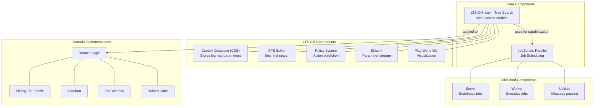
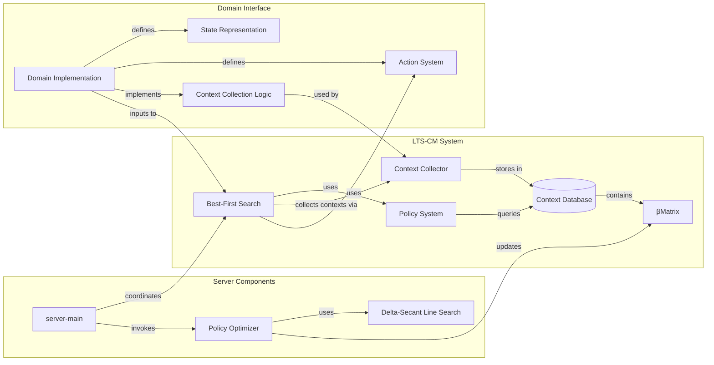
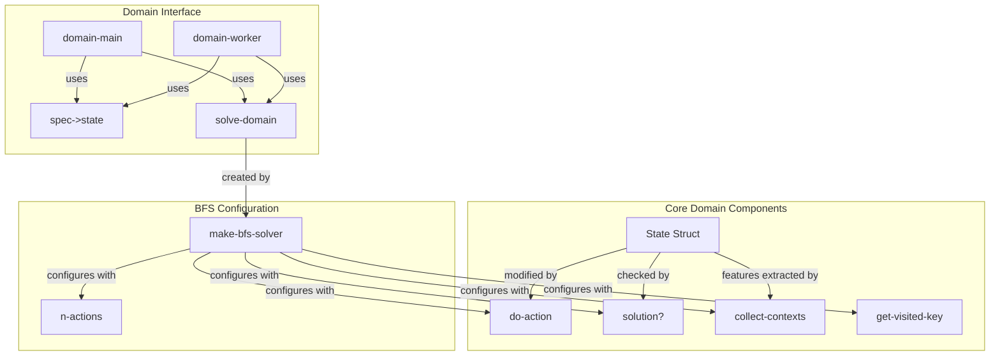
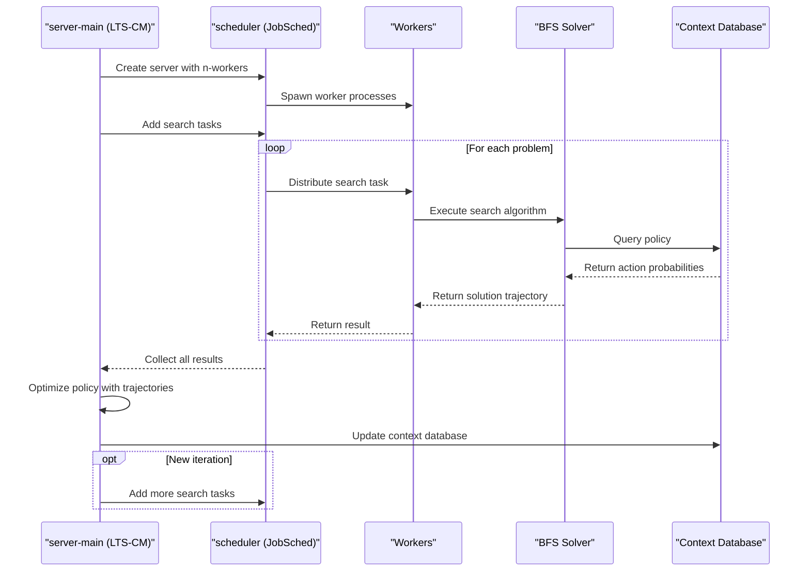

<!-- source: DeepWiki mcp.deepwiki.com · repo google-deepmind/levintreesearch_cm · page 1 Overview · fetched 2026-10-26 -->

# Overview

<details>
<summary>Relevant source files</summary>

The following files were used as context for generating this wiki page:

- [README.md](README.md)
- [lts-cm/img/domains.png](lts-cm/img/domains.png)
- [lts-cm/scribblings/lts-cm.scrbl](lts-cm/scribblings/lts-cm.scrbl)

</details>


Levin Tree Search with Context Models (LTS-CM) is an algorithm and system for efficiently solving complex search problems through a combination of best-first search and learned context models. This repository provides a complete implementation of the algorithm presented in the IJCAI 2023 paper "Levin Tree Search with Context Models", allowing users to reproduce the results and apply the approach to various puzzle domains.

This page provides a high-level overview of the LTS-CM system architecture, key components, and their interactions. For installation instructions and quick start guidance, see [Installation and Quick Start](#1.1). For details about the repository structure, see [Repository Structure](#1.2).

Sources: [README.md:1-11]()

## System Architecture

### High-Level System Overview



The Levin Tree Search with Context Models system consists of two primary subsystems:

1. **LTS-CM**: The core algorithm implementation that combines Levin Tree Search with contextual models for efficient problem solving
2. **JobSched**: A parallel job scheduling framework that enables distributing computation across multiple workers

These systems work together to solve complex puzzles across four domains: Sliding Tile Puzzle, Sokoban, The Witness, and Rubik's Cube.

Sources: [README.md:12-67]()

### LTS-CM Architecture and Data Flow



The diagram illustrates the data flow within the LTS-CM system:

1. The **Best-First Search (BFS)** algorithm forms the core search mechanism, guided by the **Policy System**
2. The **Policy System** retrieves action probabilities from the **Context Database (CDB)**
3. As the search progresses, the **Context Collector** gathers contextual information
4. The **Policy Optimizer** updates the **BetaMatrix** parameters based on solution trajectories
5. Domain-specific implementations provide state representations, actions, and context collection logic

Sources: [README.md:42-67]()

## Key Components

### LTS-CM (Levin Tree Search with Context Models)

LTS-CM combines Levin Tree Search, a variant of best-first search that balances exploration cost with solution quality, with context models that learn from experience to guide the search more efficiently. The main components of LTS-CM are:

1. **Context Database (CDB)**: Stores learned parameters and contextual information gathered during searches
2. **BFS Solver**: Implements the best-first search algorithm guided by the learned policy
3. **Policy System**: Predicts action probabilities based on contextual information
4. **BetaMatrix**: Stores the model parameters that are optimized over time
5. **GUI**: Provides visualization of states and solution trajectories

Sources: [README.md:45-56](), [README.md:82-96]()

### JobSched (Job Scheduling System)

JobSched is a parallel processing framework that enables distributing computation across multiple CPU cores. It follows a server-worker architecture:

1. **Server**: Manages job distribution and result collection
2. **Worker**: Receives jobs, executes them, and returns results
3. **Utilities**: Provides tools for message passing and communication

This framework allows LTS-CM to scale across multiple CPU cores, significantly speeding up the search and optimization process.

Sources: [README.md:58-67](), [README.md:76-78]()

### Domain Implementation Architecture



Each domain implementation (Sliding Tile Puzzle, Sokoban, The Witness, Rubik's Cube) follows a common architecture:

1. **State Representation**: Domain-specific struct representing the puzzle state
2. **Action System**: Defines legal moves and state transitions
3. **BFS Configuration**: Configures the best-first search algorithm with domain-specific functions
4. **Context Collection**: Defines how contextual information is extracted from states

This modular design allows the same LTS-CM algorithm to be applied across different puzzle domains while encapsulating the domain-specific logic.

Sources: [README.md:12-13](), [README.md:82-96]()

## Integration and Data Flow

### LTS-CM and JobSched Integration



The sequence diagram illustrates the interaction between LTS-CM and JobSched components during a typical run:

1. The system begins by creating a server with multiple workers
2. Search tasks (puzzle instances) are distributed to available workers
3. Each worker executes the BFS algorithm, querying the policy for guidance
4. Solution trajectories are returned to the server
5. The policy is optimized based on the collected trajectories
6. The context database is updated with the improved policy
7. Additional search tasks may be added for further iterations

This iterative process allows the system to improve its search efficiency over time as it learns from previous solutions.

Sources: [README.md:60-80]()

## Algorithm Overview

### Levin Tree Search

Levin Tree Search is a variant of best-first search that expands nodes in order of their "Levin cost" - a combination of the cost to reach the node and an estimate of the remaining cost to reach a solution. The key innovation in this system is the addition of context models that learn to predict better cost estimates based on experience with similar problems.

### Context Models

Context models in LTS-CM learn patterns from previously solved problems to guide future searches more efficiently. The system:

1. Collects contextual information during search
2. Stores this information in the Context Database
3. Uses this information to train a policy that predicts promising actions
4. Applies the learned policy to guide future searches

The combination of Levin Tree Search with these learned context models makes the system particularly efficient at solving complex puzzles, often requiring significantly fewer node expansions than traditional methods.

### Delta-Secant Line Search

The system uses a Delta-Secant line search algorithm for policy optimization. This convex minimization technique is documented in the module `lts-cm/delta-secant`, which implements the algorithm described in the paper "Line Search for Convex Minimization".

Sources: [lts-cm/scribblings/lts-cm.scrbl:18-118]()

## Supported Problem Domains

The system has been tested on four challenging puzzle domains:

1. **Sliding Tile Puzzle**: The classic n×n grid puzzle where tiles must be rearranged to a goal configuration
2. **Sokoban**: A puzzle where a warehouse worker must push boxes to designated locations
3. **The Witness**: A path-finding puzzle based on the video game of the same name
4. **Rubik's Cube**: The well-known 3D combination puzzle

Each of these domains presents unique challenges for search algorithms, and the LTS-CM system has demonstrated strong performance across all of them.

Sources: [README.md:12-13](), [README.md:82-96]()

## Usage Examples

The system provides several examples that demonstrate its capabilities:

### Quick Start Example
```
racket -l- lts-cm/domains/sokoban/example-optim-gui
```
This example:
- Runs the solver on simple Sokoban levels
- Shows the number of expansions during search
- Collects solution trajectories
- Optimizes policy parameters
- Demonstrates improved efficiency in subsequent searches
- Opens a GUI to visualize the solution

### Server Example
```
racket -l- lts-cm/domains/stp/server-easy
```
This example:
- Runs multiple jobs in parallel using the server-worker architecture
- Solves a set of easy Sliding Tile Puzzle instances
- Demonstrates the parallel processing capabilities of the system

For reproducing the full paper results, the repository includes commands for each domain, though some may require significant computation time.

Sources: [README.md:41-80]()

## Summary

Levin Tree Search with Context Models (LTS-CM) provides a powerful framework for solving complex search problems by combining traditional best-first search with learned context models. The system's modular architecture, parallel processing capabilities, and support for multiple puzzle domains make it a versatile tool for both research and practical applications in search and planning.

The implementation demonstrates how learning from experience can significantly improve search efficiency over time, with the system requiring fewer node expansions as it gains experience with similar problems.

---

