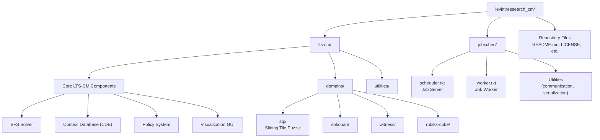
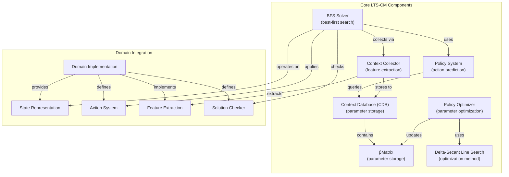
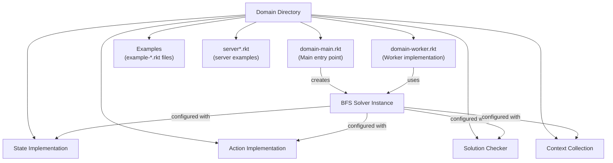
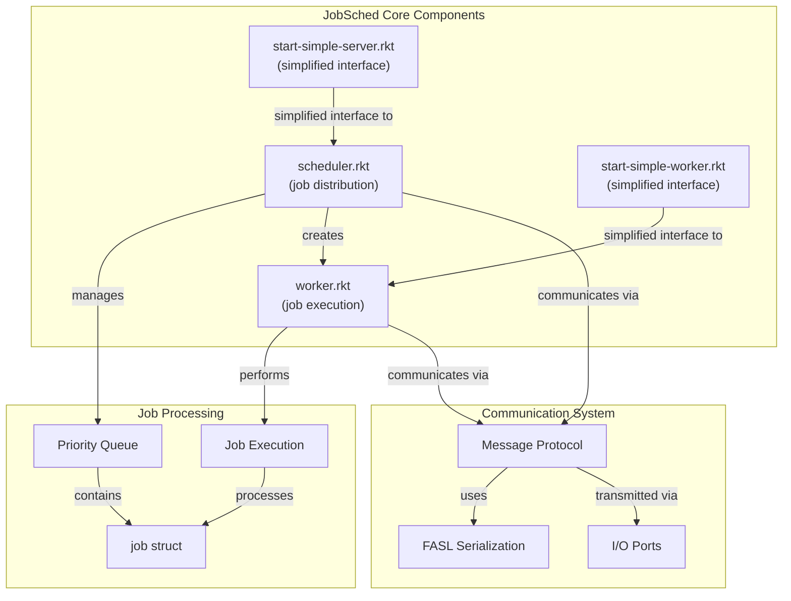
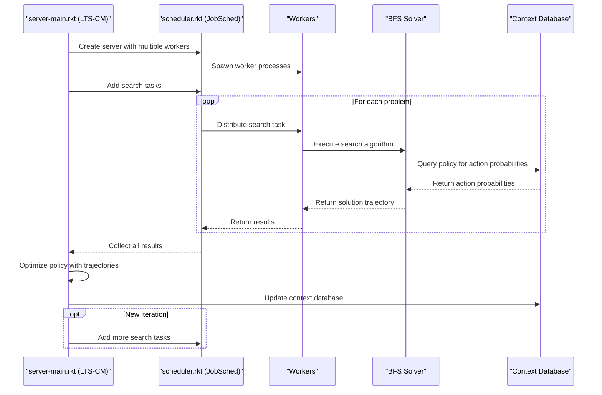

<!-- source: DeepWiki mcp.deepwiki.com · repo google-deepmind/levintreesearch_cm · page 1.2 Repository Structure · fetched 2026-10-26 -->

# Repository Structure

Relevant source files

The following files were used as context for generating this wiki page:

- [.gitignore](.gitignore)
- [CONTRIBUTING.md](CONTRIBUTING.md)
- [LICENSE](LICENSE)
- [README.md](README.md)
- [lts-cm/img/domains.png](lts-cm/img/domains.png)

## Purpose and Overview

This document provides a comprehensive overview of the `levintreesearch_cm` repository organization, detailing the main components and their relationships. It serves as a guide to help developers navigate the codebase and understand how different parts interact with each other.

For detailed information about the Levin Tree Search with Context Models algorithm, see [LTS-CM: Levin Tree Search with Context Models](#2).

## Top-Level Organization

The repository is organized into two main subsystems:

1. **LTS-CM (Levin Tree Search with Context Models)** - The core algorithm implementation
2. **JobSched** - A parallel job scheduling framework

### Repository File Structure

Sources: README.md

## LTS-CM: Core Components

The LTS-CM directory contains the implementation of the Levin Tree Search with Context Models algorithm. This algorithm combines best-first search with learned context models to efficiently solve problems across different domains.

### LTS-CM Architecture

Sources: README.md

### Component Descriptions

1. **BFS Solver**: Implements the best-first search algorithm for solving problems and finding optimal paths.

2. **Context Database (CDB)**: Stores learned model parameters and contextual information used to guide the search.

3. **Policy System**: Predicts action probabilities based on contextual information, guiding the search process.

4. **βMatrix**: Stores the parameters of the context models.

5. **Context Collector**: Extracts features from states and actions for learning and policy improvement.

6. **Policy Optimizer**: Updates policy parameters based on collected trajectory data.

## Domain Implementations

The repository includes implementations for four problem domains:

1. **Sliding Tile Puzzle** (`lts-cm/domains/stp/`)
2. **Sokoban** (`lts-cm/domains/sokoban/`)
3. **The Witness** (`lts-cm/domains/witness/`)
4. **Rubik's Cube** (`lts-cm/domains/rubiks-cube/`)

### Domain Structure

Each domain implementation follows a similar structure:

Sources: README.md

### Domain Interface Components

Each domain implements these standard components:

1. **State Representation**: A data structure representing the problem state (e.g., board configuration).

2. **Action System**: Defines available actions and their effects on states.

3. **Solution Checker**: Determines if a state is a solution to the problem.

4. **Context Collection**: Extracts features from states and actions for learning.

5. **BFS Configuration**: Domain-specific configuration for the BFS solver.

## JobSched: Job Scheduling System

The JobSched system provides parallel job execution capabilities, allowing LTS-CM to distribute computational work across multiple workers.

### JobSched Architecture

Sources: README.md

### JobSched Components

1. **Scheduler**: Central component that distributes jobs to workers and collects results.

2. **Worker**: Executes jobs received from the scheduler and returns results.

3. **Job Execution**: Mechanism for executing jobs and handling their results.

4. **Communication Protocol**: System for message passing between scheduler and workers.

## Integration Between LTS-CM and JobSched

LTS-CM uses JobSched to parallelize search and optimization tasks across multiple workers, enabling efficient processing of complex problems.

Sources: README.md

## Example Files and Entry Points

The repository contains several example files that serve as entry points for running experiments:

1. **Quick Start Example**: `lts-cm/domains/sokoban/example-optim-gui.rkt` - Demonstrates the solver, optimization, and visualization.

2. **Server Example**: `lts-cm/domains/stp/server-easy.rkt` - Shows parallel execution on Sliding Tile Puzzle instances.

3. **Paper Reproduction**: Various server files in domain directories for reproducing the paper's results:
   - `lts-cm/domains/witness/server.rkt`
   - `lts-cm/domains/sokoban/server.rkt`
   - `lts-cm/domains/stp/server.rkt`
   - `lts-cm/domains/rubiks-cube/server.rkt`

Sources: README.md

## Configuration and Logging

The system uses a logging directory to store results and checkpoints:

- Default log directory: `lts-cm-logs/` in the user's home directory
- Can be changed with the `--log-base-dir <dir>` flag
- Worker count configurable with `--n-workers` for search and `--n-futures` for optimization

Sources: README.md

## Summary

The `levintreesearch_cm` repository is organized around two main components:

1. **LTS-CM** - The core algorithm implementation for Levin Tree Search with Context Models
2. **JobSched** - A parallel job scheduling framework that enables efficient problem solving

The repository structure facilitates both research and application by providing:
- Clean separation between algorithm components and problem domains
- Parallel execution capabilities for resource-intensive tasks
- Well-defined interfaces between components
- Multiple example entry points for different use cases

For detailed information about the specific components, see their respective wiki pages:
- [Core Components](#2.1)
- [Domain Implementations](#3)
- [JobSched System](#4)

---

