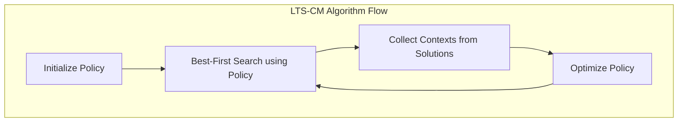
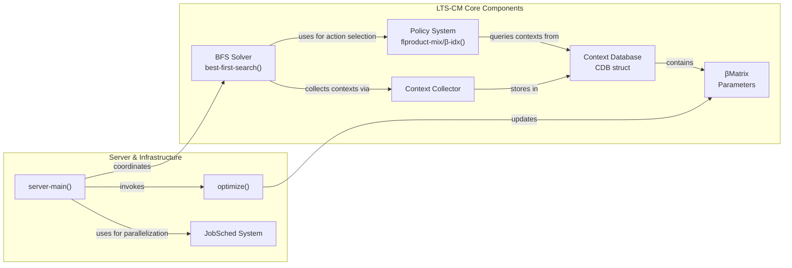
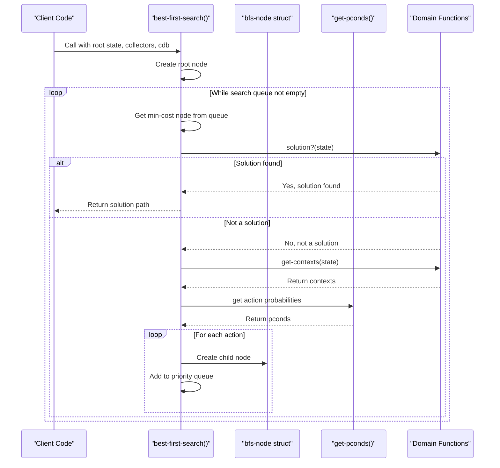
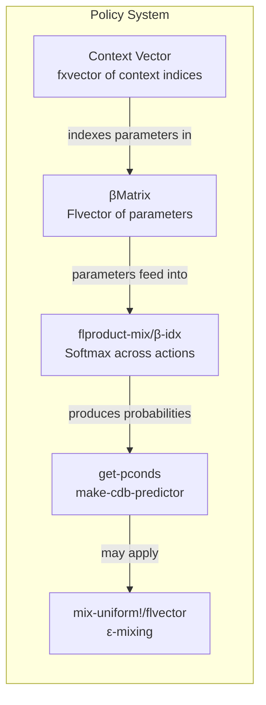
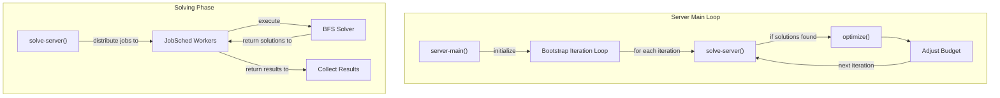
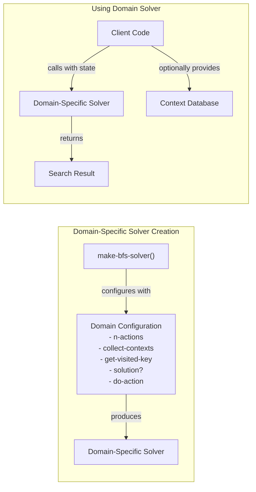
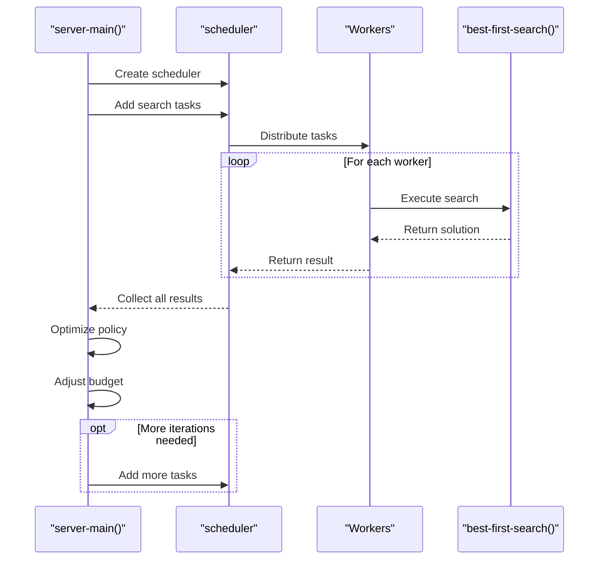

<!-- source: DeepWiki mcp.deepwiki.com · repo google-deepmind/levintreesearch_cm · page 2 LTS-CM: Levin Tree Search with Context Models · fetched 2026-10-26 -->

# LTS-CM: Levin Tree Search with Context Models

<details>
<summary>Relevant source files</summary>

The following files were used as context for generating this wiki page:

- [lts-cm/bfs.rkt](lts-cm/bfs.rkt)
- [lts-cm/policy.rkt](lts-cm/policy.rkt)
- [lts-cm/scribblings/lts-cm.scrbl](lts-cm/scribblings/lts-cm.scrbl)
- [lts-cm/server.rkt](lts-cm/server.rkt)

</details>


## Purpose and Scope

This document explains the Levin Tree Search with Context Models (LTS-CM) algorithm implementation in the repository. LTS-CM is an algorithm that combines Levin's universal search with learned context models to efficiently solve combinatorial search problems. It provides a framework for efficiently solving puzzles and planning problems by learning from past solutions.

This page covers the core algorithm, its implementation details, and how it integrates with other components. For information about specific problem domains implemented in the system, see [Problem Domains](#3). For details about the parallel job scheduling system used by LTS-CM, see [JobSched: Job Scheduling System](#4).

## Overview of the LTS-CM Algorithm

LTS-CM is a search algorithm that uses a best-first search approach guided by learned policies. The core idea is to use a context-based policy to guide the search, and then to iteratively improve this policy based on successful solutions.



Sources: [lts-cm/bfs.rkt:119-135](), [lts-cm/server.rkt:323-380]()

The algorithm follows these key steps:
1. Initialize a policy (can be uniform at first)
2. Solve problems using best-first search guided by the policy
3. Collect contexts from successful solutions
4. Optimize the policy based on these contexts
5. Repeat with improved policy

## Core System Architecture

The LTS-CM system consists of several interconnected components that work together to implement the algorithm:



Sources: [lts-cm/bfs.rkt:27-32](), [lts-cm/server.rkt:36-46](), [lts-cm/policy.rkt:21-22]()

### Key Components

| Component | Purpose | Key Code Entities |
|-----------|---------|-------------------|
| BFS Solver | Implements best-first search algorithm | `best-first-search`, `bfs-node` struct |
| Policy System | Handles action selection using context models | `flproduct-mix/β-idx`, `mix-uniform!/flvector` |
| Context Database | Stores learned context parameters | `CDB` struct, `make-cdb` |
| βMatrix | Parameter storage for the context model | `βmatrix` |
| Context Collector | Extracts contexts from states | `collect-contexts` |
| Server | Orchestrates search and optimization | `server-main` |
| Optimizer | Improves policy based on collected contexts | `optimize` |

## Best-First Search Implementation

The best-first search algorithm is the core search component that uses learned policies to guide exploration. It's implemented in the `best-first-search` function in the BFS module.



Sources: [lts-cm/bfs.rkt:137-273]()

### Key Aspects of the BFS Implementation:

1. Uses a priority queue ordered by a cost function that combines depth and action probability
2. The cost function is: `(+ (log depth) ln1/π)` where `ln1/π` is the negative log probability of the path
3. Supports transposition tables via the `visitor` struct to avoid re-expanding states
4. Collects contexts during search to enable policy learning
5. Returns a detailed result dictionary with solution information

### Search Node Structure

The search state is represented by the `bfs-node` struct defined in [lts-cm/bfs.rkt:52-54]():

```
(struct bfs-node (depth ln1/π act-seq state cost)
  #:transparent
  #:mutable)
```

Where:
- `depth`: The depth of the node in the search tree
- `ln1/π`: Negative log probability of the path to this node
- `act-seq`: Sequence of actions that led to this state (in reverse)
- `state`: The domain state
- `cost`: Combined cost used for ordering in the priority queue

## Policy System

The policy system maps contexts to action probabilities. It's implemented using a parametric model stored in a βMatrix.



Sources: [lts-cm/policy.rkt:63-128](), [lts-cm/bfs.rkt:78-79]()

The policy works by:
1. Extracting context indices from a state using domain-specific collectors
2. Looking up parameters in the βMatrix for each context
3. Combining these parameters using a product-mixing approach (similar to softmax)
4. Optionally mixing with a uniform distribution for exploration (controlled by ε-mix)

### Key Policy Functions:

- `flproduct-mix/β-idx`: Computes action probabilities from context indices using the βMatrix
- `mix-uniform!/flvector`: Mixes the policy with a uniform distribution
- `make-cdb-predictor`: Creates a predictor function that maps contexts to probabilities

## Server Architecture and Optimization

The server orchestrates the overall LTS-CM algorithm, managing the iterative process of searching and learning.



Sources: [lts-cm/server.rkt:245-385](), [lts-cm/server.rkt:103-214]()

### Server Bootstrap Process:

The server follows a bootstrap iteration process:
1. Start with an initial budget and policy (can be empty/uniform)
2. Distribute search jobs to workers for solving problems
3. Collect successful solutions and their contexts
4. Optimize the policy based on collected contexts
5. Adjust the budget based on search progress
6. Repeat until convergence or budget limit reached

### Budget Adaptation:

The system uses an adaptive budget mechanism:
- If significant progress is made, the budget may be reduced
- If progress is slow, the budget increases based on the formula:
  ```
  new_budget = α * budget + ((α - 1) * solved_expansions) / n_unsolved
  ```
- This balances exploration against exploitation of the learned policy

### Policy Optimization:

The policy is optimized using a line search approach that minimizes the expected search cost across all contexts:
1. Extracts contexts from successful solutions
2. Updates the βMatrix parameters to better predict successful actions
3. Uses regularization to avoid overfitting (controlled by *regularizer*)

## Creating a Domain-Specific Solver

LTS-CM provides a function `make-bfs-solver` that generates a domain-specific solver by configuring the generic best-first search with domain-specific functions:



Sources: [lts-cm/bfs.rkt:276-296]()

A domain-specific solver must provide:
1. `n-actions`: Number of possible actions
2. `collect-contexts`: Function to extract contexts from states
3. `get-visited-key`: Function to generate keys for transposition tables
4. `solution?`: Function to check if a state is a solution
5. `do-action`: Function to apply an action to a state

For implementation of specific domains, see [Problem Domains](#3).

## Integration with JobSched

LTS-CM uses the JobSched system for parallel execution of search tasks. The integration allows for efficient distribution of search tasks across multiple workers.



Sources: [lts-cm/server.rkt:103-214](), [lts-cm/server.rkt:323-380]()

For more details about JobSched, see [JobSched: Job Scheduling System](#4).

## Summary

LTS-CM is a powerful search algorithm that combines traditional best-first search with learned context models to efficiently solve combinatorial problems. Its key strengths are:

1. Iterative improvement of search policy through learning
2. Adaptive budget mechanism to balance exploration and exploitation
3. Parallel execution through integration with JobSched
4. Domain-agnostic framework that can be applied to various problem domains

For more detailed information about implementing specific domains, see [Problem Domains](#3).

---

