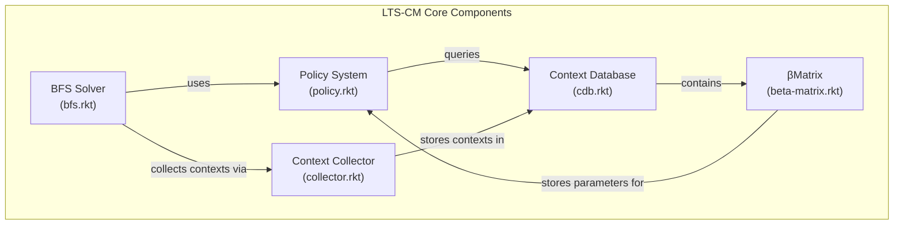
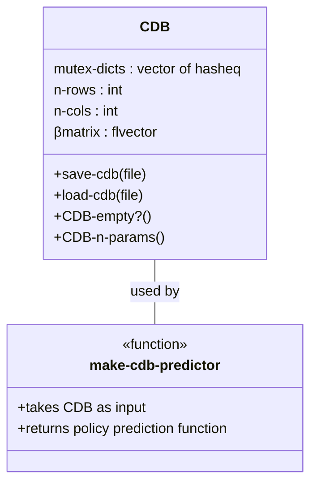
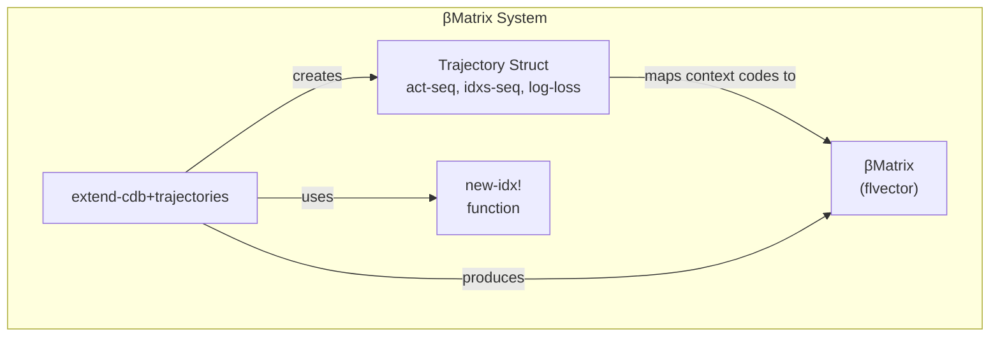
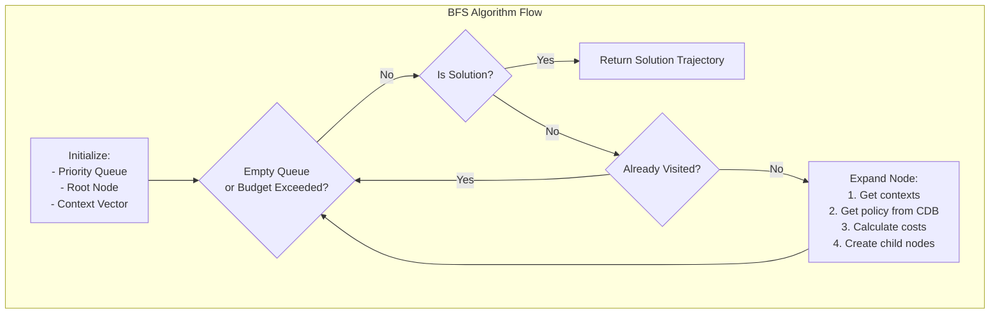
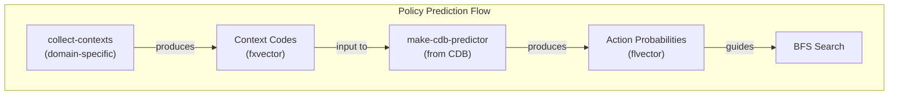
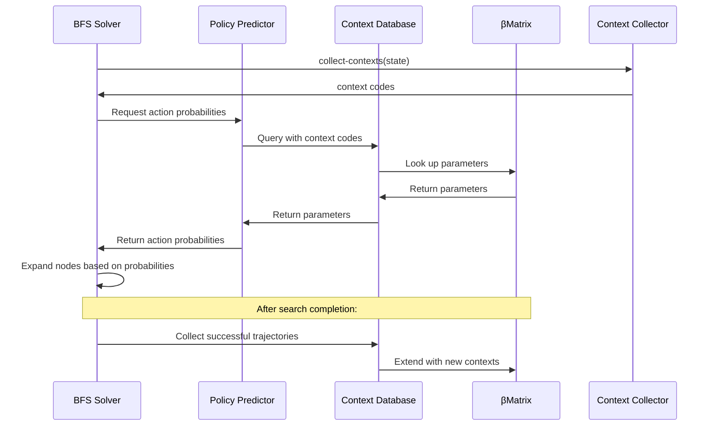

<!-- source: DeepWiki mcp.deepwiki.com · repo google-deepmind/levintreesearch_cm · page 2.1 Core Components · fetched 2026-10-26 -->

# Core Components

Relevant source files

The following files were used as context for generating this wiki page:

- [lts-cm/beta-matrix.rkt](lts-cm/beta-matrix.rkt)
- [lts-cm/bfs.rkt](lts-cm/bfs.rkt)
- [lts-cm/cdb.rkt](lts-cm/cdb.rkt)
- [lts-cm/flonum.rkt](lts-cm/flonum.rkt)

This document describes the central components of the Levin Tree Search with Context Models (LTS-CM) system. It covers the foundational elements that enable problem-solving through context-sensitive search. For information about the higher-level server architecture, see [Server Architecture](#2.2), and for details on the domains that can be solved with these components, see [Problem Domains](#3).

## Overview of Core Components

The LTS-CM system is built around four principal components that work together to enable efficient search with learned contextual information:

Sources: [lts-cm/cdb.rkt](1-71), [lts-cm/beta-matrix.rkt](1-143), [lts-cm/bfs.rkt](1-297)

## Context Database (CDB)

The Context Database is a central repository that stores learned parameters and context mappings. It maintains the associations between context codes and their corresponding indices in the βMatrix.

The `CDB` struct ([lts-cm/cdb.rkt:40]()) contains:
- `mutex-dicts`: Vector of hash tables mapping context integers to βMatrix indices
- `n-rows`: Number of rows in the βMatrix
- `n-cols`: Number of columns (actions) in the βMatrix 
- `βmatrix`: A flvector storing all parameters

Key functions:
- `make-cdb`: Creates an empty CDB with specified number of columns
- `save-cdb`/`load-cdb`: Persistence functions using FASL serialization
- `make-cdb-predictor`: Creates a policy prediction function from a CDB

Sources: [lts-cm/cdb.rkt:24-70](1-70)

## Beta Matrix (βMatrix)

The βMatrix is the core parameter storage mechanism for the policy system. It's structured as a dense matrix (implemented as a vector) that stores flonum parameters.

Key components:
- The βMatrix is stored as a flvector within the CDB structure
- Context codes are mapped to indices in the βMatrix using hash tables
- The `trajectory` struct ([lts-cm/beta-matrix.rkt:46-47]()) tracks:
  - `act-seq`: Sequence of actions
  - `idxs-seq`: Sequence of indices in the βMatrix
  - `log-loss`: Loss value for optimization

The `extend-cdb+trajectories` function ([lts-cm/beta-matrix.rkt:81-141]()) is critical as it:
1. Processes new trajectories
2. Maps context codes to indices in the βMatrix
3. Creates or extends the βMatrix with new parameters
4. Returns an updated CDB and trajectories for optimization

Sources: [lts-cm/beta-matrix.rkt:27-143](1-143)

## Best-First Search (BFS) Solver

The BFS solver implements the core search algorithm, exploring states based on a cost function that balances depth and policy guidance.

Key components:
- `bfs-node` struct ([lts-cm/bfs.rkt:52-54]()): Represents a search state with:
  - `depth`: Search depth
  - `ln1/π`: Log of inverse probability
  - `act-seq`: Action sequence
  - `state`: Domain state
  - `cost`: Search priority

- `best-first-search` function ([lts-cm/bfs.rkt:137-273]()): The main search algorithm that:
  1. Uses a priority queue to explore states
  2. Collects context information
  3. Queries the policy from CDB
  4. Applies the cost function (d/π by default)
  5. Maintains a transposition table to avoid revisiting states

- `make-bfs-solver` function ([lts-cm/bfs.rkt:276-296]()): Creates domain-specific solver instances

Sources: [lts-cm/bfs.rkt:34-296](1-296)

## Policy System and Prediction

The policy system uses the parameters stored in the CDB to predict action probabilities and guide the search process.

The policy prediction process:
1. `collect-contexts`: Domain-specific function collects context features from a state
2. Context codes are mapped to βMatrix indices
3. `make-cdb-predictor`: Creates a function that uses the CDB to predict action probabilities
4. The resulting probability distribution guides the BFS search

Key concepts:
- Context collection is domain-specific but follows a common interface
- The policy balances exploration and exploitation through ε-mixing with uniform distribution
- The `flproduct-mix/β-idx` function computes action probabilities from the βMatrix

Sources: [lts-cm/beta-matrix.rkt:143-182](143-182), [lts-cm/bfs.rkt:162-174](162-174)

## Data Flow Between Components

The following diagram shows how data flows through the core components during search and optimization:

Sources: [lts-cm/bfs.rkt:137-273](137-273), [lts-cm/beta-matrix.rkt:81-141](81-141)

## Integration with Problem Domains

The core components are designed to work with various problem domains through a consistent interface:

| Component | Interface | Domain Implementation |
|-----------|-----------|----------------------|
| BFS Solver | `make-bfs-solver` | Provides domain-specific functions |
| Context Collection | `collect-contexts` | Extract features from domain states |
| Solution Checking | `solution?` | Domain-specific goal test |
| Action Application | `do-action` | Transition function for the domain |
| Visited State Checking | `get-visited-key` | Hash function for transposition table |

Each problem domain (Sliding Tile Puzzle, Sokoban, The Witness, Rubik's Cube) implements these interfaces to enable the core components to solve them effectively. For detailed information on specific domains, see [Problem Domains](#3).

Sources: [lts-cm/bfs.rkt:276-296](276-296)

---

