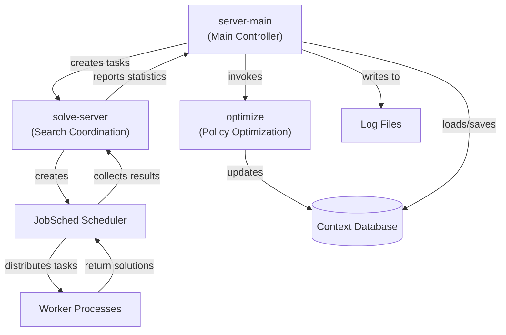
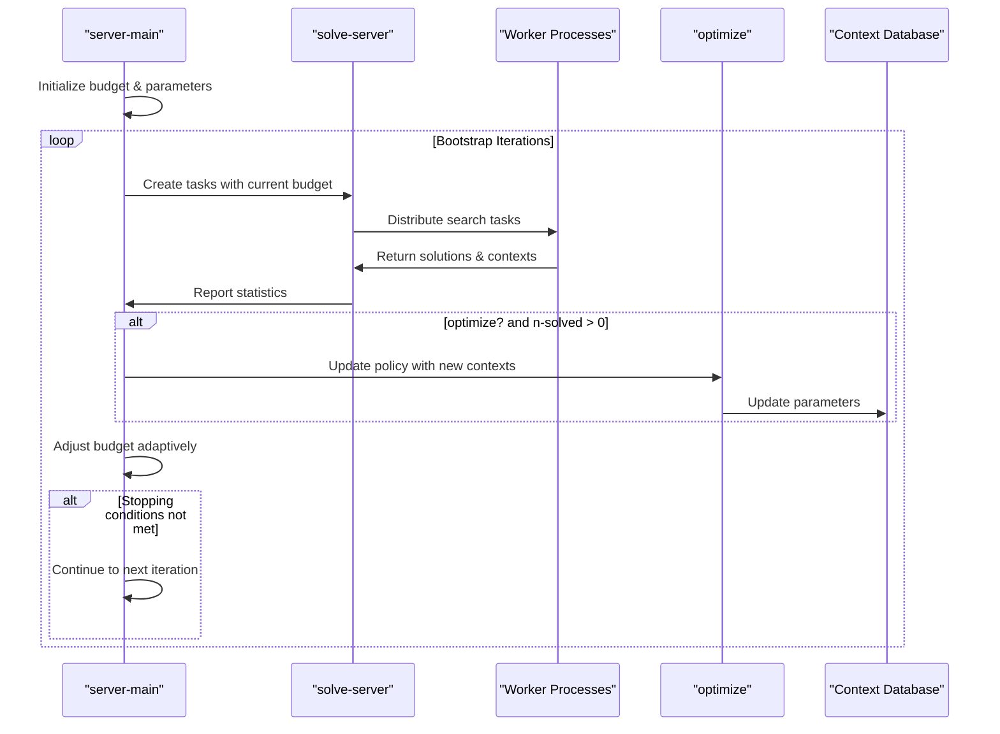
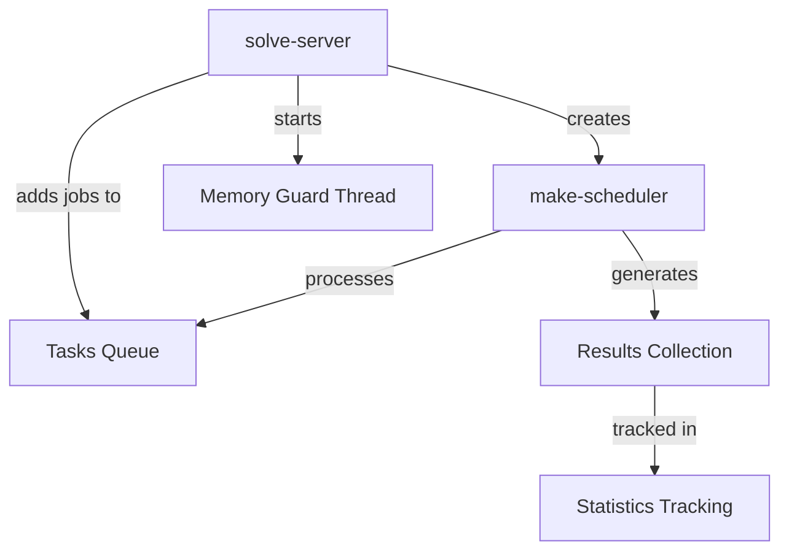
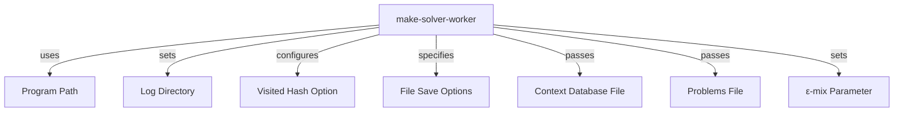
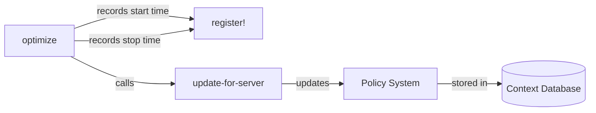
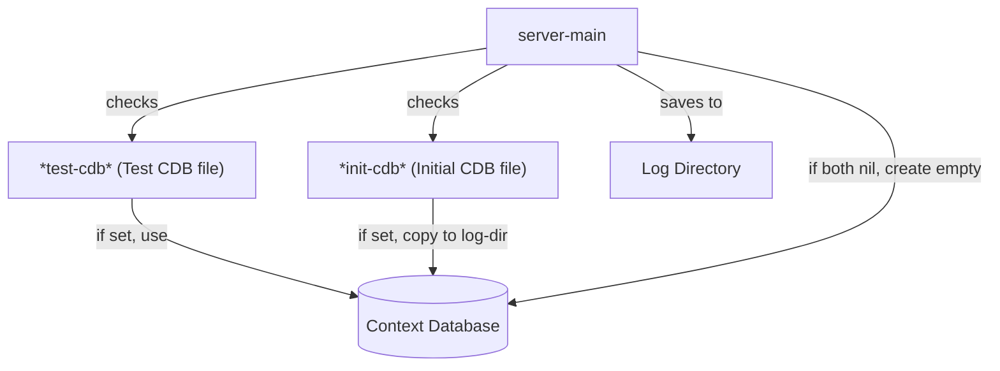
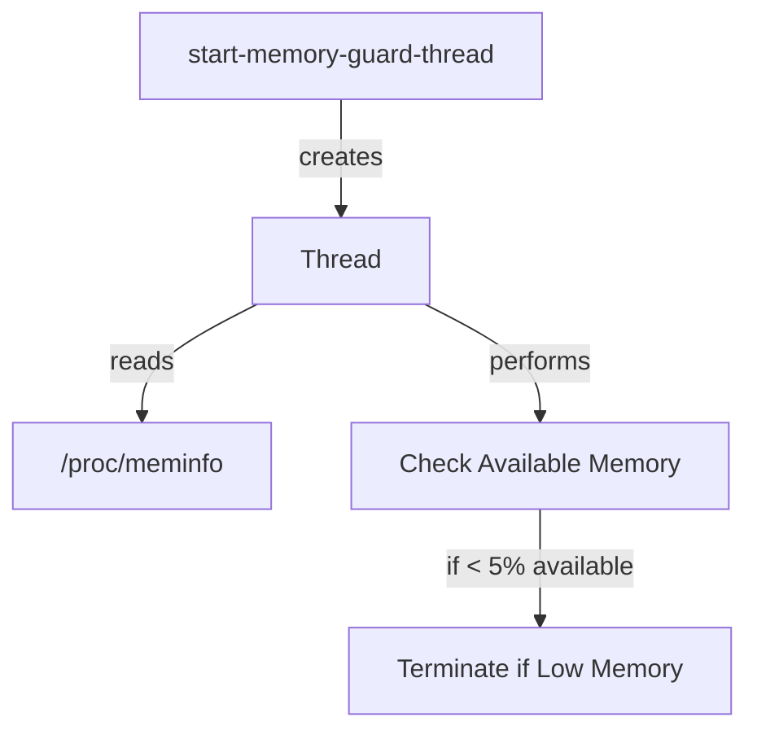
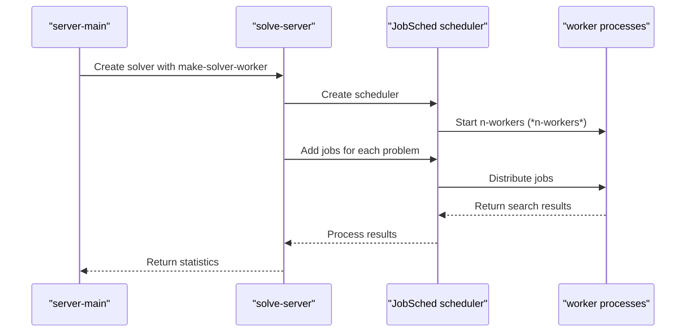

<!-- source: DeepWiki mcp.deepwiki.com · repo google-deepmind/levintreesearch_cm · page 2.2 Server Architecture · fetched 2026-10-26 -->

# Server Architecture

<details>
<summary>Relevant source files</summary>

The following files were used as context for generating this wiki page:

- [lts-cm/policy.rkt](lts-cm/policy.rkt)
- [lts-cm/server.rkt](lts-cm/server.rkt)

</details>


The Server Architecture in LTS-CM is responsible for orchestrating the search and optimization process across multiple parallel workers. It coordinates problem-solving tasks, collects results, manages the context database, and optimizes the policy based on collected data. This page explains how the server component controls the overall execution flow of the LTS-CM system.

For details about the underlying job scheduling framework, see [JobSched: Job Scheduling System](#4).

## High-Level Architecture

The server architecture combines several key components that work together to manage the entire LTS-CM search and optimization pipeline.



Sources: [lts-cm/server.rkt:245-385]()

The main components of the server architecture:

1. **server-main**: Entry point function that controls the bootstrap iteration process, manages the context database, and coordinates between solving and optimization phases.

2. **solve-server**: Handles parallel execution of search tasks, distributing them to workers and collecting results.

3. **optimize**: Triggers policy optimization based on collected search results.

## Bootstrap Iteration Process

The server uses a bootstrap iteration process to progressively solve problems and optimize the policy. This process is implemented in the `server-main` function as a loop that manages alternating phases of solving and optimization.



Sources: [lts-cm/server.rkt:323-380]()

The bootstrap iteration process works as follows:

1. Initialize the search budget and parameters
2. For each iteration:
   - Create search tasks with the current budget
   - Distribute tasks to workers
   - Collect solutions and contexts 
   - If optimization is enabled and problems were solved, update the policy
   - Adjust the budget for the next iteration based on results
   - Continue until stopping conditions are met (all solvable problems solved or maximum budget reached)

### Budget Management

The server adaptively manages the search budget based on previous search results:

```
new-budget = min(budget-max,
                 if (no unsolved problems)
                     budget
                 else if (significant progress made)
                     max(budget-init, budget/2)
                 else
                     α*budget + (α-1)*solved-expansions/n-unsolved)
```

Where:
- `α` is the budget factor (`*budget-factor*`)
- `solved-expansions` is the total number of expansions from solved problems
- `n-unsolved` is the number of unsolved problems

Sources: [lts-cm/server.rkt:357-374]()

## Search Process

The search process is managed by the `solve-server` function, which handles parallel execution of search tasks.



Sources: [lts-cm/server.rkt:103-214]()

The search process involves:

1. Creating a scheduler using the JobSched system
2. Starting a memory guard thread to prevent out-of-memory errors
3. Adding jobs to the scheduler for each problem
4. Tracking search statistics including:
   - Number of solved problems (`n-solved`)
   - Number of newly solved problems (`n-new-solved`)
   - Number of unsolved problems (`n-unsolved`)
   - Number of expansions (`expansions`)
   - Solving times and solution lengths

### Worker Configuration

Workers are created using the `make-solver-worker` function, which configures each worker with specific parameters:



Sources: [lts-cm/server.rkt:291-304]()

## Optimization Process

The optimization process is managed by the `optimize` function defined in `server.rkt`, which works with the policy system to update the parameters in the context database.



Sources: [lts-cm/server.rkt:93-100]()

The optimization process:

1. Records the start time of optimization
2. Calls `update-for-server` with parameters:
   - log-dir: Directory for storing logs
   - Tmax: Maximum number of optimization steps (`*optim-steps*`)
   - reg: Regularization parameter (`*regularizer*`)
   - n-actions: Number of actions in the domain
3. Records the stop time when optimization completes

## Context Database Management

The server initializes and manages the Context Database (CDB), which stores the learned parameters for the policy.



Sources: [lts-cm/server.rkt:264-275]()

The context database can be:
- Loaded from an existing file specified by `*init-cdb*`
- Loaded from a test file specified by `*test-cdb*`
- Created as a new empty database if no file is specified

## Memory Management

The server includes a memory guard thread to prevent out-of-memory errors.



Sources: [lts-cm/server.rkt:220-239]()

The memory guard thread:
1. Periodically checks available system memory (every 10 seconds by default)
2. Terminates the process if available memory falls below a threshold (5% by default)
3. Helps prevent catastrophic system failures due to memory exhaustion

## Configuration Parameters

The server's behavior is controlled by several global variables defined in `server.rkt`:

| Parameter | Description | Default |
|-----------|-------------|---------|
| `*init-cdb*` | File containing the initial CDB | `#f` (empty CDB) |
| `*test-cdb*` | File containing the CDB to test | `#f` |
| `*problems*` | File containing the list of problems | (required) |
| `*optim-steps*` | Number of optimization steps to perform | 1000 |
| `*visited-hash?*` | Use a hash table for visited states | `#t` |
| `*budget-init*` | Initial budget in number of expansions | 125 |
| `*budget-factor*` | Factor for increasing budget | 2 |
| `*budget-max*` | Maximum budget to use | 10^20 |
| `*n-workers*` | Number of workers to use | processor-count/2 |
| `*regularizer*` | Regularizer factor | 0.0 |

Sources: [lts-cm/server.rkt:51-84]()

## Integration with JobSched

The server integrates with the JobSched system for parallel execution of tasks.



Sources: [lts-cm/server.rkt:103-214]()

The server uses JobSched to:
1. Create and manage worker processes
2. Distribute search tasks to workers
3. Collect results and statistics from workers
4. Handle worker failures and resource management

For more details on the JobSched system itself, see [JobSched: Job Scheduling System](#4).

---

