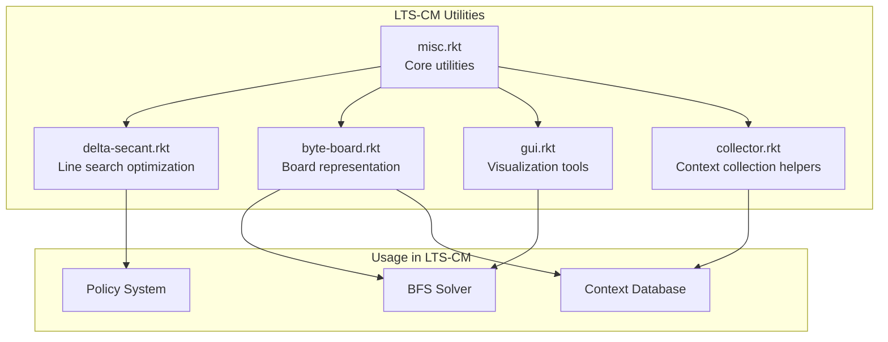
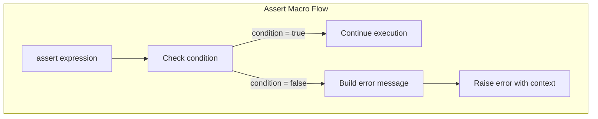
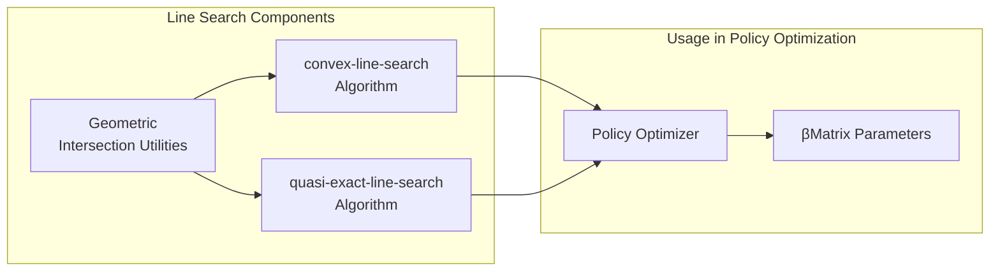
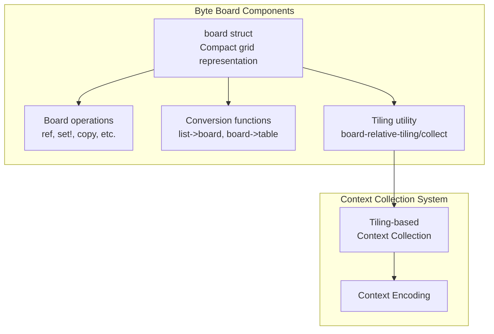
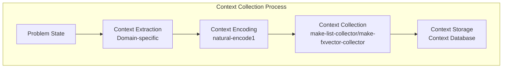
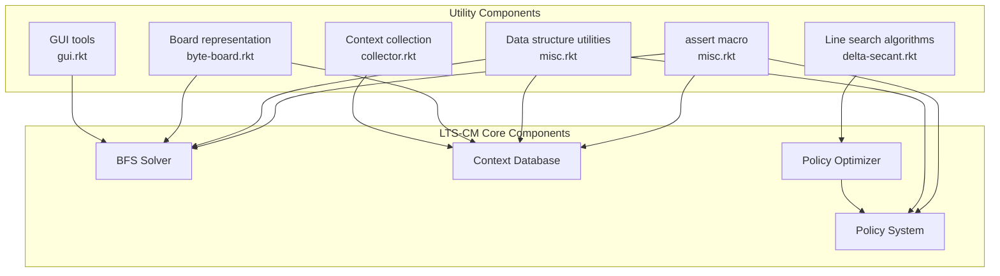

<!-- source: DeepWiki mcp.deepwiki.com · repo google-deepmind/levintreesearch_cm · page 2.3 Utilities · fetched 2026-10-26 -->

# Utilities

<details>
<summary>Relevant source files</summary>

The following files were used as context for generating this wiki page:

- [lts-cm/byte-board.rkt](lts-cm/byte-board.rkt)
- [lts-cm/collector.rkt](lts-cm/collector.rkt)
- [lts-cm/delta-secant.rkt](lts-cm/delta-secant.rkt)
- [lts-cm/gui.rkt](lts-cm/gui.rkt)
- [lts-cm/misc.rkt](lts-cm/misc.rkt)

</details>


This page provides an overview of the utility functions and tools provided by the LTS-CM system. These utilities support core functionality used throughout the system, including assertions, debugging helpers, common data manipulations, optimization algorithms, board representation, and visualization tools. For more detailed information about specific utility components, see the dedicated subpages: [GUI and Visualization](#2.3.1), [Assertions and Debugging](#2.3.2), [Line Search Optimization](#2.3.3), and [Byte Board and Context Collection](#2.3.4).

## Core Utility Components

The LTS-CM system includes several key utility components that provide essential functionality across the codebase.



Sources: [lts-cm/misc.rkt](), [lts-cm/delta-secant.rkt](), [lts-cm/byte-board.rkt](), [lts-cm/gui.rkt](), [lts-cm/collector.rkt]()

## Assertion and Debugging Utilities

The `misc.rkt` file provides robust assertion and debugging utilities that help with error detection and reporting throughout the codebase.

### Assert Macro

The `assert` macro provides a way to assert conditions with detailed error reporting. Unlike a simple `unless` statement, it automatically includes context information about arguments and provides readable error messages.



Key features of the `assert` macro:
- Automatically extracts and displays values of arguments in the error message
- Provides contextual information to help debugging
- Uses syntax-aware error reporting for better integration with Racket tools

Example usage:
```
(assert (= x y) z #:with l (+ 2 3 4))
```

If the assertion fails, it will show the values of `x`, `y`, `z`, and calculate and show `l` (which equals 9).

Sources: [lts-cm/misc.rkt:40-133]()

### Other Debugging Utilities

Additional debugging helpers include:
- `silent`: Suppresses output on the current output port
- `ask-enter`: Displays a prompt and waits for user input
- `print-ids-table`: Prints a table of values from identifiers

Sources: [lts-cm/misc.rkt:135-259]()

## Data Structure Utilities

The LTS-CM system provides various utilities for working with common data structures.

### Association List Utilities

- `ids->assoc`: Creates an association list from identifiers and their values
- `assoc-ref`: Retrieves a value from an association list with optional default
- `define-assoc`: Unpacks values from an association list into new definitions

Example:
```
(define dico (ids->assoc x y z))
(define-assoc (y [z 4]) dico)
```

Sources: [lts-cm/misc.rkt:146-176]()

### Common Operations

- `++`, `--`: Increments/decrements a variable
- `+=`: Adds a value to a variable
- `cons!`: Prepends a value to a list variable

Sources: [lts-cm/misc.rkt:180-191]()

### Collection Utilities

- `list-of-lists->vector-of-fxvectors`: Converts a list of lists to a vector of fixed-size vectors
- `list->subvectors`: Distributes elements of a list into multiple vectors
- `path-string->string` and `build-path-string`: Utilities for path manipulation

Sources: [lts-cm/misc.rkt:194-245]()

## Text Table Utilities

These utilities help in generating and displaying tabular data:

- `print-simple-table`: Prints a table with customizable formatting
- `list-stats-table`: Creates a table with statistics about lists
- `print-list-stats`: Prints statistics about lists in a formatted table

Sources: [lts-cm/misc.rkt:246-289]()

## Line Search Optimization

The `delta-secant.rkt` file implements Delta-Secant line search algorithms for convex functions. These algorithms are used for policy optimization in the LTS-CM system.



Key components:
- Geometric utilities for line intersections
- `convex-line-search`: Algorithm for finding the minimum of a convex function
- `quasi-exact-line-search`: Enhanced algorithm with gradient information support

Sources: [lts-cm/delta-secant.rkt:32-292]()

## Byte Board Representation

The `byte-board.rkt` file provides a compact board representation using byte strings, which is memory-efficient for storing grid-like state representations.



Key features:
- Memory-efficient representation using byte strings
- Operations for creating, copying, and modifying boards
- Utilities for converting between boards and other data structures
- Support for context extraction through tiling

Sources: [lts-cm/byte-board.rkt:29-143]()

## GUI and Visualization

The `gui.rkt` file provides tools for visualizing states and actions during problem-solving. These tools are essential for debugging, demonstration, and analysis.

Key components:
- `play-world`: Main function for displaying interactive visualizations
- Support for user actions, stepping through action sequences, and replay
- Integration with various domain-specific state visualizers

Sources: [lts-cm/gui.rkt:33-195]()

## Context Collection Utilities

The `collector.rkt` file provides utilities for collecting and encoding contexts, which are essential for the context-based model used in LTS-CM.



Key utilities:
- `make-list-collector`: Creates a collector that returns contexts as a list
- `make-fxvector-collector`: Creates a collector that stores contexts in an fxvector
- `make-fxvector-collector/auto`: Automatically sizes the fxvector based on collected contexts

Sources: [lts-cm/collector.rkt:16-71]()

## Integration with LTS-CM Core

The utilities provided in this section are integrated throughout the LTS-CM system. They support the core components like the Best-First Search algorithm, Context Database, and Policy System, providing essential functionality for their operation.



The utilities described in this page provide the foundation for many of the core functions of the LTS-CM system. For more detailed information about specific utility components, please refer to the dedicated subpages.

---

