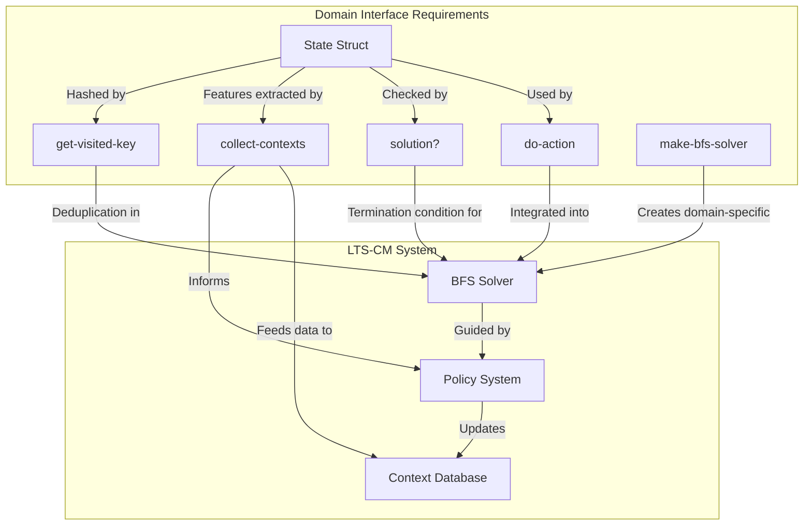
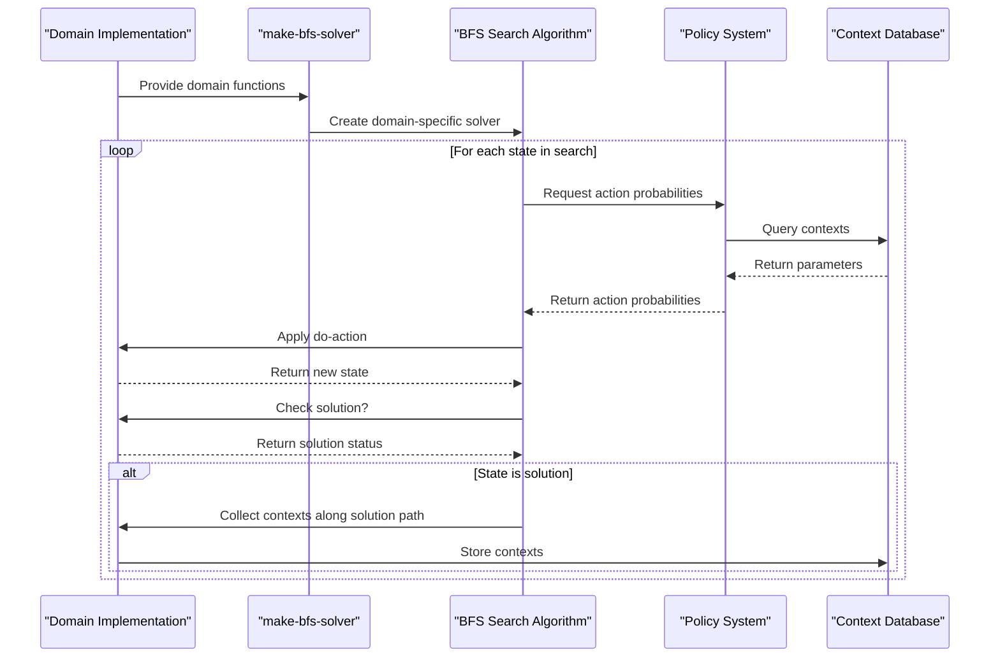
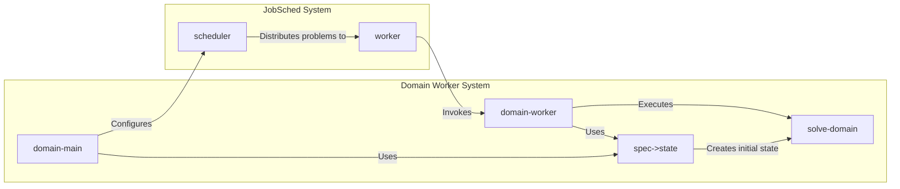

<!-- source: DeepWiki mcp.deepwiki.com · repo google-deepmind/levintreesearch_cm · page 3 Problem Domains · fetched 2026-10-26 -->

# Problem Domains

<details>
<summary>Relevant source files</summary>

The following files were used as context for generating this wiki page:

- [README.md](README.md)
- [lts-cm/domains/rubiks-cube/rubiks-cube.rkt](lts-cm/domains/rubiks-cube/rubiks-cube.rkt)
- [lts-cm/domains/sokoban/sokoban.rkt](lts-cm/domains/sokoban/sokoban.rkt)
- [lts-cm/domains/stp/sliding-tile.rkt](lts-cm/domains/stp/sliding-tile.rkt)
- [lts-cm/domains/witness/witness.rkt](lts-cm/domains/witness/witness.rkt)
- [lts-cm/img/domains.png](lts-cm/img/domains.png)

</details>


This page provides a technical overview of the problem domains implemented in the levintreesearch_cm repository. These domains serve as benchmark problems for evaluating the Levin Tree Search with Context Models (LTS-CM) algorithm. For information about the core LTS-CM algorithm itself, see [LTS-CM: Levin Tree Search with Context Models](#2).

## Domain Implementation Overview

Each problem domain follows a consistent implementation pattern to integrate with the LTS-CM framework. This allows the search algorithm to operate across different domains using a unified interface.



Sources: [lts-cm/domains/stp/sliding-tile.rkt:204-209](), [lts-cm/domains/sokoban/sokoban.rkt:276-280](), [lts-cm/domains/witness/witness.rkt:251-256](), [lts-cm/domains/rubiks-cube/rubiks-cube.rkt:225-230]()

## Key Domain Components

Each domain implementation includes the following core components:

| Component | Purpose | Implementation Pattern |
|-----------|---------|------------------------|
| State Representation | Define the problem state | Custom struct with board or bytes representation |
| Action Function | Apply moves to generate new states | `do-action` function that returns a new state |
| Solution Check | Verify if a state is a solution | `solution?` predicate function |
| Context Collection | Extract features for policy learning | `collect-contexts` function |
| Visited Key | Generate keys for state deduplication | `get-visited-key` function |
| Domain Solver | Configure the BFS solver | Use `make-bfs-solver` with domain functions |

These components are combined in a domain-specific solver that the LTS-CM system can use to solve problems and learn improved policies.

## Implemented Problem Domains

The repository implements four classic problem domains:

```mermaid
flowchart TD
    Domains["Problem Domains"]
    
    Domains --> STP["1. Sliding Tile Puzzle"]
    Domains --> Sokoban["2. Sokoban"]
    Domains --> Witness["3. The Witness"]
    Domains --> Rubik["4. Rubik's Cube"]
    
    STP -->|"State"| stpState["stp-state struct\nGrid with tiles\nEmpty position tracking"]
    STP -->|"Actions"| stpActions["Move empty space\nUp, down, left, right"]
    STP -->|"Goal"| stpGoal["All tiles in correct positions"]
    
    Sokoban -->|"State"| sokState["sokoban struct\nGrid with walls, boxes, goals\nPlayer position tracking"]
    Sokoban -->|"Actions"| sokActions["Move player\nPush boxes"]
    Sokoban -->|"Goal"| sokGoal["All boxes on goal positions"]
    
    Witness -->|"State"| witState["witness struct\nColor grid and path grid\nStart and goal positions"]
    Witness -->|"Actions"| witActions["Extend path\nUp, down, left, right"]
    Witness -->|"Goal"| witGoal["Path reaches goal\nColor constraints satisfied"]
    
    Rubik -->|"State"| rubState["cube struct\n20 cubies with positions/orientations"]
    Rubik -->|"Actions"| rubActions["12 face rotations\nClockwise/counterclockwise"]
    Rubik -->|"Goal"| rubGoal["Return to solved state"]
```



Sources: [lts-cm/domains/stp/sliding-tile.rkt:26-34](), [lts-cm/domains/sokoban/sokoban.rkt:29-34](), [lts-cm/domains/witness/witness.rkt:29-34](), [lts-cm/domains/rubiks-cube/rubiks-cube.rkt:27-33]()

### 1. Sliding Tile Puzzle (STP)

The Sliding Tile Puzzle consists of numbered tiles arranged on a grid with one empty space. The goal is to rearrange the tiles from a scrambled configuration to the correct ordered configuration by sliding tiles adjacent to the empty space.

#### State Representation

```racket
(struct stp-state board ([row0 #:mutable] [col0 #:mutable] [n-solved #:mutable])
  #:transparent)
```

- `board`: Grid representation with tile positions
- `row0`, `col0`: Position of the empty space
- `n-solved`: Number of tiles in their correct positions

#### Actions and Solution

The puzzle has 4 possible actions (up, down, left, right), which move the empty space in the corresponding direction. A solution is found when all tiles are in their correct positions.

#### Context Collection

The STP implementation uses relative tiling to extract features around the empty space:

```racket
(board-relative-tiling/collect stp
                              #:collect! collect-context!
                              #:row row0 #:col col0 #:pad-value N² #:max-value N²
                              #:row-dist 3 #:col-dist 3
                              #:row-span 2 #:col-span 2)
```

This collects patterns from multiple window sizes around the empty space to inform the policy.

Sources: [lts-cm/domains/stp/sliding-tile.rkt:32-34](), [lts-cm/domains/stp/sliding-tile.rkt:141-163](), [lts-cm/domains/stp/sliding-tile.rkt:198-202]()

### 2. Sokoban

Sokoban is a puzzle game where the player pushes boxes to target locations. The player can only push one box at a time and cannot pull boxes or push if there's another box or wall behind.

#### State Representation

```racket
(struct sokoban board ([player-row #:mutable]
                       [player-col #:mutable]
                       [n-solved #:mutable]
                       n-boxes
                       [undo-action #:mutable])
  #:transparent)
```

- `board`: Grid with walls, boxes, goals, and player positions
- `player-row`, `player-col`: Player position
- `n-solved`: Number of boxes on goal positions
- `n-boxes`: Total number of boxes
- `undo-action`: Action that would undo the last action (if possible)

#### Cell Encoding

Sokoban uses a bitwise encoding for different cell types:

```
empty-cell  #b0000
goal        #b0001
box         #b0010
goal+box    #b0011
player      #b0100
goal+player #b0101
wall        #b1000
```

#### Context Collection

Similar to STP, Sokoban uses relative tiling around the player position, plus information about which action would undo the previous move.

Sources: [lts-cm/domains/sokoban/sokoban.rkt:35-42](), [lts-cm/domains/sokoban/sokoban.rkt:55-60](), [lts-cm/domains/sokoban/sokoban.rkt:203-239]()

### 3. The Witness

The Witness is based on a puzzle game where the player draws a path through a grid. The implementation involves finding a path from a start to a goal position while satisfying constraints related to colored regions.

#### State Representation

```racket
(struct witness (colors dots [row0 #:mutable] [col0 #:mutable] rowg colg)
  #:transparent)
```

- `colors`: Grid with colored regions
- `dots`: Grid representing the path drawn so far
- `row0`, `col0`: Current position (tip of the snake)
- `rowg`, `colg`: Goal position

#### Path Representation

The path is represented using segment types:

```
NO_SEG #b00   ; No segment
V_SEG  #b01   ; Vertical segment
H_SEG  #b10   ; Horizontal segment
HV_SEG #b11   ; Both horizontal and vertical segments
```

#### Solution Check

A solution requires:
1. The path ends at the goal position
2. The path correctly separates colored regions according to the puzzle constraints

Sources: [lts-cm/domains/witness/witness.rkt:35-41](), [lts-cm/domains/witness/witness.rkt:44-45](), [lts-cm/domains/witness/witness.rkt:150-187]()

### 4. Rubik's Cube

The classic 3D combination puzzle where each face can be rotated, and the goal is to return to a state where each face has a single color.

#### State Representation

```racket
(struct cube (bytes)
  #:transparent)
```

The state is a single byte vector of 20 elements:
- First 8 elements: corner indices and orientations (1 in 3)
- Last 12 elements: edge indices and orientations (1 in 2)

#### Actions

12 actions representing clockwise and counterclockwise rotations of the 6 faces:
- Face U (Up): actions 0 and 6
- Face F (Front): actions 1 and 7
- Face R (Right): actions 2 and 8
- Face D (Down): actions 3 and 9
- Face L (Left): actions 4 and 10
- Face B (Back): actions 5 and 11

#### Context Collection

The implementation extracts features from pairs of cubies:

```racket
(define state-contexts
  (list-of-lists->vector-of-fxvectors
   (combinations (range n-cubies) 2)))
```

Sources: [lts-cm/domains/rubiks-cube/rubiks-cube.rkt:83-86](), [lts-cm/domains/rubiks-cube/rubiks-cube.rkt:95-96](), [lts-cm/domains/rubiks-cube/rubiks-cube.rkt:196-202]()

## Domain Integration with LTS-CM



Sources: [lts-cm/domains/stp/sliding-tile.rkt:204-209](), [lts-cm/domains/sokoban/sokoban.rkt:276-280](), [lts-cm/domains/witness/witness.rkt:251-256](), [lts-cm/domains/rubiks-cube/rubiks-cube.rkt:225-230]()

## Domain Worker Architecture

Each domain implements a common worker architecture for distributed problem-solving:



Each domain module exports:
1. A `domain-main` function for server configuration
2. A `domain-worker` function for problem-solving
3. A `spec->state` function to create the initial state
4. A domain-specific solver created with `make-bfs-solver`

Sources: [lts-cm/domains/stp/sliding-tile.rkt:215-221](), [lts-cm/domains/sokoban/sokoban.rkt:286-292](), [lts-cm/domains/witness/witness.rkt:262-268](), [lts-cm/domains/rubiks-cube/rubiks-cube.rkt:236-242]()

## Problem Datasets

The repository includes benchmark datasets for each domain:

- **Sliding Tile Puzzle**: Datasets from h-levin (Apache-2.0 license)
- **Sokoban**: Datasets from Boxoban (Apache-2.0 license)
- **The Witness**: Datasets from h-levin (Apache-2.0 license)
- **Rubik's Cube**: New datasets included in the repository

These datasets allow for performance evaluation of the LTS-CM algorithm across multiple difficulties and problem types.

Sources: [README.md:113-120]()

---

