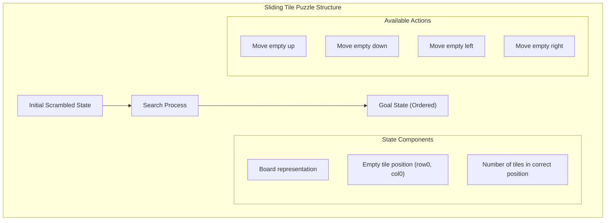
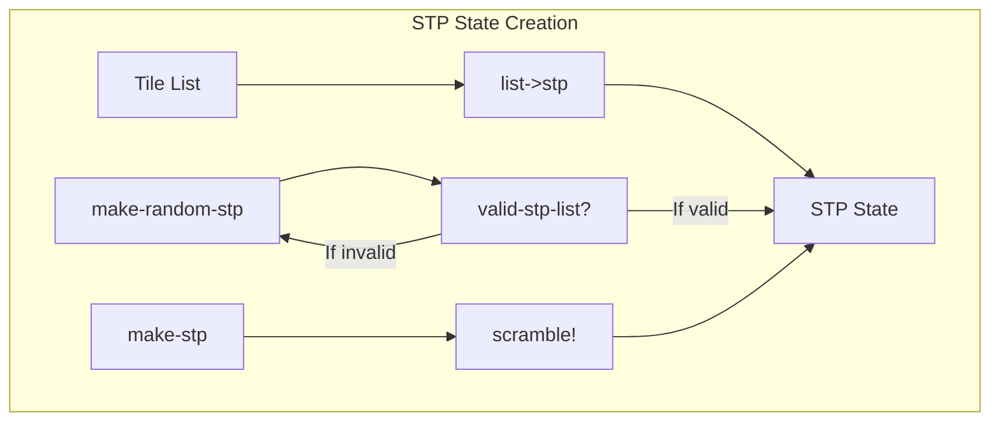
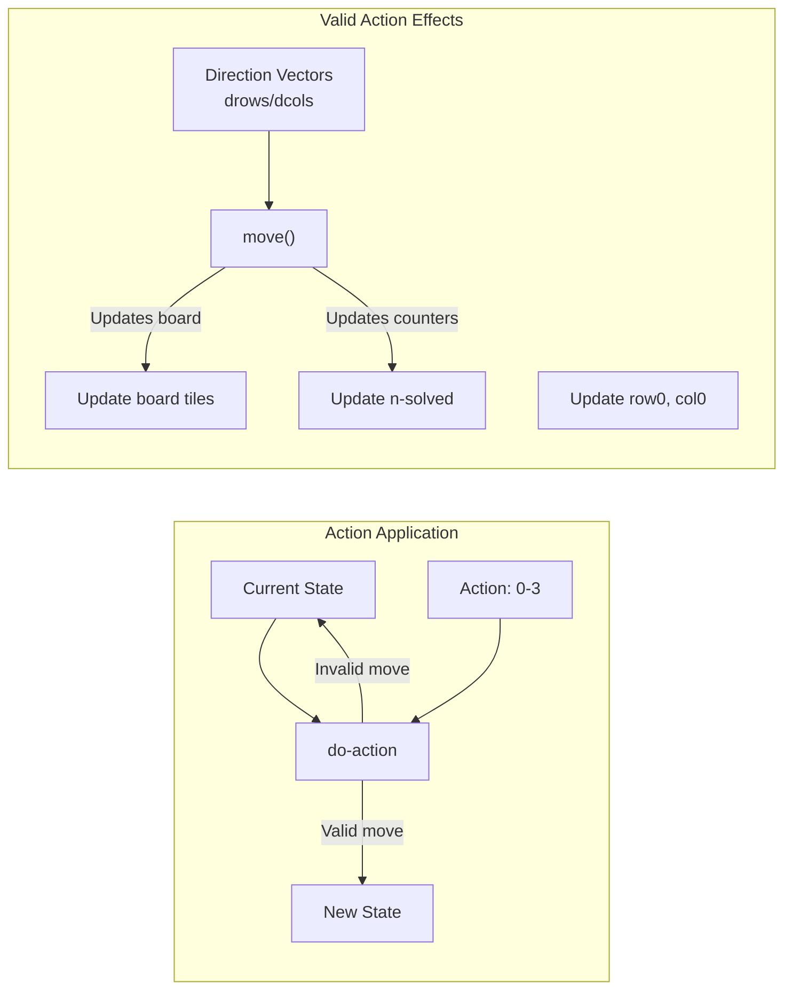
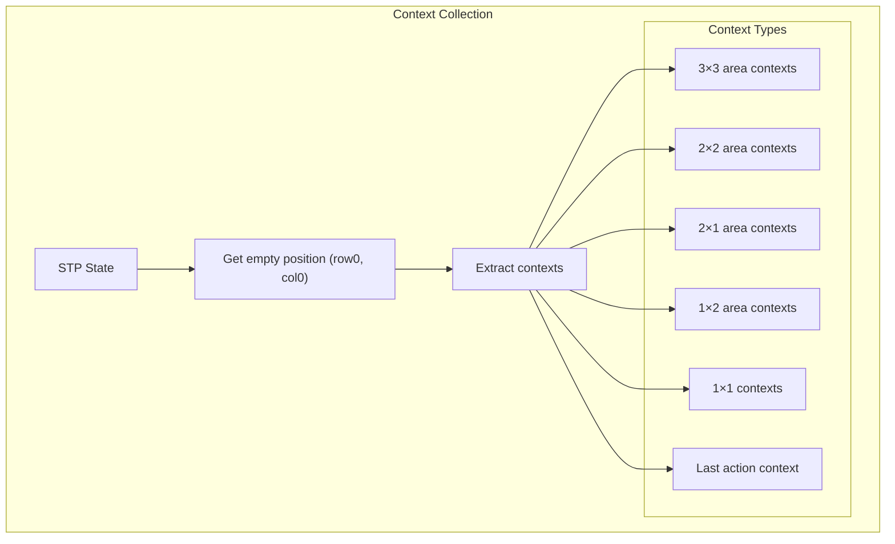
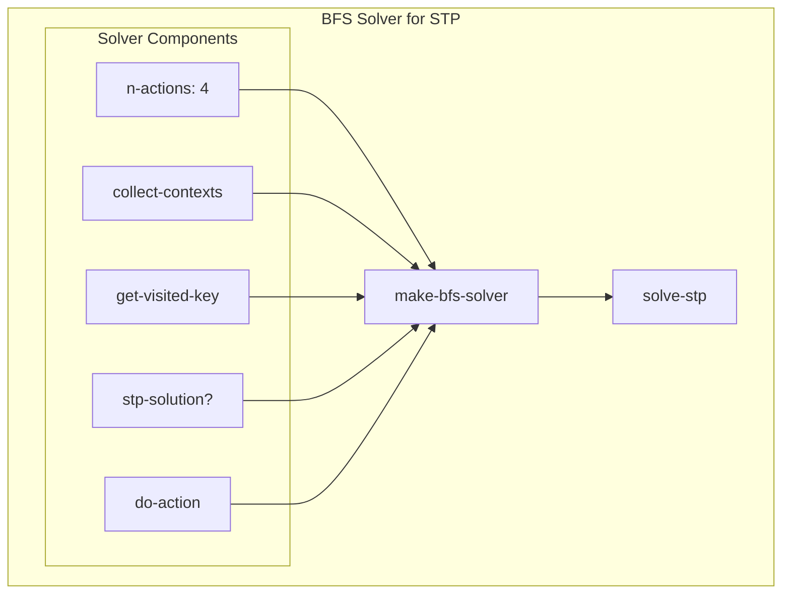
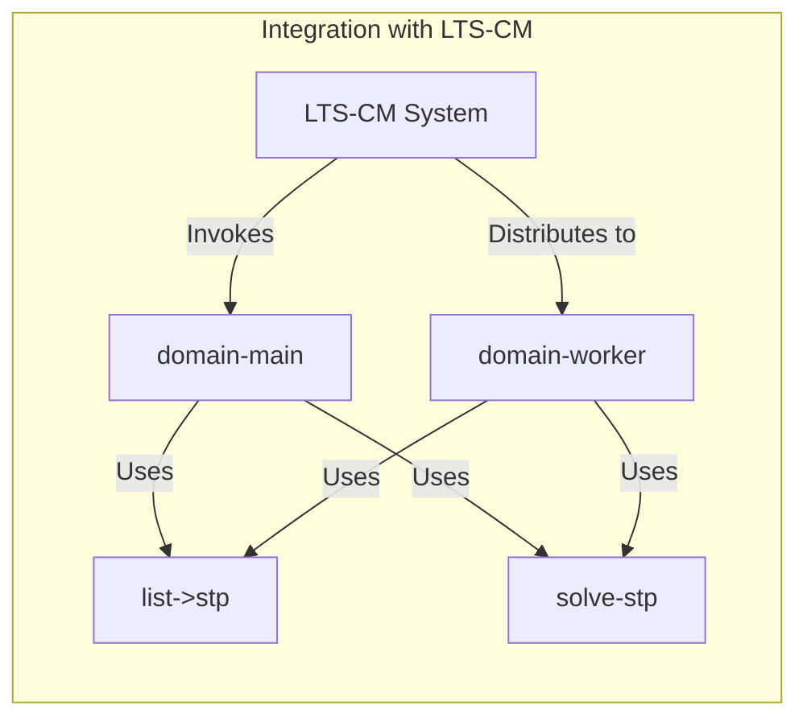
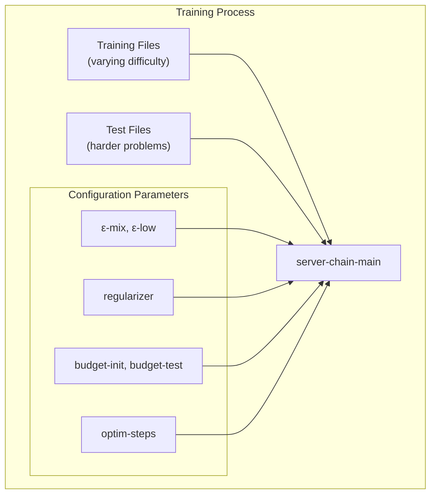

<!-- source: DeepWiki mcp.deepwiki.com · repo google-deepmind/levintreesearch_cm · page 3.1 Sliding Tile Puzzle · fetched 2026-10-26 -->

# Sliding Tile Puzzle

<details>
<summary>Relevant source files</summary>

The following files were used as context for generating this wiki page:

- [lts-cm/domains/stp/server-easy.rkt](lts-cm/domains/stp/server-easy.rkt)
- [lts-cm/domains/stp/sliding-tile.rkt](lts-cm/domains/stp/sliding-tile.rkt)

</details>


This document describes the implementation of the Sliding Tile Puzzle (STP) domain within the Levin Tree Search with Context Models (LTS-CM) framework. The STP is one of the primary domains used to evaluate the LTS-CM algorithm's capabilities in solving combinatorial puzzles.

## 1. Overview of the Sliding Tile Puzzle

The Sliding Tile Puzzle consists of a grid of numbered tiles with one empty space (represented by 0). The goal is to rearrange the tiles from an initial scrambled state to a target ordered state by sliding tiles into the empty space. In this implementation, the puzzle can be of arbitrary size N×N, with the most common being 3×3, 4×4, and 5×5.



Sources: [lts-cm/domains/stp/sliding-tile.rkt:26-34]()

## 2. State Representation

The STP state is implemented as a structure called `stp-state` that inherits from the `board` type and includes additional attributes for the empty tile position and the count of correctly placed tiles.

```mermaid
classDiagram
    class board {
        board-vec: bytes
        board-n-rows: int
        board-n-cols: int
    }
    
    class "stp-state" {
        Inherits: board
        row0: int (mutable)
        col0: int (mutable)
        n-solved: int (mutable)
    }
    
    board <|-- "stp-state"
    
    note for "stp-state" "row0, col0: position of empty tile (0)\nn-solved: count of tiles in correct positions"
```

Sources: [lts-cm/domains/stp/sliding-tile.rkt:32-33]()

### 2.1 State Creation and Manipulation

Several functions are provided to create and manipulate STP states:

- `list->stp`: Converts a list of tile values to an STP state
- `make-stp`: Creates an STP of size N×N with optional scrambling
- `make-random-stp`: Creates a truly random STP puzzle
- `stp-state-copy`: Creates a deep copy of an STP state

The system also includes a validation function `valid-stp-list?` that verifies whether a given tile arrangement is solvable using parity checking. This is crucial because not all random arrangements of tiles can be solved.



Sources: [lts-cm/domains/stp/sliding-tile.rkt:37-100](), [lts-cm/domains/stp/sliding-tile.rkt:169-175]()

### 2.2 Actions and State Transitions

The STP domain defines 4 possible actions (n-actions = 4), corresponding to moving the empty tile up, down, left, or right. The `do-action` function applies an action to an STP state, creating a new state if the action is valid:



Sources: [lts-cm/domains/stp/sliding-tile.rkt:30](), [lts-cm/domains/stp/sliding-tile.rkt:177-193](), [lts-cm/domains/stp/sliding-tile.rkt:49-59]()

## 3. Context Collection for Learning

A key aspect of the LTS-CM system is its ability to learn from context patterns. For the STP domain, the `collect-contexts` function extracts relevant features from the puzzle state that help the model learn effective policies.

The context collection process uses a "relative tiling" approach, where features are collected based on the position of the empty tile. This captures local patterns around the empty space that are relevant for decision-making.



Sources: [lts-cm/domains/stp/sliding-tile.rkt:135-163]()

## 4. Search Implementation

The STP domain implements the components needed for best-first search (BFS) within the LTS-CM framework:

- `stp-solution?`: Checks if a state is a solution (all tiles in correct positions)
- `get-visited-key`: Generates a key for tracking visited states
- `solve-stp`: The BFS solver configured for STP problems



Sources: [lts-cm/domains/stp/sliding-tile.rkt:196-209]()

## 5. Integration with LTS-CM Framework

The STP domain integrates with the broader LTS-CM framework through domain-specific entry points:

- `domain-main`: Main entry point for running STP experiments
- `domain-worker`: Worker entry point for distributed solving



Sources: [lts-cm/domains/stp/sliding-tile.rkt:214-221]()

## 6. Training and Testing Configuration

The STP domain includes a server configuration for training and testing the LTS-CM system on sliding tile puzzles. The `server-easy.rkt` file defines training sets with varying difficulty levels and a test set for evaluation.



Sources: [lts-cm/domains/stp/server-easy.rkt:46-59](), [lts-cm/domains/stp/server-easy.rkt:35-41]()

## 7. Utility Functions

The implementation includes various utility functions for displaying and manipulating STP states:

- `stp->string`: Converts an STP state to a formatted string for display
- `stp->list`: Converts an STP state to a list representation
- `stp-n-solved`: Counts the number of tiles in their correct positions

Sources: [lts-cm/domains/stp/sliding-tile.rkt:120-129](), [lts-cm/domains/stp/sliding-tile.rkt:35-36]()

## 8. Example Usage

The STP implementation includes a DrRacket module that demonstrates the basic usage:

1. Create a 5×5 puzzle with 5 scramble moves
2. Display the puzzle
3. Solve the puzzle using the BFS solver
4. Analyze the results, including contexts and action sequences

This example can serve as a starting point for experimenting with the sliding tile puzzle implementation.

Sources: [lts-cm/domains/stp/sliding-tile.rkt:227-239]()

## 9. Relation to Other System Components

The Sliding Tile Puzzle is one of several domains implemented within the LTS-CM framework. It follows the domain interface pattern established for all problem domains in the system, making it compatible with the overall architecture.

For information about other problem domains, see:
- [Sokoban](#3.2)
- [The Witness](#3.3)
- [Rubik's Cube](#3.4)

For details about the LTS-CM system that provides the search and learning capabilities, see [LTS-CM: Levin Tree Search with Context Models](#2).

---

