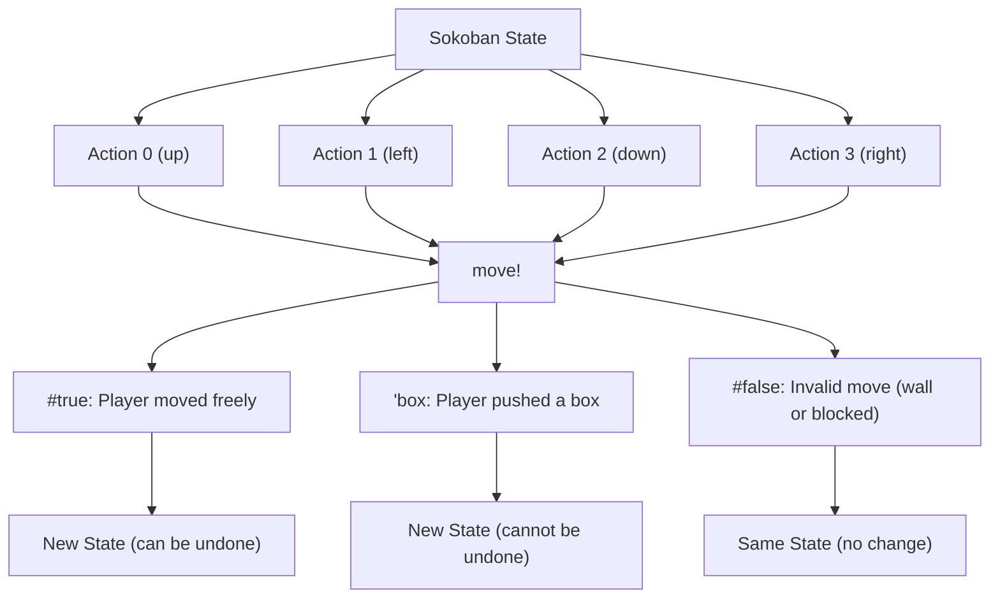
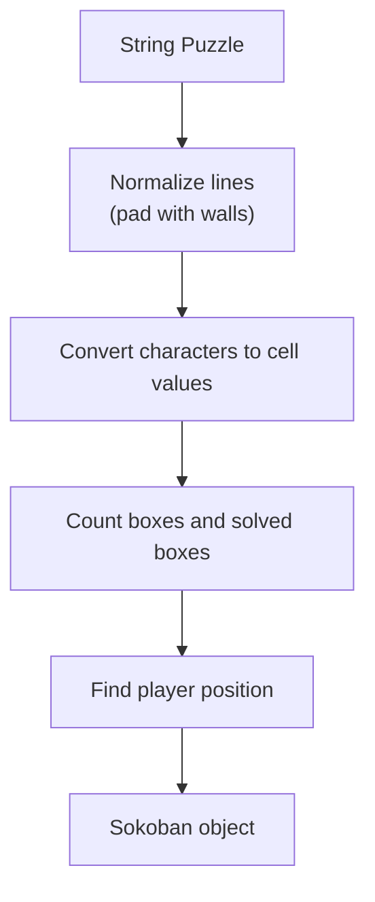
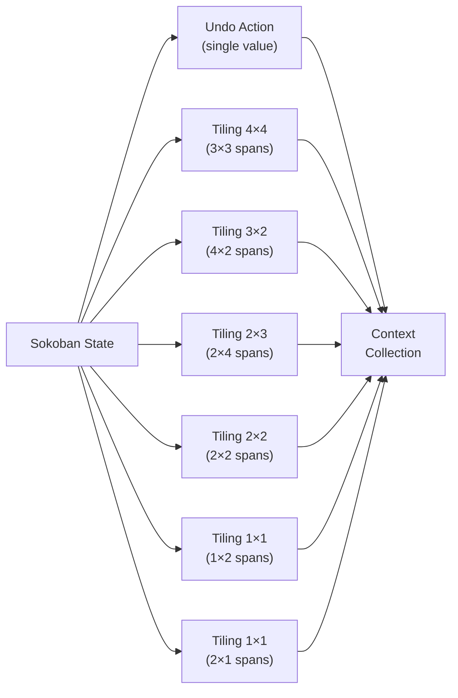
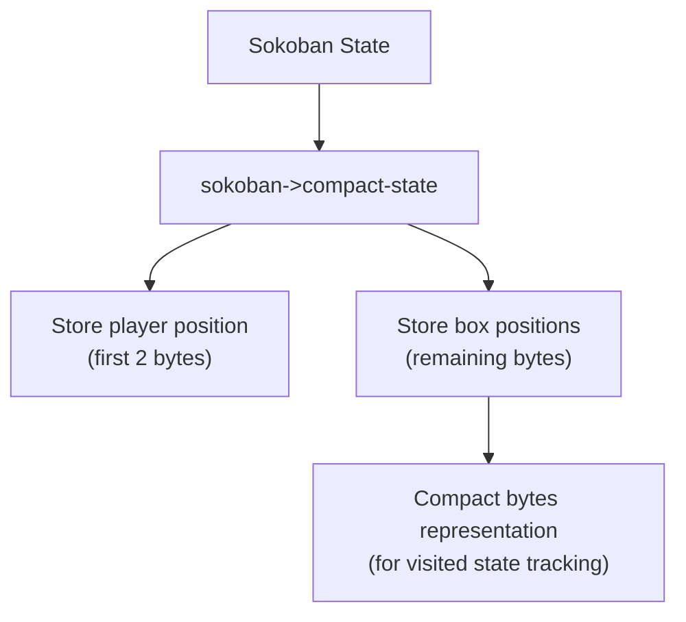
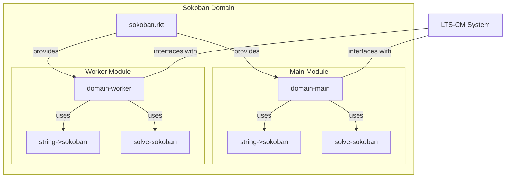

<!-- source: DeepWiki mcp.deepwiki.com · repo google-deepmind/levintreesearch_cm · page 3.2 Sokoban · fetched 2026-10-26 -->

# Sokoban

<details>
<summary>Relevant source files</summary>

The following files were used as context for generating this wiki page:

- [lts-cm/domains/sokoban/sokoban.rkt](lts-cm/domains/sokoban/sokoban.rkt)

</details>


This document provides a detailed explanation of the Sokoban implementation in the levintreesearch_cm repository. Sokoban is one of the puzzle domains used to evaluate the Levin Tree Search with Context Models (LTS-CM) algorithm, along with other domains like the Sliding Tile Puzzle ([3.1](#3.1)), The Witness ([3.3](#3.3)), and Rubik's Cube ([3.4](#3.4)).

## Overview

Sokoban (倉庫番, "warehouse keeper") is a classic puzzle game where the player pushes boxes onto designated goal locations. This implementation provides:

1. A state representation for Sokoban puzzles
2. Movement mechanics including box pushing
3. Context collection for the LTS-CM algorithm
4. Problem-solving capabilities using best-first search

Sources: [lts-cm/domains/sokoban/sokoban.rkt:29-31]()

## State Representation

### Board Structure

The Sokoban state is represented by the `sokoban` struct, which extends the `board` struct from the byte-board system.

```mermaid
classDiagram
    class "board" {
        vec: bytes
        n-rows: integer
        n-cols: integer
    }
    
    class "sokoban" {
        +player-row: integer (mutable)
        +player-col: integer (mutable)
        +n-solved: integer (mutable)
        +n-boxes: integer
        +undo-action: integer (mutable)
    }
    
    board <|-- sokoban
```

The `sokoban` struct tracks:
- Player position (`player-row`, `player-col`)
- Number of boxes on goal positions (`n-solved`)
- Total number of boxes (`n-boxes`)
- Previous action to undo (`undo-action`)

Sources: [lts-cm/domains/sokoban/sokoban.rkt:55-60]()

### Cell Representation

Each cell on the board is represented by a byte value using a bit pattern:

| Binary Value | Decimal | Description  | Character |
|--------------|---------|--------------|-----------|
| `#b0000`     | 0       | Empty cell   | (space)   |
| `#b0001`     | 1       | Goal         | `.`       |
| `#b0010`     | 2       | Box          | `$`       |
| `#b0011`     | 3       | Box on goal  | `*`       |
| `#b0100`     | 4       | Player       | `@`       |
| `#b0101`     | 5       | Player on goal | `+`     |
| `#b1000`     | 8       | Wall         | `#`       |

The implementation provides helper functions to check cell contents:
- `has-goal?`: Checks if a cell has a goal (bit 0)
- `has-box?`: Checks if a cell has a box (bit 1)
- `has-player?`: Checks if a cell has a player (bit 2)

Sources: [lts-cm/domains/sokoban/sokoban.rkt:35-50]()

## Game Mechanics

### Actions

Sokoban has 4 possible actions, represented numerically:
- 0: Move up
- 1: Move left
- 2: Move down
- 3: Move right



Sources: [lts-cm/domains/sokoban/sokoban.rkt:33](), [lts-cm/domains/sokoban/sokoban.rkt:147-197]()

### Movement Logic

The movement logic is implemented in the `move!` function, which:
1. Takes the player's current position and movement direction
2. Checks the target cell
3. Handles three cases:
   - Player hitting a wall (no movement)
   - Player pushing a box (if possible)
   - Player moving to an empty space

When a player pushes a box:
- The function checks if there is space behind the box
- Updates the score if a box moves onto or off a goal
- Returns `'box` to indicate a box was pushed

When a player moves freely:
- The function updates player position
- Returns `#true` to indicate the action can be undone

When movement is blocked:
- The function returns `#false` and doesn't change the state

Sources: [lts-cm/domains/sokoban/sokoban.rkt:147-184]()

### Solution Condition

A Sokoban puzzle is considered solved when all boxes are on goal positions:

```racket
(define (sokoban-solution? soko)
  (fx= (sokoban-n-boxes soko)
       (sokoban-n-solved soko)))
```

Sources: [lts-cm/domains/sokoban/sokoban.rkt:140-142]()

## Implementation Details

### Puzzle Initialization

Sokoban puzzles are initialized from string representations using standard Sokoban notation:



The function `string->sokoban` converts a text representation to a `sokoban` struct:
- Splits the input string into lines
- Normalizes line lengths by padding with walls
- Converts characters to cell values
- Counts boxes and solved boxes
- Finds the player's position

Sources: [lts-cm/domains/sokoban/sokoban.rkt:83-115]()

### State Modification

The `do-action` function creates a new Sokoban state by:
1. Making a copy of the current state
2. Calling `move!` to update the copy based on the action
3. Recording the undo action if applicable
4. Returning the new state

This approach preserves the original state for search algorithms.

Sources: [lts-cm/domains/sokoban/sokoban.rkt:187-197]()

## Context Collection

The LTS-CM algorithm requires context information from states to learn and improve its policy. For Sokoban, contexts are collected through:



The `collect-contexts` function:
1. Records the undo action (which action would undo the previous move)
2. Collects multiple tiling patterns centered around the player
   - Each tiling has different row/column distances and spans
   - Uses the `board-relative-tiling/collect` function from the byte-board module

The various tiling patterns capture different spatial relationships and features at multiple scales.

Sources: [lts-cm/domains/sokoban/sokoban.rkt:203-239]()

## Search Process

### Compact State Representation

For efficient state tracking during search, the implementation uses a compact representation:



The `sokoban->compact-state` function:
- Creates a bytes vector with player position first (2 bytes)
- Followed by box positions (2 bytes per box)
- Used for tracking visited states during search

Sources: [lts-cm/domains/sokoban/sokoban.rkt:252-270]()

### BFS Solver

The Sokoban solver is created using `make-bfs-solver` with domain-specific functions:

```racket
(define solve-sokoban
  (make-bfs-solver #:n-actions n-actions
                   #:collect-contexts collect-contexts
                   #:get-visited-key get-visited-key
                   #:solution? sokoban-solution?
                   #:do-action do-action))
```

The solver uses:
- `n-actions`: Number of possible actions (4)
- `collect-contexts`: Function to collect contexts for learning
- `get-visited-key`: Function to generate keys for visited state tracking
- `solution?`: Function to check if a state is a solution
- `do-action`: Function to apply an action to a state

Sources: [lts-cm/domains/sokoban/sokoban.rkt:275-280]()

## Module Structure

The implementation includes main and worker modules that integrate with the LTS-CM system:



The main and worker modules use:
- `domain-main`: Entry point for solving problems directly
- `domain-worker`: Entry point for solving problems through the job scheduling system
- Both use `string->sokoban` to create states and `solve-sokoban` to solve them

Sources: [lts-cm/domains/sokoban/sokoban.rkt:286-292]()

## Testing

The implementation includes test cases that verify:
- State initialization from strings
- Movement mechanics including box pushing
- Solution checking
- Compact state representation

These tests ensure the Sokoban implementation works correctly with the LTS-CM algorithm.

Sources: [lts-cm/domains/sokoban/sokoban.rkt:312-361]()

---

