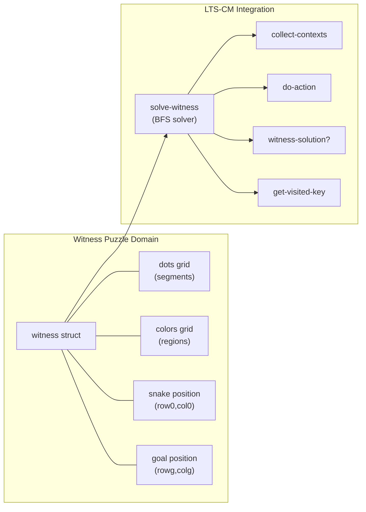
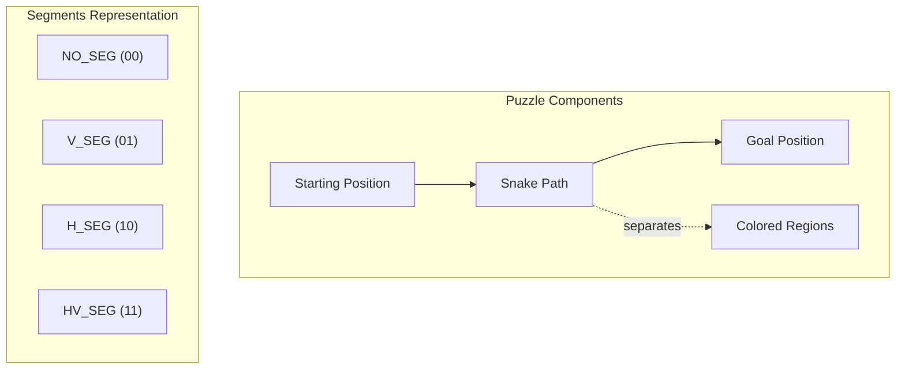
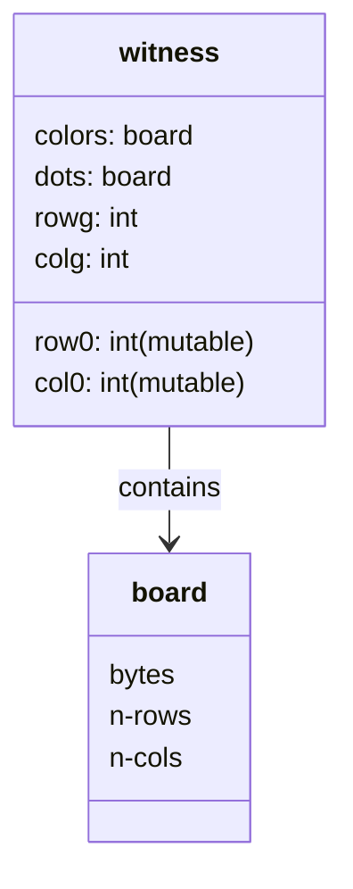
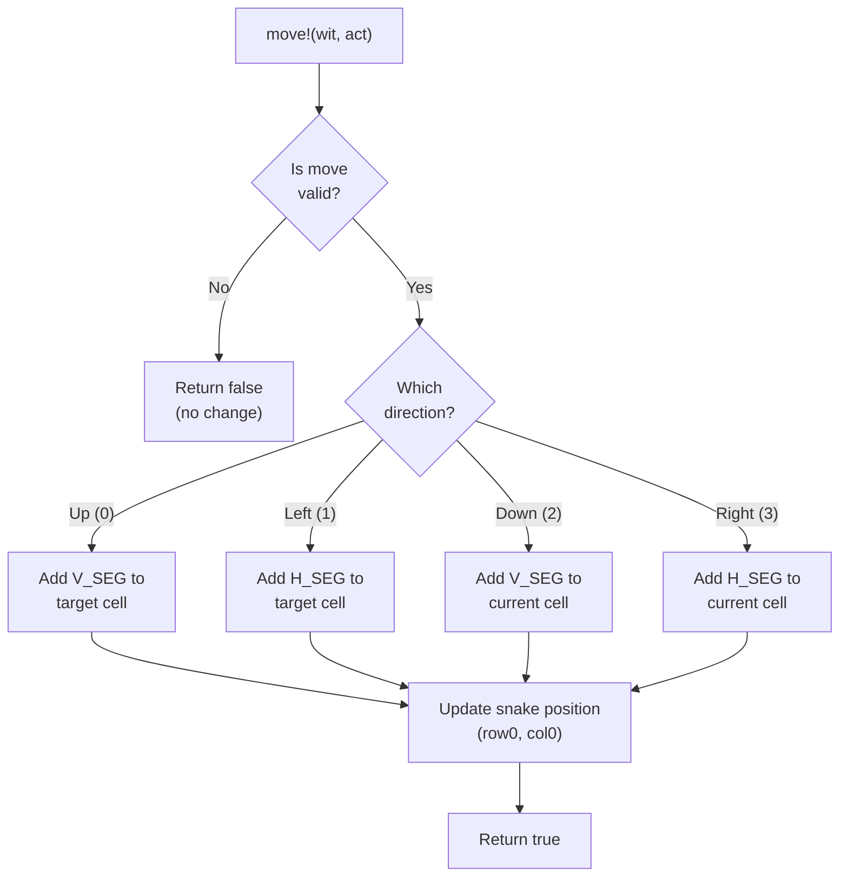
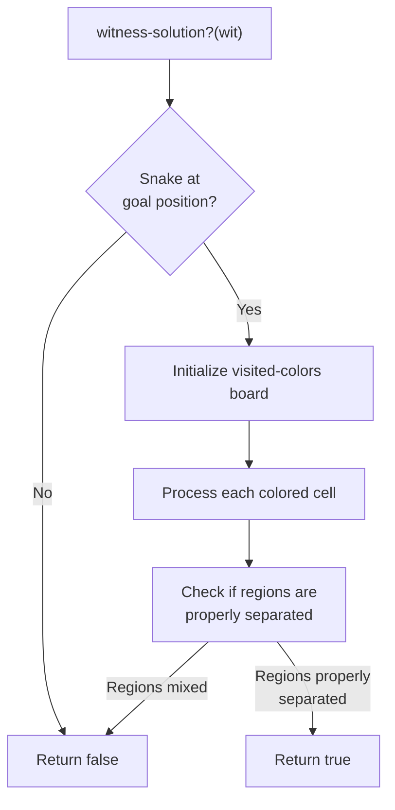
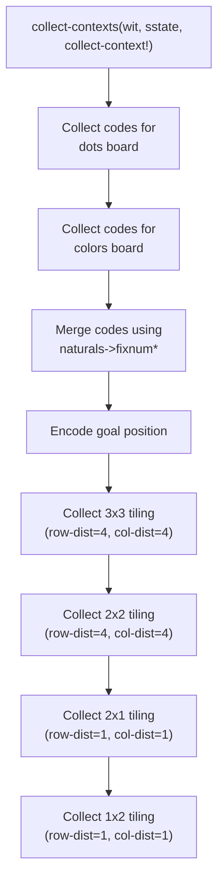
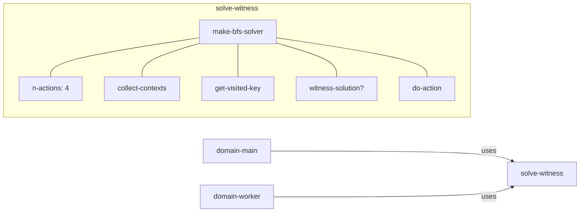

<!-- source: DeepWiki mcp.deepwiki.com · repo google-deepmind/levintreesearch_cm · page 3.3 The Witness · fetched 2026-10-26 -->

# The Witness

<details>
<summary>Relevant source files</summary>

The following files were used as context for generating this wiki page:

- [lts-cm/domains/witness/witness.rkt](lts-cm/domains/witness/witness.rkt)

</details>


This document provides a detailed explanation of The Witness puzzle implementation in the levintreesearch_cm repository. The Witness is one of the problem domains used to evaluate the performance of the Levin Tree Search with Context Models (LTS-CM) algorithm.

## Overview

The Witness implementation represents a simplified version of a puzzle inspired by the video game "The Witness." In this puzzle, the player controls a "snake" that must navigate through a grid from a starting point to a goal position while satisfying certain constraints related to colored regions.



Sources: [lts-cm/domains/witness/witness.rkt:28-31](), [lts-cm/domains/witness/witness.rkt:44-45](), [lts-cm/domains/witness/witness.rkt:251-256]()

## Puzzle Mechanics

The Witness puzzle is played on a grid where:

1. A "snake" must navigate from a starting position to a goal
2. The snake creates segments (horizontal and vertical) as it moves
3. These segments separate colored regions on the grid
4. A solution is valid when:
   - The snake reaches the goal
   - The segments properly separate different colored regions



Sources: [lts-cm/domains/witness/witness.rkt:35-40](), [lts-cm/domains/witness/witness.rkt:150-187]()

## State Representation

The puzzle state is represented by the `witness` struct, which contains all the information needed to track the current state of the puzzle.



| Field | Description |
|-------|-------------|
| `colors` | A grid representing colored regions (values are color indices) |
| `dots` | A grid tracking segments between dots (bit flags for H_SEG, V_SEG) |
| `row0, col0` | Current position of the snake's tip (mutable) |
| `rowg, colg` | Goal position the snake must reach |

The dots grid uses bit flags to represent different types of segments:
- `NO_SEG` (00): No segment
- `V_SEG` (01): Vertical segment
- `H_SEG` (10): Horizontal segment
- `HV_SEG` (11): Both horizontal and vertical segments

Sources: [lts-cm/domains/witness/witness.rkt:35-40](), [lts-cm/domains/witness/witness.rkt:44-45]()

## Action System

The Witness puzzle has four possible actions corresponding to the four cardinal directions:

| Action Index | Direction | Description |
|--------------|-----------|-------------|
| 0 | Up | Move the snake up |
| 1 | Left | Move the snake left |
| 2 | Down | Move the snake down |
| 3 | Right | Move the snake right |

The `move!` function implements the action logic, with several constraints:
- The target cell must be within bounds
- No segment should already exist in the target cell
- The target cell should not have any segment ending in it



Sources: [lts-cm/domains/witness/witness.rkt:32](), [lts-cm/domains/witness/witness.rkt:115-148]()

## Solution Checking

The `witness-solution?` function determines whether the current state represents a valid solution to the puzzle:

1. Checks if the snake has reached the goal position
2. Verifies that all colored regions are properly separated by segments



The algorithm uses a flood-fill approach to check if:
- All cells of the same color are connected
- No cells of different colors are connected
- All connections respect the segments placed by the snake

Sources: [lts-cm/domains/witness/witness.rkt:150-187]()

## Context Collection

The context collection system extracts features from the puzzle state for use by the LTS-CM policy. This is implemented in the `collect-contexts` function.



The context collection process:
1. Creates relative tilings of both the dots and colors boards
2. Encodes the goal position
3. Collects various sized tilings at different sampling rates
4. Merges these codes to create context vectors for the policy

This process uses the byte-board relative tiling collection provided by the LTS-CM system.

Sources: [lts-cm/domains/witness/witness.rkt:197-231]()

## Search Implementation

The search implementation uses the BFS solver from the LTS-CM system, configured specifically for The Witness puzzle domain.



The key components of the search implementation:

1. **State Transitions**: The `do-action` function creates a new state by copying the current state and applying an action.

2. **Visited State Tracking**: The `get-visited-key` function converts the dots board to bytes to track visited states efficiently.

3. **Solution Checking**: The `witness-solution?` function verifies if a state represents a valid solution.

4. **Context Collection**: The `collect-contexts` function extracts features for the policy.

5. **Integration**: The implementation includes `main` and `worker` modules for integration with the LTS-CM job scheduling system.

Sources: [lts-cm/domains/witness/witness.rkt:233-256](), [lts-cm/domains/witness/witness.rkt:262-268]()

## Example Usage and Testing

The implementation includes a testing module that demonstrates how to:
1. Create a witness puzzle from a specification
2. Apply a sequence of moves
3. Check if a state is a solution

A puzzle specification includes:
- Grid dimensions
- Starting position
- Goal position
- Color values for the grid

```
'((4 4) (0 0) (4 2) (4 2 0 0 4 0 2 2 0 0 2 2 0 0 0 0))
```

The module also includes test cases to verify the behavior of the puzzle mechanics and solution checking.

Sources: [lts-cm/domains/witness/witness.rkt:274-323]()

## Visualization

The Witness implementation includes functionality to convert a puzzle state to a string representation for visualization purposes. The `witness->string` function creates a text-based visualization showing:
- The snake's path as line segments (`│`, `─`, `┌`, `┐`, `└`, `┘`)
- The goal position as an asterisk (`*`)
- Color values as numbers

This visualization is useful for debugging and understanding the current state of the puzzle.

Sources: [lts-cm/domains/witness/witness.rkt:58-109]()

---

