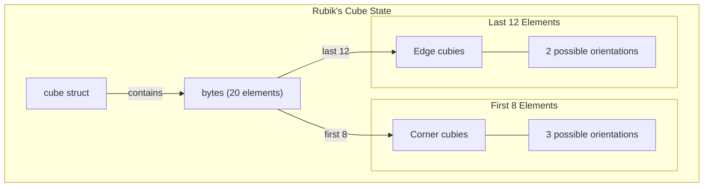
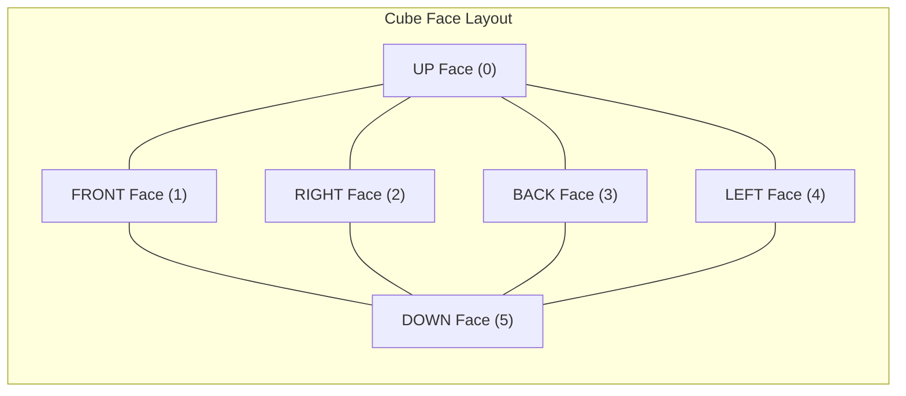
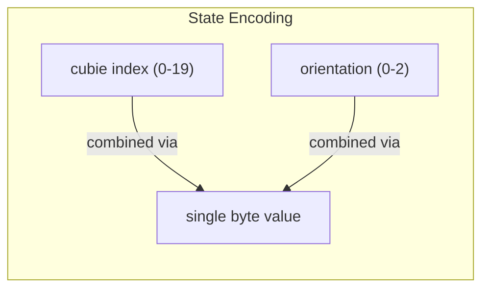
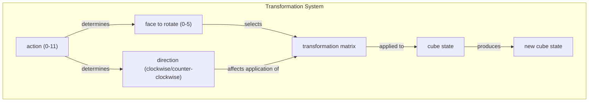
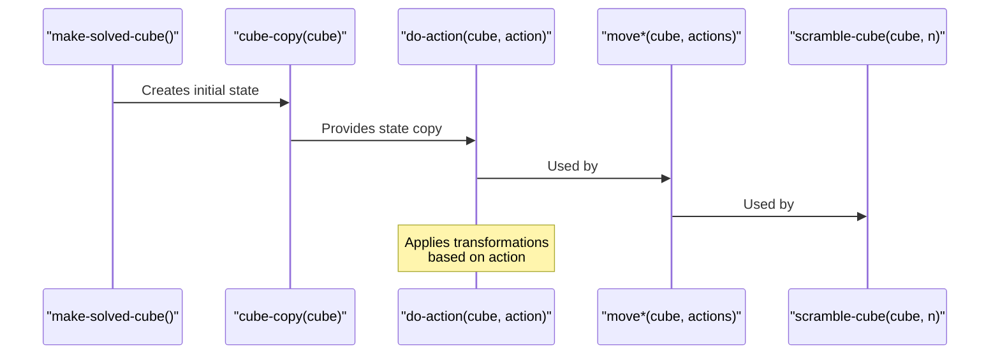
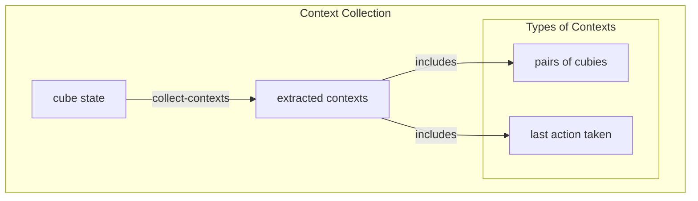
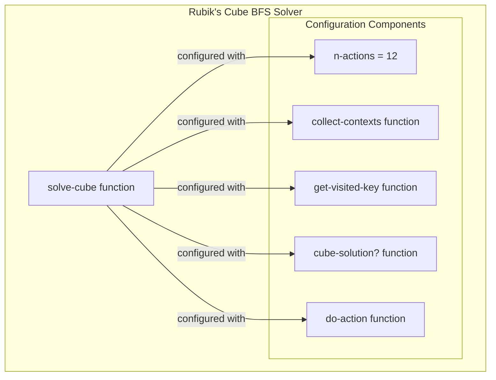
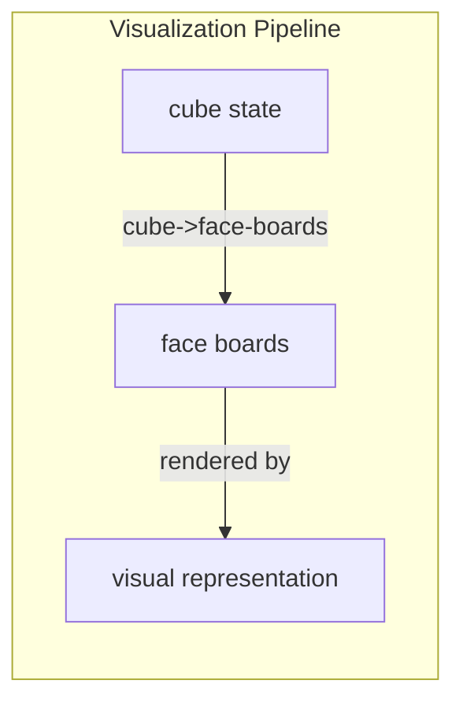
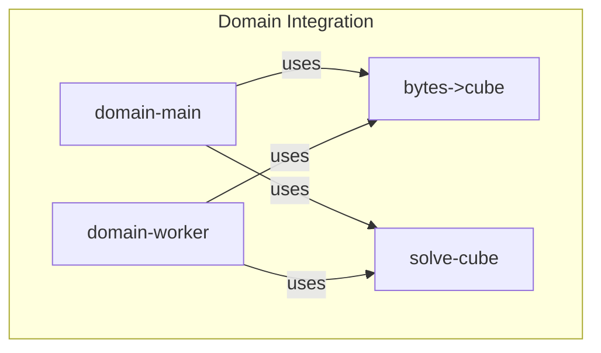

<!-- source: DeepWiki mcp.deepwiki.com · repo google-deepmind/levintreesearch_cm · page 3.4 Rubik's Cube · fetched 2026-10-26 -->

# Rubik's Cube

<details>
<summary>Relevant source files</summary>

The following files were used as context for generating this wiki page:

- [lts-cm/domains/rubiks-cube/rubiks-cube.rkt](lts-cm/domains/rubiks-cube/rubiks-cube.rkt)

</details>


This page documents the Rubik's Cube implementation in the levintreesearch_cm repository. It covers the state representation, action space, transformation functions, and search mechanisms specific to the Rubik's Cube domain. The implementation serves as one of the problem domains for evaluating the Levin Tree Search with Context Models (LTS-CM) algorithm.

## State Representation

The Rubik's Cube state is represented as a single byte vector of 20 elements:
- The first 8 elements represent corner cubies and their orientations (3 possible orientations)
- The last 12 elements represent edge cubies and their orientations (2 possible orientations)

Each element in the vector encodes both the cubie index and its orientation into a single byte value.



Sources: [lts-cm/domains/rubiks-cube/rubiks-cube.rkt:30-81](), [lts-cm/domains/rubiks-cube/rubiks-cube.rkt:95-96]()

The cube layout follows a specific indexing scheme for faces and cubies as described in the code comments:



Sources: [lts-cm/domains/rubiks-cube/rubiks-cube.rkt:36-47]()

### Encoding State

The state uses an efficient encoding system where both the cubie position and orientation are combined into a single byte value:



The `cubie+orientation->number` function encodes these values, while `number->cubie+orientation` decodes them:

Sources: [lts-cm/domains/rubiks-cube/rubiks-cube.rkt:101-106]()

## Actions and Transformations

The Rubik's Cube domain defines 12 possible actions:
- Actions 0-5: Clockwise rotations of the 6 faces (U, F, R, B, L, D)
- Actions 6-11: Counter-clockwise rotations of the same faces (U', F', R', B', L', D')

The reverse of any action is computed by adding or subtracting 6 (modulo 12).

Sources: [lts-cm/domains/rubiks-cube/rubiks-cube.rkt:83-92]()

### Transformation Matrices

The implementation uses precomputed transformation matrices to efficiently apply cube rotations:



The `all-transf` data structure contains the transformation information for each face rotation, detailing which cubies change position and how their orientations change.

Sources: [lts-cm/domains/rubiks-cube/rubiks-cube.rkt:119-129](), [lts-cm/domains/rubiks-cube/rubiks-cube.rkt:132-147]()

## Core Operations

### State Manipulation

The implementation provides several functions for manipulating cube states:

- `make-solved-cube`: Creates a new solved cube state
- `cube-copy`: Creates a deep copy of a cube state
- `do-action`: Applies a single action to a cube state
- `move*`: Applies a sequence of actions to a cube state
- `scramble-cube`: Applies random actions to generate a scrambled cube



Sources: [lts-cm/domains/rubiks-cube/rubiks-cube.rkt:108-181]()

### Checking for Solution

The `cube-solution?` function checks if a cube state is solved by comparing its byte vector with the byte vector of a solved cube:

```
(define (cube-solution? cub)
  (bytes=? (cube-bytes cub) solved-cube-bytes))
```

Sources: [lts-cm/domains/rubiks-cube/rubiks-cube.rkt:187-190]()

## Context Collection

The implementation extracts contexts from cube states to inform the LTS-CM learning system. Contexts are features that help the system learn effective policies.



The `collect-contexts` function extracts two types of context information:
1. Pairwise relationships between cubies (position and orientation)
2. The last action taken to reach the current state

Sources: [lts-cm/domains/rubiks-cube/rubiks-cube.rkt:196-216]()

## Search Algorithm

The Rubik's Cube domain uses a Best-First Search (BFS) solver configured with domain-specific functions:



The `get-visited-key` function ensures the search doesn't revisit already-seen states by using the cube's bytes as a unique identifier.

Sources: [lts-cm/domains/rubiks-cube/rubiks-cube.rkt:222-230]()

## Visualization

The implementation includes functionality to convert cube states into a representation suitable for visualization:



The `cube->face-boards` function translates the compact state representation into a more visualization-friendly format that represents each face as a 3×3 board.

Sources: [lts-cm/domains/rubiks-cube/rubiks-cube.rkt:248-307]()

## Integration with LTS-CM

The Rubik's Cube domain integrates with the LTS-CM system through standardized domain worker interfaces:



The `module+` sections define entry points that allow the Rubik's Cube domain to be used by the LTS-CM system for experiments and evaluations.

Sources: [lts-cm/domains/rubiks-cube/rubiks-cube.rkt:236-241]()

## Testing

The implementation includes unit tests to verify:
1. Action reversibility (applying an action followed by its reverse returns to the original state)
2. Sequence reversibility (applying a sequence of actions followed by its reverse sequence)
3. Fixed action sequence outcomes
4. BFS solver correctness on moderately scrambled cubes

Sources: [lts-cm/domains/rubiks-cube/rubiks-cube.rkt:313-336]()

---

