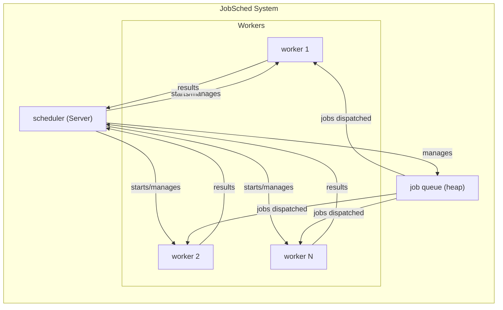
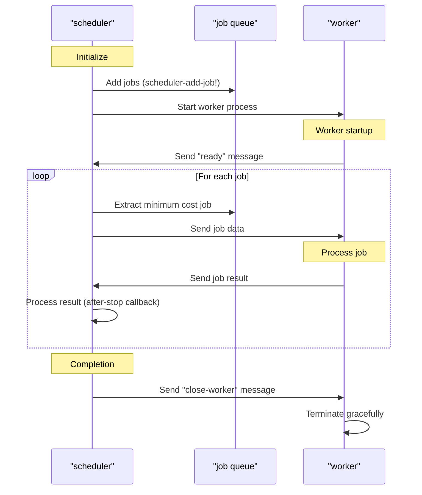
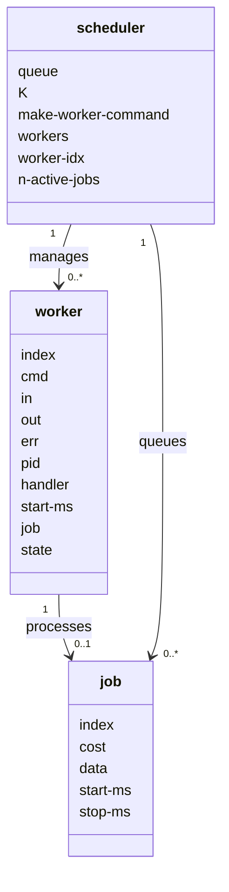
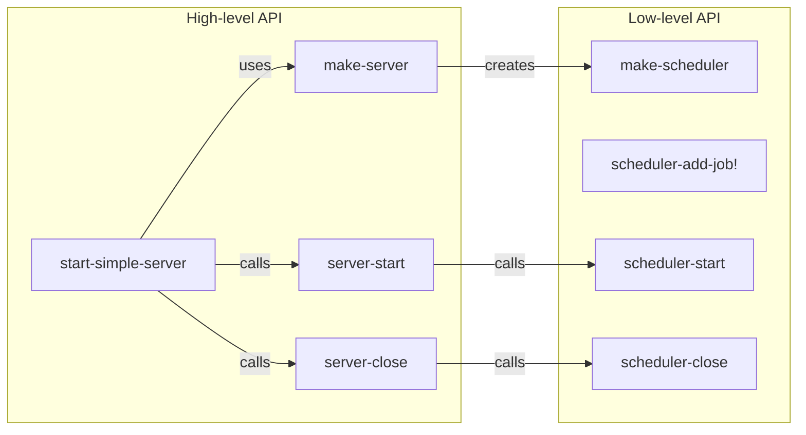

<!-- source: DeepWiki mcp.deepwiki.com · repo google-deepmind/levintreesearch_cm · page 4 JobSched: Job Scheduling System · fetched 2026-10-26 -->

# JobSched: Job Scheduling System

<details>
<summary>Relevant source files</summary>

The following files were used as context for generating this wiki page:

- [jobsched/scribblings/jobsched.scrbl](jobsched/scribblings/jobsched.scrbl)
- [jobsched/server.rkt](jobsched/server.rkt)

</details>


## Purpose and Scope

JobSched is a job scheduling system designed for parallel task execution using a server-worker architecture on a single machine. It enables efficient distribution of computational tasks across multiple Racket instances, allowing for true parallelism by running each worker as a separate OS process with its own Racket instance. This approach overcomes the limitations of single-instance multithreading, particularly for CPU-intensive workloads.

This document covers the architecture, components, workflow, and usage of the JobSched system. For information about how JobSched integrates with the LTS-CM framework, see [LTS-CM and JobSched Integration](#1.2).

Sources: [jobsched/scribblings/jobsched.scrbl:13-48]()

## Architecture Overview

JobSched employs a server-worker architecture where the server dispatches jobs to multiple worker processes. Each worker runs as an independent Racket instance, communicating with the server through I/O ports.

### Architecture Diagram



Sources: [jobsched/scribblings/jobsched.scrbl:20-48](), [jobsched/server.rkt:51-58]()

### Job Distribution and Communication



Sources: [jobsched/scribblings/jobsched.scrbl:30-48](), [jobsched/server.rkt:183-311]()

## Core Components

### Scheduler and Server

The `scheduler` is the central component of JobSched, managing the job queue and workers. It maintains a priority queue of jobs ordered by their cost and dispatches them to available workers.

Key fields of the `scheduler` struct:
- `queue`: A heap-based priority queue for jobs
- `K`: Number of jobs added so far
- `make-worker-command`: Function to create worker command lines
- `workers`: List of active workers
- `n-active-jobs`: Number of currently active jobs

The server functionality is built on top of the scheduler, providing higher-level interfaces for creating and managing job scheduling.

Sources: [jobsched/server.rkt:51-58](), [jobsched/server.rkt:60-67]()

### Worker

The `worker` struct represents a worker process that executes jobs. Workers are independent Racket instances that communicate with the server through I/O ports.

Key fields of the `worker` struct:
- `index`: Worker identifier
- `cmd`: Command line used to start the worker
- `in`, `out`, `err`: I/O ports for communication
- `pid`: Process ID
- `job`: Current job being processed
- `state`: Current state of the worker (starting, ready, running, etc.)

Worker states include:
- `state:starting`: Worker process is starting up
- `state:ready?-sent`: Server has asked if worker is ready
- `state:ready`: Worker is ready to receive a job
- `state:running`: Worker is processing a job
- `state:closing`, `state:closed`, `state:killed`: Various termination states

Sources: [jobsched/server.rkt:102-117](), [jobsched/server.rkt:120-158]()

### Job

The `job` struct represents a task to be executed by a worker. Jobs are organized in a priority queue based on their cost.

Key fields of the `job` struct:
- `index`: Unique job identifier
- `cost`: Cost value used for priority ordering
- `data`: The data to be processed (must be readable)
- `start-ms`, `stop-ms`: Timestamps for job execution

Sources: [jobsched/scribblings/jobsched.scrbl:160-174]()

## Component Relationships



Sources: [jobsched/server.rkt:51-58](), [jobsched/server.rkt:102-117](), [jobsched/scribblings/jobsched.scrbl:160-174]()

## Job Processing Workflow

1. **Server Initialization**:
   - Create a scheduler with `make-scheduler` or `make-server`
   - Add jobs to the queue with `scheduler-add-job!`
   - Start workers with `scheduler-start` or `server-start`

2. **Worker Initialization**:
   - Start worker processes using `start-worker` or `start-simple-worker`
   - Workers signal they're ready to receive jobs

3. **Job Distribution**:
   - Server extracts the minimum cost job from the queue
   - Server sends the job to an available worker
   - Worker's state changes to `state:running`

4. **Job Execution**:
   - Worker processes the job using the provided `run-job` function
   - Worker sends the result back to the server
   - Server processes the result and can add new jobs

5. **Completion**:
   - When all jobs are finished, the server can be closed with `server-close`
   - Workers are terminated gracefully

Sources: [jobsched/server.rkt:183-311](), [jobsched/scribblings/jobsched.scrbl:30-48]()

## API Overview

### Server API



Sources: [jobsched/server.rkt:326-375](), [jobsched/server.rkt:183-320]()

### Simple Interface Functions

JobSched provides simplified interfaces for common use cases:

- `start-simple-server`: Creates and starts a server with a single function call
- `start-simple-worker`: Simplified worker interface that hides the job object

Key parameters for `start-simple-server`:
- `worker-file`: Path to the worker implementation file
- `data-list`: List of data items to be processed as jobs
- `process-result`: Function to process job results
- `n-workers`: Number of worker processes to start (defaults to min of job count and processor count)

Sources: [jobsched/scribblings/jobsched.scrbl:76-111](), [jobsched/server.rkt:362-375]()

## Communication Protocol

Communication between server and workers happens through I/O ports using a message protocol:

1. **Worker Ready Signal**: Worker sends `message:ready` to indicate it's ready for a job
2. **Job Dispatch**: Server sends job data to worker
3. **Result Return**: Worker sends job result back to server
4. **Worker Control**: Server can send `message:ask-ready` to check worker readiness or `message:close-worker` to terminate a worker

Sources: [jobsched/server.rkt:127-128](), [jobsched/server.rkt:134-135](), [jobsched/server.rkt:306]()

## Usage Examples

### Basic Server-Worker Pattern

1. Define a worker implementation that processes jobs
2. Create a server that manages workers and dispatches jobs
3. Add jobs to the server's queue
4. Start the server, which will distribute jobs to workers
5. Process the results as they come in

A complete example can be found in the repository at [jobsched/examples/server-worker-simple.rkt]()

Sources: [jobsched/scribblings/jobsched.scrbl:117-119]()

### Using the Simple Interface

```
(start-simple-server
  #:worker-file "path/to/worker.rkt"
  #:data-list '(data1 data2 data3)
  #:process-result (lambda (data result) (process-result data result))
  #:n-workers 4)
```

In the worker file:
```
(start-simple-worker
  (lambda (data) (process-data data)))
```

Sources: [jobsched/scribblings/jobsched.scrbl:88-111]()

## Advantages and Comparison

JobSched offers several advantages over other Racket parallelism mechanisms:

| Mechanism | Shared Memory | Multiple GCs | Full Racket Support | Remote Execution |
|-----------|---------------|--------------|---------------------|-----------------|
| JobSched | No | Yes | Yes | No |
| Futures | Yes | No | Limited | No |
| Places | Yes | No | Yes | No |
| Distributed Places | No | Yes | Yes | Yes |

The key advantage of JobSched is that it uses separate Racket instances for each worker, which:
- Avoids garbage collection bottlenecks
- Allows for true parallelism
- Supports full Racket features without limitations

JobSched has been successfully used with more than 120 workers in parallel, handling over 100,000 fast-paced jobs.

Sources: [jobsched/scribblings/jobsched.scrbl:286-303](), [jobsched/scribblings/jobsched.scrbl:45-48]()

## Integration with LTS-CM

In the levintreesearch_cm project, JobSched is used to parallelize the Levin Tree Search with Context Models algorithm. It distributes search tasks across multiple workers, allowing for efficient exploration of the search space.

Sources: [jobsched/scribblings/jobsched.scrbl:20-48]()

---

