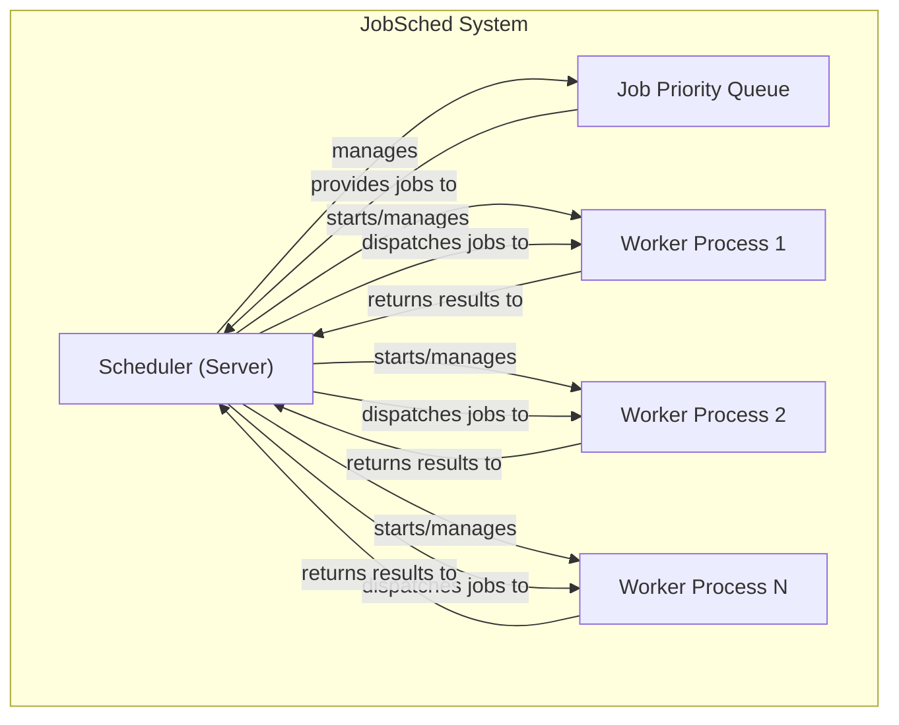
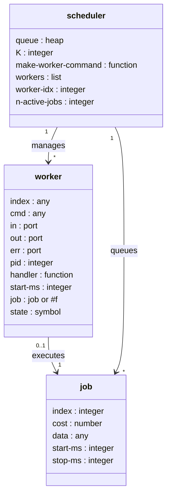
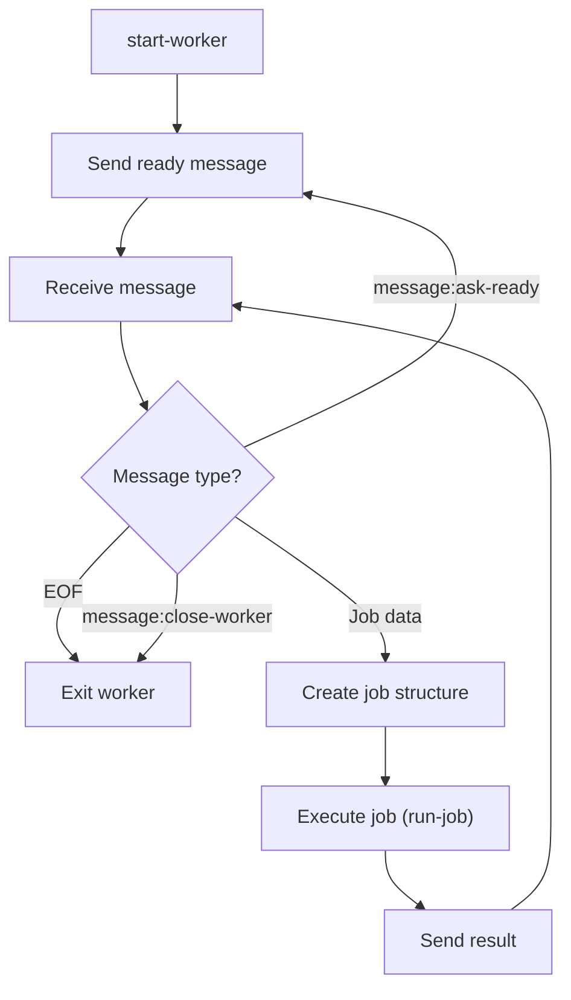
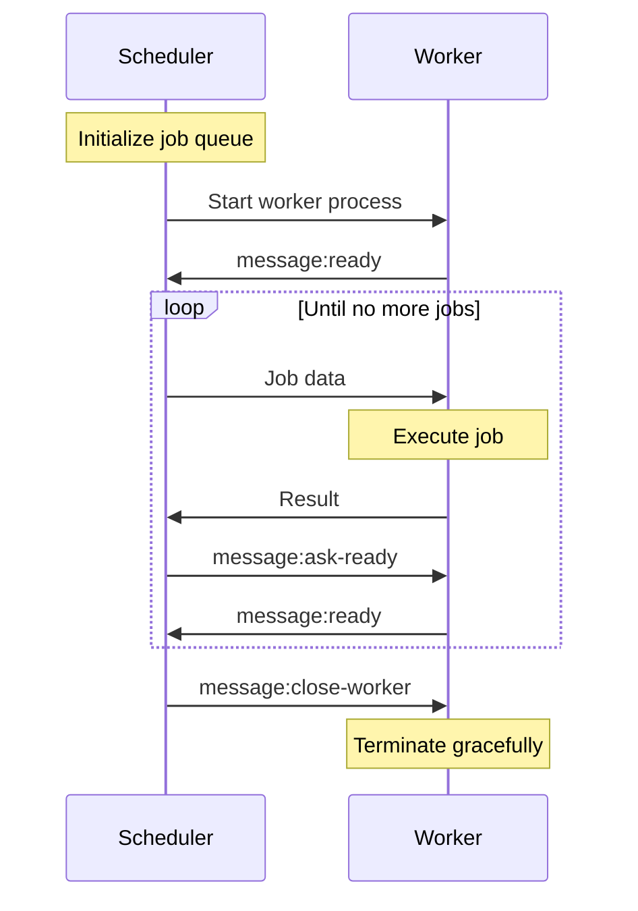

<!-- source: DeepWiki mcp.deepwiki.com · repo google-deepmind/levintreesearch_cm · page 4.1 Core Architecture · fetched 2026-10-26 -->

# Core Architecture

<details>
<summary>Relevant source files</summary>

The following files were used as context for generating this wiki page:

- [jobsched/scribblings/jobsched.scrbl](jobsched/scribblings/jobsched.scrbl)
- [jobsched/server.rkt](jobsched/server.rkt)
- [jobsched/worker.rkt](jobsched/worker.rkt)

</details>


This document explains the core architecture of the JobSched system, which is a parallel job scheduling framework in the `levintreesearch_cm` repository. JobSched facilitates distributing computational tasks across multiple Racket instances, each running in its own process. For details about how this system is used in the LTS-CM algorithm, see [LTS-CM and JobSched Integration](#4).

## System Purpose

JobSched implements a server-worker architecture that enables true parallelism by running multiple Racket instances on a single machine. This approach overcomes the limitations of single-process concurrency in Racket (such as garbage collection bottlenecks), enabling better performance for CPU-intensive tasks like tree search.

## Core Components Overview

JobSched consists of several interconnected components that work together to schedule and execute jobs in parallel.



Sources: [jobsched/scribblings/jobsched.scrbl:20-49](), [jobsched/server.rkt:50-70]()

## Data Model and Structures

The JobSched system uses three primary data structures:



Sources: [jobsched/server.rkt:50-59](), [jobsched/server.rkt:102-105](), [jobsched/scribblings/jobsched.scrbl:160-174]()

### Job Structure

The `job` structure represents a task to be executed. It contains:
- `index`: A unique identifier for the job
- `cost`: Used for prioritization in the queue (lower cost jobs execute first)
- `data`: The actual data needed to execute the job
- `start-ms`: Timestamp when job execution started
- `stop-ms`: Timestamp when job execution finished

Jobs are stored in a priority queue based on their `cost` field.

Sources: [jobsched/scribblings/jobsched.scrbl:160-174]()

## Scheduler Component

The scheduler is the central component of the JobSched system, implemented in `server.rkt`. It manages:
- A priority queue of jobs
- Worker processes
- Job distribution
- Result processing

### Scheduler Functionality

The scheduler provides several key functions:

| Function | Purpose |
|----------|---------|
| `make-scheduler` | Creates a new scheduler |
| `scheduler-add-job!` | Adds a job to the queue |
| `scheduler-start` | Starts the scheduler and workers |
| `scheduler-close` | Terminates all workers |
| `make-server` | Creates a scheduler with specific worker configuration |
| `server-start` | Starts the server with a list of jobs |
| `server-close` | Terminates workers gracefully |

Sources: [jobsched/server.rkt:60-70](), [jobsched/server.rkt:93-98](), [jobsched/server.rkt:183-320]()

### Worker Management States

Workers are managed through a state machine:

```mermaid
stateDiagram-v2
    [*] --> "state:starting" : Worker process starts
    "state:starting" --> "state:ready?-sent" : Server asks if ready
    "state:ready?-sent" --> "state:ready" : Worker responds ready
    "state:ready" --> "state:running" : Server assigns job
    "state:running" --> "state:ready" : Job completed
    "state:ready" --> "state:closing" : Server closes worker
    "state:closing" --> "state:closed" : Worker process terminates
    "state:running" --> "state:killed" : Worker killed (error)
    "state:starting" --> "state:killed" : Worker killed (error)
    "state:ready?-sent" --> "state:killed" : Worker killed (error)
    "state:killed" --> [*]
    "state:closed" --> [*]
```

Sources: [jobsched/server.rkt:110-117](), [jobsched/server.rkt:130-158]()

## Worker Component

Workers are separate Racket processes that execute jobs assigned by the scheduler. The worker component is implemented in `worker.rkt`.

### Worker Functionality

The main worker functions are:
- `start-worker`: Initializes a worker and processes jobs
- `start-simple-worker`: A simplified version that works directly with job data

The worker follows this processing flow:



Sources: [jobsched/worker.rkt:35-71](), [jobsched/worker.rkt:73-74]()

## Communication Protocol

JobSched uses a message-passing protocol for communication between the server and workers through Racket's input/output ports.

### Message Types

The following messages are exchanged:
- `message:ready`: Worker signals it's ready to receive a job
- `message:ask-ready`: Server asks worker if it's ready
- `message:close-worker`: Server instructs worker to shut down
- Job data: Sent from server to worker (as a list)
- Job results: Sent from worker to server

Sources: [jobsched/server.rkt:127-128](), [jobsched/server.rkt:251-272](), [jobsched/worker.rkt:36-52]()

## Execution Flow

The typical execution flow in JobSched:



Sources: [jobsched/scribblings/jobsched.scrbl:30-42](), [jobsched/server.rkt:246-309]()

## API Layers

JobSched provides two API layers:

### Simple API

The simple API hides the complexity of scheduler and job objects:
- `start-simple-server`: Creates server, processes jobs, then terminates
- `start-simple-worker`: Processes job data directly without exposing job structure

This is useful for straightforward parallel processing tasks.

Sources: [jobsched/scribblings/jobsched.scrbl:76-116](), [jobsched/server.rkt:362-375](), [jobsched/worker.rkt:73-74]()

### Advanced API

The advanced API provides more control:
- `make-scheduler`/`make-server`: Creates a scheduler with specific configuration
- `scheduler-add-job!`: Adds individual jobs to the queue
- `scheduler-start`: Starts processing with callbacks for job events
- `scheduler-close`: Terminates workers when done

This allows for dynamic job addition and more complex job processing workflows.

Sources: [jobsched/server.rkt:60-70](), [jobsched/server.rkt:93-98](), [jobsched/server.rkt:183-320](), [jobsched/server.rkt:326-358]()

## Integration with LTS-CM

JobSched is a critical component that enables LTS-CM to parallelize tree search across multiple processes. For detailed information on this integration, see the [LTS-CM and JobSched Integration](#4) section of the wiki.

Sources: [jobsched/scribblings/jobsched.scrbl:45-48]()

---

