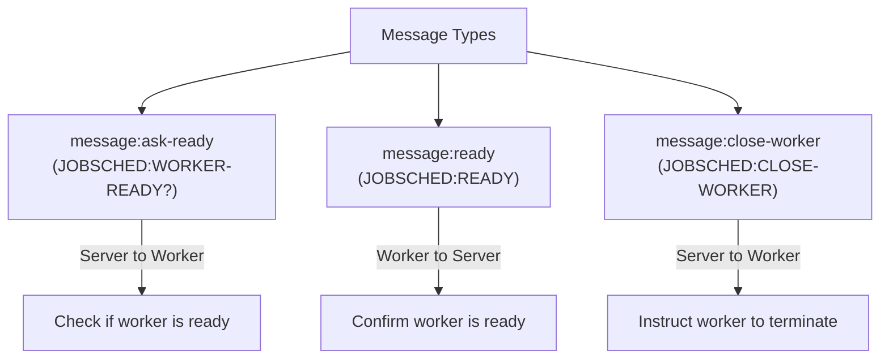
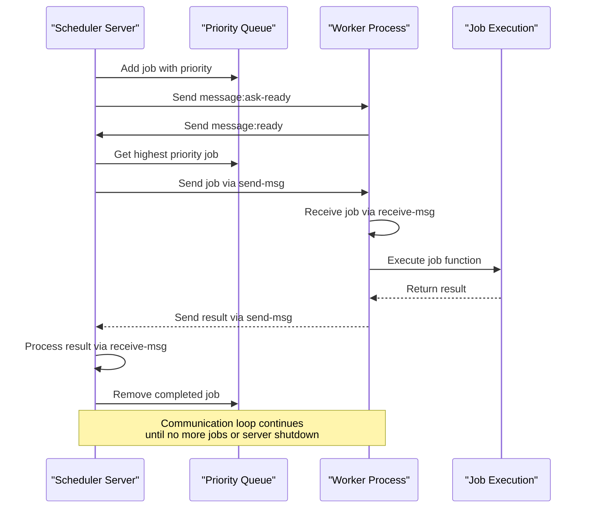
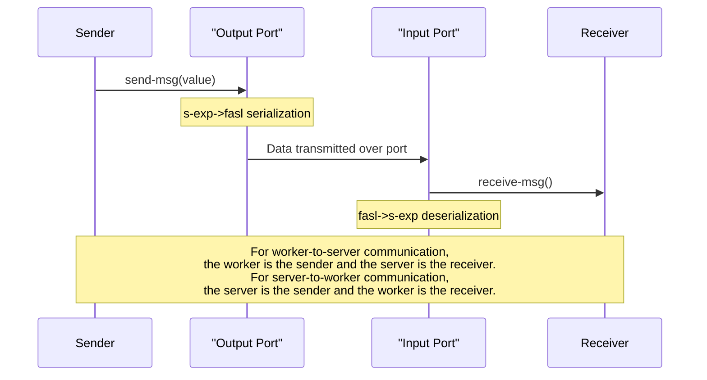
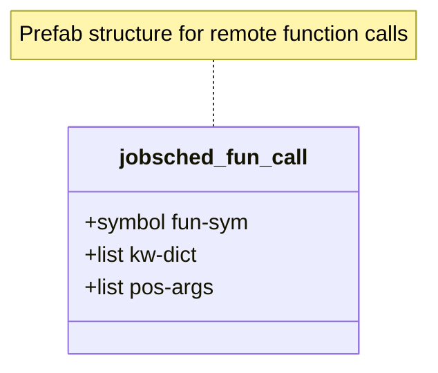
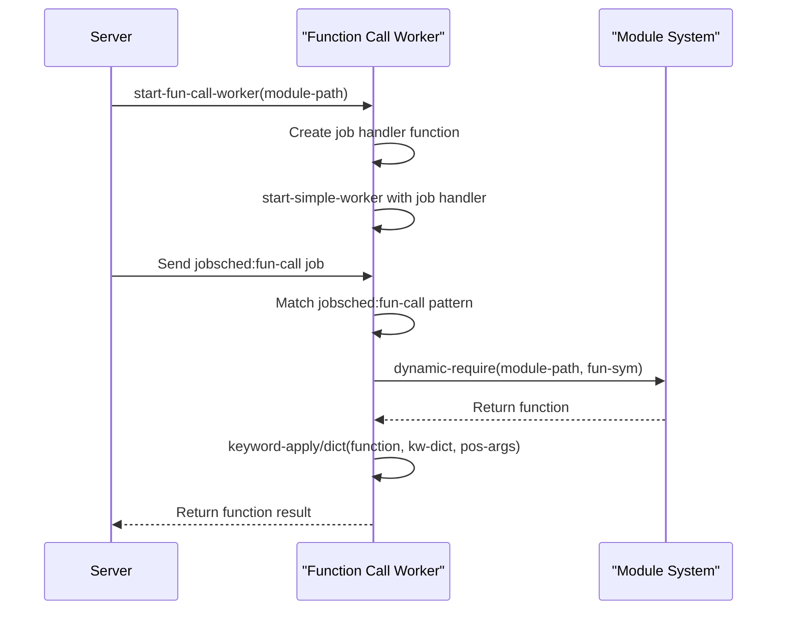
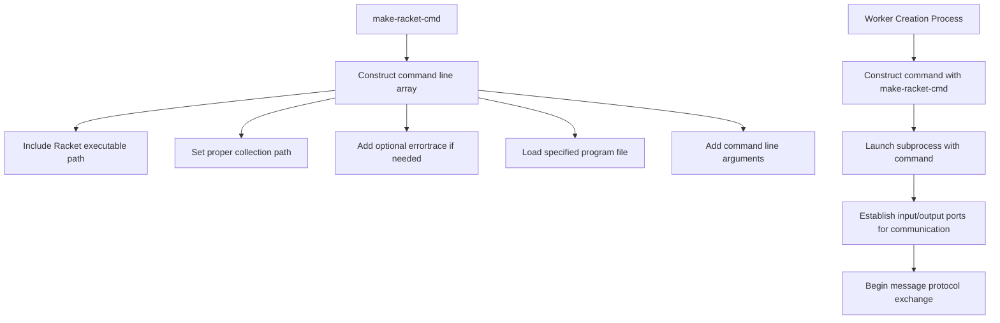

<!-- source: DeepWiki mcp.deepwiki.com · repo google-deepmind/levintreesearch_cm · page 4.2 Job Execution and Communication · fetched 2026-10-26 -->

# Job Execution and Communication

Relevant source files

The following files were used as context for generating this wiki page:

- [jobsched/fun-call.rkt](jobsched/fun-call.rkt)
- [jobsched/utils.rkt](jobsched/utils.rkt)

This page explains how jobs are executed and how workers communicate with the server in the JobSched system. It covers the message passing protocol, job execution process, and communication mechanisms that enable parallel job processing in the levintreesearch_cm repository.

For information about the core server and worker architecture, see [Core Architecture](#4.1). For details on the utility functions, see [Utilities](#4.2.1), and for a deep dive into function call jobs, see [Function Call Jobs](#4.2.2).

## Message Protocol

The JobSched system uses a well-defined message protocol to facilitate communication between server and worker processes.

### Standard Message Types

Sources: [jobsched/utils.rkt:54-56]()

### Message Serialization and Transport

Messages between server and workers are serialized using Racket's FASL (Fast Association List) serialization mechanism. The system provides two key functions for message handling:

| Function | Purpose | Implementation Details |
|----------|---------|------------------------|
| `send-msg` | Serializes a value and sends it to an output port | Uses `s-exp->fasl` with `#:keep-mutable? #true` to maintain mutable data structures |
| `receive-msg` | Receives and deserializes a value from an input port | Uses `fasl->s-exp` with `#:datum-intern? #false` |

Sources: [jobsched/utils.rkt:94-101]()

## Job Execution Flow

The complete flow of job execution in the JobSched system involves several steps from job creation to result processing:

Sources: Based on overall system architecture as described in the diagrams

## Communication Mechanism

Sources: [jobsched/utils.rkt:94-101]()

## Function Call Jobs

A key job type in the JobSched system is the function call job, which allows remote execution of functions on worker processes.

### Function Call Structure

Sources: [jobsched/fun-call.rkt:14]()

### Function Call Worker

The `start-fun-call-worker` function creates a specialized worker that can execute function call jobs:

Sources: [jobsched/fun-call.rkt:33-45]()

## Worker Process Creation

The JobSched system creates worker processes by launching new Racket instances. This is facilitated by the `make-racket-cmd` function that constructs the appropriate command line:

Sources: [jobsched/utils.rkt:74-90]()

## Debugging and Verbosity

The JobSched system includes a debugging mechanism to facilitate development and troubleshooting:

| Component | Purpose |
|-----------|---------|
| `*jobsched-verb?*` | Global boolean flag controlling verbosity |
| `when-verb` | Macro that conditionally executes debugging code |

When verbosity is enabled, the system will output diagnostic messages prefixed with "jobsched: " to help track the flow of execution and communication.

Sources: [jobsched/utils.rkt:25-31]()

## Summary

The JobSched job execution and communication system provides:

1. A well-defined message protocol for server-worker communication
2. Efficient serialization for message passing
3. A clear flow for job execution and result collection
4. Support for function call jobs that enable remote function execution
5. Debugging capabilities for development and troubleshooting

This infrastructure enables the LTS-CM system to efficiently parallelize computation-intensive tasks across multiple processes, improving overall performance for search algorithms and other operations.

---

