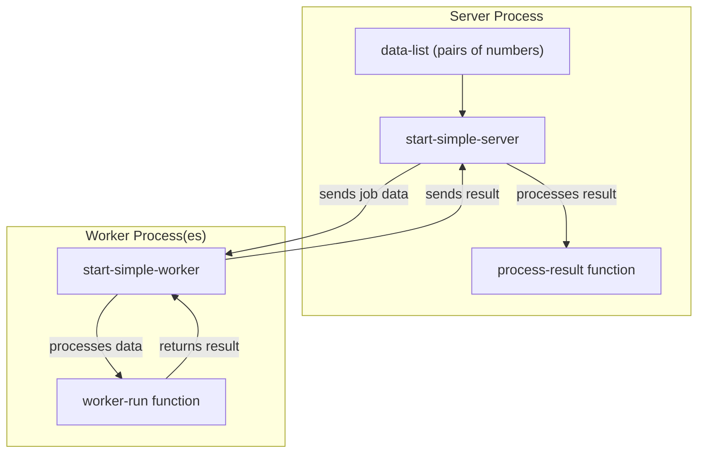
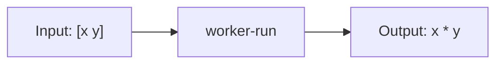
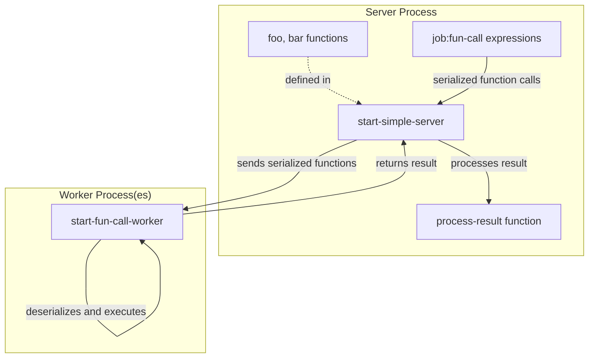
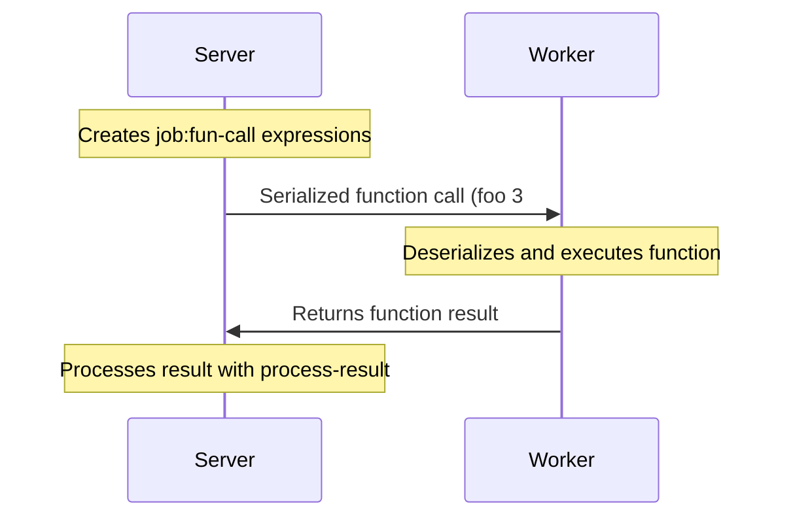
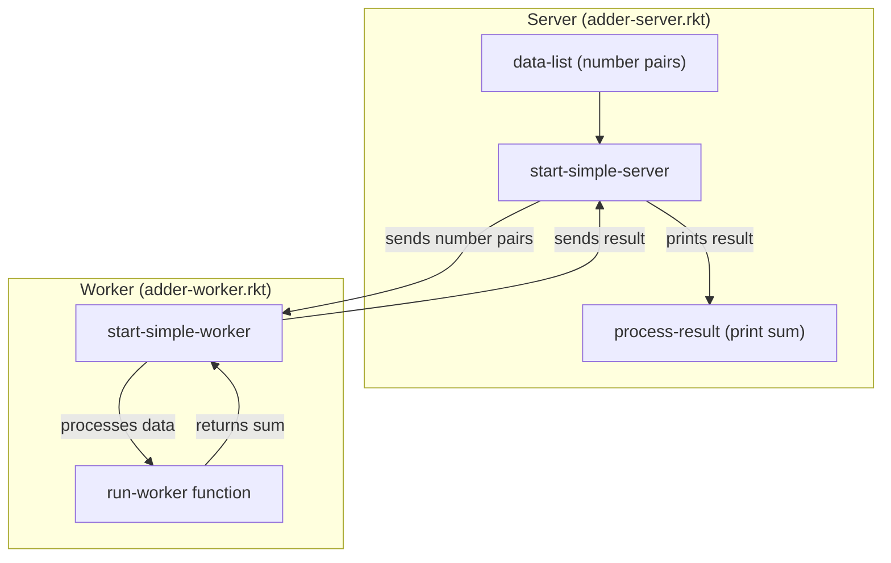
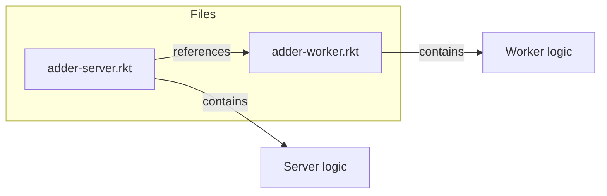

<!-- source: DeepWiki mcp.deepwiki.com · repo google-deepmind/levintreesearch_cm · page 4.3 Examples and Usage · fetched 2026-10-26 -->

# Examples and Usage

Relevant source files

The following files were used as context for generating this wiki page:

- [jobsched/examples/adder-server.rkt](jobsched/examples/adder-server.rkt)
- [jobsched/examples/adder-worker.rkt](jobsched/examples/adder-worker.rkt)
- [jobsched/examples/server-worker-fun-call.rkt](jobsched/examples/server-worker-fun-call.rkt)
- [jobsched/examples/server-worker-simple.rkt](jobsched/examples/server-worker-simple.rkt)

This page provides practical examples of how to use the JobSched system for parallel job scheduling and execution. JobSched enables distributing computational tasks across multiple worker processes, making it an efficient solution for parallelizable problems. For detailed information about the JobSched architecture, see [Core Architecture](#4.1) and for information about job execution mechanisms, see [Job Execution and Communication](#4.2).

## Overview of Examples

The JobSched library comes with several example implementations that demonstrate different usage patterns:

1. **Simple Server-Worker**: Basic pattern for distributing data processing tasks
2. **Function Call Example**: Remote function execution pattern 
3. **Adder Example**: A minimal but complete server-worker implementation

## Simple Server-Worker Example

The simplest way to use JobSched is with a server that distributes data to workers, which process the data and return results.

### Architecture

Sources: [jobsched/examples/server-worker-simple.rkt:1-28]()

### Implementation Details

The simple server-worker example implements multiplication of number pairs:

1. **Worker Implementation**:
   - Defines a `worker-run` function that multiplies two numbers
   - Uses `start-simple-worker` to initialize the worker

Sources: [jobsched/examples/server-worker-simple.rkt:6-12]()

2. **Server Implementation**:
   - Creates a list of data pairs (x, y) for all combinations of numbers 0-4
   - Defines a `process-result` function to handle worker results
   - Uses `start-simple-server` to initialize the server and distribute jobs

Sources: [jobsched/examples/server-worker-simple.rkt:16-27]()

### Usage Pattern

To use the simple server-worker pattern:

1. Define a worker function that processes input data
2. Create a worker submodule that calls `start-simple-worker`
3. Create a server that:
   - Prepares a list of data items to process
   - Defines a result handler
   - Calls `start-simple-server` with appropriate parameters

## Function Call Example

The function call example demonstrates a more sophisticated pattern where workers remotely execute functions defined on the server.

### Architecture

Sources: [jobsched/examples/server-worker-fun-call.rkt:1-34]()

### Implementation Details

1. **Function Definitions**:
   - `foo` and `bar` functions are defined and provided
   - Functions accept various parameter types including keyword arguments

Sources: [jobsched/examples/server-worker-fun-call.rkt:10-14]()

2. **Worker Implementation**:
   - Uses `start-fun-call-worker` with a reference to the file containing the functions

Sources: [jobsched/examples/server-worker-fun-call.rkt:17]()

3. **Server Implementation**:
   - Creates function call requests using `job:fun-call`
   - Starts the server with the function call data

Sources: [jobsched/examples/server-worker-fun-call.rkt:22-34]()

### Key Feature: Remote Function Execution

The function call example showcases how to remotely execute functions with their arguments:

Sources: [jobsched/examples/server-worker-fun-call.rkt:30-32]()

## Adder Example

The adder example is a minimalistic implementation that demonstrates the core components needed for a complete JobSched application.

### Architecture

Sources: [jobsched/examples/adder-server.rkt:1-35](), [jobsched/examples/adder-worker.rkt:1-24]()

### Server Implementation

The server component:
- Creates pairs of numbers to be added
- Defines a result handler that prints the results
- Starts the server with the worker file path

Sources: [jobsched/examples/adder-server.rkt:22-35]()

### Worker Implementation

The worker component:
- Defines a function to add two numbers
- Starts a simple worker with this function

Sources: [jobsched/examples/adder-worker.rkt:16-23]()

### Separation of Server and Worker

Unlike the first two examples where the server and worker are defined in the same file, the adder example separates them into different files:

Sources: [jobsched/examples/adder-server.rkt:19]()

## Common Patterns and Best Practices

Based on the examples, here are some common patterns for using JobSched:

### Data Processing Pattern

| Component | Implementation |
|-----------|----------------|
| Worker function | Define a function that takes input data and returns processed result |
| Worker initialization | Call `start-simple-worker` with the worker function |
| Data preparation | Create a list of data items to process |
| Result handling | Define a function to process results from workers |
| Server initialization | Call `start-simple-server` with appropriate parameters |

Sources: [jobsched/examples/server-worker-simple.rkt:6-27]()

### Function Call Pattern

| Component | Implementation |
|-----------|----------------|
| Function definitions | Define and provide functions to be called remotely |
| Worker initialization | Call `start-fun-call-worker` with reference to function definitions |
| Job creation | Use `job:fun-call` to create serialized function calls |
| Result handling | Define a function to process results from workers |
| Server initialization | Call `start-simple-server` with function call jobs |

Sources: [jobsched/examples/server-worker-fun-call.rkt:10-34]()

### Key Parameters for `start-simple-server`

The `start-simple-server` function accepts several important parameters:

- `#:worker-file`: Path to the file containing the worker code
- `#:data-list`: List of data items to be processed
- `#:process-result`: Function that processes results from workers
- `#:n-workers`: (Optional) Number of worker processes to start

Sources: [jobsched/examples/server-worker-simple.rkt:24-27](), [jobsched/examples/server-worker-fun-call.rkt:22-34](), [jobsched/examples/adder-server.rkt:33-35]()

---

